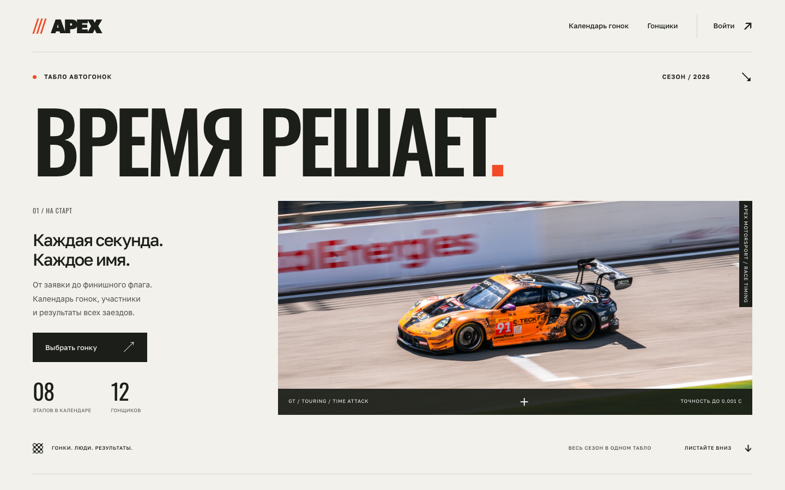

# Лабораторная № 2 · APEX

**Данилевский Тимур Давидович, K3339. Вариант 6: табло победителей автогонок.**

## Запуск приложения

Включите Docker Desktop, затем из корня репозитория:

```bash
cd students/K3339/Danilevskiy_Timur/laboratory_work_2
bash run.command
```

Нужен Python 3.10. Откройте [APEX](http://127.0.0.1:8000/).

| Роль | Логин | Пароль |
|---|---|---|
| Гонщик | `racer` | `DemoRace2026!` |
| Судья | `judge` | `DemoControl2026!` |

Это локальные демонстрационные аккаунты. Можно создать собственный аккаунт на сайте.

## Материалы

- [Инструкция приложения](students/K3339/Danilevskiy_Timur/laboratory_work_2/README.md)
- [Отчёт ЛР2](docs/lr2/report.md)
- [Вопросы для защиты и проверки](docs/lr2/testing.md)
- [Отчёты на GitHub Pages](https://k1ll4a.github.io/ITMO_ICT_WebDevelopment_2026-2027/)

Из корня репозитория отчёт можно открыть локально:

```bash
pip install -r requirements-docs.txt
mkdocs serve --dev-addr 127.0.0.1:8001
```

32 интеграционных теста выполнены на PostgreSQL 16.15. Строгая сборка MkDocs проходит.
Исходники отчёта ЛР1 и его изображения сохранены из ветки `lab1` без изменений.


