# Лабораторная работа №2

---

## Цель работы

Цель работы - познакомиться с Django, научиться создавать модели, формы и страницы, а затем написать сайт по своему варианту. Мой вариант - табло победителей автогонок. Для хранения данных я использовал PostgreSQL.

Сначала я выполнил практические задания в одном проекте практических работ. Затем создал отдельный сайт автогонок. Для каждого проекта настроил свою базу данных, чтобы автомобили и владельцы не смешивались с участниками гонок.

---

## Практическое занятие 2.1

### Практическое задание 1. Создание проекта

По заданию нужно установить Django, создать проект и приложение с указанными именами.

Сначала я установил Django и создал проект практических работ и приложение.

Для работы используется Python 3.12 и Django 5.2. В каталоге `students/k3340/Shitarev_Andrey/practical_works/simple_django_web_project` находятся `manage.py`, папка `django_project_shitarev` с общими настройками и приложение `project_first_app`. Для шаблонов и подключения к базе используются Jinja2 и драйвер psycopg.

Проект содержит настройки сайта, а приложение содержит его модели и страницы. Запрос из браузера сначала попадает в `urls.py`. Этот файл выбирает представление в `views.py`. Представление получает данные через модели и передает их шаблону. Шаблон формирует HTML, который возвращается в браузер.

Файл `manage.py` нужен для запуска команд Django. С его помощью можно создать миграции, запустить сервер или выполнить проверки. Папка проекта содержит `settings.py` и главный `urls.py`. Код моделей и страниц находится внутри приложения.

Затем в `settings.py` я подключил приложение, PostgreSQL и два движка шаблонов. Django Templates нужен панели администратора, а собственные страницы работают через Jinja2. Для базы указал имя `web_practice_shitarev`, пользователя `web_lab_user` и локальный сервер PostgreSQL.

Настройки проекта записаны в файле `settings.py`:

В списке `INSTALLED_APPS` я подключил приложение. Django использует этот список при запуске:

```python
INSTALLED_APPS = [
    'django.contrib.admin', 'django.contrib.auth', 'django.contrib.contenttypes',
    'django.contrib.sessions', 'django.contrib.messages', 'django.contrib.staticfiles',
    'project_first_app',
]
```

В настройке `DATABASES` я указал PostgreSQL и параметры подключения. В `TEMPLATES` подключил два способа обработки шаблонов: стандартный для Admin и Jinja2 для страниц.

Здесь `INSTALLED_APPS` перечисляет подключенные приложения. `DATABASES` сообщает Django, к какой базе подключаться. `TEMPLATES` содержит настройки двух движков. Строка `AUTH_USER_MODEL` заранее указывает собственную модель пользователя: это важно, потому что в практике 2.3 владельца необходимо сделать пользователем. Если менять модель пользователя после первых миграций, придется отдельно решать проблему уже созданных связей в базе.

### Практическое задание 2.1. Модель автовладельцев

По заданию нужно создать модель данных об автовладельцах по схеме из методички.

На схеме показаны модели владельца, автомобиля, владения и удостоверения и связи между ними:

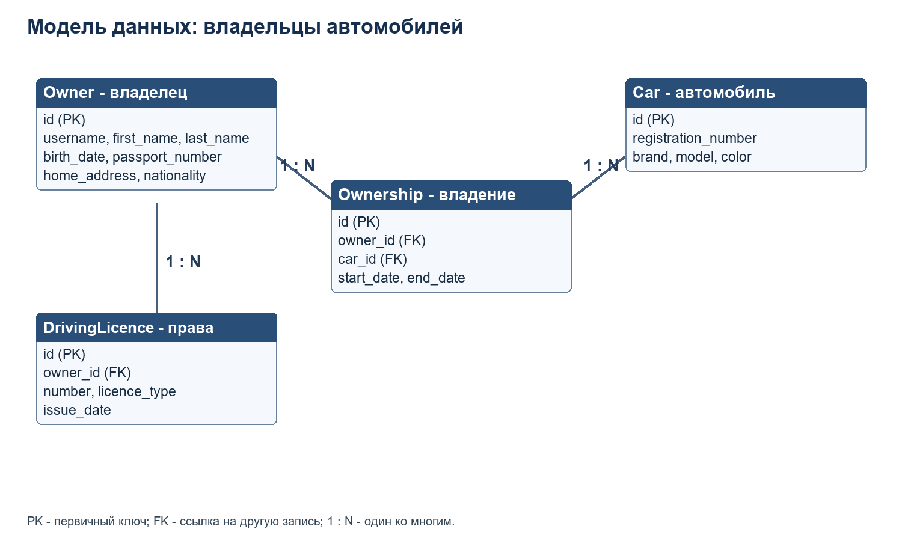

`PK` - номер записи, `FK` - ссылка на другую запись. Обозначение `1 : N` означает, что одной записи может соответствовать несколько связанных записей.

Сначала я описал в `project_first_app/models.py` владельца, автомобиль, владение автомобилем и водительское удостоверение.

Модель в Django - описание данных на Python. После создания миграций Django использует это описание, чтобы подготовить таблицы в PostgreSQL. Владелец наследуется от `AbstractUser`, поэтому кроме дополнительных полей получает возможности обычного пользователя Django. Автомобиль связан с владельцами через модель владения: в ней можно хранить даты начала и окончания. Благодаря этому одна и та же машина может принадлежать разным людям в разные периоды.

Код моделей:

Сначала я подключил необходимые части Django и модели:

```python
from django.contrib.auth.models import AbstractUser
from django.db import models
```

Модель Owner описывает владельца и его данные.

```python
class Owner(AbstractUser):
    first_name = models.CharField(max_length=30)
    last_name = models.CharField(max_length=30)
    birth_date = models.DateTimeField(null=True, blank=True)
    passport_number = models.CharField(max_length=30, blank=True)
    home_address = models.CharField(max_length=200, blank=True)
    nationality = models.CharField(max_length=100, blank=True)
```

Модель Car хранит сведения об автомобиле.

```python
class Car(models.Model):
    registration_number = models.CharField(max_length=15)
    brand = models.CharField(max_length=20)
    model = models.CharField(max_length=20)
    color = models.CharField(max_length=30, null=True, blank=True)
    owners = models.ManyToManyField(Owner, through='Ownership')

    def __str__(self):
        return f'{self.brand} {self.model} ({self.registration_number})'
```

Модель Ownership связывает владельца и автомобиль и хранит даты владения.

```python
class Ownership(models.Model):
    owner = models.ForeignKey(Owner, on_delete=models.CASCADE)
    car = models.ForeignKey(Car, on_delete=models.CASCADE)
    start_date = models.DateTimeField(null=True, blank=True)
    end_date = models.DateTimeField(null=True, blank=True)
```

Модель DrivingLicence хранит данные водительского удостоверения.

```python
class DrivingLicence(models.Model):
    TYPES = [('A', 'A'), ('B', 'B'), ('C', 'C'), ('D', 'D'), ('E', 'E')]
    owner = models.ForeignKey(Owner, on_delete=models.CASCADE)
    number = models.CharField(max_length=10)
    licence_type = models.CharField(max_length=10, choices=TYPES)
    issue_date = models.DateTimeField()
```

`ForeignKey` обозначает ссылку на другую запись. Например, удостоверение связано с конкретным владельцем. Поле `ManyToManyField` показывает, что у владельца может быть несколько автомобилей, а автомобиль может иметь нескольких владельцев. Параметр `through` указывает на отдельную модель, в которой лежат данные о периоде владения. Для категории удостоверения задан выбор значений A-E.

### Практическое задание 2.2. Миграции

По заданию нужно создать миграции и применить их к базе данных.

Миграция - это файл с инструкциями для изменения структуры базы данных. Сначала Django сравнивает модели с предыдущим состоянием и записывает необходимые изменения в файл. Затем он выполняет эти инструкции и создает или изменяет таблицы. Сами модели описываются в Python, а данные хранятся в PostgreSQL.

После создания моделей я выполнил две команды:

```text
python manage.py makemigrations
python manage.py migrate
```

Первая команда создает файлы в `migrations/`, вторая выполняет их в PostgreSQL. В проекте практических работ применены начальная миграция, изменение полей имени и фамилии и изменение поля категории удостоверения. Файл `__init__.py` сообщает Python, что каталог является пакетом.

Затем я посмотрел состояние миграций. Отметка `[X]` показывает, что они применены.

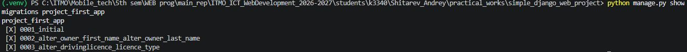

После этого я посмотрел созданные таблицы в PostgreSQL с помощью `psql`:

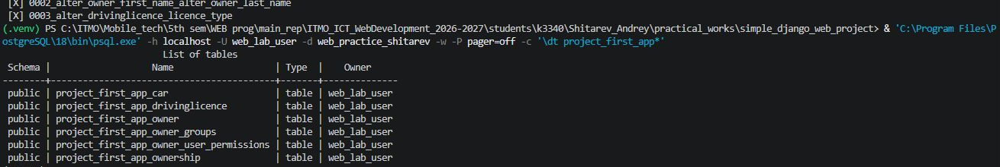

### Практическое задание 3. Панель администратора и данные

По заданию нужно зарегистрировать модели в панели администратора, создать суперпользователя и добавить владельцев и автомобили. Каждого владельца нужно связать минимум с тремя автомобилями, указав непересекающиеся даты владения.

Сначала я зарегистрировал модели в `admin.py`. Для пользователя добавил отображение даты рождения, паспорта, адреса и национальности:

```python
from django.contrib import admin
from django.contrib.auth.admin import UserAdmin
from .models import Owner, Car, Ownership, DrivingLicence


@admin.register(Owner)
class OwnerAdmin(UserAdmin):
    fieldsets = UserAdmin.fieldsets + (('Данные владельца', {'fields': ('birth_date', 'passport_number', 'home_address', 'nationality')}),)


admin.site.register([Car, Ownership, DrivingLicence])
```

Для данных создана команда `management/commands/practice_data.py`. В ней добавляются два владельца и четыре автомобиля. Первые три автомобиля последовательно связываются с обоими владельцами: сначала один владеет автомобилем с 2018 по 2020 год, затем второй с 2021 по 2023 год. Таким образом у каждого владельца есть три автомобиля, а периоды в подготовленных данных не пересекаются. 

Код команды:

Команда получает или создает записи владельцев и автомобилей, а затем связывает их с помощью модели `Ownership`. Для каждого владения указываются даты начала и окончания.

Затем я создал суперпользователя и открыл панель администратора проекта практических работ:

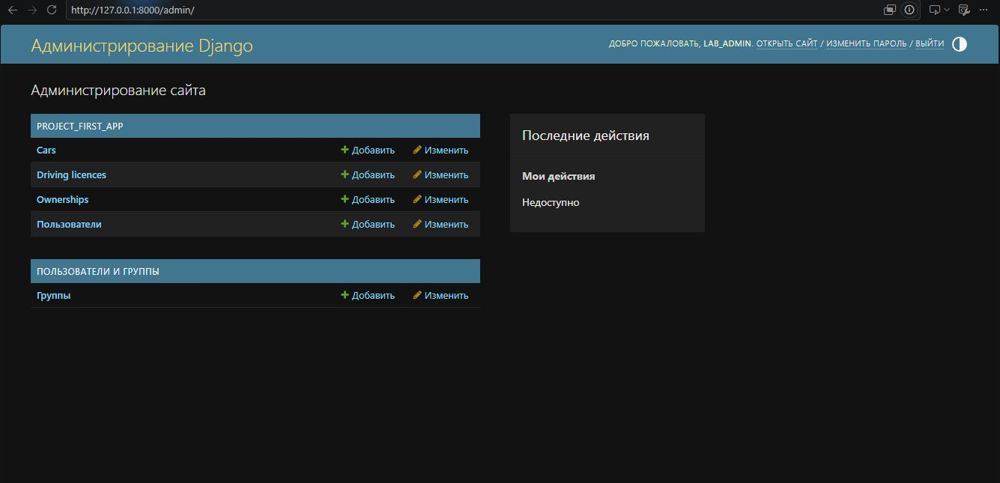

### Практическое задание 4. Страница владельца

По заданию нужно получить владельца из базы по ID и показать его данные на странице.

Я создал файл `views.py`. В нем находятся представления - функции или классы, которые получают запрос от браузера и решают, что показать пользователю.

В этом файле я написал функцию `owner_detail`:

```python
def owner_detail(request, owner_id):
    owner = get_object_or_404(Owner, pk=owner_id)
    return render(request, 'owner.html', {'owner': owner}, using='jinja2')
```

Когда пользователь открывает адрес страницы, функция получает запрос `request` и номер владельца `owner_id`. Затем `get_object_or_404` ищет запись в базе. Если записи нет, Django показывает страницу 404. Если запись найдена, `render` передает ее в шаблон `owner.html`. Шаблон подставляет данные в HTML и готовая страница возвращается в браузер. Для обработки шаблона выбран Jinja2.

После этого я создал `owner.html`, подключил адрес и открыл страницу в браузере.

Так выглядит страница владельца, полученная по его идентификатору:


### Практическое задание 5. Адрес страницы

По заданию нужно создать адрес страницы владельца и подключить адреса приложения к проекту.

Сначала я записал адреса в `project_first_app/urls.py`. Затем подключил их в главном файле адресов через `include`. Например, `/owner/1` открывает страницу первого владельца. Код маршрутов приложения:

```python
from django.urls import path
from . import views

urlpatterns = [
    path('owner/<int:owner_id>', views.owner_detail, name='owner_detail'),
    path('owners/', views.owner_list, name='owner_list'),
    path('owners/new/', views.owner_create, name='owner_create'),
    path('cars/', views.CarList.as_view(), name='car_list'),
    path('cars/new/', views.CarCreate.as_view(), name='car_create'),
    path('cars/<int:pk>/', views.CarDetail.as_view(), name='car_detail'),
    path('cars/<int:pk>/edit/', views.CarUpdate.as_view(), name='car_update'),
    path('cars/<int:pk>/delete/', views.CarDelete.as_view(), name='car_delete'),
]
```

Шаблон `owner.html` находится в каталоге `jinja2/`. В нем переменные в двойных фигурных скобках заменяются значениями полей владельца. Через параметр `using='jinja2'` представление явно выбирает нужный движок.

---

## Практическое занятие 2.2

Для этой практики я продолжил работу над тем же проектом. Связь между владельцами и автомобилями уже описана в `Ownership`. Далее я добавил страницы и формы.

### Практическое задание 1. Связи

По заданию нужно связать владельцев и автомобили через отдельную модель, в которой будут храниться даты начала и окончания владения.

Сначала я создал модель `Ownership` и добавил в нее ссылки на владельца и автомобиль, а также даты владения.

У каждого владения есть ссылка на владельца и ссылка на автомобиль. Это позволяет записать несколько периодов для одной машины. В подготовленных данных конец предыдущего периода раньше начала следующего. Общая проверка пересечений при произвольном вводе через Admin пока не добавлена.

В таблице владения видны владельцы, автомобили и даты их владения:

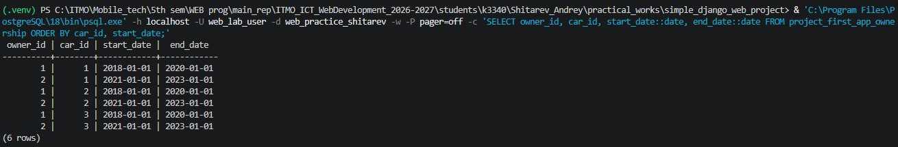

### Практическое задание 2. Представления

По заданию нужно вывести список владельцев с помощью функции, а список автомобилей, отдельный автомобиль и его изменение сделать с помощью классов. Также нужно добавить минимум трех владельцев и три автомобиля.

Сначала я написал функцию для списка владельцев. Затем добавил классы для списка автомобилей, страницы автомобиля и его изменения. Классы для создания и удаления автомобиля понадобятся в следующем задании. Ниже код представлений:

Сначала я подключил необходимые части Django и модели:

```python
from django.shortcuts import get_object_or_404, redirect, render
from django.urls import reverse_lazy
from django.views.generic import ListView, DetailView, CreateView, UpdateView, DeleteView
from .forms import OwnerForm, CarForm
from .models import Owner, Car
```

Это представление находит владельца по номеру и передает его в шаблон.

```python
def owner_detail(request, owner_id):
    owner = get_object_or_404(Owner, pk=owner_id)
    return render(request, 'owner.html', {'owner': owner}, using='jinja2')
```

Эта функция получает список владельцев и передает его на страницу.

```python
def owner_list(request):
    return render(request, 'owners.html', {'owners': Owner.objects.all()}, using='jinja2')
```

Эта функция показывает форму владельца и сохраняет заполненные данные.

```python
def owner_create(request):
    form = OwnerForm(request.POST or None)
    if request.method == 'POST' and form.is_valid():
        form.save()
        return redirect('owner_list')
    return render(request, 'form.html', {'form': form}, using='jinja2')
```

Этот класс получает список автомобилей.

```python
class CarList(ListView):
    model = Car
    template_name = 'cars.html'
    template_engine = 'jinja2'
```

Этот класс получает один автомобиль по его номеру.

```python
class CarDetail(DetailView):
    model = Car
    template_name = 'car.html'
    template_engine = 'jinja2'
```

Этот класс показывает форму и создает автомобиль.

```python
class CarCreate(CreateView):
    model = Car
    form_class = CarForm
    template_name = 'form.html'
    template_engine = 'jinja2'
    success_url = reverse_lazy('car_list')
```

Этот класс показывает форму с данными автомобиля и сохраняет изменения.

```python
class CarUpdate(UpdateView):
    model = Car
    form_class = CarForm
    template_name = 'form.html'
    template_engine = 'jinja2'
    success_url = reverse_lazy('car_list')
```

Этот класс показывает подтверждение и удаляет автомобиль.

```python
class CarDelete(DeleteView):
    model = Car
    template_name = 'car_delete.html'
    template_engine = 'jinja2'
    success_url = reverse_lazy('car_list')
```

`get_object_or_404` получает запись из базы или сообщает, что она не найдена. Классы `ListView`, `DetailView`, `CreateView`, `UpdateView` и `DeleteView` выполняют типовые действия. Для них указаны имена шаблонов и движок `jinja2`. В шаблонах `owners.html`, `cars.html` и `car.html` выводятся полученные данные.

Так выглядят списки владельцев и автомобилей:

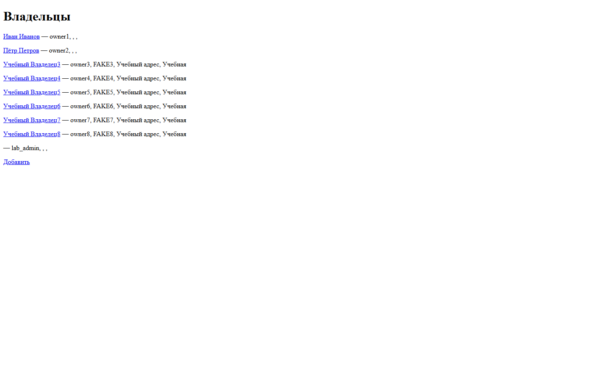

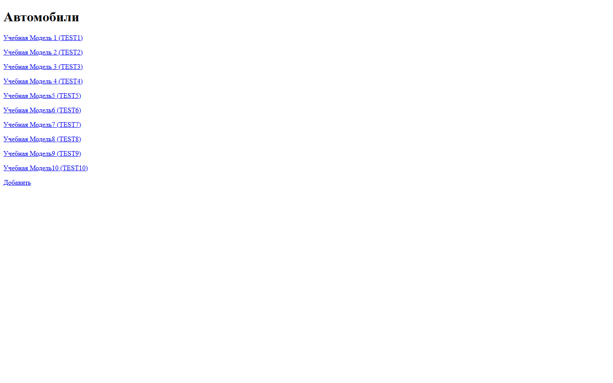

Страница отдельного автомобиля:

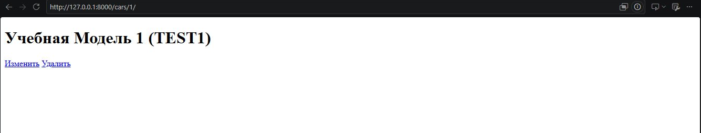

### Практическое задание 3. Формы

По заданию нужно сделать форму добавления владельца с помощью функции. Для создания, изменения и удаления автомобиля нужно использовать классы. Через формы нужно добавить еще минимум трех владельцев и три автомобиля.

Сначала я создал формы в `forms.py`. Для владельца использовал функцию, а для автомобиля - классовые представления:

```python
from django import forms
from django.contrib.auth.forms import UserCreationForm
from .models import Owner, Car


class OwnerForm(UserCreationForm):
    class Meta:
        model = Owner
        fields = ('username', 'first_name', 'last_name', 'birth_date', 'passport_number', 'home_address', 'nationality')


class CarForm(forms.ModelForm):
    class Meta:
        model = Car
        fields = ('registration_number', 'brand', 'model', 'color')
```

`UserCreationForm` помогает создать пользователя с паролем. `ModelForm` строит поля автомобиля на основе модели. Если отправленные данные корректны, `is_valid()` возвращает истину и данные сохраняются. После первоначальных данных через формы добавлены еще шесть владельцев и шесть автомобилей.

Шаблон `form.html` выводит поля, а `car_delete.html` просит подтвердить удаление. Скрытое поле CSRF нужно Django для защиты отправки формы. HTML-страницы практики намеренно оставлены простыми.

Для проверки изменения я создал отдельный автомобиль и открыл его форму. После изменения цвета проверил сохранение, затем открыл подтверждение удаления и удалил эту запись:

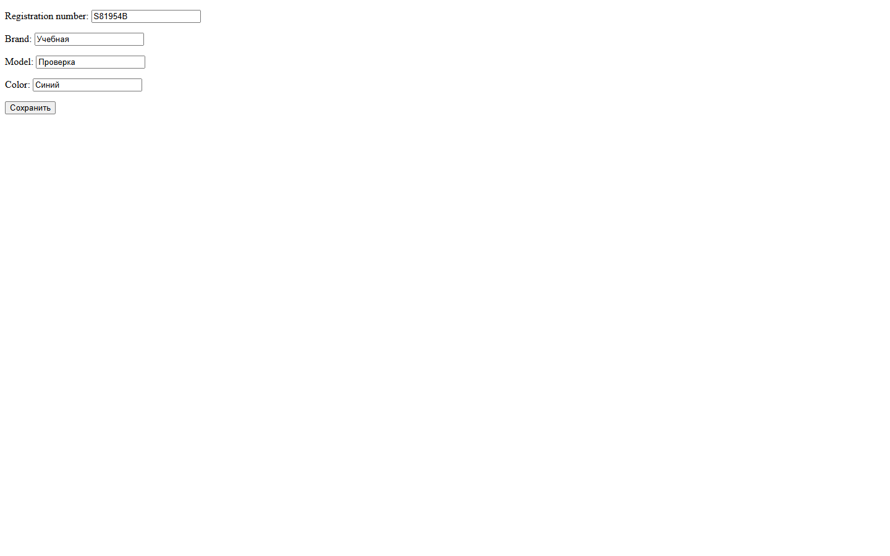

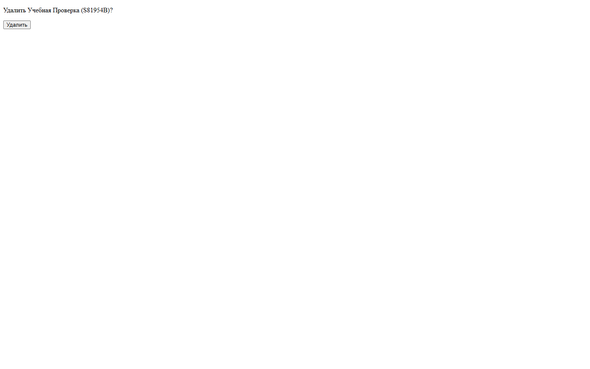

Формы добавления владельца и автомобиля:

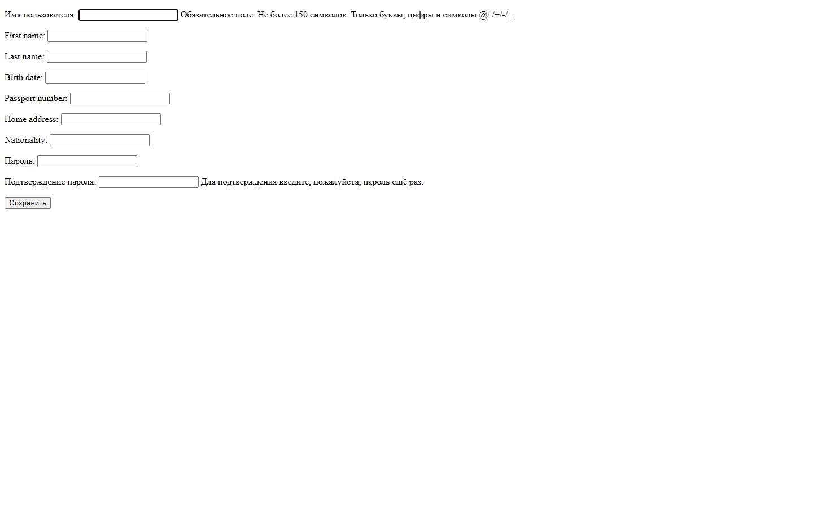

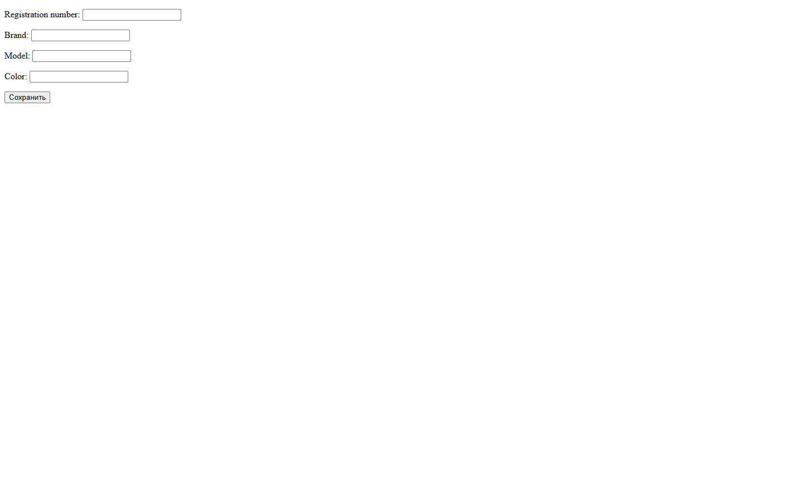

---

## Практическое занятие 2.3

По заданию нужно сделать владельца автомобиля пользователем приложения и добавить ему номер паспорта, домашний адрес и национальность.

Сначала я расширил модель пользователя, затем добавил новые поля в форму и панель администратора.

Владелец уже создан как пользователь на основе `AbstractUser`. Это было сделано до применения первой миграции, чтобы затем не менять модель пользователя в работающей базе. К владельцу добавлены номер паспорта, адрес и национальность. Они отображаются в Admin и доступны в форме создания. 

В форме создания владельца видны дополнительные поля пользователя:


Страницы списка и отдельного владельца показывают данные пользователя. После этого я перешел к сайту автогонок.

---

## Лабораторная часть. Табло победителей автогонок

### Постановка задачи

Для варианта 6 требуется сайт автогонок. Пользователь должен иметь возможность зарегистрироваться, заполнить данные гонщика, выбрать гонку и управлять своей регистрацией. На странице гонки нужны заезды и результаты, а также комментарии с оценкой. Администратор указывает результаты через Django Admin и может управлять гонками через сайт.

Для сайта я создал проект `students/k3340/Shitarev_Andrey/laboratory_work_2`. В нем находятся `manage.py`, папка настроек `django_project_shitarev` и приложение `project_first_app`. База этого проекта называется `web_racing_shitarev`.

### Настройки и шаблонизация

Сначала я настроил PostgreSQL и два движка шаблонов. Встроенный Admin работает на стандартных шаблонах Django, а собственные страницы - через Jinja2. Для сайта автогонок я использовал стандартного пользователя Django: паспортные данные здесь не нужны.

### Модель данных

На схеме показаны пользователь, гонщик, гонка, регистрация, заезд и комментарий. Линии между ними показывают связи записей:

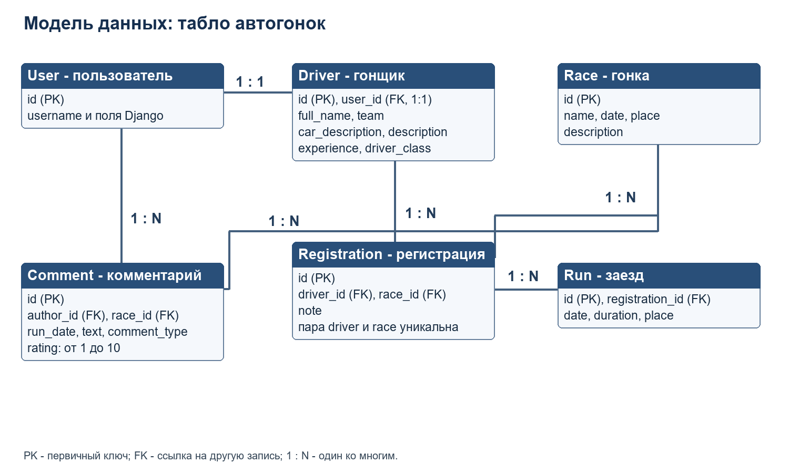

Связь `1 : 1` означает, что одному пользователю соответствует один профиль гонщика. Связь `1 : N` означает, что с одной записью может быть связано несколько других записей. Например, одной регистрации может соответствовать несколько заездов.

Сначала я определил, какие данные нужны сайту. Затем создал в `models.py` пять моделей. `Driver` содержит данные участника и связан с пользователем. `Race` хранит гонку. `Registration` связывает гонщика и гонку. `Run` хранит отдельный заезд и его результат. `Comment` содержит отзыв.

Полный код моделей:

Сначала я подключил необходимые части Django и модели:

```python
from django.conf import settings
from django.core.validators import MinValueValidator, MaxValueValidator
from django.db import models
```

Модель Driver хранит сведения об участнике и связана с пользователем.

```python
class Driver(models.Model):
    user = models.OneToOneField(settings.AUTH_USER_MODEL, on_delete=models.CASCADE)
    full_name = models.CharField(max_length=150)
    team = models.CharField(max_length=100)
    car_description = models.TextField()
    description = models.TextField()
    experience = models.CharField(max_length=100)
    driver_class = models.CharField(max_length=100)
    def __str__(self):
        return self.full_name
```

Модель Race хранит сведения о гонке.

```python
class Race(models.Model):
    name = models.CharField(max_length=150)
    date = models.DateField()
    place = models.CharField(max_length=150)
    description = models.TextField(blank=True)
    def __str__(self):
        return self.name
```

Модель Registration связывает гонщика с гонкой.

```python
class Registration(models.Model):
    driver = models.ForeignKey(Driver, on_delete=models.CASCADE)
    race = models.ForeignKey(Race, on_delete=models.CASCADE)
    note = models.CharField(max_length=200, blank=True)
    class Meta:
        constraints = [models.UniqueConstraint(fields=['driver', 'race'], name='unique_driver_race')]
    def __str__(self):
        return f'{self.driver} - {self.race}'
```

Модель Run хранит отдельный заезд и его результат.

```python
class Run(models.Model):
    registration = models.ForeignKey(Registration, on_delete=models.CASCADE, related_name='runs')
    date = models.DateField()
    duration = models.DurationField()
    place = models.PositiveIntegerField(validators=[MinValueValidator(1)])
```

Модель Comment хранит комментарий и оценку.

```python
class Comment(models.Model):
    TYPES = [('cooperation', 'Вопрос о сотрудничестве'), ('racing', 'Вопрос о гонках'), ('other', 'Иное')]
    author = models.ForeignKey(settings.AUTH_USER_MODEL, on_delete=models.CASCADE)
    race = models.ForeignKey(Race, on_delete=models.CASCADE, related_name='comments')
    run_date = models.DateField()
    text = models.TextField()
    comment_type = models.CharField(max_length=20, choices=TYPES)
    rating = models.PositiveSmallIntegerField(validators=[MinValueValidator(1), MaxValueValidator(10)])
```

У профиля гонщика связь с пользователем один к одному: один пользователь управляет своим профилем. В регистрации есть ограничение `unique_driver_race`, поэтому дважды зарегистрировать одного гонщика на одну гонку нельзя. При этом у одной регистрации может быть несколько записей `Run`. Это удобно: регистрация остается одной, а заезды можно учитывать отдельно.

В комментарии заданы три типа и проверка рейтинга от 1 до 10. В заезде сохраняются дата, время прохождения и место. После описания моделей создана и применена миграция к отдельной базе PostgreSQL.

Состояние миграций проекта автогонок:

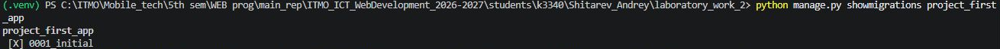

Таблицы моделей в базе автогонок:

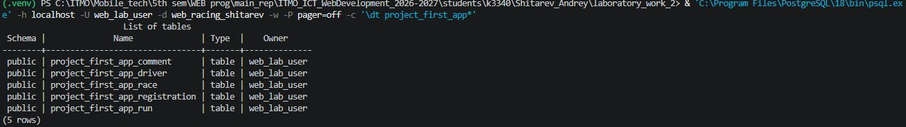

### Django Admin

Сначала я зарегистрировал все пять моделей в `admin.py`. Затем открыл панель администратора. В ней можно посмотреть регистрации и комментарии, добавить заезды, указать время и место.

Так выглядит панель управления гонками и результатами:

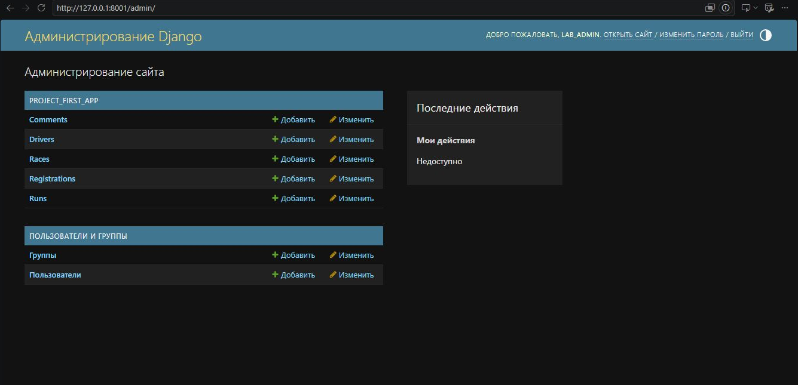

В форме изменения заезда указаны регистрация участника, дата, время и занятое место:

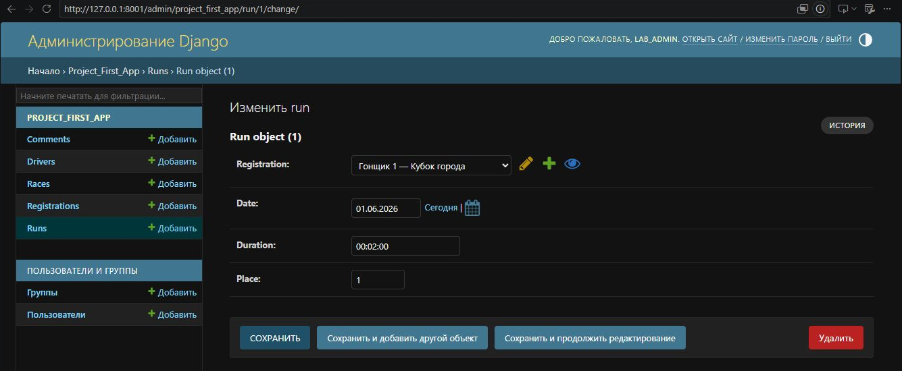

### Формы

Затем я создал в `forms.py` формы для регистрации, профиля, гонки, регистрации на гонку и комментария:

Сначала я подключил необходимые части Django и модели:

```python
from django import forms
from django.contrib.auth.forms import UserCreationForm
from django.contrib.auth.models import User
from .models import Driver, Race, Registration, Comment
```

Форма `SignupForm` нужна для регистрации пользователя. Она содержит имя пользователя и поля для пароля.

```python
class SignupForm(UserCreationForm):
    class Meta:
        model = User
        fields = ('username',)
```

Форма `DriverForm` нужна для ввода данных гонщика, команды и автомобиля.

```python
class DriverForm(forms.ModelForm):
    class Meta:
        model = Driver
        exclude = ('user',)
```

Форма `RaceForm` нужна для ввода и изменения сведений о гонке.

```python
class RaceForm(forms.ModelForm):
    class Meta:
        model = Race
        fields = ('name', 'date', 'place', 'description')
```

Форма `RegistrationForm` позволяет указать примечание к регистрации на гонку.

```python
class RegistrationForm(forms.ModelForm):
    class Meta:
        model = Registration
        fields = ('note',)
```

Форма `CommentForm` содержит поля комментария, его типа, даты заезда и оценки.

```python
class CommentForm(forms.ModelForm):
    class Meta:
        model = Comment
        fields = ('run_date', 'text', 'comment_type', 'rating')
```

В `Meta` перечислены поля, доступные пользователю. Например, форма регистрации на гонку позволяет изменить примечание, но не позволяет выбрать другого владельца записи. Пользователь и гонка устанавливаются сервером.

### Представления и проверка прав

В `views.py` я добавил обработку запросов. Для действий с аккаунтом указал `login_required`, чтобы пользователь сначала вошел на сайт. При изменении и удалении регистрации добавил проверку ее владельца. Для управления гонками добавил проверку `is_staff`.

Ниже приведен код представлений:

Сначала я подключил необходимые части Django и модели:

```python
from django.contrib.auth import authenticate, login, logout
from django.contrib.auth.decorators import login_required, user_passes_test
from django.core.paginator import Paginator
from django.db import IntegrityError, transaction
from django.db.models import Q
from django.http import HttpResponseBadRequest
from django.shortcuts import get_object_or_404, redirect, render
from django.views.decorators.http import require_POST
from .forms import SignupForm, DriverForm, RaceForm, RegistrationForm, CommentForm
from .models import Driver, Race, Registration, Run
```

Функция `page` передает данные в шаблон и возвращает готовую страницу браузеру.

```python
def page(request, name, context=None, status=200):
    return render(request, name, context or {}, using='jinja2', status=status)
```

Функция `show_form` показывает страницу с переданной формой и ее заголовком.

```python
def show_form(request, form, title, status=200):
    return page(request, 'form.html', {'form': form, 'title': title}, status)
```

Эта функция создает учетную запись пользователя.

```python
def signup(request):
    form = SignupForm(request.POST or None)
    if request.method == 'POST' and form.is_valid():
        login(request, form.save())
        return redirect('race_list')
    return show_form(request, form, 'Регистрация', 400 if request.method == 'POST' else 200)
```

Эта функция выполняет вход пользователя.

```python
def sign_in(request):
    error = ''
    if request.method == 'POST':
        user = authenticate(request, username=request.POST.get('username'), password=request.POST.get('password'))
        if user is not None:
            login(request, user)
            return redirect('race_list')
        error = 'Неверное имя пользователя или пароль'
    return page(request, 'login.html', {'error': error}, 400 if error else 200)
```

Эта функция завершает сеанс пользователя.

```python
@login_required
@require_POST
def sign_out(request):
    logout(request)
    return redirect('race_list')
```

Эта функция получает гонки из базы, применяет поиск и делит список на страницы.

```python
def race_list(request):
    query = request.GET.get('q', '').strip()
    place = request.GET.get('place', '').strip()
    races = Race.objects.order_by('date', 'id')
    if query:
        races = races.filter(Q(name__icontains=query) | Q(description__icontains=query))
    if place:
        races = races.filter(place__icontains=place)
    pages = Paginator(races, 3)
    return page(request, 'race_list.html', {'races': pages.get_page(request.GET.get('page')), 'query': query, 'place': place})
```

Эта функция собирает данные выбранной гонки, заезды и комментарии для страницы.

```python
def race_detail(request, race_id):
    race = get_object_or_404(Race, pk=race_id)
    runs = Run.objects.filter(registration__race=race).select_related('registration__driver').order_by('place', 'id')
    registered = request.user.is_authenticated and Registration.objects.filter(driver__user=request.user, race=race).exists()
    return page(request, 'race_detail.html', {'race': race, 'runs': runs, 'comments': race.comments.select_related('author'), 'comment_form': CommentForm(), 'registered': registered})
```

Эта функция показывает и сохраняет профиль текущего пользователя.

```python
@login_required
def driver_profile(request):
    driver = Driver.objects.filter(user=request.user).first()
    form = DriverForm(request.POST or None, instance=driver)
    if request.method == 'POST' and form.is_valid():
        driver = form.save(commit=False)
        driver.user = request.user
        driver.save()
        return redirect('race_list')
    return show_form(request, form, 'Профиль гонщика', 400 if request.method == 'POST' else 200)
```

Эта функция регистрирует текущего гонщика и проверяет повторную запись.

```python
@login_required
def registration_create(request, race_id):
    race = get_object_or_404(Race, pk=race_id)
    driver = Driver.objects.filter(user=request.user).first()
    if not driver:
        return redirect('profile')
    if Registration.objects.filter(driver=driver, race=race).exists():
        return HttpResponseBadRequest('Вы уже зарегистрированы на гонку')
    form = RegistrationForm(request.POST or None)
    if request.method == 'POST' and form.is_valid():
        registration = form.save(commit=False)
        registration.driver, registration.race = driver, race
        try:
            with transaction.atomic():
                registration.save()
        except IntegrityError:
            return HttpResponseBadRequest('Вы уже зарегистрированы на гонку')
        return redirect('race_detail', race_id=race.pk)
    return show_form(request, form, 'Регистрация на гонку', 400 if request.method == 'POST' else 200)
```

Эта функция выбирает регистрации текущего пользователя.

```python
@login_required
def my_registrations(request):
    registrations = Registration.objects.filter(driver__user=request.user).select_related('race')
    return page(request, 'registrations.html', {'registrations': registrations})
```

Эта функция позволяет изменить свою регистрацию.

```python
@login_required
def registration_edit(request, pk):
    registration = get_object_or_404(Registration, pk=pk, driver__user=request.user)
    form = RegistrationForm(request.POST or None, instance=registration)
    if request.method == 'POST' and form.is_valid():
        form.save()
        return redirect('my_registrations')
    return show_form(request, form, 'Изменение регистрации', 400 if request.method == 'POST' else 200)
```

Эта функция удаляет свою регистрацию после отправки формы.

```python
@login_required
@require_POST
def registration_delete(request, pk):
    registration = get_object_or_404(Registration, pk=pk, driver__user=request.user)
    registration.delete()
    return redirect('my_registrations')
```

Эта функция сохраняет комментарий и связывает его с автором и гонкой.

```python
@login_required
@require_POST
def comment_create(request, race_id):
    race = get_object_or_404(Race, pk=race_id)
    form = CommentForm(request.POST)
    if form.is_valid():
        comment = form.save(commit=False)
        comment.race, comment.author = race, request.user
        comment.save()
        return redirect('race_detail', race_id=race.pk)
    return show_form(request, form, 'Комментарий', 400)
```

Эта функция показывает форму и сохраняет гонку, если пользователь имеет права администратора.

```python
@user_passes_test(lambda user: user.is_staff)
def race_edit(request, race_id=None):
    race = get_object_or_404(Race, pk=race_id) if race_id else None
    form = RaceForm(request.POST or None, instance=race)
    if request.method == 'POST' and form.is_valid():
        race = form.save()
        return redirect('race_detail', race_id=race.pk)
    return show_form(request, form, 'Гонка', 400 if request.method == 'POST' else 200)
```

Эта функция удаляет гонку после проверки прав администратора.

```python
@user_passes_test(lambda user: user.is_staff)
@require_POST
def race_delete(request, race_id):
    race = get_object_or_404(Race, pk=race_id)
    race.delete()
    return redirect('race_list')
```

Функция `race_list` получает поисковую строку и место из адреса, затем фильтрует записи и делит их на страницы. В `registration_create` сервер сам подставляет текущего гонщика и проверяет, нет ли уже регистрации. Ограничение в базе остается дополнительной защитой. `comment_create` сохраняет автора из текущего сеанса; участвовать в гонке для комментария не требуется.

После этого я связал адреса с функциями в `urls.py`. Ниже список маршрутов:

```python
from django.urls import path
from . import views

urlpatterns = [
    path('', views.race_list, name='race_list'),
    path('signup/', views.signup, name='signup'),
    path('login/', views.sign_in, name='login'),
    path('logout/', views.sign_out, name='logout'),
    path('profile/', views.driver_profile, name='profile'),
    path('registrations/', views.my_registrations, name='my_registrations'),
    path('races/new/', views.race_edit, name='race_create'),
    path('races/<int:race_id>/', views.race_detail, name='race_detail'),
    path('races/<int:race_id>/edit/', views.race_edit, name='race_edit'),
    path('races/<int:race_id>/delete/', views.race_delete, name='race_delete'),
    path('races/<int:race_id>/register/', views.registration_create, name='registration_create'),
    path('races/<int:race_id>/comment/', views.comment_create, name='comment_create'),
    path('registrations/<int:pk>/edit/', views.registration_edit, name='registration_edit'),
    path('registrations/<int:pk>/delete/', views.registration_delete, name='registration_delete'),
]
```

### Страницы и оформление

Затем я создал HTML-файлы в `project_first_app/jinja2/`. В `base.html` добавил общую навигацию. В `race_list.html` разместил список гонок, поиск и ссылки страниц. В `race_detail.html` добавил информацию о гонке, таблицу заездов и комментарии. `form.html` используется для нескольких форм, `login.html` - для входа, `registrations.html` - для собственных регистраций.

Например, общий шаблон выглядит так:

В общей странице подключается файл оформления:

```html
<link rel="stylesheet" href="/static/project_first_app/style.css">
```

В форме выхода передается CSRF-токен. Это нужно для защиты действий, которые изменяют состояние на сервере. Кнопки администратора показываются только сотруднику, но дополнительно право проверяется и в представлениях.

Администратору доступны ссылки для добавления и изменения гонки и кнопка удаления:

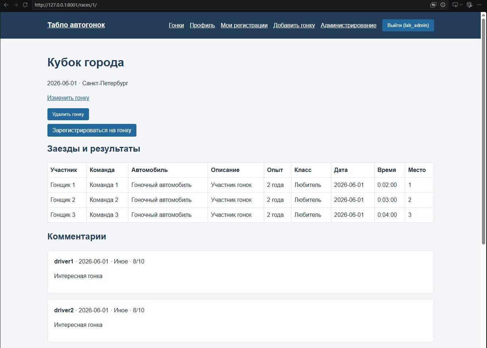

Форма изменения гонки:

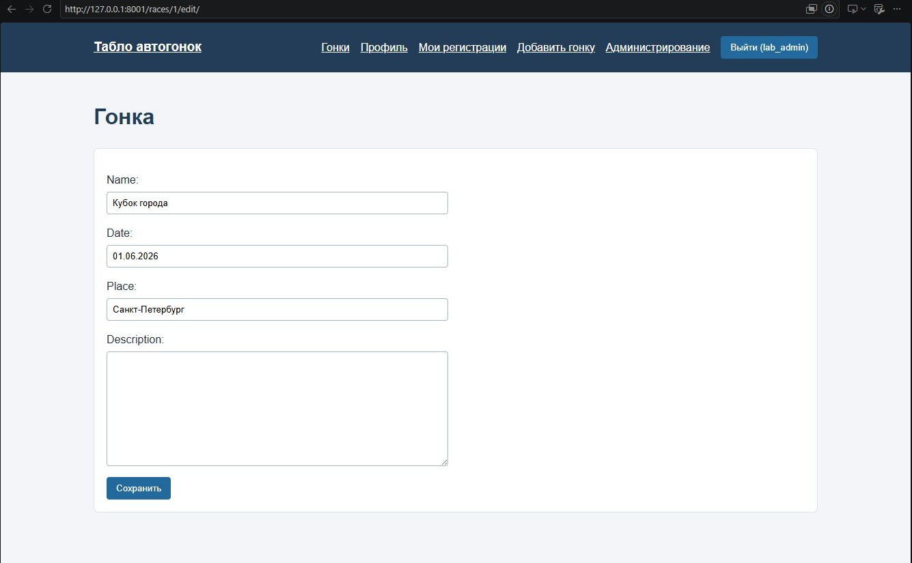

Для оформления я создал файл `static/project_first_app/style.css`. В нем задал цвета, размеры, карточки, формы и таблицу с горизонтальной прокруткой на узком экране.

Так выглядит список гонок с поиском и фильтром:

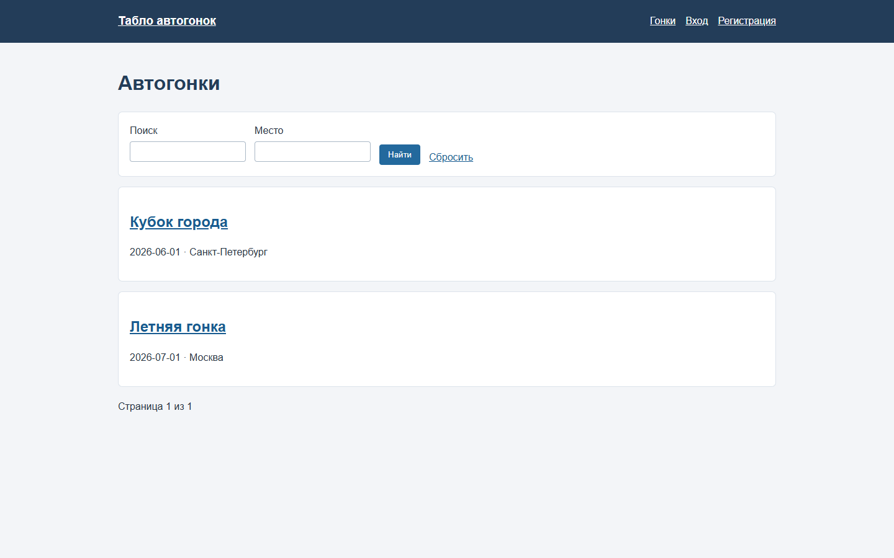

Страницы регистрации и входа:

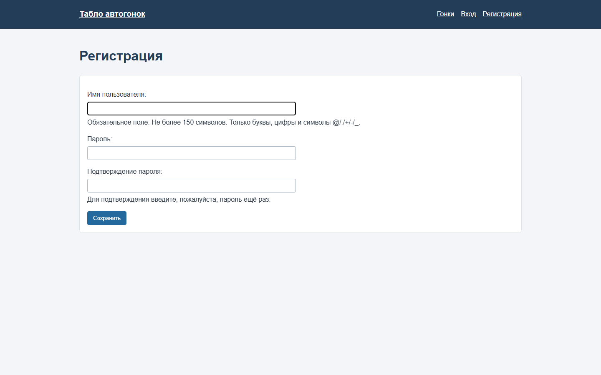

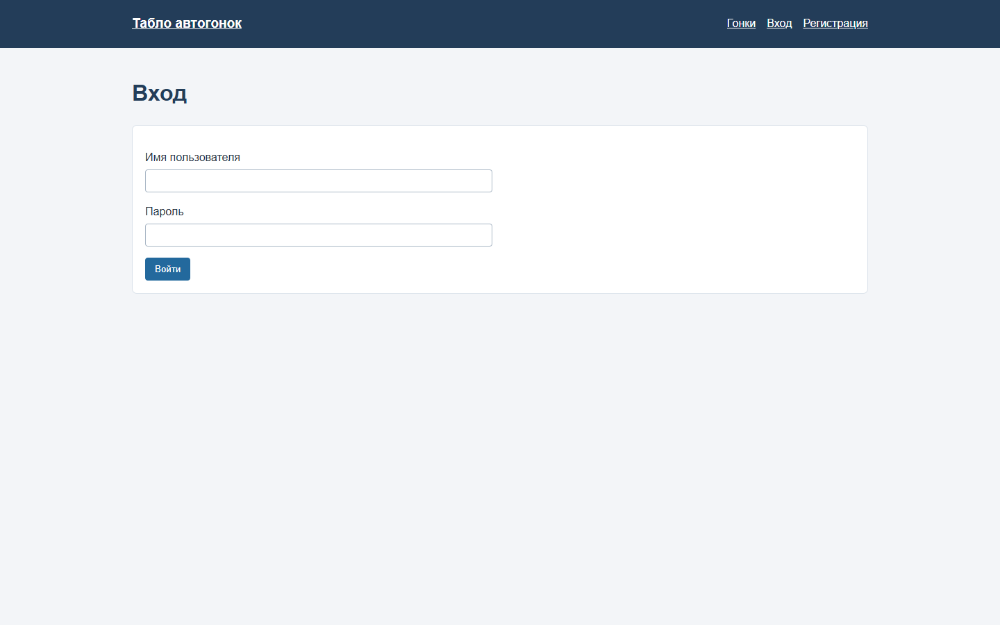

После входа пользователь заполняет свой профиль гонщика:

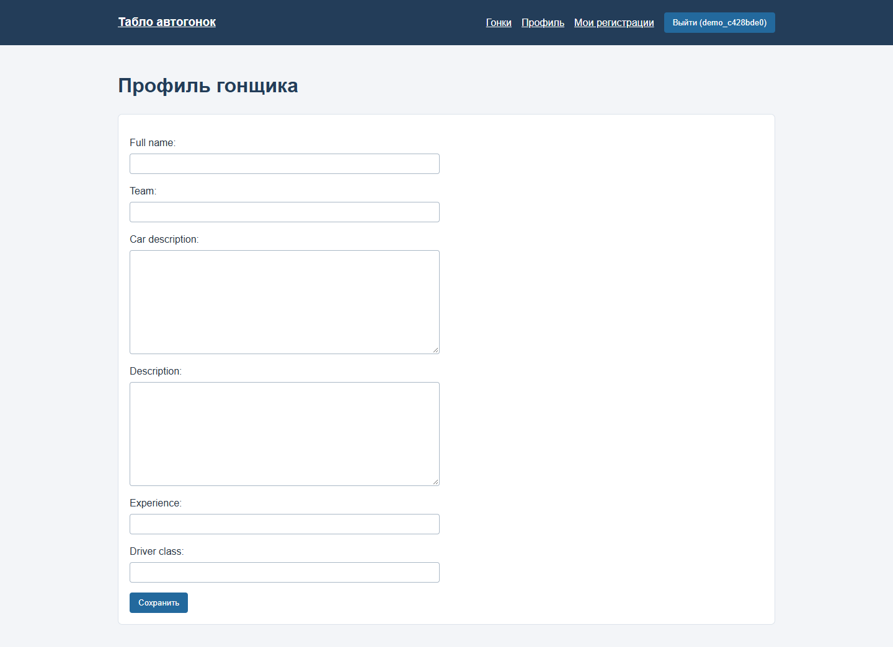

После заполнения профиля можно зарегистрироваться на гонку и указать примечание:

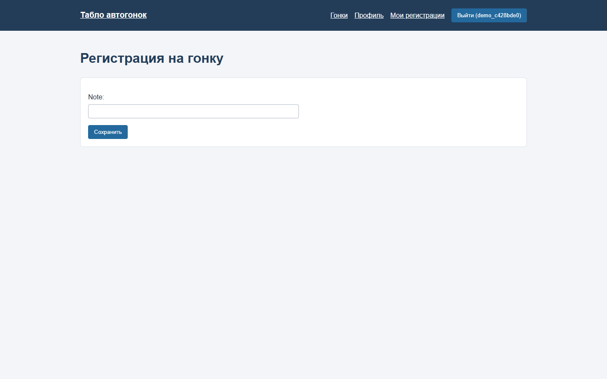

Созданная запись появляется на странице собственных регистраций:

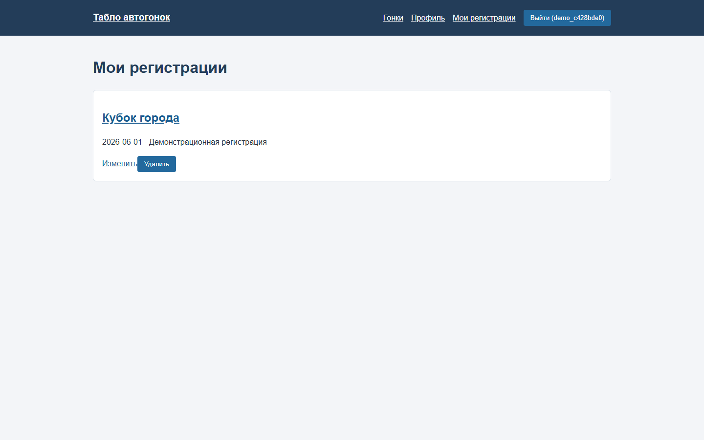

Авторизованный пользователь также видит форму комментария:

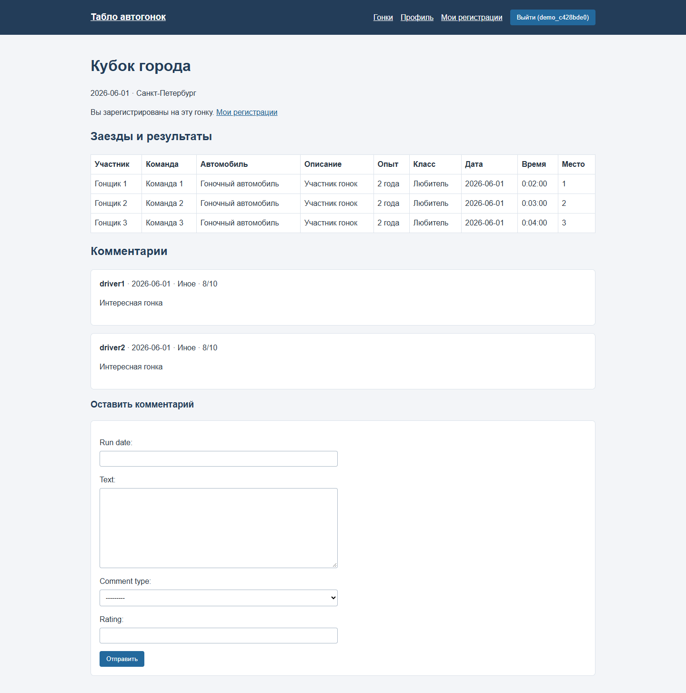

Затем я проверил поиск по названию и фильтр по месту проведения:

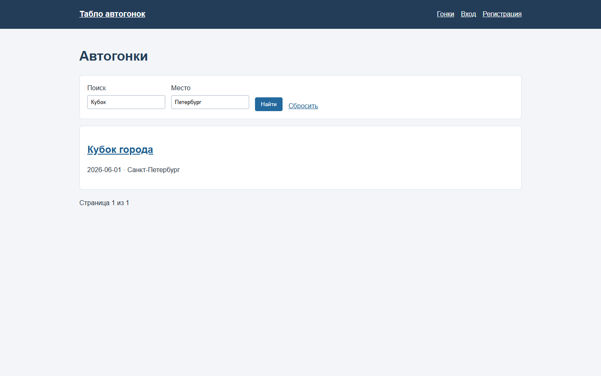

Для проверки перехода между страницами я добавил дополнительные гонки и открыл вторую страницу:

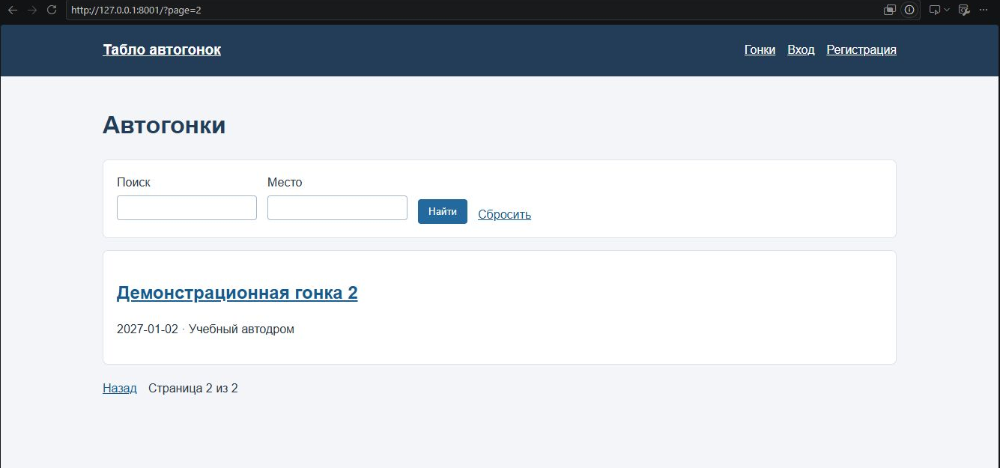

### Подробно о странице гонки

Далее я сделал страницу конкретной гонки в `race_detail.html`. Сначала вывел название, место и дату. Затем добавил таблицу заездов с данными гонщиков. Если заездов нет, вместо них показывается сообщение. Ниже разместил комментарии и форму для пользователя, который вошел на сайт.

Код страницы:

В этом фрагменте шаблон перебирает комментарии и выводит текст каждого из них:

```html
<h2>Комментарии</h2><article class="card"><b>{{ comment.author.username }}</b> · {{ comment.run_date }} · {{ comment.get_comment_type_display() }} · {{ comment.rating }}/10<p>{{ comment.text }}</p></article><p>Комментариев пока нет.</p>
```

В цикле `for` Jinja2 последовательно берет записи, переданные представлением. Условие `if` позволяет показать ссылки в зависимости от состояния входа и прав. Сами права все равно проверяются на сервере: скрытие ссылки лишь делает интерфейс понятнее.

Для поиска и фильтра я использовал метод GET. Выбранные значения попадают в адрес страницы. При переходе вперед или назад они сохраняются, поэтому фильтр не сбрасывается. Вот шаблон списка:

Форма поиска отправляет введенные значения в адрес страницы:

```html
<form method="get" class="card filters"><label>Поиск <input name="q" value="{{ query }}"></label><label>Место <input name="place" value="{{ place }}"></label><button>Найти</button><a href="/">Сбросить</a></form>
```

В `form.html` форма используется повторно для профиля, регистрации, гонки и других действий. Django формирует HTML полей через `form.as_p()`. На странице `login.html` отдельно расположены поля имени и пароля. В `registrations.html` перечисляются только регистрации, которые представление отобрало для текущего пользователя. Удаление отправляется методом POST и требует подтверждения в браузере.

На странице гонки показаны заезды, результаты и комментарии:

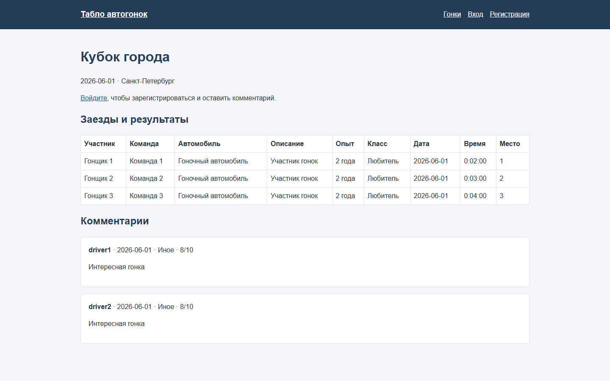

### Файлы проекта и порядок запуска

В корне каждого проекта `manage.py` запускает команды Django. В папке настроек `settings.py` описывает подключение и приложения, а `urls.py` включает маршруты. Файлы `__init__.py` обозначают пакеты Python. Файлы в `migrations/` нужны для повторного создания схемы на другой базе.

В практическом приложении дополнительно находятся шаблоны `owner.html`, `owners.html`, `cars.html`, `car.html`, `form.html` и `car_delete.html`. Их названия соответствуют отображаемым данным или действию. Команды `practice_data.py` и `demo_data.py` размещены в `management/commands/`, чтобы запускать их стандартной командой `manage.py`.

Для запуска практики из ее каталога используем `python manage.py runserver`. Для гонок можно открыть второй терминал и использовать `python manage.py runserver 8001`. Окружение Python нужно активировать заранее.

### Данные

Команда `python manage.py demo_data` добавляет две гонки, трех гонщиков, регистрации, результаты и комментарии. Для создания собственной учетной записи можно использовать форму сайта.

---

## Вывод

В этой работе я познакомился с устройством Django-проекта, моделями, миграциями, формами и представлениями. В практической части были созданы владельцы и автомобили, а связь владения позволила хранить периоды между ними. Затем отдельный проект использовал PostgreSQL для данных гонок: пользователь связан с профилем гонщика, регистрация - с гонкой, а каждый заезд - с регистрацией.

Django получает запрос, обращается к моделям и передает данные шаблону Jinja2. Шаблон формирует страницу, которую видит пользователь. Admin позволяет управлять записями и результатами, а проверки прав в представлениях ограничивают изменение чужих регистраций.

