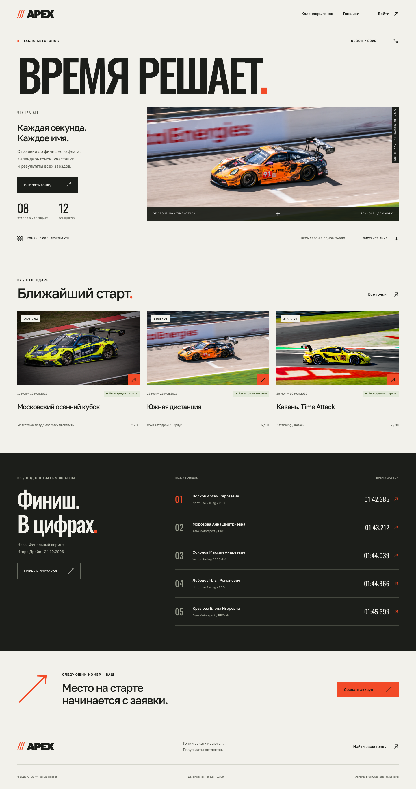

# Веб-программирование

**Данилевский Тимур Давидович · K3339 · 2026–2027**

## Лабораторные работы

| № | Тема | Отчёт |
|---|---|---|
| 1 | Работа с сокетами | [Отчёт ЛР1](lr1/report.md) |
| 2 | Табло победителей автогонок | [Отчёт ЛР2](lr2/report.md) |

## Лабораторная работа № 2

**Вариант 6 — табло победителей автогонок.**

APEX — сайт для просмотра гонок, регистрации участников и публикации результатов заездов.
Реализация: Python 3.10, Django 3.2, Jinja2 и PostgreSQL 16.

[Перейти к отчёту](lr2/report.md){ .md-button .md-button--primary }
[Запуск и сдача](lr2/submission.md){ .md-button }

Все сведения о соревнованиях, гонщиках, командах, комментариях и результатах в демонстрационном наполнении вымышлены. Фотографии используются как иллюстрации автоспорта.
