# Лабораторная работа №1. Работа с сокетами

## Цель работы

Изучить принципы клиент-серверного взаимодействия с использованием сокетов. Получить практические навыки работы с протоколами **UDP** и **TCP**, познакомиться с устройством **HTTP**, а также реализовать многопользовательское взаимодействие с использованием потоков.

В ходе лабораторной работы были выполнены следующие задания:

1. Обмен сообщениями по UDP.
2. Вычисление площади трапеции через TCP.
3. Раздача HTML-страницы по HTTP.
4. Многопользовательский чат на сокетах.
5. Простой веб-сервер с обработкой GET и POST запросов.

---

## Задание 1. Обмен сообщениями по UDP

### Описание

В первом задании реализовано клиент-серверное взаимодействие с использованием протокола **UDP**.

UDP работает без предварительного установления соединения между клиентом и сервером. Клиент отправляет серверу сообщение `Hello, server`, сервер выводит его и отправляет клиенту ответ `Hello, client`.

Для создания UDP-сокета используется:

```python
socket.socket(socket.AF_INET, socket.SOCK_DGRAM)
```

где:

- `AF_INET` — использование IPv4;
- `SOCK_DGRAM` — использование UDP.

### Сервер

```python
import socket

HOST = "localhost"
PORT = 8080

server_socket = socket.socket(socket.AF_INET, socket.SOCK_DGRAM)

server_socket.bind((HOST, PORT))

print(f"UDP-сервер запущен на {HOST}:{PORT}")

data, client_address = server_socket.recvfrom(1024)

message = data.decode()
print(f"Сообщение от клиента: {message}")

response = "Hello, client"
server_socket.sendto(response.encode(), client_address)

server_socket.close()
```

### Клиент

```python
import socket

HOST = "localhost"
PORT = 8080

client_socket = socket.socket(socket.AF_INET, socket.SOCK_DGRAM)

message = "Hello, server"
client_socket.sendto(message.encode(), (HOST, PORT))

data, server_address = client_socket.recvfrom(1024)

response = data.decode()
print(f"Ответ от сервера: {response}")

# закрываем сокет
client_socket.close()
```

### Результат

После запуска сервер получает сообщение:

```text
Сообщение от клиента: Hello, server
```

Клиент получает ответ:

```text
Ответ от сервера: Hello, client
```

Результат:
    Клиент и сервер успешно обмениваются сообщениями по протоколу UDP.

### Скриншот работы

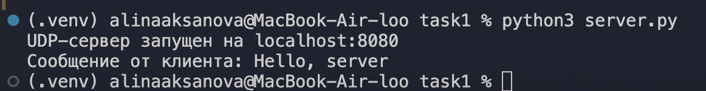
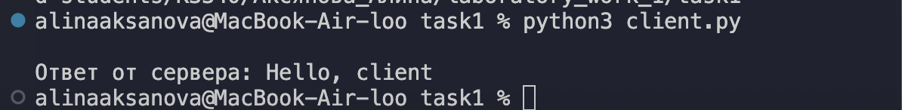

---

## Задание 2. Вычисления через TCP

### Описание

Во втором задании реализовано клиент-серверное взаимодействие с использованием протокола TCP

Мною выпонялся вариант №3, севрев вычислял площадь трапеции

Площадь трапеции определяется по формуле:

**S = (a + b) · h / 2**

где:

- `a` — первое основание трапеции;
- `b` — второе основание трапеции;
- `h` — высота трапеции.

В отличие от UDP, TCP требует предварительного установления соединения между клиентом и сервером.

Для создания TCP-сокета используется:

```python
socket.socket(socket.AF_INET, socket.SOCK_STREAM)
```

### Сервер

```python
import socket

HOST = "localhost"
PORT = 8081

server_socket = socket.socket(socket.AF_INET, socket.SOCK_STREAM)

server_socket.bind((HOST, PORT))

server_socket.listen(1)

print(f"TCP-сервер запущен на {HOST}:{PORT}")

while True:
    client_connection, client_address = server_socket.accept()
    print(f"Подключение от {client_address}")

    data = client_connection.recv(1024).decode()

    a, b, h = map(float, data.split())

    area = (a + b) * h / 2

    client_connection.sendall(str(area).encode())

    client_connection.close()
```

### Клиент

```python
import socket

HOST = "localhost"
PORT = 8081

client_socket = socket.socket(socket.AF_INET, socket.SOCK_STREAM)

client_socket.connect((HOST, PORT))

a = float(input("Введите первое основание трапеции: "))
b = float(input("Введите второе основание трапеции: "))
h = float(input("Введите высоту трапеции: "))

message = f"{a} {b} {h}"

client_socket.sendall(message.encode())

data = client_socket.recv(1024).decode()

print(f"Площадь трапеции: {data}")

client_socket.close()
```

### Пример работы

При вводе:

```text
Первое основание: 5
Второе основание: 7
Высота: 3
```

результат:

```text
Площадь трапеции: 18.0
```

Результат:
    Клиент передаёт параметры трапеции серверу по TCP. Сервер выполняет вычисление и возвращает результат клиенту.

### Скриншот работы

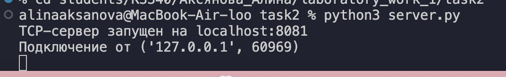
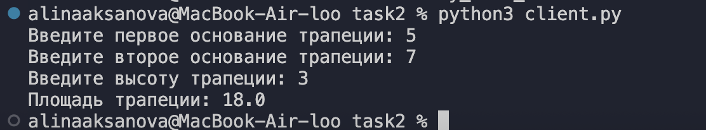
---

## Задание 3. Раздача HTML-страницы по HTTP

### Описание

В третьем задании реализован простой HTTP-сервер с использованием библиотеки `socket`.

В качестве клиента используется браузер. После подключения браузер отправляет HTTP-запрос. Сервер получает запрос, считывает содержимое файла `index.html`, формирует HTTP-ответ и отправляет его браузеру.

HTTP-ответ содержит:

| Часть | Назначение |
|---|---|
| `HTTP/1.1 200 OK` | Статус успешного выполнения запроса |
| `Content-Type` | Тип передаваемых данных |
| `Content-Length` | Размер тела ответа |
| `Connection: close` | Закрытие соединения после ответа |
| Тело ответа | Содержимое HTML-страницы |

### Сервер

```python
import socket

HOST = "localhost"
PORT = 8082

server_socket = socket.socket(socket.AF_INET, socket.SOCK_STREAM)

server_socket.bind((HOST, PORT))

server_socket.listen(5)

print(f"HTTP-сервер запущен на http://{HOST}:{PORT}")

while True:
    client_connection, client_address = server_socket.accept()
    print(f"Подключение от {client_address}")

    request = client_connection.recv(1024).decode()
    print(f"Запрос клиента:\n{request}")

    with open("index.html", "r", encoding="utf-8") as file:
        html_content = file.read()

    html_bytes = html_content.encode("utf-8")

    http_headers = (
        "HTTP/1.1 200 OK\r\n"
        "Content-Type: text/html; charset=UTF-8\r\n"
        f"Content-Length: {len(html_bytes)}\r\n"
        "Connection: close\r\n"
        "\r\n"
    )

    client_connection.sendall(http_headers.encode() + html_bytes)

    client_connection.close()
```

### HTML-страница

Файл `index.html`:

```html
<!DOCTYPE html>
<html lang="ru">
<head>
    <meta charset="UTF-8">
    <title>Лабораторная работа №1</title>
</head>
<body>
    <h1>Лабораторная работа №1</h1>
    <h2>Задание 3</h2>
    <p>Эта HTML-страница получена с сервера через HTTP.</p>
</body>
</html>
```

### Пример HTTP-запроса

При переходе в браузере на адрес `http://localhost:8082` сервер получает запрос вида:

```http
GET / HTTP/1.1
Host: localhost:8082
```

Результат:
    Сервер успешно считывает HTML-код из отдельного файла `index.html` и передаёт его браузеру в теле HTTP-ответа.

### Скриншот работы

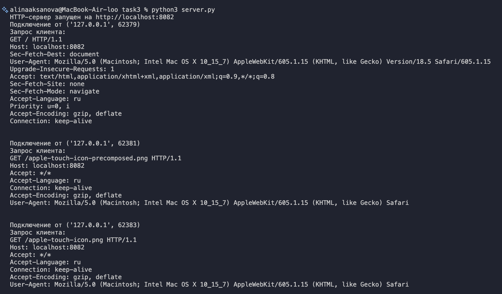
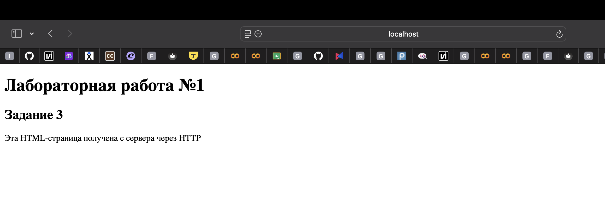

---

## Задание 4. Многопользовательский чат

### Описание

В четвёртом задании реализован **многопользовательский чат** с использованием протокола TCP и библиотеки `threading`

Используется один серверный скрипт и один клиентский скрипт. Для подключения нескольких пользователей один и тот же `client.py` запускается в нескольких терминалах

Каждый пользователь вводит имя, которое используется для его идентификации в чате

### Использование потоков

Для каждого подключённого пользователя сервер создаёт отдельный поток:

```python
thread = threading.Thread(
    target=handle_client,
    args=(client_connection, client_address)
)

thread.start()
```

Это позволяет серверу одновременно работать с несколькими клиентами

### Хранение подключений

Активные подключения сохраняются в списке:

```python
clients = []
```

Для рассылки сообщений используется функция:

```python
def broadcast(message, sender_connection):
    for client in clients:
        if client != sender_connection:
            client.sendall(message)
```

Сообщение отправляется всем подключённым клиентам, кроме его отправителя

### Получение сообщений на клиенте

На стороне клиента отдельный поток используется для постоянного получения сообщений от сервера:

```python
def receive_messages():
    while True:
        try:
            message = client_socket.recv(1024)

            if not message:
                break

            print(message.decode())

        except ConnectionError:
            break


receive_thread = threading.Thread(target=receive_messages)
receive_thread.start()
```

Основной поток при этом используется для ввода и отправки сообщений

### Выход из чата

Для выхода используется команда:

```text
/exit
```

После её отправки соединение клиента закрывается, а сервер удаляет пользователя из списка активных подключений

Результат:
    Реализован многопользовательский TCP-чат. Пользователи идентифицируются по имени, могут обмениваться сообщениями и выходить из чата

### Скриншот работы

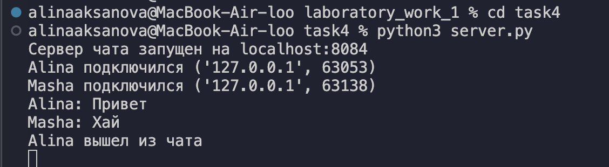
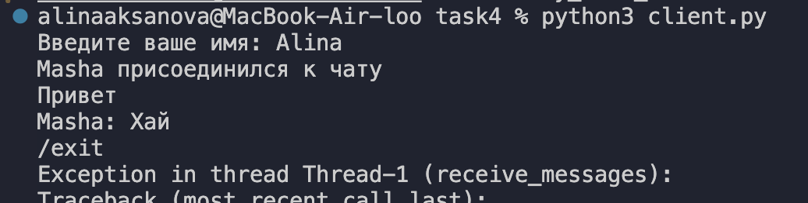
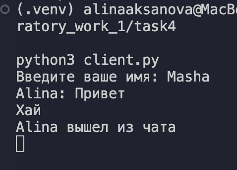

---

## Задание 5. Простой веб-сервер GET/POST

### Описание

В пятом задании реализован простой HTTP-сервер для ведения журнала оценок

Сервер самостоятельно разбирает HTTP-запросы и поддерживает методы GET и POST


### Хранение данных

Для хранения оценок используется словарь:

```python
grades = {}
```

Название дисциплины является ключом, а значением является список всех оценок по этой дисциплине.

Пример:

```python
{
    "Математика": ["5", "4", "3"],
    "Физика": ["5"]
}
```

Такой способ хранения позволяет группировать оценки по предметам, а не создавать отдельную запись для каждой оценки.

### HTML-форма

Для добавления оценки используется форма:

```html
<form method="POST" action="/">
    <label>
        Дисциплина:
        <input type="text" name="subject" required>
    </label>

    <br><br>

    <label>
        Оценка:
        <input type="number" name="grade" min="1" max="5" required>
    </label>

    <br><br>

    <button type="submit">Добавить оценку</button>
</form>
```

### Обработка POST-запроса

Полученные от браузера данные разбираются с помощью `parse_qs`:

```python
form_data = parse_qs(body)

subject = form_data.get("subject", [""])[0]
grade = form_data.get("grade", [""])[0]
```

После этого оценка добавляется в соответствующую дисциплину:

```python
if subject and grade:
    if subject not in grades:
        grades[subject] = []

    grades[subject].append(grade)
```

### Получение тела HTTP-запроса

Размер тела POST-запроса определяется по заголовку `Content-Length`:

```python
content_length = 0

for header in headers.decode("utf-8").split("\r\n"):
    if header.lower().startswith("content-length:"):
        content_length = int(header.split(":")[1].strip())
```

Если первый вызов `recv()` не получил всё тело запроса, сервер продолжает чтение:

```python
while len(body) < content_length:
    data = client_connection.recv(4096)

    if not data:
        break

    body += data
```

Это необходимо, так как TCP представляет собой поток байтов и один вызов `recv()` не гарантирует получение всего HTTP-запроса

### Пример результата

После добавления нескольких оценок журнал может иметь следующий вид:

```text
Математика: 5, 4, 3
Физика: 5
Web-программирование: 4, 5
```

Результат:
    Сервер обрабатывает GET и POST запросы. Оценки сохраняются в памяти сервера и группируются по названию дисциплины.

"Хранение данных":
    Оценки хранятся в оперативной памяти в словаре `grades`. После остановки сервера данные удаляются.

### Скриншот работы

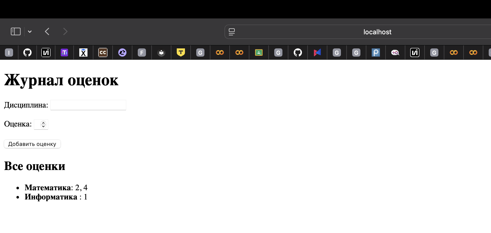
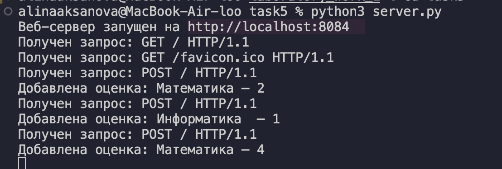
---

## Вывод

В ходе лабораторной работы были изучены основные принципы клиент-серверного взаимодействия с использованием сокетов в Python

Был реализован обмен сообщениями по протоколам UDP и TCP. Были изучены основные методы библиотеки `socket`: `bind()`, `listen()`, `accept()`, `connect()`, `sendto()`, `recvfrom()`, `sendall()` и `recv()`.

Также был реализован простой HTTP-сервер и рассмотрена структура HTTP-запросов и ответов. На практике были использованы методы GET и POST, HTTP-заголовки и тело запроса.

Для реализации многопользовательского чата была использована библиотека `threading`, которая позволила обрабатывать подключения нескольких пользователей в отдельных потоках.

В результате работы были получены практические навыки создания простых сетевых приложений и работы с клиент-серверной архитектурой на Python.