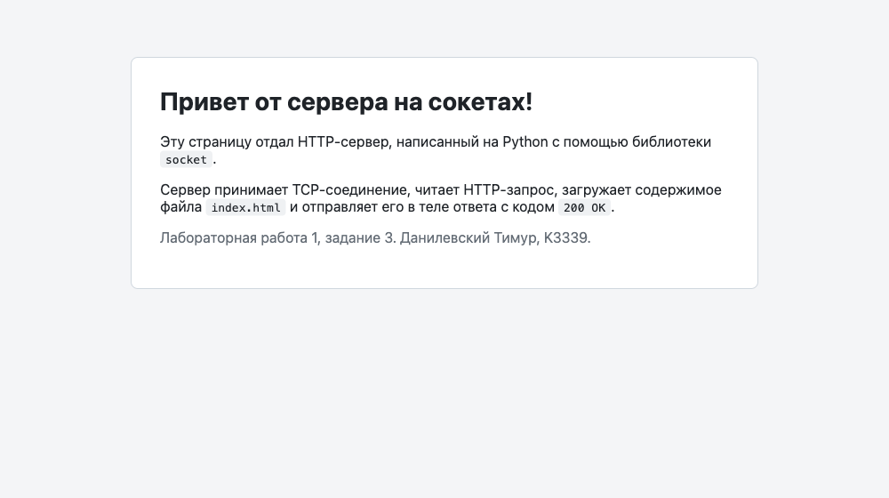
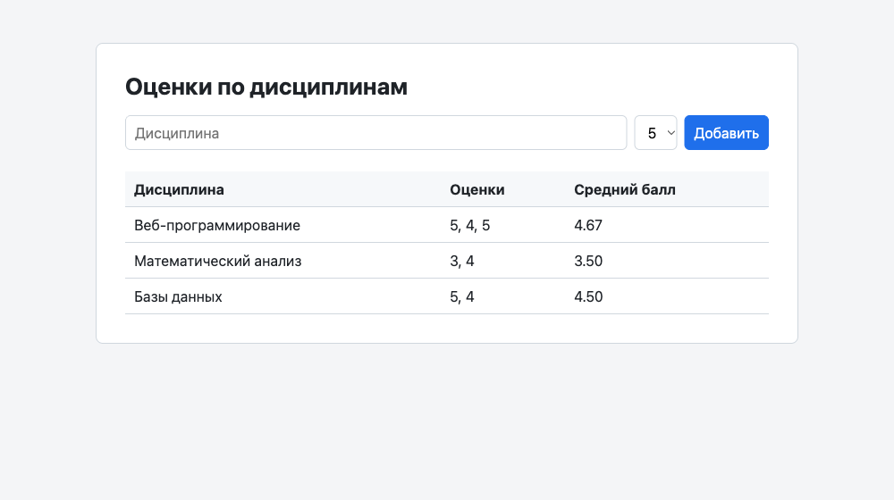

# Лабораторная работа 1. Работа с сокетами

**Цель:** овладеть практическими навыками работы с сокетами и построения
простейших клиент-серверных приложений.

- **Студент:** Данилевский Тимур, группа K3339
- **Вариант задания 2:** 3 (площадь трапеции)
- **Язык:** Python 3.10, библиотеки `socket` и `threading`
- **Код:** `students/K3339/Danilevskiy_Timur/laboratory_work_1/`

| Задание | Протокол | Порт | Файлы |
|---------|----------|------|-------|
| 1. Обмен приветствиями | UDP | 9090 | `task1/server.py`, `task1/client.py` |
| 2. Площадь трапеции | TCP | 9091 | `task2/server.py`, `task2/client.py` |
| 3. Отдача HTML-страницы | HTTP поверх TCP | 8080 | `task3/server.py`, `task3/index.html` |
| 4. Многопользовательский чат | TCP + потоки | 9092 | `task4/server.py`, `task4/client.py` |
| 5. Веб-сервер с оценками | HTTP поверх TCP | 8081 | `task5/server.py` |

Все серверы слушают `127.0.0.1` и останавливаются по `Ctrl+C`.

---

## Задание 1. Обмен сообщениями по UDP

**Условие.** Клиент отправляет серверу сообщение «Hello, server», сервер выводит его
и отвечает «Hello, client», клиент выводит ответ.

### Как это работает

UDP — протокол без установления соединения. Сокет создаётся с типом
`SOCK_DGRAM`, а данные передаются отдельными датаграммами:

- сервер привязывает сокет к адресу (`bind`) и в цикле ждёт датаграммы через
  `recvfrom()`, которая возвращает данные **и адрес отправителя**;
- ответ отправляется по этому адресу через `sendto()`;
- у клиента нет `connect()`: он сразу отправляет датаграмму на адрес сервера.

UDP не гарантирует доставку, поэтому клиент ждёт ответ с таймаутом (`settimeout`),
чтобы не зависнуть, если сервер не запущен.

```python
data, addr = sock.recvfrom(BUFFER_SIZE)
print(f"Сообщение от {addr[0]}:{addr[1]}: {data.decode('utf-8')}")
sock.sendto("Hello, client".encode("utf-8"), addr)
```

### Пример работы

```text title="Сервер"
$ python task1/server.py
UDP-сервер запущен на 127.0.0.1:9090
Сообщение от 127.0.0.1:54396: Hello, server
```

```text title="Клиент"
$ python task1/client.py
Ответ от сервера 127.0.0.1:9090: Hello, client
```

??? info "Полный код: task1/server.py"
    ```python
    --8<-- "students/K3339/Danilevskiy_Timur/laboratory_work_1/task1/server.py"
    ```

??? info "Полный код: task1/client.py"
    ```python
    --8<-- "students/K3339/Danilevskiy_Timur/laboratory_work_1/task1/client.py"
    ```

---

## Задание 2. Площадь трапеции по TCP (вариант 3)

**Условие.** Клиент запрашивает у сервера математическую операцию, параметры
вводятся с клавиатуры. Сервер считает и возвращает результат.

Площадь трапеции: `S = (a + b) / 2 · h`, где `a` и `b` — основания, `h` — высота.

### Протокол

TCP устанавливает соединение (`SOCK_STREAM`): сервер вызывает `listen()` и `accept()`,
клиент вызывает `connect()`. На каждый запрос открывается одно соединение:

1. клиент отправляет строку `"a b h"`, например `"3.0 5.0 4.0"`;
2. сервер разбирает числа, проверяет их и отвечает строкой
   `"Площадь трапеции: 16.00"` или текстом ошибки;
3. соединение закрывается.

Ввод проверяется дважды: клиент не даёт ввести не число или неположительное значение,
а сервер не доверяет входным данным и проверяет их сам.

```python
def handle_request(data):
    try:
        a, b, h = map(float, data.split())
    except ValueError:
        return "Ошибка: нужно передать три числа через пробел: a b h"

    if a <= 0 or b <= 0 or h <= 0:
        return "Ошибка: основания и высота должны быть положительными"

    return f"Площадь трапеции: {trapezoid_area(a, b, h):.2f}"
```

### Пример работы

```text title="Клиент"
$ python task2/client.py
Площадь трапеции: S = (a + b) / 2 * h
Основание a: abc
Введите число
Основание a: -1
Значение должно быть положительным
Основание a: 2,5
Основание b: 7.5
Высота h: 4
Площадь трапеции: 20.00
```

```text title="Сервер"
$ python task2/server.py
TCP-сервер запущен на 127.0.0.1:9091
Запрос от 127.0.0.1:63688: '2.5 7.5 4.0'
Ответ: Площадь трапеции: 20.00
```

??? info "Полный код: task2/server.py"
    ```python
    --8<-- "students/K3339/Danilevskiy_Timur/laboratory_work_1/task2/server.py"
    ```

??? info "Полный код: task2/client.py"
    ```python
    --8<-- "students/K3339/Danilevskiy_Timur/laboratory_work_1/task2/client.py"
    ```

---

## Задание 3. Отдача HTML-страницы по HTTP

**Условие.** Реализовать серверную часть: при подключении клиент получает
HTTP-сообщение со страницей из файла `index.html`.

### Как это работает

HTTP — текстовый протокол поверх TCP. Сервер читает запрос из сокета,
берёт из стартовой строки (`GET / HTTP/1.1`) путь и формирует ответ:

```http
HTTP/1.1 200 OK
Content-Type: text/html; charset=utf-8
Content-Length: 1550
Connection: close

<!DOCTYPE html>
...
```

- строки заголовков разделяются `\r\n`, заголовки от тела отделяет пустая строка;
- `Content-Length` — длина тела **в байтах** (кириллица в UTF-8 занимает 2 байта на символ),
  поэтому файл читается сразу как `bytes`;
- `charset=utf-8` нужен, чтобы браузер правильно показал русский текст;
- на запросы других путей (например, `/favicon.ico`, который браузер запрашивает сам)
  сервер отвечает `404 Not Found`.

```python
def build_response(status, content_type, body):
    head = (
        f"HTTP/1.1 {status}\r\n"
        f"Content-Type: {content_type}\r\n"
        f"Content-Length: {len(body)}\r\n"
        "Connection: close\r\n"
        "\r\n"
    )
    return head.encode("utf-8") + body
```

### Пример работы

```text title="Сервер"
$ python task3/server.py
HTTP-сервер запущен: http://127.0.0.1:8080/
127.0.0.1:63690 — GET / HTTP/1.1
127.0.0.1:63691 — GET /favicon.ico HTTP/1.1
```



??? info "Полный код: task3/server.py"
    ```python
    --8<-- "students/K3339/Danilevskiy_Timur/laboratory_work_1/task3/server.py"
    ```

??? info "Полный код: task3/index.html"
    ```html
    --8<-- "students/K3339/Danilevskiy_Timur/laboratory_work_1/task3/index.html"
    ```

---

## Задание 4. Многопользовательский чат

**Условие.** Реализовать многопользовательский чат на `socket` и `threading`:
пользователи идентифицируются по имени и могут выйти из чата.

Реализован вариант на **TCP**. Клиент — **один скрипт** `task4/client.py`,
каждый пользователь запускает его в отдельном терминале.

### Устройство сервера

- главный поток в цикле принимает подключения (`accept`) и для каждого клиента
  запускает поток `handle_client`;
- подключённые пользователи хранятся в словаре `clients` вида `{сокет: имя}`, по нему
  сервер рассылает сообщения всем участникам (`broadcast`);
- словарь общий для всех потоков, поэтому доступ к нему защищён `threading.Lock`;
- TCP передаёт поток байтов, а не отдельные сообщения, поэтому каждое сообщение
  заканчивается символом `\n`, а читается построчно через `conn.makefile()`.

```python
clients = {}  # сокет клиента -> имя пользователя
clients_lock = threading.Lock()


def broadcast(text, exclude=None):
    """Отправляет сообщение всем подключённым, кроме exclude."""
    with clients_lock:
        recipients = [conn for conn in clients if conn is not exclude]
    for conn in recipients:
        try:
            send_line(conn, text)
        except OSError:
            pass  # клиент отключился — его удалит собственный поток
```

### Протокол

| Шаг | Клиент → сервер | Сервер → клиент |
|-----|-----------------|-----------------|
| Регистрация | имя пользователя | `NAME_OK`, `NAME_TAKEN` (имя занято) или `NAME_EMPTY` |
| Сообщение | текст | всем остальным: `[Имя]: текст` |
| `/users` | команда | `* Сейчас в чате: ...` |
| `/exit` | команда | соединение закрывается, остальным: `* Имя вышел из чата` |

Если клиент отключился без `/exit` (закрыл терминал, `Ctrl+C`), сервер всё равно
удалит его в блоке `finally` и сообщит остальным.

### Устройство клиента

Клиенту нужно одновременно ждать ввод с клавиатуры и принимать сообщения
от сервера, поэтому работа разделена на два потока:

- **главный поток** читает `input()` и отправляет сообщения на сервер;
- **поток `receive`** читает строки из сокета и печатает их.

```python
leaving = threading.Event()
threading.Thread(target=receive, args=(reader, leaving), daemon=True).start()
```

### Пример работы (три пользователя)

```text title="Alice"
Введите имя: Alice
* Добро пожаловать, Alice! Команды: /users — участники, /exit — выход
* Bob вошёл в чат
* Carol вошёл в чат
Всем привет!
[Bob]: Привет, Alice
* Bob вышел из чата
Bob ушёл
* Carol вышел из чата
/exit
Вы вышли из чата
```

```text title="Bob"
Введите имя: Alice
Это имя уже занято, выберите другое
Введите имя: Bob
* Добро пожаловать, Bob! Команды: /users — участники, /exit — выход
* Carol вошёл в чат
[Alice]: Всем привет!
Привет, Alice
/exit
Вы вышли из чата
```

```text title="Carol"
Введите имя:
Имя не может быть пустым
Введите имя: Carol
* Добро пожаловать, Carol! Команды: /users — участники, /exit — выход
[Alice]: Всем привет!
[Bob]: Привет, Alice
/users
* Сейчас в чате: Alice, Bob, Carol
* Bob вышел из чата
[Alice]: Bob ушёл
/exit
Вы вышли из чата
```

```text title="Сервер"
$ python task4/server.py
Сервер чата запущен на 127.0.0.1:9092
Alice подключился (127.0.0.1:63736)
Bob подключился (127.0.0.1:63735)
Carol подключился (127.0.0.1:63734)
[Alice]: Всем привет!
[Bob]: Привет, Alice
Bob отключился
[Alice]: Bob ушёл
Carol отключился
Alice отключился
```

??? info "Полный код: task4/server.py"
    ```python
    --8<-- "students/K3339/Danilevskiy_Timur/laboratory_work_1/task4/server.py"
    ```

??? info "Полный код: task4/client.py"
    ```python
    --8<-- "students/K3339/Danilevskiy_Timur/laboratory_work_1/task4/client.py"
    ```

---

## Задание 5. Веб-сервер для оценок (GET и POST)

**Условие.** Написать на `socket` веб-сервер, который принимает и записывает
дисциплину и оценку (POST) и отдаёт HTML-страницу со всеми оценками (GET).
Запрос разбирается вручную.

### Эндпоинты

| Метод | URL | Параметры | Ответ |
|-------|-----|-----------|-------|
| GET | `/` | — | `200 OK`, HTML-страница с формой и таблицей оценок |
| POST | `/` | тело формы: `discipline=<название>&grade=<2..5>` | `303 See Other` с `Location: /` |
| другие | `/` | — | `405 Method Not Allowed` |
| любой | другой путь | — | `404 Not Found` |

При ошибках в запросе (нет названия, оценка не от 2 до 5, некорректная стартовая строка)
сервер возвращает `400 Bad Request` со страницей, где описана ошибка.

### Модель данных

Оценки сгруппированы по дисциплинам: каждой дисциплине соответствует **одна запись**
со списком её оценок. Для этого используется словарь, где ключ — название дисциплины,
а значение — список оценок:

```python
grades = {
    "Веб-программирование": [5, 4, 5],
    "Математический анализ": [3, 4],
    "Базы данных": [5, 4],
}
```

Новая оценка добавляется одной строкой: если дисциплины ещё нет, `setdefault`
создаст пустой список.

```python
self.grades.setdefault(discipline, []).append(int(grade))
```

Порядок дисциплин сохраняется, так как в Python 3.7+ словари помнят порядок вставки.
Лишние пробелы в названии убираются, чтобы `"  Базы   данных "` и `"Базы данных"`
попадали в одну запись.

### Разбор HTTP-запроса

Сервер построен по схеме класса `MyHTTPServer`:
`serve_forever → serve_client → parse_request → parse_headers → handle_request → send_response`.

1. **Стартовая строка.** Читается первая строка и разбивается на метод, путь и версию:

    ```python
    parts = raw.decode("iso-8859-1").rstrip("\r\n").split()
    if len(parts) != 3:
        raise HTTPError(400, "Bad Request", "Некорректная строка запроса")
    method, target, version = parts
    ```

2. **Заголовки.** Строки `Имя: значение` читаются до пустой строки.
   Имена приводятся к нижнему регистру, потому что регистр в них не важен.

3. **Тело (для POST).** После заголовков читается ровно `Content-Length` байт.
   Браузер отправляет форму в формате `application/x-www-form-urlencoded`
   (`discipline=%D0%91%D0%B0...&grade=5`), он декодируется через `urllib.parse.parse_qs`:

    ```python
    def body(self):
        length = self.headers.get("content-length")
        if not length:
            return b""
        try:
            return self.rfile.read(int(length))
        except ValueError:
            raise HTTPError(400, "Bad Request", "Некорректный Content-Length")
    ```

4. **Ответ на POST.** Сервер возвращает `303 See Other` с `Location: /`,
   и браузер сам делает `GET /` (паттерн Post/Redirect/Get). Поэтому обновление
   страницы не отправляет форму повторно.

!!! warning "Защита от XSS"
    Название дисциплины вводит пользователь, поэтому перед вставкой в HTML оно
    экранируется через `html.escape`. Иначе строка вида `<script>...</script>`
    выполнилась бы в браузере.

### Пример работы



```text title="Запросы через curl"
$ curl -i -X POST --data-urlencode "discipline=Веб-программирование" -d grade=5 http://127.0.0.1:8081/
HTTP/1.1 303 See Other
Location: /
Content-Length: 0

$ curl -X POST --data-urlencode "discipline=Физика" -d grade=7 http://127.0.0.1:8081/
...
<h1>400 Bad Request</h1>
<p>Оценка должна быть целым числом от 2 до 5</p>

$ curl -i -X DELETE http://127.0.0.1:8081/
HTTP/1.1 405 Method Not Allowed
```

```text title="Сервер"
$ python task5/server.py
Сервер grades-server запущен: http://127.0.0.1:8081/
GET / -> 200 OK
POST / -> 303 See Other
GET / -> 200 OK
POST / -> 400 Bad Request
GET /nope -> 404 Not Found
DELETE / -> 405 Method Not Allowed
```

??? info "Полный код: task5/server.py"
    ```python
    --8<-- "students/K3339/Danilevskiy_Timur/laboratory_work_1/task5/server.py"
    ```

---

## Вывод

В ходе работы изучены основы сетевого взаимодействия через сокеты:

- разница между UDP (датаграммы без соединения, `sendto`/`recvfrom`) и TCP
  (поток байтов с установкой соединения, `connect`/`accept`/`sendall`/`recv`);
- устройство протокола HTTP: стартовая строка, заголовки, пустая строка, тело,
  ручной разбор запроса и формирование ответа с правильным `Content-Length`;
- обработка нескольких клиентов одновременно с помощью потоков и синхронизация
  доступа к общим данным через `Lock`;
- разделение потока TCP на отдельные сообщения с помощью разделителя `\n`.
