# ЛР1. Работа с сокетами

**Студент:** Лукошников Дмитрий  
**Группа:** К3342  

## Цель работы

Понять принципы межсокетного взаимодействия в вебе. Научиться реализовывать базовую архитектуру клиент-сервер.

## Краткая теория

| Протокол | Тип сокета | Установка соединения | Гарантии доставки |
|---|---|---|---|
| UDP | `SOCK_DGRAM` | нет | нет |
| TCP | `SOCK_STREAM` | да (`connect`/`accept`) | да, порядок сохраняется |
| HTTP | поверх TCP | да | да |

**UDP** — протокол без установления соединения: отправитель просто посылает датаграмму, не дожидаясь подтверждения. Быстрее TCP, но не гарантирует доставку и порядок пакетов.

**TCP** — требует установления соединения перед обменом данными и гарантирует доставку и порядок байт.

**HTTP** — прикладной протокол поверх TCP: обычный текст строгого формата (статус-строка, заголовки, пустая строка, тело).

---

## Задание 1. Обмен сообщениями по UDP

Клиент отправляет серверу `Hello, server`, сервер печатает его и отвечает `Hello, client`, клиент печатает ответ.

### Код сервера (`Server_UDP.py`)

```python
import socket

server_socket = socket.socket(socket.AF_INET, socket.SOCK_DGRAM)
server_socket.bind(('localhost', 8080))

data, adr = server_socket.recvfrom(1024)
print(data.decode())

server_socket.sendto(b'Hello, client', adr)

server_socket.close()
```

### Код клиента (`Client_UDP.py`)

```python
import socket

client_socket = socket.socket(socket.AF_INET, socket.SOCK_DGRAM)

client_socket.sendto(b'Hello, server', ('localhost', 8080))

data, adr = client_socket.recvfrom(1024)
print(data.decode())

client_socket.close()
```

### Пример работы

### Сервер
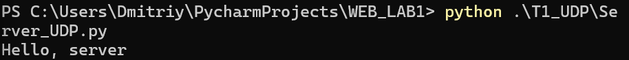
### Клиент
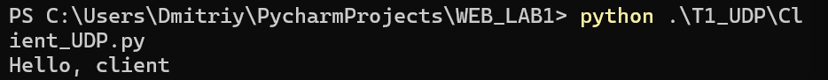

---

## Задание 2. Вычисления через TCP (теорема Пифагора)

Вариант 1 — теорема Пифагора. Клиент вводит катеты с клавиатуры, сервер считает гипотенузу `c = √(a² + b²)` и возвращает результат.

### Код сервера (`Server_TCP.py`)

```python
import math
import socket

host = 'localhost'
port = 8081

def pifagor(k1, k2):
    return math.sqrt(k1**2 + k2**2)

server_socket = socket.socket(socket.AF_INET, socket.SOCK_STREAM)
server_socket.bind((host, port))
server_socket.listen(1)
print(f"Сервер запущен на порту {port}...")

while True:
    client_connection, client_address = server_socket.accept()
    print(f'Подключение от {client_address}')

    request = client_connection.recv(1024).decode()
    print(f"Получено сообщение от клиента {client_address} - {request}")

    k1, k2 = map(float, request.split(','))
    response = f"Гипотенуза = {str(pifagor(k1, k2))}"
    client_connection.sendall(response.encode())
    print(f"Ответ отправлен клиенту {client_address} - {response}")

    client_connection.close()
```

### Код клиента (`Client_TCP.py`)

```python
import socket

host = 'localhost'
port = 8081

client_socket = socket.socket(socket.AF_INET, socket.SOCK_STREAM)
client_socket.connect((host, port))
print("Это клиент-серверная часть приложения для счёта гипотенузы по теореме Пифагора")

while True:
    try:
        k1 = float(input("Введите длину первого катета: "))
        k2 = float(input("Введите длину второго катета: "))
    except ValueError:
        print("Катеты должны быть в формате float")
        print("Попробуй еще раз")
        continue
    request = f"{k1},{k2}"
    break

client_socket.sendall(request.encode())

response = client_socket.recv(1024)
print(f'Ответ от сервера: {response.decode()}')

client_socket.close()
```

### Пример работы

### Сервер
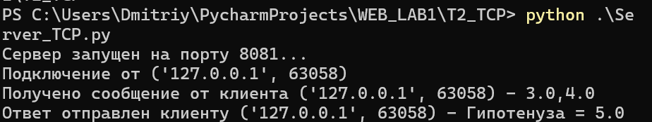
### Клиент
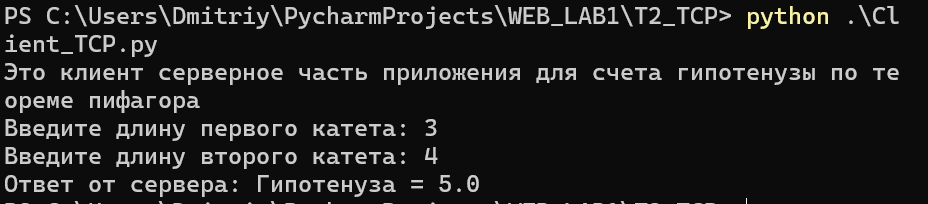

---

## Задание 3. Раздача HTML-страницы по HTTP

Сервер по сокету отдаёт корректный HTTP-ответ с телом из файла `index.html`. `Content-Length` считается в байтах.

### Код сервера (`Server_HTTP.py`)

```python
import socket

HOST = 'localhost'
PORT = 8082

server_socket = socket.socket(socket.AF_INET, socket.SOCK_STREAM)
server_socket.bind((HOST, PORT))
server_socket.listen(5)
print(f"HTTP сервер запущен на {HOST}:{PORT}...")

with open('index.html', 'r', encoding='utf-8') as f:
    html_content = f.read()
html_bytes = html_content.encode('utf-8')

print(f"Ссылка для подключения - http://localhost:8082/")

while True:
    connection, address = server_socket.accept()
    print(f'Подключение от {address}')
    request = connection.recv(1024).decode('utf-8', errors='ignore')
    print(f'Запрос клиента:\n{request}')

    header = (
        "HTTP/1.1 200 OK\r\n"
        "Content-Type: text/html; charset=UTF-8\r\n"
        f"Content-Length: {len(html_bytes)}\r\n"
        "Connection: close\r\n"
        "\r\n"
    )
    http_response = header.encode('utf-8') + html_bytes
    connection.sendall(http_response)
    connection.close()
```

### Файл `index.html`

```html
<!DOCTYPE html>
<html lang="en">
<head>
    <meta charset="UTF-8">
    <title>Это сервер на питоне</title>
</head>
<body>
    <h1>Всем привет, я сделал это, ура!</h1>
    <p>Сервер отправил этот html файл как HTTP ответ клиенту</p>
    <em>Лукошников Дмитрий, 466549, К3342</em>
    <h2>Получилось очень круто!</h2>
</body>
</html>
```

### Пример работы

### Сервер
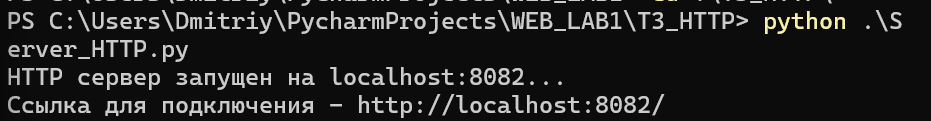

### Страница
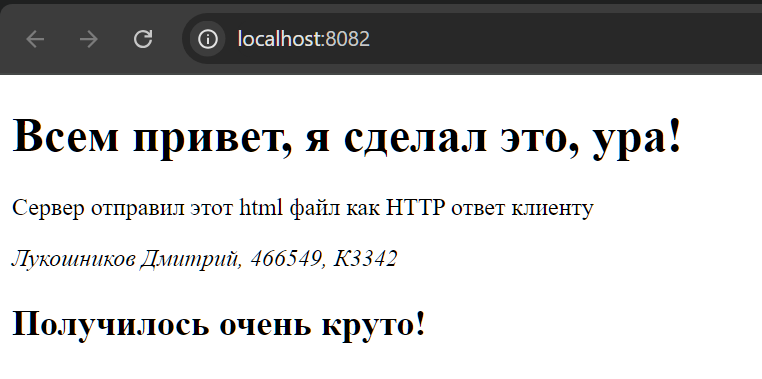

---

## Задание 4. Многопользовательский чат 

Многопользовательский чат на TCP: один клиентский скрипт, который несколько пользователей запускают в разных терминалах. Сервер держит список подключений и рассылает сообщения всем в чате.

### Код сервера (`Server_Chat.py`)

```python
import socket
import threading

host = 'localhost'
port = 8083

clients = {}

def sendMessage(message, sender_connection):
    for connection in list(clients):
        if connection is sender_connection:
            continue
        try:
            connection.sendall(message.encode())
        except OSError:
            remove_client(connection)


def remove_client(connection):
    name = clients.pop(connection, None)
    if name is None:
        return
    print(f"[{name} отключился]")
    sendMessage(f"[{name} отключился]\n", connection)
    try:
        connection.close()
    except OSError:
        pass


def handle_client(connection, address):
    try:
        connection.sendall("Введите имя: ".encode())
        name = connection.recv(1024).decode().strip()
        clients[connection] = name
        print(f"[{name} подключился]")
        sendMessage(f"[{name} подключился]\n", connection)
        connection.sendall(
            f"{name}, добро пожаловать! Напишите \\exit для выхода. Пишите сообщение в пустой строке и оно будет видно в чате\n".encode()
        )

        while True:
            data = connection.recv(1024)
            if not data:
                break
            message = data.decode().strip()
            if not message:
                continue
            if message == r"\exit":
                break
            print(f"[{name} - {message}]")
            sendMessage(f"[{name}]: {message}\n", connection)
    except OSError:
        pass
    finally:
        remove_client(connection)


server = socket.socket(socket.AF_INET, socket.SOCK_STREAM)
server.setsockopt(socket.SOL_SOCKET, socket.SO_REUSEADDR, 1)
server.bind((host, port))
server.listen()
print(f"[Сервер запущен на порту - {port}]")

while True:
    connection, address = server.accept()
    threading.Thread(target=handle_client, args=(connection, address), daemon=True).start()
```

### Код клиента (`Client_Chat.py`)

```python
import socket
import sys
import threading

host = 'localhost'
port = 8083

def receive_messages(sock):
    while True:
        try:
            data = sock.recv(1024)
            if not data:
                print("Сервер закрыл соединение.")
                break
            print(data.decode(), end='')
        except OSError:
            break
    sock.close()
    sys.exit(0)


client_socket = socket.socket(socket.AF_INET, socket.SOCK_STREAM)
client_socket.connect((host, port))

print(client_socket.recv(1024).decode(), end='')
name = input()
try:
    client_socket.sendall(name.encode())
except OSError:
    print("Сервер вылетел, попробуйте позже")
    sys.exit(0)

threading.Thread(target=receive_messages, args=(client_socket,), daemon=True).start()

while True:
    message = input()
    if not message:
        continue
    try:
        client_socket.sendall(message.encode())
    except OSError:
        print("Сервер вылетел, попробуйте позже")
        sys.exit(0)
    if message == r"\exit":
        print("Вы вышли из чата")
        client_socket.close()
        sys.exit(0)
    print(f"Вы[{name}] отправили сообщение в чат - {message}")
```

### Пример работы

### Сервер
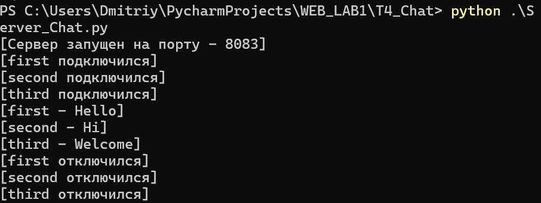
### Клиент 1
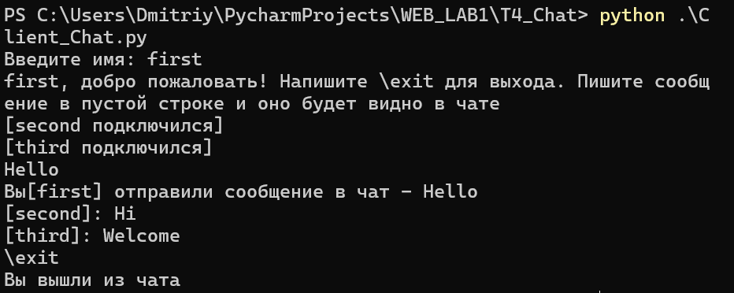
### Клиент 2
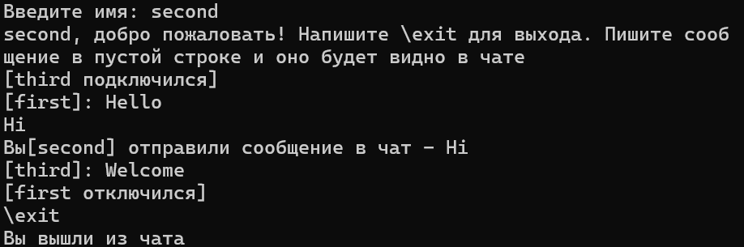
### Клиент 3
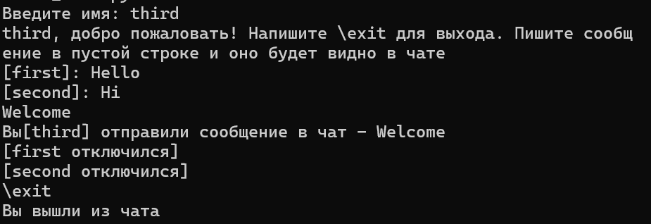

---

## Задание 5. Простой веб-сервер (GET/POST)

Веб-сервер на сокете, который разбирает HTTP-запрос вручную:

- **POST** — принимает дисциплину и оценку, сохраняет в журнал;
- **GET** — отдаёт HTML-страницу со всеми оценками.

Журнал группируется по предмету: `{предмет: [оценки]}` — одна дисциплина с списком оценок.

### Код сервера (`ServerWeb.py`)

```python
import socket
from urllib.parse import parse_qs

HOST = 'localhost'
PORT = 8084

journal = {}
ALLOWED_GRADES = {"2", "3", "4", "5"}

INDEX_HTML = """<!DOCTYPE html>
<html lang="ru">
<head>
    <meta charset="UTF-8">
    <title>Журнал оценок</title>
</head>
<body>
    <h1>Журнал оценок</h1>

    <form method="POST" action="/">
        <label>Дисциплина: <input type="text" name="subject" required></label><br>
        <label>Оценка: <input type="text" name="grade" required></label><br>
        <button type="submit">Добавить</button>
    </form>

    <h2>Все оценки</h2>
    {TABLE}
</body>
</html>
"""


def render_table():
    if not journal:
        return "<p>Пока нет ни одной оценки.</p>"
    rows = ""
    for subject, grades in journal.items():
        rows += f"<tr><td>{subject}</td><td>{', '.join(grades)}</td></tr>"
    return (
        "<table border='1' cellpadding='5'>"
        "<tr><th>Дисциплина</th><th>Оценки</th></tr>"
        + rows +
        "</table>"
    )

def send_response(connection, status, body):
    body_bytes = body.encode('utf-8')
    response = (
        f"HTTP/1.1 {status}\r\n"
        "Content-Type: text/html; charset=UTF-8\r\n"
        f"Content-Length: {len(body_bytes)}\r\n"
        "Connection: close\r\n"
        "\r\n"
    ).encode('utf-8') + body_bytes
    connection.sendall(response)

server_socket = socket.socket(socket.AF_INET, socket.SOCK_STREAM)
server_socket.setsockopt(socket.SOL_SOCKET, socket.SO_REUSEADDR, 1)
server_socket.bind((HOST, PORT))
server_socket.listen(5)
print(f"HTTP сервер запущен: http://{HOST}:{PORT}/")

while True:
    connection, address = server_socket.accept()
    print(f"Подключение от {address}")

    data = b""
    while b"\r\n\r\n" not in data:
        chunk = connection.recv(4096)
        if not chunk:
            break
        data += chunk
    head, _, body = data.partition(b"\r\n\r\n")

    content_length = 0
    for line in head.split(b"\r\n"):
        if line.lower().startswith(b"content-length:"):
            content_length = int(line.split(b":", 1)[1].strip())
            break
    while len(body) < content_length:
        chunk = connection.recv(4096)
        if not chunk:
            break
        body += chunk

    request_line = head.split(b"\r\n")[0].decode('utf-8', errors='ignore')
    parts = request_line.split()
    method = parts[0] if len(parts) > 0 else ""
    path = parts[1] if len(parts) > 1 else "/"

    print(f"{method} {path}")

    if method == "POST":
        params = parse_qs(body.decode('utf-8', errors='ignore'))
        subject = params.get("subject", [""])[0].strip()
        grade = params.get("grade", [""])[0].strip()

        if subject and grade in ALLOWED_GRADES:
            journal.setdefault(subject, []).append(grade)

        redirect = (
            "HTTP/1.1 303 See Other\r\n"
            "Location: /\r\n"
            "Content-Length: 0\r\n"
            "Connection: close\r\n"
            "\r\n"
        ).encode('utf-8')
        connection.sendall(redirect)
    elif method == "GET":
        html = INDEX_HTML.replace("{TABLE}", render_table())
        send_response(connection, "200 OK", html)
    else:
        send_response(connection, "405 Method Not Allowed", "<h1>405</h1>")
    connection.close()
```

### Пример работы

### Пустой журнал
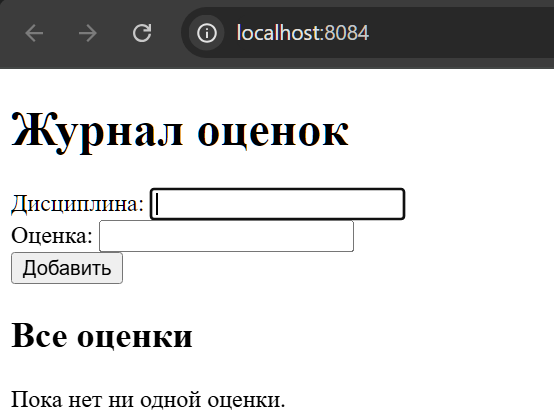
### Заполненный журнал
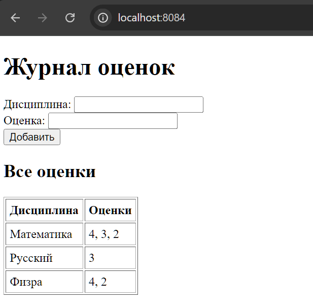

---

## Вывод

В ходе работы были реализованы клиент-серверные приложения на сокетах:

1. UDP-обмен — базовый обмен датаграммами без установки соединения.
2. TCP-вычисления — передача параметров и результата с гарантией доставки.
3. HTTP-раздача — формирование корректного HTTP-ответа вручную.
4. Многопользовательский чат — TCP + threading, идентификация пользователей, рассылка сообщений.
5. Веб-сервер GET/POST — разбор HTTP-запроса, хранение журнала с группировкой по дисциплине.

Все приложения используют библиотеку `socket`; для чата дополнительно задействована `threading`.