# Лабораторная работа №1. Задание - Работа с сокетами
## Межсокетное взаимодействие. Обмен сообщениями по UDP

### Цель работы

Понять принципы межсокетного взаимодействия в вебе. Научиться реализовывать базовую архитектуру клиент-сервер.

### Практическое задание 1. Обмен сообщениями по UDP

**Задание:**

Реализовать клиентскую и серверную части приложения с использованием протокола UDP.

Клиент должен отправить серверу сообщение `Hello, server`. Сервер должен получить и вывести его на экран, после чего отправить клиенту ответное сообщение `Hello, client`. Клиент должен получить ответ и вывести его на экран.

### Ход работы

#### 1. Реализация серверной части

Создан файл `server.py`, в котором реализована серверная часть приложения.

```python
import socket

HOST = "127.0.0.1"
PORT = 5000

server_socket = socket.socket(socket.AF_INET, socket.SOCK_DGRAM)
server_socket.bind((HOST, PORT))

print(f"Сервер запущен на {HOST}:{PORT}")

while True:
    data, client_address = server_socket.recvfrom(1024)

    message = data.decode("utf-8")
    print(f"Получено от клиента: {message}")

    response = "Hello, client"
    server_socket.sendto(response.encode("utf-8"), client_address)
```

**Описание работы сервера:**

1. Импортируется библиотека `socket`.
2. Задаются IP-адрес `127.0.0.1` и порт `5000`.
3. Создаётся UDP-сокет с помощью `socket.SOCK_DGRAM`.
4. С помощью `bind()` сервер привязывается к указанному адресу и порту.
5. Метод `recvfrom(1024)` ожидает получение сообщения от клиента.
6. Полученные данные преобразуются из байтов в строку с помощью `decode("utf-8")`.
7. Полученное сообщение выводится в консоль.
8. Сервер формирует ответ `Hello, client` и отправляет его клиенту с помощью `sendto()`.

#### 2. Реализация клиентской части

Создан файл `client.py`, в котором реализована клиентская часть приложения.

```python
import socket

HOST = "127.0.0.1"
PORT = 5000

client_socket = socket.socket(socket.AF_INET, socket.SOCK_DGRAM)

message = "Hello, server"
client_socket.sendto(message.encode("utf-8"), (HOST, PORT))

data, server_address = client_socket.recvfrom(1024)

response = data.decode("utf-8")
print(f"Получено от сервера: {response}")

client_socket.close()
```

**Описание работы клиента:**

1. Импортируется библиотека `socket`.
2. Задаются IP-адрес сервера `127.0.0.1` и порт `5000`.
3. Создаётся UDP-сокет с помощью `socket.SOCK_DGRAM`.
4. Формируется сообщение `Hello, server`.
5. Метод `sendto()` отправляет сообщение серверу.
6. Метод `recvfrom(1024)` ожидает ответ от сервера.
7. Полученные данные преобразуются в строку с помощью `decode("utf-8")`.
8. Ответ сервера выводится в консоль.
9. После получения ответа клиентский сокет закрывается с помощью `close()`.


Основные методы, применяемые в работе:

- `socket.socket()` — создание сокета;
- `socket.bind()` — привязка серверного сокета к IP-адресу и порту;
- `sendto()` — отправка сообщения получателю;
- `recvfrom()` — получение сообщения и адреса отправителя;
- `encode()` — преобразование строки в байты;
- `decode()` — преобразование байтов в строку;
- `close()` — закрытие сокета.

### Результаты выполнения работы

Для проверки программы необходимо сначала запустить сервер, а затем клиент.

**Запуск сервера:**

```bash
python server.py
```

После запуска сервер ожидает подключения и получения сообщений от клиентов.

**Запуск клиента:**

```bash
python client.py
```

При успешном выполнении программы на стороне сервера отображается:

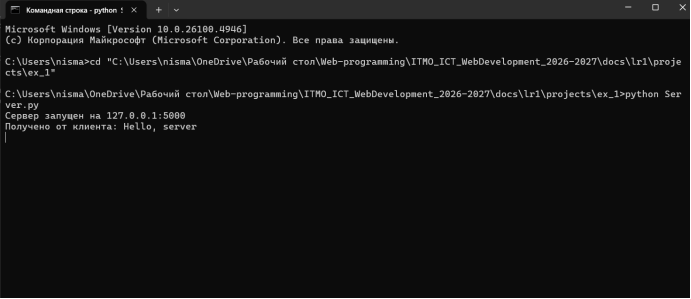

На стороне клиента отображается:

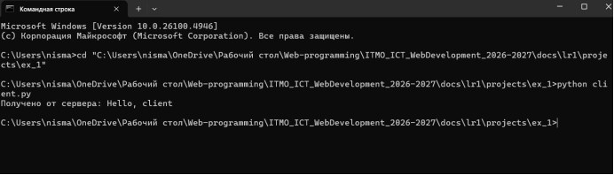

Таким образом, клиент успешно отправляет сообщение серверу, сервер принимает его и возвращает ответ клиенту.

### Вывод

Было реализовано приложение для обмена сообщениями с использованием протокола UDP и стандартной библиотеки Python `socket`.

В процессе работы были освоены основные методы взаимодействия с сокетами: `bind()`, `sendto()`, `recvfrom()`, а также преобразование данных между строковым и байтовым форматами с помощью `encode()` и `decode()`.
Однако, у нас отсутсвует гарантия доставки пакетов, сравнивая тот же TCP

## Практическое задание 2. Вычисления через TCP

### Цель работы

Понять принципы межсокетного взаимодействия в вебе. Научиться реализовывать базовую архитектуру клиент-сервер с использованием сокетов и протокола TCP.

### Теоретические сведения

**TCP (Transmission Control Protocol)** — протокол передачи данных с установлением соединения. Перед обменом информацией клиент и сервер устанавливают соединение, после чего TCP обеспечивает надёжную доставку данных и сохранение их порядка.

**Задание:**

Реализовать клиентскую и серверную части приложения с использованием протокола TCP.

Клиент должен запрашивать у пользователя параметры математической операции, отправлять их серверу и получать результат вычисления.


**Мой вариант: №3 — поиск площади трапеции.**

Формула для вычисления площади трапеции:

\[
S = \frac{(a+b)\cdot h}{2}
\]

где:

- `a` — первое основание трапеции;
- `b` — второе основание трапеции;
- `h` — высота трапеции;
- `S` — площадь трапеции.

### Ход работы

#### 1. Реализация клиентской части

Создан файл `client.py`, в котором реализована клиентская часть приложения.

```python
import socket

HOST = "127.0.0.1"
PORT = 5000

client_socket = socket.socket(
    socket.AF_INET,
    socket.SOCK_STREAM
)

client_socket.connect((HOST, PORT))

try:
    a = float(input("Введите первое основание трапеции: "))

    if a <= 0:
        print("Ошибка: основание должно быть положительным")
        client_socket.close()
        exit()

    b = float(input("Введите второе основание трапеции: "))

    if b <= 0:
        print("Ошибка: основание должно быть положительным")
        client_socket.close()
        exit()

    h = float(input("Введите высоту трапеции: "))

    if h <= 0:
        print("Ошибка: высота должна быть положительной")
        client_socket.close()
        exit()

    message = f"{a} {b} {h}"

    client_socket.send(message.encode("utf-8"))

    data = client_socket.recv(1024).decode("utf-8")

    print(f"Площадь трапеции: {data}")

except ValueError:
    print("Ошибка: необходимо ввести число")

finally:
    client_socket.close()
```

**Описание работы клиента:**

1. Импортируется библиотека `socket`.
2. Задаются IP-адрес сервера `127.0.0.1` и порт `5000`.
3. Создаётся TCP-сокет с помощью `socket.SOCK_STREAM`.
4. Метод `connect()` устанавливает соединение с сервером.
5. Пользователь вводит первое и второе основания трапеции, а также её высоту.
6. Проверяется, что введённые значения являются положительными числами.
7. Полученные параметры объединяются в одну строку.
8. Метод `send()` отправляет данные серверу после преобразования строки в байты с помощью `encode("utf-8")`.
9. Метод `recv(1024)` получает результат вычисления от сервера.
10. Полученный результат преобразуется в строку и выводится на экран.
11. В блоке `finally` соединение закрывается с помощью `close()`.

#### 2. Реализация серверной части

Создан файл `server.py`, в котором реализована серверная часть приложения.

```python
import socket

HOST = "127.0.0.1"
PORT = 5000

server_socket = socket.socket(
    socket.AF_INET,
    socket.SOCK_STREAM
)

server_socket.bind((HOST, PORT))

server_socket.listen(1)

print("Сервер ожидает подключения...")

while True:
    conn, addr = server_socket.accept()

    print(f"Подключен клиент: {addr}")

    try:
        data = conn.recv(1024).decode("utf-8")

        a, b, h = map(float, data.split())

        area = ((a + b) * h) / 2

        conn.send(str(round(area, 2)).encode("utf-8"))

        print(f"Площадь трапеции: {area}")

    except ValueError:
        conn.send("Ошибка вычисления".encode("utf-8"))

    finally:
        conn.close()
```

**Описание работы сервера:**

1. Импортируется библиотека `socket`.
2. Задаются IP-адрес `127.0.0.1` и порт `5000`.
3. Создаётся TCP-сокет с помощью `socket.SOCK_STREAM`.
4. Метод `bind()` привязывает сервер к указанному IP-адресу и порту.
5. Метод `listen(1)` переводит сервер в режим ожидания входящих подключений.
6. Метод `accept()` принимает подключение клиента.
7. Метод `recv(1024)` получает данные от клиента.
8. Полученная строка разделяется на три значения, которые преобразуются в числа типа `float`.
9. Сервер вычисляет площадь трапеции по формуле:

   \[
   S = \frac{(a+b)\cdot h}{2}
   \]

10. Результат округляется до двух знаков после запятой и отправляется клиенту с помощью `send()`.
11. В случае ошибки преобразования данных сервер отправляет сообщение `Ошибка вычисления`.
12. После завершения обработки запроса соединение с клиентом закрывается с помощью `close()`.


В Python для работы с TCP используется стандартная библиотека `socket` и тип сокета `socket.SOCK_STREAM`.

Основные методы, применяемые в работе:

- `socket.socket()` — создание сокета;
- `bind()` — привязка серверного сокета к IP-адресу и порту;
- `listen()` — ожидание входящих подключений;
- `accept()` — принятие подключения клиента;
- `connect()` — установка соединения с сервером;
- `send()` — отправка данных;
- `recv()` — получение данных;
- `encode()` — преобразование строки в байты;
- `decode()` — преобразование байтов в строку;
- `close()` — закрытие соединения и сокета.

### Результаты выполнения работы

Для проверки программы необходимо сначала запустить сервер, а затем клиент.

**Запуск сервера:**

```bash
python server.py
```
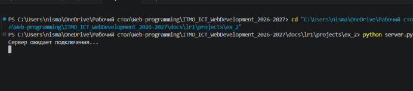

**Запуск клиента:**

```bash
python client.py
```

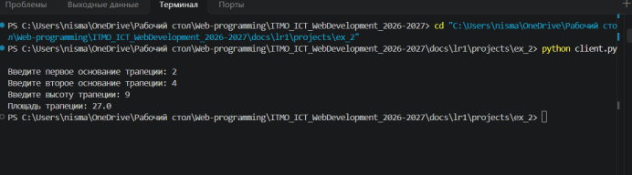

Для проверки работы программы можно использовать следующие входные данные:

- Первое основание: `2`
- Второе основание: `4`
- Высота: `9    `


**Результат на стороне клиента:**

```text
Введите первое основание трапеции: 2
Введите второе основание трапеции: 4
Введите высоту трапеции: 9
Площадь трапеции: 27.0
```

**Результат на стороне сервера:**

```text
Сервер ожидает подключения...
Подключен клиент: ('127.0.0.1', 52087)
Площадь трапеции: 27.0
```

Таким образом, клиент успешно передаёт исходные параметры серверу, сервер выполняет вычисление площади трапеции и возвращает результат клиенту.

### Вывод

В ходе выполнения задания были изучены принципы межсокетного взаимодействия и особенности протокола TCP.

Было реализовано клиент-серверное приложение для вычисления площади трапеции с использованием стандартной библиотеки Python `socket`.

В процессе работы были освоены основные методы взаимодействия с TCP-сокетами: `connect()`, `bind()`, `listen()`, `accept()`, `send()` и `recv()`.

Также была реализована проверка введённых пользователем данных на корректность и обработка ошибок при преобразовании значений.

В результате выполнения задания клиент успешно передаёт параметры трапеции серверу, сервер вычисляет площадь по заданной формуле и отправляет результат обратно клиенту.


### Практическое задание 3. Раздача HTML-страницы по HTTP

**Задание:**

Реализовать серверную часть приложения с использованием библиотеки `socket`.

Клиент подключается к серверу, после чего сервер принимает HTTP-запрос, загружает HTML-страницу из файла `index.html` и отправляет её клиенту в виде HTTP-ответа.

Если файл не найден, сервер должен вернуть страницу с ошибкой `404 Not Found`.

### Ход работы

#### 1. Подготовка HTML-страницы

Для выполнения задания был подготовлен HTML-файл `index.html`, который содержит страницу, предназначенную для отображения в браузере.

Сервер считывает содержимое этого файла и передаёт его клиенту в теле HTTP-ответа.

#### 2. Реализация серверной части

Создан файл `server.py`, в котором реализована логика HTTP-сервера.

```python
import socket
import os

HOST = "127.0.0.1"
PORT = 8080

# Создание серверного сокета
server = socket.socket(socket.AF_INET, socket.SOCK_STREAM)

server.setsockopt(socket.SOL_SOCKET, socket.SO_REUSEADDR, 1)

server.bind((HOST, PORT))
server.listen(5)

print(f"Сервер работает по адресу http://{HOST}:{PORT}")

while True:
    client, address = server.accept()

    print(f"Клиент подключился: {address}")

    request = client.recv(1024).decode("utf-8")
    print(request)

    try:
        file_path = os.path.join(
            os.path.dirname(__file__),
            "../../files/index.html"
        )

        with open(file_path, "r", encoding="utf-8") as f:
            page = f.read()

        status = "HTTP/1.1 200 OK"

    except FileNotFoundError:
        page = """
        <!DOCTYPE html>
        <html>
        <head>
            <meta charset="UTF-8">
            <title>Ошибка</title>
        </head>
        <body>
            <h1>404 Not Found</h1>
            <p>Страница не найдена.</p>
        </body>
        </html>
        """

        status = "HTTP/1.1 404 Not Found"

    # Перевод страницы в байты
    page_bytes = page.encode("utf-8")

    # Формирование HTTP-ответа
    response = (
        status + "\r\n"
        "Content-Type: text/html; charset=UTF-8\r\n"
        f"Content-Length: {len(page_bytes)}\r\n"
        "Connection: close\r\n"
        "\r\n"
    ).encode("utf-8") + page_bytes

    # Отправка ответа клиенту
    client.sendall(response)

    client.close()
```

**Описание работы сервера:**

1. Импортируются библиотеки `socket` и `os`.
2. Задаются IP-адрес `127.0.0.1` и порт `8080`.
3. Создаётся TCP-сокет с помощью `socket.SOCK_STREAM`.
4. С помощью `setsockopt()` устанавливается параметр `SO_REUSEADDR`, позволяющий повторно использовать локальный адрес после завершения предыдущего соединения.
5. Метод `bind()` привязывает сервер к указанному IP-адресу и порту.
6. Метод `listen(5)` переводит сервер в режим ожидания входящих подключений.
7. Метод `accept()` принимает подключение клиента.
8. Метод `recv(1024)` получает HTTP-запрос от клиента, после чего запрос выводится в консоль.
9. С помощью `os.path.join()` формируется путь к файлу `index.html`.
10. Функция `open()` открывает HTML-файл, а `read()` считывает его содержимое.
11. Если файл найден, сервер формирует статус `HTTP/1.1 200 OK`.
12. Если файл не найден, формируется HTML-страница с сообщением `404 Not Found`.
13. Содержимое страницы преобразуется в байты с помощью `encode("utf-8")`.
14. Формируется HTTP-ответ, включающий строку статуса и заголовки:
    - `Content-Type` — указывает тип передаваемого содержимого;
    - `Content-Length` — определяет размер тела ответа в байтах;
    - `Connection: close` — сообщает о закрытии соединения после передачи ответа.
15. Метод `sendall()` отправляет сформированный HTTP-ответ клиенту.
16. После отправки ответа соединение закрывается с помощью `close()`.

### Результаты выполнения работы

Для проверки программы необходимо запустить HTTP-сервер.

**Запуск сервера:**

```bash
python main.py
```
После запуска в консоли появляется сообщение:
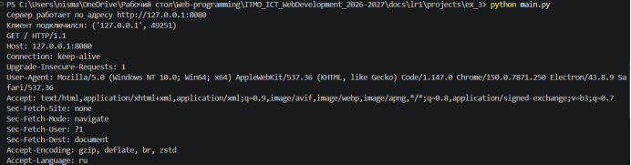

Далее необходимо открыть браузер и перейти по адресу:

```text
http://127.0.0.1:5000
```

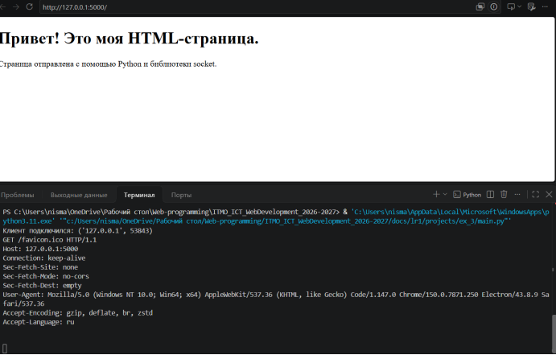

Браузер отправляет HTTP-запрос серверу. Сервер принимает запрос, считывает содержимое файла `index.html` и возвращает его в виде HTTP-ответа.


После успешного выполнения запроса браузер отображает HTML-страницу из файла `index.html`.


Таким образом, сервер успешно обрабатывает HTTP-запросы, загружает HTML-страницу из файла и передаёт её клиенту.

### Вывод

В ходе выполнения задания были изучены принципы работы протокола HTTP и особенности взаимодействия клиента и сервера.

Был реализован простой HTTP-сервер на языке Python с использованием стандартной библиотеки socket.

### Практическое задание 4. Чат на сокетах

**Задание:**

Реализовать двухпользовательский или многопользовательский чат с использованием библиотеки `socket`.

Для получения максимального количества баллов необходимо реализовать многопользовательский чат с использованием протокола TCP и библиотеки `threading`.

**Реализованное решение:**

Разработан многопользовательский TCP-чат, в котором:

- Несколько пользователей могут одновременно подключаться к серверу.
- Каждый пользователь указывает своё имя при подключении.
- Пользователи могут обмениваться текстовыми сообщениями.
- Сервер пересылает сообщения всем подключённым пользователям, кроме отправителя.
- Для каждого клиента создаётся отдельный поток.
- Для выхода из чата предусмотрена команда `/exit`.

### Ход работы

#### 1. Реализация серверной части

Создан файл `server.py`, который отвечает за подключение пользователей, получение сообщений и их рассылку другим участникам чата.

Для хранения подключённых пользователей используется словарь `clients`, в котором ключом является сокет клиента, а значением — его имя.

```python
clients = {}

lock = threading.Lock()
```

Для рассылки сообщений реализована функция `broadcast()`. Она получает сообщение и сокет отправителя, после чего отправляет сообщение всем остальным подключённым пользователям.

```python
def broadcast(message, sender_socket):
    with lock:
        client_sockets = list(clients.keys())

    for client_socket in client_sockets:
        if client_socket != sender_socket:
            client_socket.send(message.encode("utf-8"))
```

Для каждого подключённого пользователя запускается отдельный поток с помощью `threading.Thread()`. Функция `handle_client()` обрабатывает сообщения конкретного клиента, определяет его имя и отслеживает отключение.

Основные этапы работы сервера:

1. Создаётся TCP-сокет.
2. Сервер привязывается к IP-адресу `127.0.0.1` и порту `5000`.
3. Метод `listen()` переводит сервер в режим ожидания подключений.
4. Метод `accept()` принимает нового клиента.
5. Для клиента создаётся отдельный поток.
6. Сервер получает имя пользователя и сохраняет его в словаре `clients`.
7. Полученные сообщения передаются функции `broadcast()`.
8. При получении команды `/exit` или потере соединения пользователь удаляется из списка подключённых клиентов.
9. Соединение закрывается.

#### 2. Реализация клиентской части

Создан файл `client.py`, который отвечает за подключение пользователя к серверу, отправку сообщений и получение сообщений от других участников.

Для одновременного получения и отправки сообщений используется отдельный поток.

Основная логика получения сообщений реализована в функции `receive_messages()`:

```python
def receive_messages(client_socket):
    while True:
        try:
            message = client_socket.recv(1024).decode("utf-8")

            if not message:
                break

            print(f"\n{message}")
            print("> ", end="", flush=True)

        except (ConnectionResetError, ConnectionAbortedError, OSError):
            break
```

После подключения клиент отправляет серверу имя пользователя. Затем запускается отдельный поток для получения сообщений:

```python
receive_thread = threading.Thread(
    target=receive_messages,
    args=(client_socket,)
)

receive_thread.daemon = True
receive_thread.start()
```

Основные этапы работы клиента:

1. Создаётся TCP-сокет.
2. Метод `connect()` устанавливает соединение с сервером.
3. Пользователь вводит своё имя.
4. Имя отправляется серверу с помощью `send()`.
5. Запускается отдельный поток для получения сообщений от других участников.
6. Пользователь может вводить и отправлять текстовые сообщения.
7. Для выхода из чата используется команда `/exit`.
8. При завершении работы соединение закрывается.

### Результаты выполнения работы

Для проверки работы чата необходимо сначала запустить сервер, а затем открыть несколько экземпляров клиента.

**Запуск сервера:**

```bash
python server.py
```

После запуска сервер ожидает подключения пользователей.

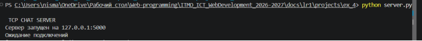

**Запуск клиентов:**

В отдельных окнах терминала необходимо выполнить команду:

```bash
python client.py
```

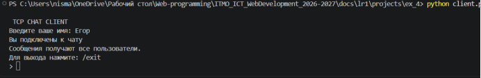

Каждый пользователь вводит своё имя и подключается к общему чату.

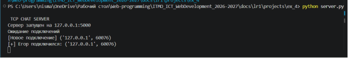

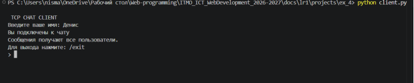

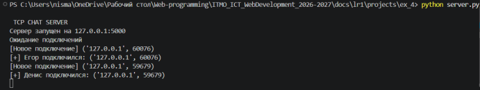


В результате проверки было установлено, что несколько пользователей могут одновременно подключаться к серверу и обмениваться сообщениями. Сообщения отображаются у всех участников чата, кроме отправителя.

Для завершения работы пользователь вводит команду `/exit`, после чего его соединение закрывается, а сервер удаляет его из списка активных клиентов.

### Вывод

В ходе выполнения лабораторной работы были изучены принципы построения многопользовательских клиент-серверных приложений и особенности работы протокола TCP.


### Практическое задание 5. Простой веб-сервер (GET/POST)

**Задание:**

Разработать простой веб-сервер на Python с использованием библиотеки `socket`, который должен обрабатывать GET и POST HTTP-запросы.

Сервер должен выполнять следующие функции:

1. Принимать и сохранять информацию о дисциплине и оценке.
2. Возвращать HTML-страницу со списком всех оценок по дисциплинам.
3. Группировать оценки по названию предмета, сохраняя несколько оценок в рамках одной дисциплины.

**Реализованное решение:**

Разработан HTTP-сервер, который принимает запросы от браузера, обрабатывает их в зависимости от HTTP-метода и возвращает соответствующие HTML-страницы.

Для хранения оценок используется словарь Python, в котором название дисциплины является ключом, а список оценок — значением.

### Ход работы

#### 1. Создание структуры хранения оценок

Для хранения оценок используется словарь `grades`.

```python
self.grades = {}
```

Такая структура позволяет группировать оценки по дисциплинам.

При получении новой оценки сервер проверяет, существует ли соответствующий предмет в словаре. Если предмета ещё нет, создаётся новый список. Затем оценка добавляется в этот список.

```python
if subject not in self.grades:
    self.grades[subject] = []

self.grades[subject].append(grade)
```

Таким образом, оценки хранятся сгруппированными по предметам, а не отдельными записями.

#### 2. Разбор HTTP-запросов

Для обработки запросов реализован класс `Request`, который хранит основные данные HTTP-запроса:

- `method` — HTTP-метод;
- `target` — адрес запрашиваемого ресурса;
- `version` — версия HTTP;
- `headers` — заголовки запроса;
- `body` — тело запроса.

Основная логика разбора запроса находится в методе `parse_request()`.

Сначала сервер считывает первую строку запроса и определяет метод, адрес и версию HTTP. Затем считывает заголовки.

Для POST-запросов дополнительно определяется размер тела запроса с помощью заголовка `Content-Length`.

```python
if method == 'POST':
    content_length = int(
        headers.get('Content-Length', 0)
    )

    if content_length > 0:
        body = rfile.read(
            content_length
        ).decode('utf-8')
```

Полученные данные преобразуются в строку и передаются для дальнейшей обработки.

#### 3. Обработка GET и POST запросов

Для определения дальнейших действий используется метод `handle_request()`.

В зависимости от HTTP-метода и адреса запроса сервер вызывает соответствующий обработчик:

```python
if req.path == '/grades' and req.method == 'GET':
    return self.handle_get_grades(req)

elif req.path == '/grades' and req.method == 'POST':
    return self.handle_post_grades(req)

elif req.path == '/grades/add' and req.method == 'GET':
    return self.handle_get_form(req)
```

В сервере реализованы три основных маршрута:

| Метод | Адрес | Назначение |
|---|---|---|
| GET | `/grades` | Просмотр всех оценок |
| POST | `/grades` | Добавление новой оценки |
| GET | `/grades/add` | Открытие формы добавления оценки |

Также при переходе на главную страницу `/` сервер перенаправляет пользователя на `/grades`.

#### 4. Реализация POST-запроса

Метод `handle_post_grades()` отвечает за получение и сохранение новых оценок.

Для разбора переданных параметров используется функция `parse_qs()` из модуля `urllib.parse`.

```python
data = parse_qs(req.body)

subject = data.get('subject', [''])[0]
grade = data.get('grade', [''])[0]

if not subject or not grade:
    raise Exception("Bad request: missing fields")
```

#### 5. Реализация GET-запроса

Метод `handle_get_grades()` отвечает за отображение всех сохранённых оценок.

Сначала сервер открывает HTML-шаблон `grades.html`, после чего формирует HTML-код для каждой дисциплины и её оценок.

Для каждой дисциплины создаётся отдельный блок с названием предмета и списком оценок.

```python
for subject, grades in self.grades.items():
    grades_html += f"""
    <div class="subject-card">
        <h2>{subject}</h2>

        <div class="grades">
    """

    for grade in grades:
        grades_html += f"""
            <span class="grade">{grade}</span>
        """

    grades_html += """
        </div>
    </div>
    """
```

После формирования HTML-кода он вставляется в основной шаблон вместо специального маркера `<!-- GRADES -->`.

Если оценок ещё нет, пользователю отображается сообщение о том, что журнал пока пуст.

#### 6. Формирование HTTP-ответа

Для отправки результатов клиенту реализован метод `send_response()`.

Он формирует HTTP-ответ, который состоит из строки статуса, заголовков и тела ответа.

Основные заголовки:

- `Server` — название сервера;
- `Content-Type` — тип передаваемого содержимого;
- `Content-Length` — размер тела ответа в байтах;
- `Connection: close` — закрытие соединения после передачи ответа.

Пример формирования заголовков:

```python
headers = [
    f'Server: {self._server_name}\r\n',
    'Content-Type: text/html; charset=utf-8\r\n',
    f'Content-Length: {len(resp)}\r\n',
    'Connection: close\r\n'
]
```

После формирования заголовков сервер отправляет HTML-содержимое клиенту.

Также реализован метод `send_error()`, который формирует HTML-страницу с сообщением об ошибке, например при обращении к неизвестному адресу.

### Результаты выполнения работы

Для проверки работы программы необходимо запустить сервер и открыть его адрес в браузере.

**Запуск сервера:**

```bash
python server.py
```

После запуска в консоли отображается сообщение:

```text
[СЕРВЕР] Запущен на http://localhost:8080
```

**Проверка добавления оценок (POST):**

Для добавления новой оценки необходимо открыть страницу:

```text
http://localhost:8080/grades/add
```

На странице отображается форма, в которой пользователь вводит название дисциплины и оценку.

После отправки формы сервер получает POST-запрос, обрабатывает данные и сохраняет оценку в словаре `grades`.

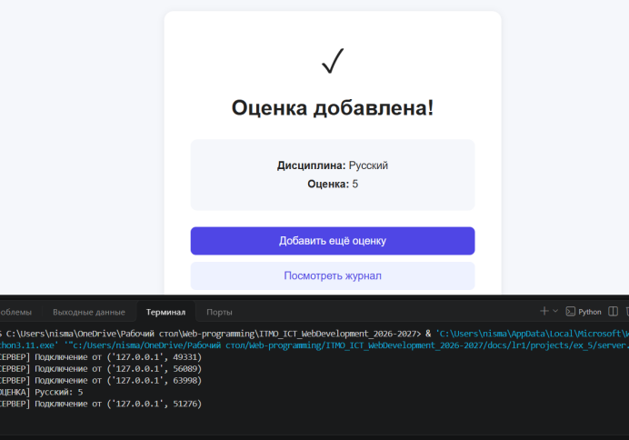
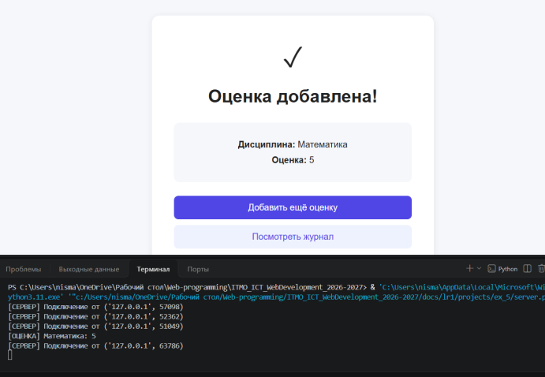

**Проверка просмотра оценок (GET):**

Для просмотра всех сохранённых оценок необходимо открыть:

```text
http://localhost:8080/grades
```
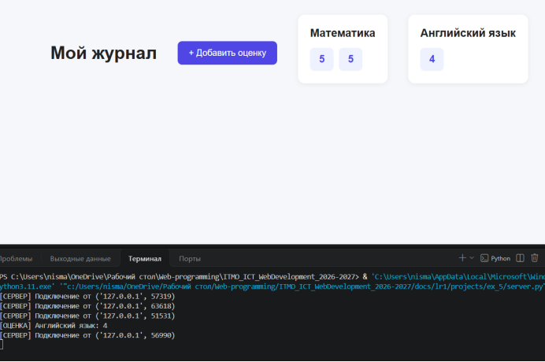


Таким образом, сервер успешно принимает данные через POST-запросы, сохраняет оценки с группировкой по предметам и возвращает HTML-страницу со всеми результатами через GET-запросы.

### Вывод

В ходе выполнения задания были изучены принципы обработки HTTP-запросов и особенности взаимодействия клиента и сервера с использованием протокола HTTP.

Был разработан простой веб-сервер на языке Python с использованием стандартной библиотеки `socket`.

В процессе работы были реализованы обработчики GET и POST запросов, разбор HTTP-заголовков и тела запроса, а также формирование HTTP-ответов с HTML-содержимым.

Для хранения оценок использовался словарь, позволяющий группировать несколько оценок по одной дисциплине. Также были реализованы просмотр журнала оценок, добавление новых записей и обработка ошибок.

В результате выполнения задания создан простой веб-сервер, который позволяет добавлять оценки по дисциплинам и просматривать общий журнал через браузер.

## Общий вывод

В ходе выполнения лабораторной работы были изучены основы сетевого взаимодействия и принципы работы клиент-серверных приложений на языке Python с использованием библиотеки `socket`.

В процессе выполнения пяти практических заданий были реализованы:
- обмен сообщениями между клиентом и сервером с использованием протокола UDP;
- передача данных по TCP для выполнения вычислений на стороне сервера;
- простой HTTP-сервер для обработки GET-запросов и отправки HTML-страниц;
- многопользовательский TCP-чат с использованием потоков `threading`;
- HTTP-сервер для обработки GET- и POST-запросов и ведения журнала оценок.

В результате работы удалось на практике разобраться в различиях между протоколами TCP и UDP, научиться создавать сокеты, устанавливать соединения, передавать и принимать данные, обрабатывать HTTP-запросы и формировать HTTP-ответы. Также были изучены основы многопоточности и способы организации одновременной работы нескольких клиентов с сервером.