# Лабораторная работа №1

**Студент:** Нгуен Динь Нам - 415149

**Группа:** K3340

## Цель работы

Изучение клиент-серверного взаимодействия с помощью библиотеки `socket` в Python. Работа включает обмен сообщениями по UDP и TCP, формирование HTTP-ответов, создание многопользовательского чата и обработку запросов GET и POST.

## Задание 1. Обмен сообщениями по UDP

Я разработал клиентскую и серверную программы для обмена короткими сообщениями по UDP. После запуска сервер привязывает сокет к локальному адресу и порту и ожидает данные. Клиент отправляет строку `Hello, server`, а сервер выводит её в терминале и отвечает сообщением `Hello, client`.

Для создания UDP-сокета я использовал тип `SOCK_DGRAM`:

```python
socket_server = socket.socket(socket.AF_INET, socket.SOCK_DGRAM)
```

Метод `recvfrom()` возвращает полученные данные и адрес отправителя. Сервер использует этот адрес, чтобы направить ответ нужному клиенту:

```python
request, address = socket_server.recvfrom(1024)
socket_server.sendto(b"Hello, client", address)
```

Перед отправкой программа преобразует текст в байты, а после получения выполняет обратное преобразование. Этот пример показывает обмен датаграммами без предварительного установления соединения.

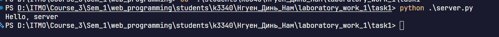

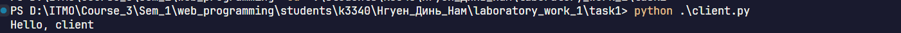

## Задание 2. Вычисления через TCP

**Вариант 1. Теорема Пифагора.**

В качестве её применения я выбрал вычисление гипотенузы прямоугольного треугольника по двум катетам:

```text
c = √(a² + b²)
```

Пользователь вводит длины катетов в клиентской программе. Она объединяет значения в строку и передаёт их серверу. Сервер преобразует данные в числа, выполняет вычисление и возвращает результат клиенту.

Для передачи данных я использовал TCP-сокет типа `SOCK_STREAM`. Сервер ожидает подключения после вызова `listen()` и принимает клиента с помощью `accept()`:

```python
client_connection, address = socket_server.accept()
```

Дальнейший обмен происходит через сокет `client_connection`.

Чтобы сервер мог определить конец запроса, я добавил символ `\n` к отправляемой строке. Программа накапливает данные до появления этого символа, поскольку один вызов `recv()` может вернуть только часть сообщения.

Для проверки вычисления подходит пример с катетами 3 и 4. Ожидаемая длина гипотенузы в этом случае равна 5.

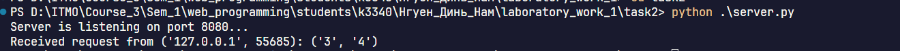

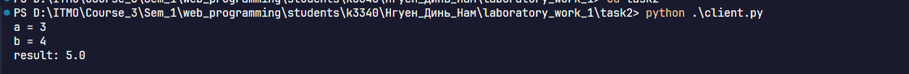

## Задание 3. Передача HTML-страницы по HTTP

В третьем задании я реализовал сервер, который читает файл `index.html` и передаёт его содержимое браузеру. Браузер выступает клиентом и отправляет HTTP-запрос при открытии локального адреса.

Сервер формирует ответ из строки состояния, заголовков и тела страницы. Строка `HTTP/1.1 200 OK` сообщает об успешной обработке запроса. Заголовок `Content-Type` задаёт тип содержимого и кодировку, а `Content-Length` содержит размер тела в байтах.

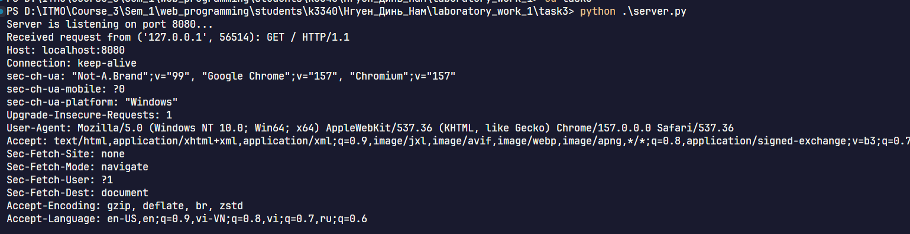

Для чтения HTML-файла я выбрал бинарный режим:

```python
with open("index.html", "rb") as file:
    body = file.read()
```

Полученные байты позволяют рассчитать длину содержимого через `len(body)` и отправить его через сокет. Последовательность `\r\n\r\n` отделяет заголовки от тела ответа. После получения данных браузер обрабатывает HTML и отображает страницу.

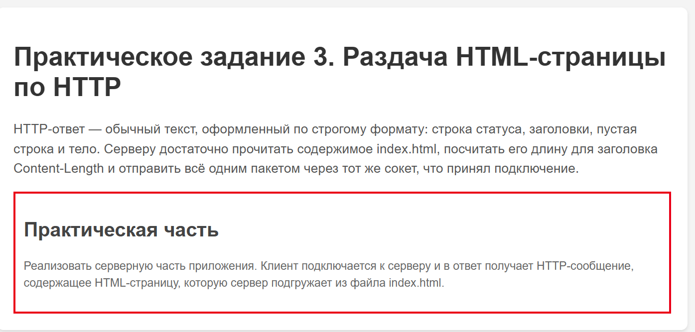

## Задание 4. Многопользовательский чат

Для чата я использовал TCP и библиотеку `threading`. Основной поток сервера принимает новые подключения, а отдельные потоки обрабатывают сообщения участников. Благодаря этому ожидание данных от одного пользователя позволяет продолжать обслуживание остальных клиентов.

Каждый участник запускает один и тот же файл `client.py` в отдельном терминале и вводит nickname. Сервер получает имя первой строкой и связывает его с сокетом пользователя в словаре `clients`.

Обработку каждого подключения я вынес в функцию `handle_client()`:

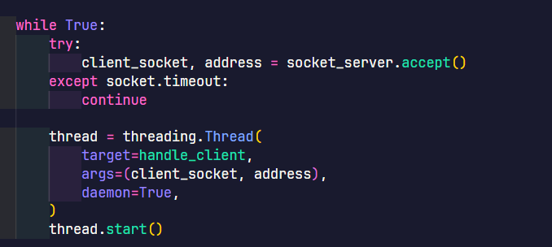

После получения nickname функция воспринимает следующие строки как сообщения. Сервер добавляет имя отправителя к тексту и вызывает `broadcast()`, которая передаёт сообщение остальным участникам.

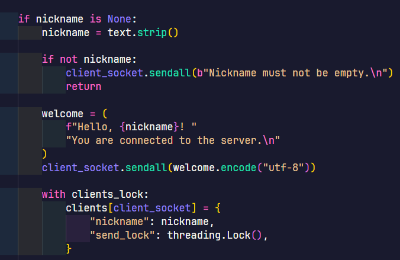

На стороне клиента отдельный поток принимает входящие сообщения, пока основной поток ожидает ввод с клавиатуры. Такая организация позволяет получать сообщения во время набора собственного текста.

Для работы с общими данными я добавил блокировки. `clients_lock` защищает словарь при добавлении, удалении и получении списка пользователей. Отдельный `send_lock` каждого клиента обеспечивает последовательную отправку сообщений в его сокет из разных потоков.

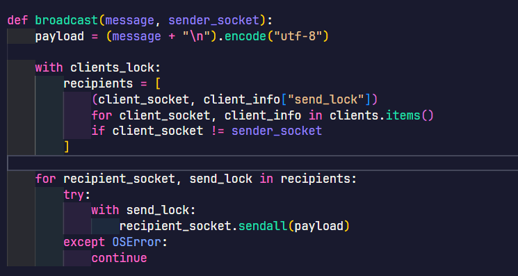

Пользователь выходит из чата с помощью команды `exit`. Клиент закрывает соединение, после чего сервер удаляет его из словаря и освобождает сокет.

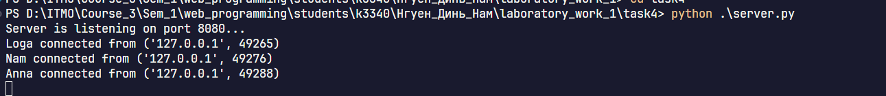

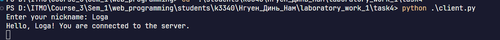

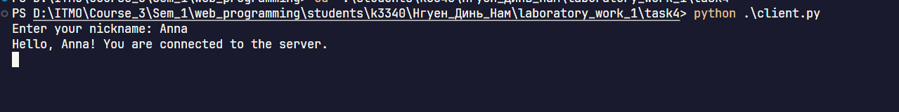

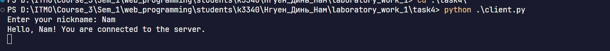

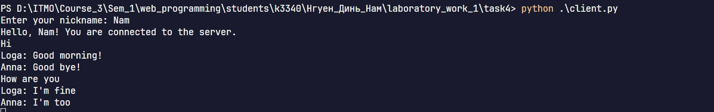

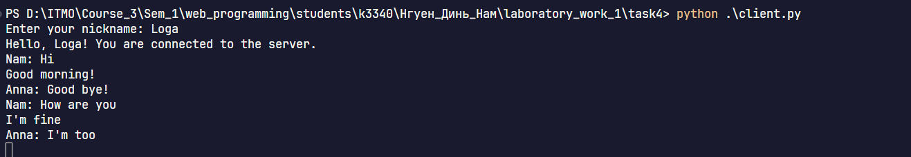

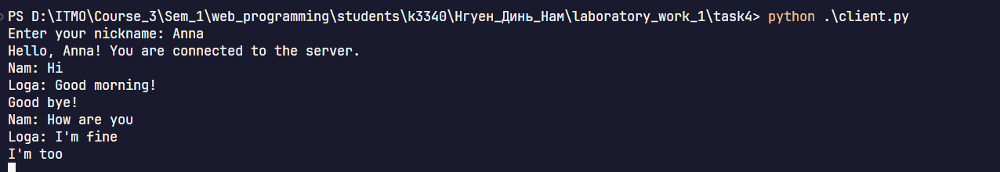

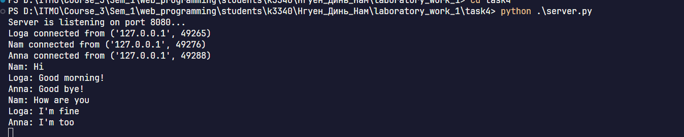

## Задание 5. Веб-сервер с обработкой GET и POST

В последнем задании я разработал веб-сервер для хранения и просмотра оценок по предметам. Приложение состоит из трёх файлов. `server.py` обрабатывает HTTP-запросы и сохраняет данные, `index.html` задаёт структуру страницы, а `style.css` оформляет форму и таблицу.

При запросе `GET /` сервер возвращает страницу с текущими оценками. Поля формы расположены в порядке «имя студента, номер ИСУ, предмет, оценка». Предмет и оценка обязательны, а сведения о студенте пользователь может оставить пустыми. Для этой реализации я выбрал шкалу целых оценок от 1 до 5.

После отправки формы браузер выполняет `POST /grades`. Функция `read_request()` определяет метод и путь по первой строке запроса, получает заголовки и дочитывает тело по значению `Content-Length`. Затем `parse_qs()` разбирает данные формы.

Для хранения журнала я использовал словарь `grades`. Название предмета служит ключом, а список содержит оценки и сведения о студентах:

```json
{
  "math": [
    {
      "student_name": "Nam",
      "student_id": "415149",
      "grade": 5
    },
    {
      "student_name": "Hao",
      "student_id": "415442",
      "grade": 5
    }
  ]
}
```

Такая структура объединяет все оценки одного предмета в общей записи. Чтобы программа одинаково обрабатывала названия `Math`, `math` и `MATH`, я добавил удаление пробелов по краям и преобразование через `casefold()`:

```python
subject = fields.get("subject", [""])[0].strip().casefold()
```

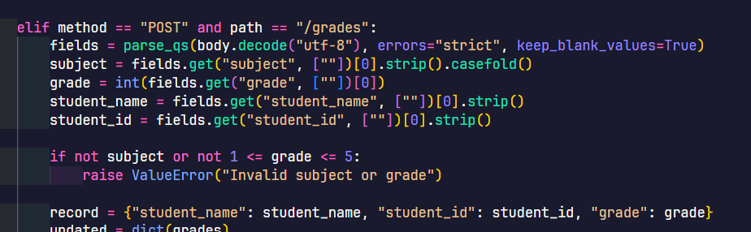
Перед сохранением сервер проверяет название предмета и допустимость оценки. Он записывает обновлённые данные в `grades.json`, а при следующем запуске программа загружает этот файл.

После успешного добавления сервер возвращает `303 See Other` с заголовком `Location: /`. Браузер переходит на главную страницу через GET и показывает обновлённую таблицу. Её столбцы содержат номер ИСУ, имя студента, предмет и оценку.

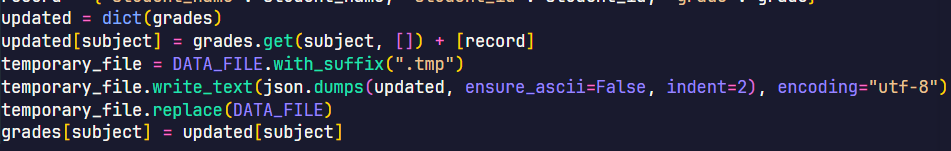

Функция `make_page()` формирует строки таблицы и подставляет их в HTML-шаблон. При этом `escape()` преобразует специальные символы, чтобы браузер отображал введённые значения как текст. Функция `send_response()` кодирует содержимое в UTF-8, рассчитывает его длину в байтах и отправляет HTTP-ответ.

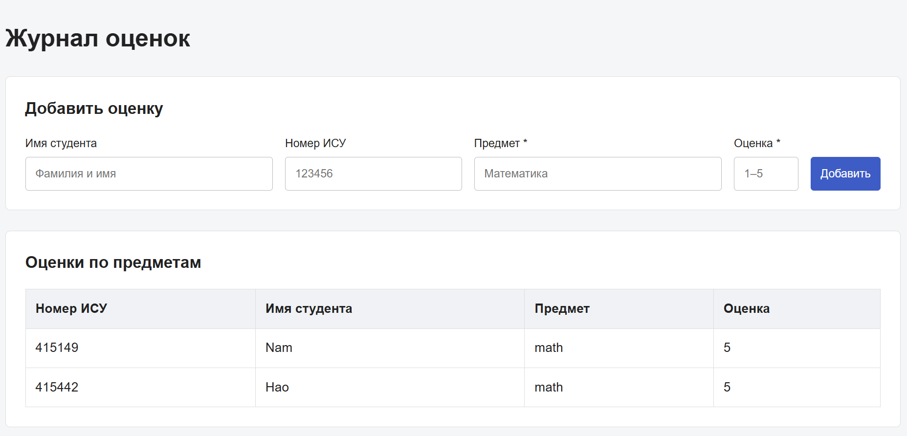

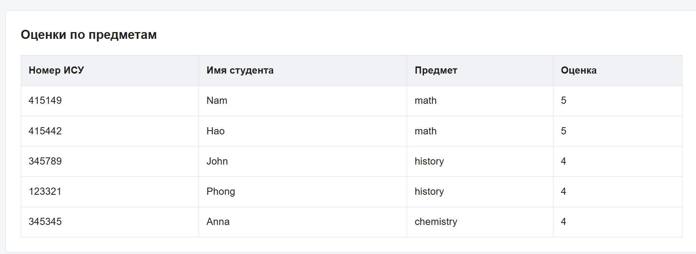

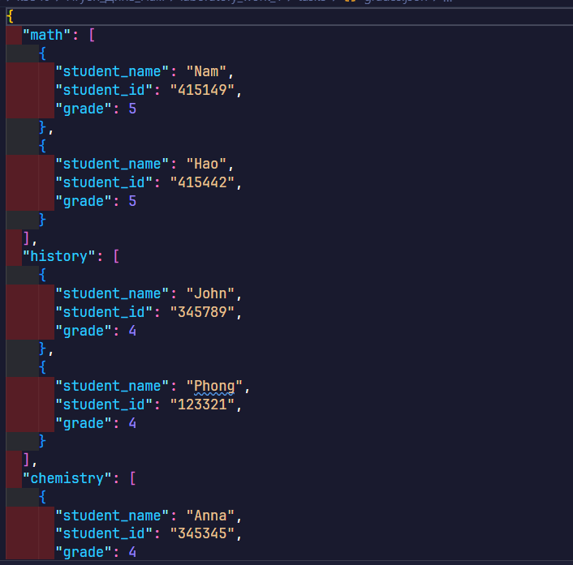

##

В ходе работы я реализовал обмен сообщениями по UDP, вычисления через TCP, передачу HTML-страницы по HTTP, многопользовательский чат и журнал оценок. Эти задания помогли мне разобраться в последовательности взаимодействия клиента и сервера, приёме данных по частям и формировании HTTP-ответов. Отдельное внимание я уделил потокам, защите общих данных и сохранению информации между запусками программы.
