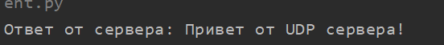
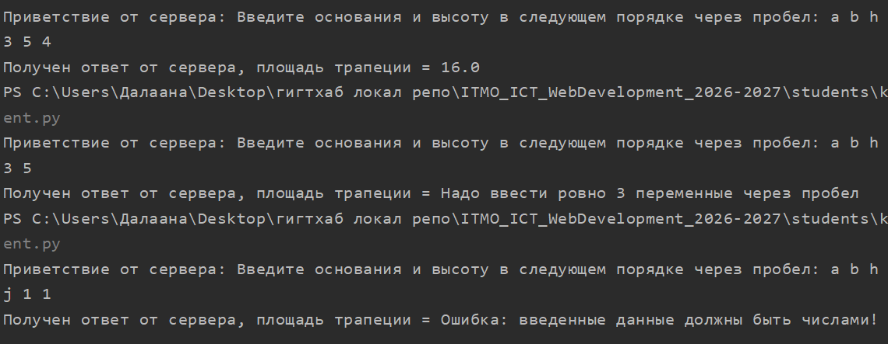
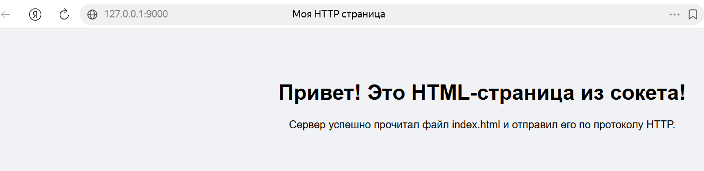
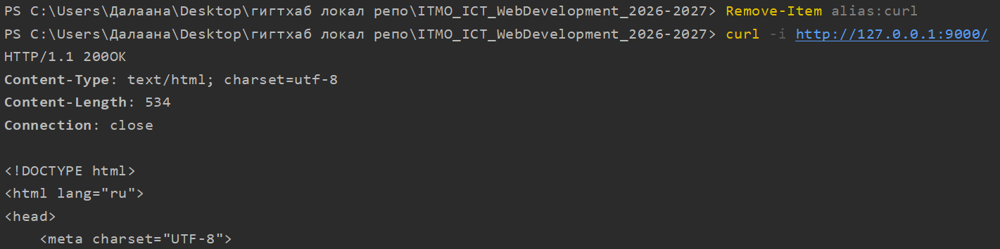
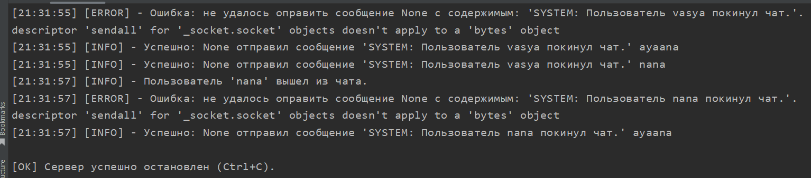
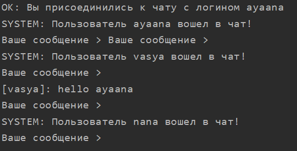
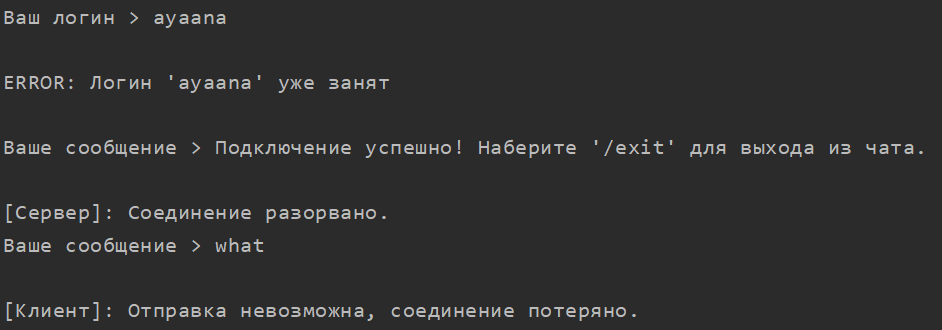
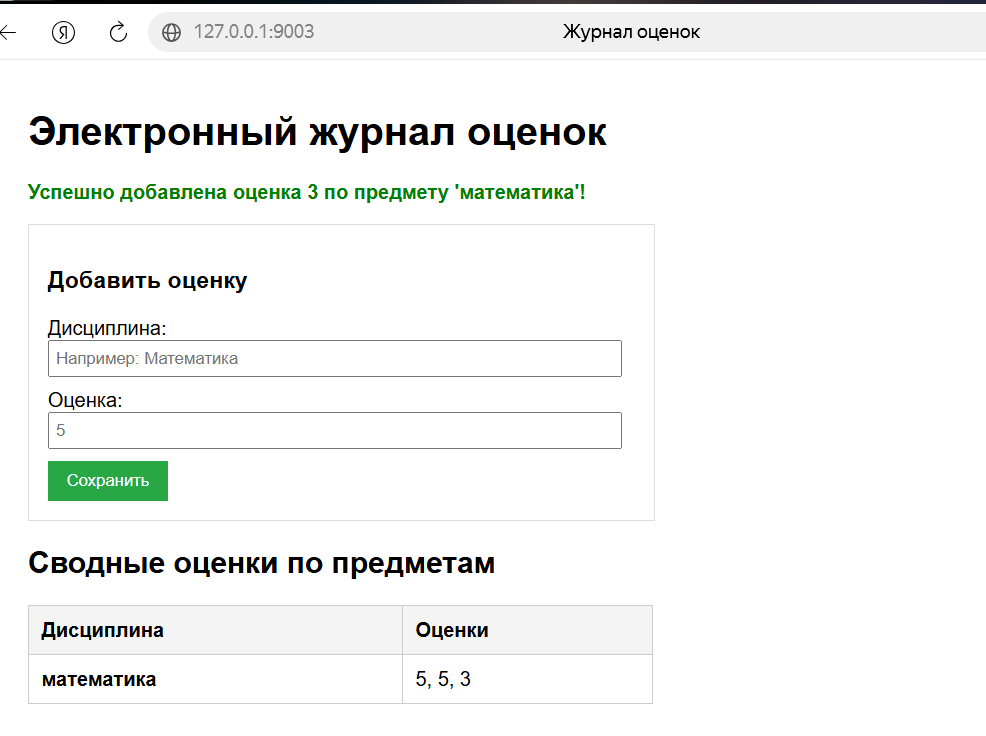
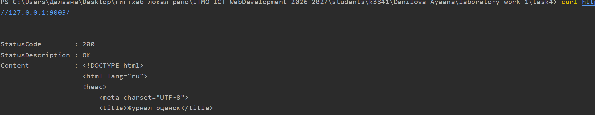

# Лабораторная работа №1. Работа с сокетами

## Цель работы

Понять принципы межсокетного взаимодействия в вебе. Научиться реализовывать базовую архитектуру клиент-сервер.

---

## Используемые протоколы

| Протокол | Уровень | Соединение | Где применили |
|---|---|---|---|
| **UDP** | транспортный | нет, отдельные датаграммы, без гарантии доставки | задача 1 |
| **TCP** | транспортный | есть, надёжный упорядоченный поток байт | задачи 2, 4 |
| **HTTP/1.1** | прикладной, поверх TCP | запрос-ответ (текстовый формат) | задачи 3, 5 |

---

## Ход работы

Сервер и клиент запускали в отдельных окнах терминала, каждую программу — из папки своей задачи. В задачах 3 и 5 клиентом служил браузер (и `curl` для проверки заголовков).

### Задача 1. UDP: клиент и сервер

Клиент отправляет строку, сервер печатает её вместе с адресом отправителя и отвечает.

**server.py**

```python
import socket

server_socket = socket.socket(socket.AF_INET, socket.SOCK_DGRAM)

server_socket.bind(('', 12345))
print("UDP Сервер запущен и ждет открыток...")

data, client_address = server_socket.recvfrom(1024)
print(f"Получено от {client_address}: {data.decode('utf-8')}")

response = "Привет от UDP сервера!".encode('utf-8')
server_socket.sendto(response, client_address)

server_socket.close()
```

**client.py**

```python
import socket

client_socket = socket.socket(socket.AF_INET, socket.SOCK_DGRAM)

server_address = ('localhost', 12345)
message = "Привет, UDP сервер!".encode('utf-8')

client_socket.sendto(message, server_address)

data, _ = client_socket.recvfrom(1024)
print(f"Ответ от сервера: {data.decode('utf-8')}")

client_socket.close()
```

**Запуск** (папка `task1`):

```bash
# терминал 1
python server.py
# терминал 2
python client.py
```

Ожидаемый результат: сервер печатает `Получено от ('127.0.0.1', <порт>): Привет, UDP сервер!`, клиент — `Ответ от сервера: Привет от UDP сервера!`.


**client**



**server**


--- 

### Задача 2. TCP: вычисление площади трапеции

TCP-сервер принимает от клиента основания и высоту (`a b h`) и возвращает площадь `(a + b) / 2 * h`. Обрабатываются ошибки: неверное число параметров, нечисловой ввод, отрицательные значения.
Используется системный вызов select, так как он на уровне ядра Windows умеет корректно прерываться сигналами ОС, благодаря чему каждые 0.5 секунды (или мгновенно при нажатии Ctrl+C) select возвращает управление в интерпретатор Python, давая ему возможность сработать и проверить: «Не нажал ли пользователь Ctrl+C?

**server.py**

```python
import socket


def calc_trapezoid_area(a: float, b: float, h: float) -> float:
    return (a + b) / 2 * h


sock = socket.socket(socket.AF_INET, socket.SOCK_STREAM)
sock.setsockopt(socket.SOL_SOCKET, socket.SO_REUSEADDR, 1)
sock.bind(('0.0.0.0', 12345))

sock.listen(5)

while True:
    client_sock, client_addr = sock.accept()
    print(f"Подключился клиент с адресом {client_addr} и на порту {client_sock}")
    try:
        client_sock.sendall("Введите основания и высоту в следующем порядке через пробел: a b h".encode("utf-8"))

        data = client_sock.recv(1024)
        if not data:
            client_sock.close()
            continue

        data = data.decode("utf-8", errors='ignore').rstrip()
        if not data:
            client_sock.sendall("Получен пустой ввод. Сокет выключается.\n".encode("utf-8"))
            client_sock.close()
            break
        parts = data.split()
        if len(parts) != 3:
            client_sock.sendall("Надо ввести ровно 3 переменные через пробел".encode("utf-8"))
            client_sock.close()
            continue
        a, b, h = map(float, parts)
        print(f"Полученные байты переведенные в кодировку utf-8: a={a}, b={b}, h={h}")
        client_sock.sendall(f"{calc_trapezoid_area(float(a), float(b), float(h))}".encode("utf-8"))
    except ValueError:
        client_sock.sendall("Ошибка: введенные данные должны быть числами!\n".encode("utf-8"))
    except Exception as e:
        client_sock.sendall("Ошибка: что-то со связью\n".encode("utf-8"))
    finally:
        client_sock.close()

sock.close()
```

**client.py**

```python
import socket
import sys

sock = socket.socket(socket.AF_INET, socket.SOCK_STREAM)
sock.connect(('localhost', 12345))

hello = sock.recv(1024).decode("utf-8")
print(f"[Сервер] {hello}. Нажмите Ctrl+C для остановки.")

try:
    sock.sendall(f"{input()}\n".encode("utf-8"))
except KeyboardInterrupt:
    print("\n[OK] Клиент успешно остановлен пользователем (Ctrl+C).")
    sock.close()
    sys.exit(-1)

ans = sock.recv(1024).decode("utf-8")
print(f"Получен ответ от сервера, площадь трапеции = {ans}")

sock.close()
```

**Запуск** (папка `task2`):

```bash
# терминал 1
python server.py
# терминал 2
python client.py
# на приглашение ввести:  3 5 4     -> площадь 16.0
```

Дополнительно проверили обработку ошибок повторным запуском клиента с вводом `3 5` (неверное число параметров) и `a b c` (не числа).



---

### Задача 3. HTTP-сервер, отдающий HTML-страницу

Программа запускает сетевое ожидание подключений через socket, затем отправляет ответно сокету правильно составленную html страничку, в том числе в случае отсутствия файла ошибку.

**server.py**

```python
import os
import select
import socket


def run_server():
    HOST, PORT = '127.0.0.1', 9000
    path = 'index.html'

    sock = socket.socket(socket.AF_INET, socket.SOCK_STREAM)
    sock.setsockopt(socket.SOL_SOCKET, socket.SO_REUSEADDR, 1)
    sock.bind((HOST, PORT))
    sock.listen(5)
    try:
        while True:
            readable, _, _ = select.select([sock], [], [], 0.5)
            if sock in readable:
                client_sock, client_addr = sock.accept()
                print(f"Подключился {client_addr}")

                try:
                    request = client_sock.recv(1024)
                    print(request.decode("utf-8"))

                    if os.path.exists(path):
                        with open(path, 'rb') as f:
                            html_content = f.read()

                        content_len = len(html_content)

                        headers = (
                            "HTTP/1.1 200OK\r\n"
                            "Content-Type: text/html; charset=utf-8\r\n"
                            f"Content-Length: {content_len}\r\n"
                            "Connection: close\r\n\r\n"
                        )
                        response = headers.encode("utf-8") + html_content
                    else:
                        error_body = "<h1>404 Not Found</h1>".encode('utf-8')
                        headers = (
                            "HTTP/1.1 404 Not Found\r\n"
                            "Content-Type: text/html; charset=utf-9\r\n"
                            f"Content-Length: {len(error_body)}\r\n"
                            "Connection: close\r\n\r\n"
                        )
                        response = headers.encode("utf-8") + error_body

                    client_sock.sendall(response)
                except Exception as e:
                    print(f"Ошибка при обработке запроса: {e}")
                finally:
                    client_sock.close()
    except KeyboardInterrupt:
        print("\n[OK] Сервер успешно остановлен (Ctrl+C).")
    finally:
        sock.close()


if __name__ == "__main__":
    run_server()
```

**index.html**

```html
<!DOCTYPE html>
<html lang="ru">
<head>
    <meta charset="UTF-8">
    <title> Моя HTTP страница </title>
    <style>
        body { font-family: sans-serif; background-color: #f0f2f5; text-align: center; padding-top: 50px; }
        h1 { color: #1677ff }
    </style>
</head>
<body>
    <h1> Привет! Это HTML-страница из сокета! </h1>
    <p>Сервер успешно прочитал файл index.html и отправил его по протоколу HTTP.</p>
</body>
</html>
```

**Запуск** (папка `task3`; путь к `index.html` относительный, поэтому запускать надо из неё):

```bash
python server.py
# в браузере открыть http://127.0.0.1:9000
# или посмотреть заголовки ответа:
curl -i http://127.0.0.1:9000/
```





---

### Задача 4. Многопоточный TCP-чат

Сервер на каждого клиента запускает отдельный поток. Клиент первым сообщением отправляет логин; сервер проверяет его на пустоту и уникальность, после чего рассылает сообщения всем остальным участникам и уведомляет о входе/выходе. Общий словарь `clients` защищён `threading.Lock`. На клиенте приём сообщений вынесен в отдельный поток, чтобы `input()` не блокировал получение.

**server.py**

```python
import logging
import select
import socket
import threading

HOST, PORT = '127.0.0.1', 9002
logging.basicConfig(
    level=logging.INFO,
    format='[%(asctime)s] [%(levelname)s] - %(message)s',
    datefmt='%H:%M:%S'
)
clients = {str: socket.socket}

lock = threading.Lock()


def send_message(msg: str, sender_login: str = None):
    with lock:
        for client, sock in list(clients.items()):
            if client != sender_login:
                try:
                    sock.sendall(msg.encode("utf-8"))
                    logging.info(f"Успешно: {sender_login} отправил сообщение '{msg}' {client}")
                except Exception as e:
                    logging.error(f"Ошибка: не удалось оправить сообщение {sender_login} с содержимым: '{msg}'.\r\n{e}")


def handle_client(client_sock, client_address):
    login = None
    try:
        raw_login = client_sock.recv(1024).decode("utf-8").strip()
        if not raw_login or raw_login.isspace():
            client_sock.sendall("ERROR: Логин не был введен\n".encode("utf-8"))
            logging.warning(f"Отказ: {client_address} ввел пустой логин")
            # заканчивается обработка клиента, то есть в чат он не вошел бедни
            return

        with lock:
            if raw_login in clients:
                client_sock.sendall(f"ERROR: Логин '{raw_login}' уже занят\n".encode("utf-8"))
                logging.warning(f"Отказ: логин '{raw_login}' уже используется ({client_address})")
                return
            # уведомляем, что все ок и начинаем держать активным сокет с пользователем = присоединение к чату
            login = raw_login
            clients[login] = client_sock
            client_sock.sendall(f"OK: Вы присоединились к чату с логином {login}\n".encode("utf-8"))
        logging.info(f"Пользователь '{login}' подключился с {client_address}")
        send_message(f"SYSTEM: Пользователь {login} вошел в чат!")

        # беспрерывно получаем сообщение от пользователя и отправляем в чат
        while True:
            msg = client_sock.recv(1024).decode("utf-8")
            # на клиенте вызвали sock.close() или sys.exit()
            if not msg:
                break
            if msg.lower() == '/exit':
                break
            client_sock.sendall("OK: Сообщение отправлено".encode("utf-8"))
            logging.info(f"[{login}]: {msg}")
            send_message(f"[{login}]: {msg}", sender_login=login)
    finally:
        if login:
            with lock:
                if login in clients:
                    del clients[login]
            logging.info(f"Пользователь '{login}' вышел из чата.")
            send_message(f"SYSTEM: Пользователь {login} покинул чат.")

        client_sock.close()


def start_server(HOST: str, PORT: int):
    sock = socket.socket(socket.AF_INET, socket.SOCK_STREAM)
    sock.setsockopt(socket.SOL_SOCKET, socket.SO_REUSEADDR, 1)
    sock.bind((HOST, PORT))
    sock.listen(5)

    logging.info(f"ЧАТ-сервер запущен на {HOST}:{PORT}")

    try:
        while True:
            readable, _, _ = select.select([sock], [], [], 0.5)
            if sock in readable:
                client_sock, client_addr = sock.accept()

                thread = threading.Thread(target=handle_client, args=(client_sock, client_addr), daemon=True)
                thread.start()
    except KeyboardInterrupt:
        print("\n[OK] Сервер успешно остановлен (Ctrl+C).")
    finally:
        sock.close()


if __name__ == "__main__":
    start_server(HOST, PORT)
```

**client.py**

```python
import socket
import sys
import threading

from server import HOST, PORT

lock = threading.Lock()


def receive_messages(sock: socket.socket):
    while True:
        try:
            msg = sock.recv(1024).decode("utf-8")
            # срабатывает при client_sock.close()
            if not msg:
                print("\n[Сервер]: Соединение разорвано.")
                break
            print(f"\n{msg}\nВаше сообщение > ", end="")
        except Exception:
            break
    sock.close()


def start_client():
    sock = socket.socket(socket.AF_INET, socket.SOCK_STREAM)

    try:
        sock.connect((HOST, PORT))
    except Exception as e:
        print(f"Не удалось подключиться к серверу: {e}")
        return
    login = input("Ваш логин > ").strip()
    if not login:
        print("ERROR: Логин не был введен")
        return
    try:
        sock.sendall(login.encode("utf-8"))
    except Exception as e:
        print(f"Не удалось отправить логин серверу: {e}")
        return

    recv_thread = threading.Thread(target=receive_messages, args=(sock,), daemon=True)
    recv_thread.start()

    print("Подключение успешно! Наберите '/exit' для выхода из чата.")

    while True:
        try:
            msg = input("Ваше сообщение > ")
            if not msg:
                continue
            if msg.lower() == "/exit":
                print("Выходим из чата")
                break
            sock.sendall(msg.encode("utf-8"))

        except (OSError, ConnectionResetError, BrokenPipeError):
            # сокет уже закрыт потоком чтения, ничего отправлять не нужно
            print("\n[Клиент]: Отправка невозможна, соединение потеряно.")
            break
        except KeyboardInterrupt:
            # отправляем /exit только если сокет еще успешен
            try:
                sock.sendall("/exit".encode("utf-8"))
            except OSError:
                pass
            break
    sock.close()
    sys.exit()


if __name__ == "__main__":
    start_client()
```

**Запуск** (папка `task4`):

```bash
# терминал 1
python server.py
# терминалы 2 и 3 — два клиента
python client.py     # логин: alice
python client.py     # логин: bob
# обмен сообщениями, выход командой /exit
# проверка уникальности логина: третий клиент с логином alice
```









---

### Задача 5. HTTP-сервер «Электронный журнал оценок»

Класс `MyHTTPServer` разбирает HTTP-запрос вручную: стартовую строку, заголовки и тело (по `Content-Length`). Поддерживаются:

- `GET /` и `GET /grades` — страница со сводной таблицей оценок по предметам;
- `POST /add_grade` — добавление оценки (поля `subject`, `grade`, формат `application/x-www-form-urlencoded`);
- любой другой путь — `404`; некорректные данные формы — `400`.

Оценки хранятся в памяти в `defaultdict(list)`: `{предмет: [оценки]}`.

**server.py**

```python
from collections import defaultdict
import select
import socket
import sys
from urllib.parse import parse_qs, urlparse


class MyHTTPServer:
    def __init__(self, host: str, port: int, server_name: str = "GradeBookServer"):
        self.host = host
        self.port = port
        self.server_name = server_name
        # Хранилище оценок: {'Математика': [5, 4], 'Физика': [5]}
        self.grades_db = defaultdict(list)

    def serve_forever(self):
        """Обрабатывает входящие соединения"""
        server_sock = socket.socket(socket.AF_INET, socket.SOCK_STREAM)
        server_sock.setsockopt(socket.SOL_SOCKET, socket.SO_REUSEADDR, 1)
        server_sock.bind((self.host, self.port))
        server_sock.listen(10)
        print(f"[{self.server_name}] Сервер запущен на http://{self.host}:{self.port}")

        try:
            while True:
                readable, _, _ = select.select([server_sock], [], [], 0.5)
                if server_sock in readable:
                    client_sock, client_addr = server_sock.accept()
                    try:
                        self.serve_client(client_sock)
                    except Exception as e:
                        print(f"Ошибка при обработке клиента {client_addr}: {e}")
                    finally:
                        client_sock.close()
        except KeyboardInterrupt:
            print("\n[OK] Сервер успешно остановлен (Ctrl+C).")
        finally:
            server_sock.close()

    def serve_client(self, client_sock: socket.socket):
        """Обрабатывает клиентское подключение"""
        rfile = client_sock.makefile("rb")

        # Чтение первой строки
        req_line = rfile.readline().decode("utf-8").strip()
        if not req_line:
            return

        method, path, query_params, version = self.parse_request(req_line)
        headers = self.parse_headers(rfile)

        # Чтение тела запроса при наличии Content-Length
        body = ""
        content_length = int(headers.get("Content-Length", 0))
        if content_length > 0:
            body_bytes = rfile.read(content_length)
            body = body_bytes.decode("utf-8")

        status_code, reason, resp_headers, resp_body = self.handle_request(
            method, path, query_params, headers, body
        )

        self.send_response(client_sock, status_code, reason, resp_headers, resp_body)

    def parse_request(self, req_line: str):
        """Разбирает первую строку HTTP-запроса"""
        words = req_line.split()
        if len(words) != 3:
            raise ValueError("Malformed request line")

        method, raw_url, version = words
        parsed_url = urlparse(raw_url)
        path = parsed_url.path
        query_params = parse_qs(parsed_url.query)

        return method, path, query_params, version

    def parse_headers(self, rfile):
        """Парсит заголовок"""
        headers = {}
        while True:
            line = rfile.readline().decode("utf-8")
            if line in ("\r\n", "\n", ""):
                break
            if ":" in line:
                key, val = line.split(":", 1)
                headers[key.strip()] = val.strip()

        return headers

    def handle_request(self, method: str, path: str, query_params: dict, headers: dict, body: str):
        """Обрабатывает URL в соответствии с нужным методом (GET / POST)"""
        resp_headers = {"Content-Type": "text/html; charset=utf-8"}

        # Главная страница + страница просмотра журнала (GET)
        if method == "GET" and path in ("/", "/grades"):
            html_content = self._render_grades_page()
            return 200, "OK", resp_headers, html_content

        # Добавление новой оценки (POST)
        elif method == "POST" and path == "/add_grade":
            parsed_body = parse_qs(body)
            subject = parsed_body.get("subject", [None])[0]
            grade_str = parsed_body.get("grade", [None])[0]

            if subject and grade_str:
                subject = subject.strip()
                try:
                    grade = int(grade_str)
                    # Сохраняем оценку в список соответствующего предмета
                    self.grades_db[subject].append(grade)

                    # Возвращаем обновленную страницу
                    html_content = self._render_grades_page(
                        message=f"Успешно добавлена оценка {grade} по предмету '{subject}'!"
                    )
                    return 200, "OK", resp_headers, html_content
                except ValueError:
                    return 400, "Bad Request", resp_headers, "<h1>Ошибка: Оценка должна быть числом</h1>"

            return 400, "Bad Request", resp_headers, "<h1>Ошибка: Не переданы subject или grade</h1>"

        return 404, "Not Found", resp_headers, "<h1>404 Page Not Found</h1>"

    def _render_grades_page(self, message: str = "") -> str:
        """Вспомогательный метод для генерации HTML-страницы журнала"""
        rows = ""
        if not self.grades_db:
            rows = "<tr><td colspan='2'>Журнал пока пуст</td></tr>"
        else:
            for subject, grades in self.grades_db.items():
                grades_str = ", ".join(map(str, grades))
                rows += f"<tr><td><b>{subject}</b></td><td>{grades_str}</td></tr>\n"

        msg_html = f"<p style='color: green;'><b>{message}</b></p>" if message else ""

        return f"""<!DOCTYPE html>
<html lang="ru">
<head>
    <meta charset="UTF-8">
    <title>Журнал оценок</title>
    <style>
        body {{ font-family: Arial, sans-serif; margin: 40px; }}
        table {{ border-collapse: collapse; width: 500px; margin-top: 20px; }}
        th, td {{ border: 1px solid #ccc; padding: 10px; text-align: left; }}
        th {{ background-color: #f4f4f4; }}
        form {{ margin-bottom: 20px; padding: 15px; border: 1px solid #ddd; width: 470px; }}
        input {{ margin-bottom: 10px; padding: 5px; width: 95%; }}
        button {{ padding: 8px 15px; background: #28a745; color: white; border: none; cursor: pointer; }}
    </style>
</head>
<body>
    <h1>Электронный журнал оценок</h1>
    {msg_html}

    <form action="/add_grade" method="POST">
        <h3>Добавить оценку</h3>
        <label>Дисциплина:</label><br>
        <input type="text" name="subject" required placeholder="Например: Математика"><br>
        <label>Оценка:</label><br>
        <input type="number" name="grade" min="1" max="5" required placeholder="5"><br>
        <button type="submit">Сохранить</button>
    </form>

    <h2>Сводные оценки по предметам</h2>
    <table>
        <thead>
            <tr>
                <th>Дисциплина</th>
                <th>Оценки</th>
            </tr>
        </thead>
        <tbody>
            {rows}
        </tbody>
    </table>
</body>
</html>"""

    def send_response(self, client_sock: socket.socket, status_code: int, reason: str, headers: dict, body: str):
        """6. Формирование status line, заголовков и отправка ответа"""
        body_bytes = body.encode("utf-8")

        headers["Content-Length"] = str(len(body_bytes))
        headers["Server"] = self.server_name
        headers["Connection"] = "close"

        response_lines = [f"HTTP/1.1 {status_code} {reason}"]
        for key, value in headers.items():
            response_lines.append(f"{key}: {value}")

        response_lines.append("")
        response_lines.append("")

        header_bytes = "\r\n".join(response_lines).encode("utf-8")
        client_sock.sendall(header_bytes + body_bytes)


if __name__ == "__main__":
    host = "127.0.0.1"
    port = 9003
    serv = MyHTTPServer(host, port)
    try:
        serv.serve_forever()
    except KeyboardInterrupt:
        print("\nСервер остановлен.")
        sys.exit(0)
```

**Запуск** (папка `task5`):

```bash
python server.py
# в браузере: http://127.0.0.1:9003  — заполнить форму и нажать «Сохранить»

# то же через curl:
curl http://127.0.0.1:9003/
curl -i --data-urlencode "subject=Математика" --data-urlencode "grade=5" http://127.0.0.1:9003/add_grade
# проверка ошибок:
curl -i http://127.0.0.1:9003/unknown
curl -i -d "subject=Физика&grade=abc" http://127.0.0.1:9003/add_grade
```




---

## Вывод

На практике разобрали, чем UDP отличается от TCP на уровне API сокетов (`sendto/recvfrom` против `listen/accept/connect`), написали TCP-сервер с обработкой некорректного ввода, многопоточный чат с общим состоянием под `Lock` и два HTTP-сервера, в которых запрос и ответ разбираются и формируются вручную (стартовая строка, заголовки, `Content-Length`, коды 200/400/404). Убедились, что при ручной сборке HTTP-ответа любая мелочь в формате (например, пропущенный пробел) ломает работу клиента.