# Интерфейсы ЛР2

## Страницы и права

| URL | Назначение | Доступ |
| --- | --- | --- |
| `/` | Каталог, поиск, фильтры, пагинация | Все |
| `/rooms/<id>/` | Данные отеля и номера, отзывы | Все |
| `/register/` | Регистрация | Неавторизованные |
| `/login/` | Вход | Все |
| `/logout/` | Выход, только POST | Авторизованные |
| `/rooms/<id>/book/` | Форма бронирования | Авторизованные |
| `/bookings/` | Собственные бронирования | Авторизованные |
| `/bookings/<id>/edit/` | Изменение дат и числа гостей | Владелец до заселения |
| `/bookings/<id>/delete/` | Подтверждение удаления | Владелец до заселения |
| `/bookings/<id>/review/` | Отзыв с оценкой 1–10 | Владелец завершённого проживания |
| `/staff/bookings/` | Список бронирований и операции заселения/выселения | Сотрудники |
| `/staff/guests/` | Таблица постояльцев за последние 30 дней | Сотрудники |
| `/admin/` | Управление моделями Django-admin | Пользователи с правами админки |

## Каталог и карточка номера

Каталог содержит 12 учебных номеров. На странице показано 6 карточек.
Поле поиска принимает название отеля или город; остальные фильтры уточняют
тип номера, вместимость, цену и доступность на даты.

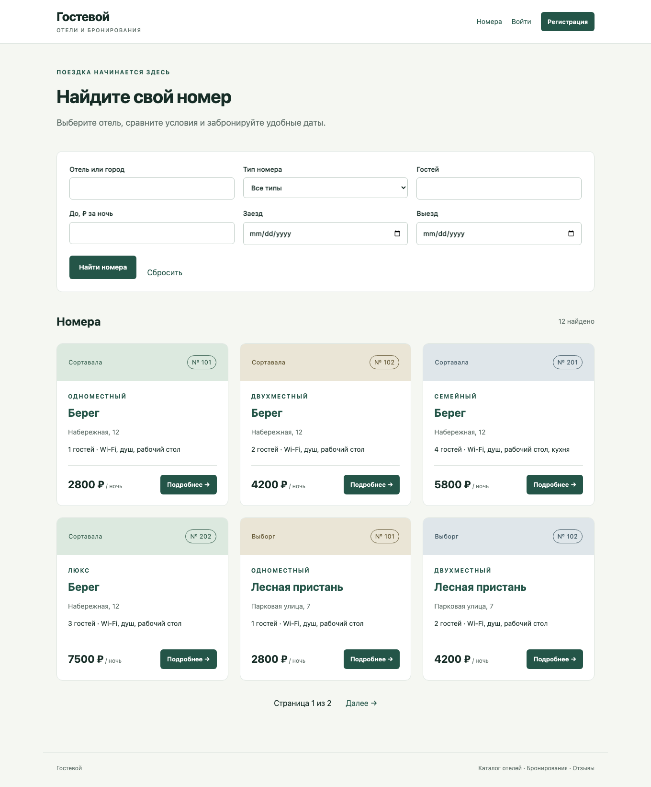

Карточка номера содержит название и владельца отеля, адрес, описание,
тип номера, удобства и стоимость за ночь. Здесь же показаны отзывы с автором,
периодом проживания и рейтингом.

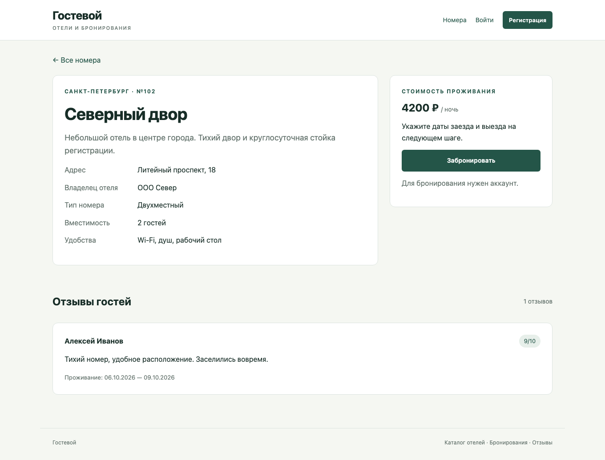

## Регистрация и бронирование

Регистрация создаёт обычного пользователя. Признаки сотрудника через клиентскую
форму установить нельзя. После регистрации выполняется вход.

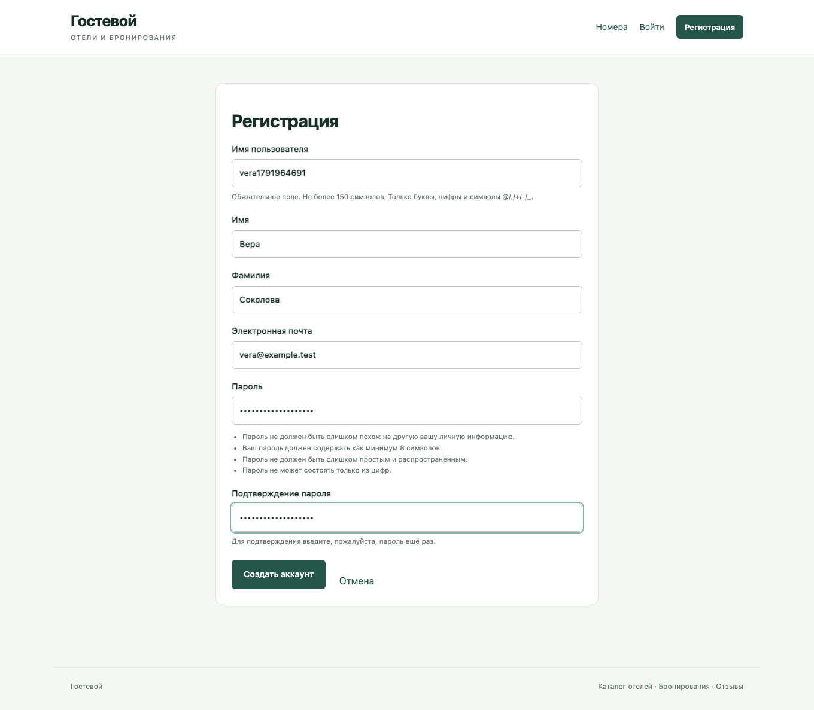

Форма бронирования содержит даты и число гостей. Условия номера показаны над формой.
Ошибки выводятся рядом с полями или над формой.

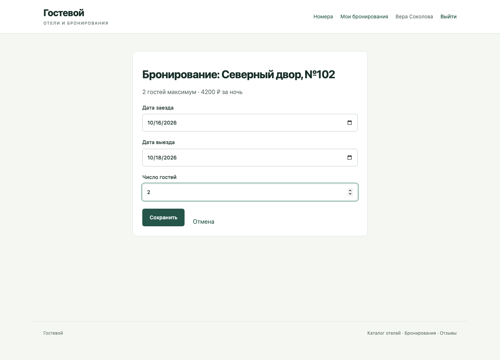

## Собственные бронирования

Страница отображает отель, номер, плановые даты, число гостей, стоимость и статус.
До заселения доступны изменение и удаление. После выселения появляется возможность
написать отзыв. Изменение использует ту же форму, заполненную текущими значениями.

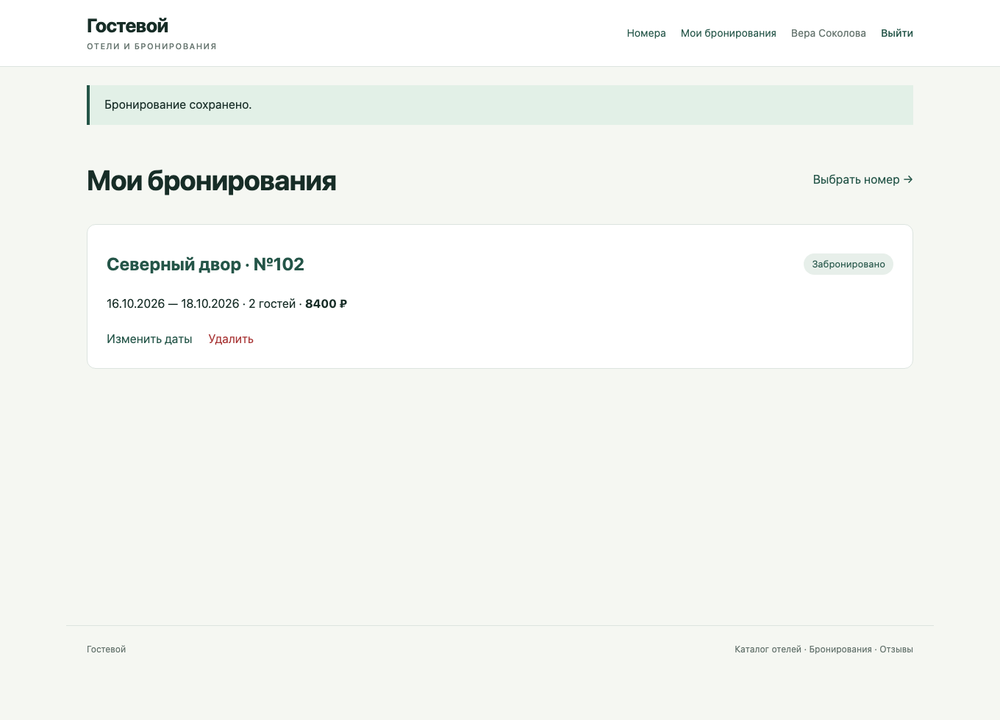

Удаление выполняется отдельным POST после подтверждения.

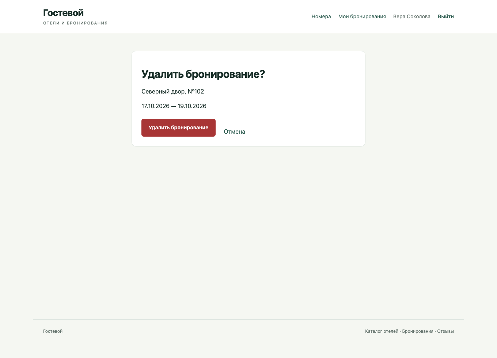

## Интерфейс сотрудника

Сотруднику доступны дополнительные пункты меню. В списке бронирований есть фильтры
отеля и статуса и кнопки действий. Заселение возможно в период бронирования;
выселение — после заселения.

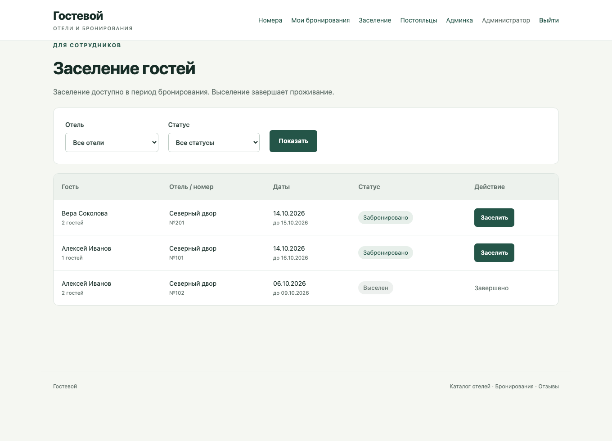

Таблица постояльцев показывает фактические даты и проживающих сейчас гостей.
Обычный пользователь не видит эту страницу и получает 403 при прямом обращении.

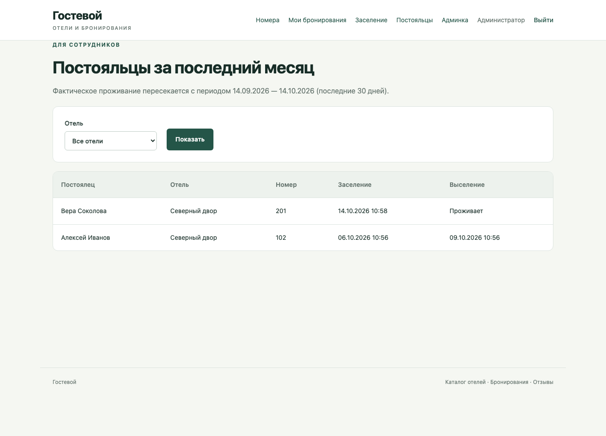

В Django-admin все четыре модели зарегистрированы. В списке Booking есть действия
«Заселить выбранных гостей» и «Выселить выбранных гостей». Поля фактических дат
меняются этими действиями.

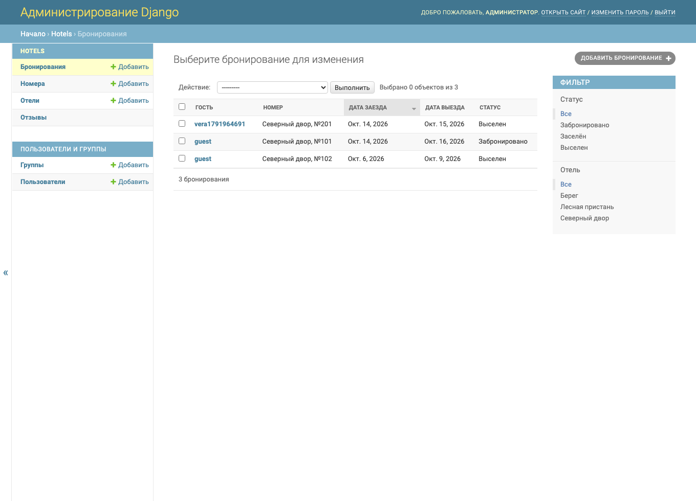

## Отзывы

Отзыв связан с завершённым бронированием. Автор вводит только оценку и текст;
данные пользователя, номера и фактического проживания сохраняются сервером.

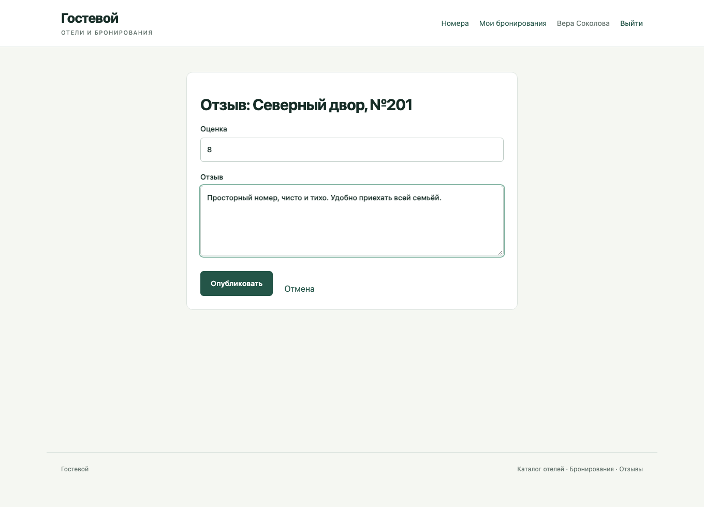

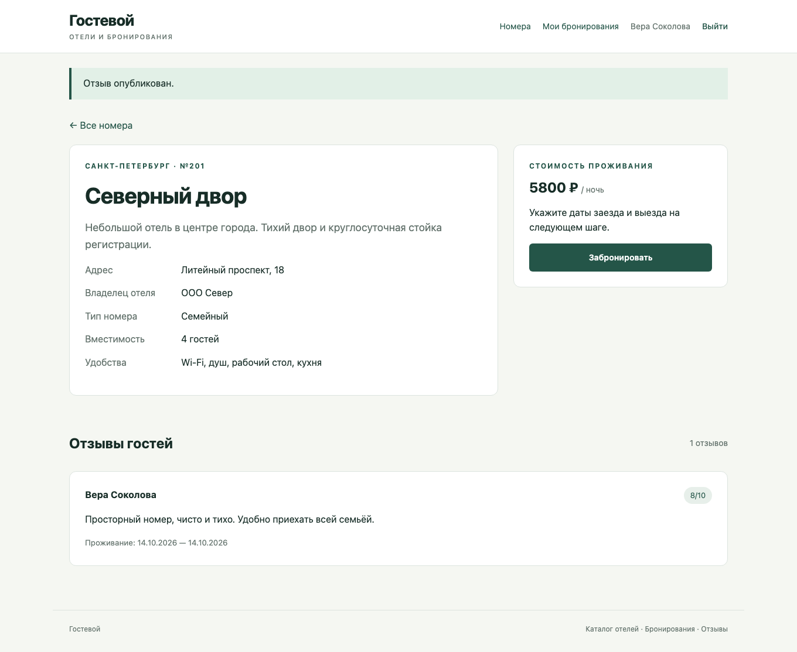

## Мобильная версия

При ширине 390 px фильтры и карточки располагаются в одну колонку.
Навигация переносится по строкам; таблицы сотрудника допускают горизонтальную прокрутку.

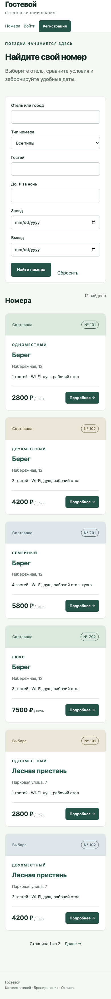
