# Интерфейсы

## Главная

Первый экран знакомит с табло и ведёт в календарь. Ниже — ближайшие открытые гонки и пять
лидеров первой попытки последней завершённой гонки. Все показатели получаются из БД.

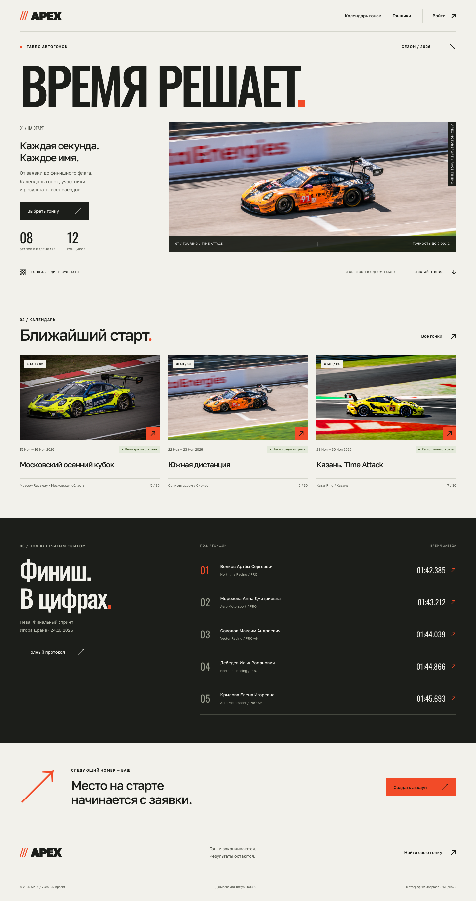

## Мобильная версия

Карточки и формы перестраиваются в одну колонку. Меню раскрывается кнопкой, закрывается
повторным нажатием и клавишей Escape. Состояние сообщается через `aria-expanded`.

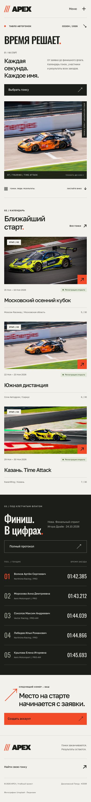

## Календарь

Поиск охватывает название, трассу и место проведения; статус выбирается в списке.
Переход между страницами сохраняет фильтры. Отображаются дата, статус и количество участников.

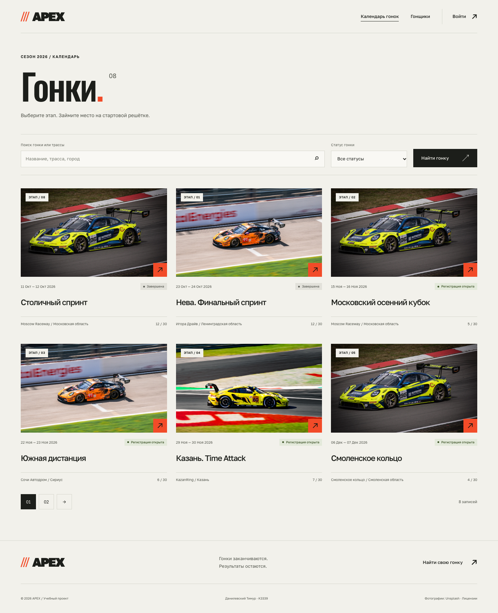

## Гонка, результаты и обсуждение

Подробная страница содержит характеристики трассы, даты, кнопку подачи заявки и протокол.
Каждая строка таблицы — конкретный заезд участника, а не только его лучший результат.
При отсутствии результатов показывается понятное пустое состояние.

В стартовом списке видны ФИО, команда, автомобиль, биография, опыт и класс. В «Паддоке»
показаны тип комментария, период заезда, оценка, текст и автор.

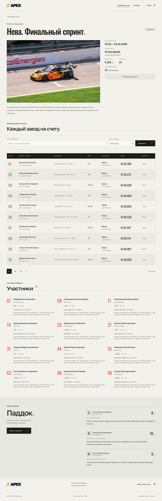

## Гонщики

Карточки показывают полные сведения об участнике. Доступны поиск по ФИО, команде и автомобилю,
фильтр класса и пагинация.

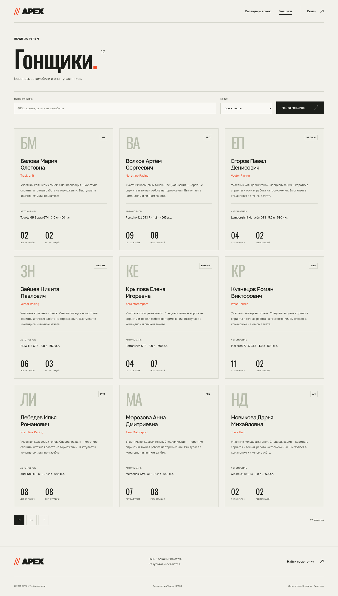

## Регистрация и вход

Для аккаунта требуются ФИО, уникальный логин и два совпадающих пароля. Пароли проверяются
стандартными валидаторами Django и хранятся в виде хешей. Ошибки выводятся у соответствующих полей.

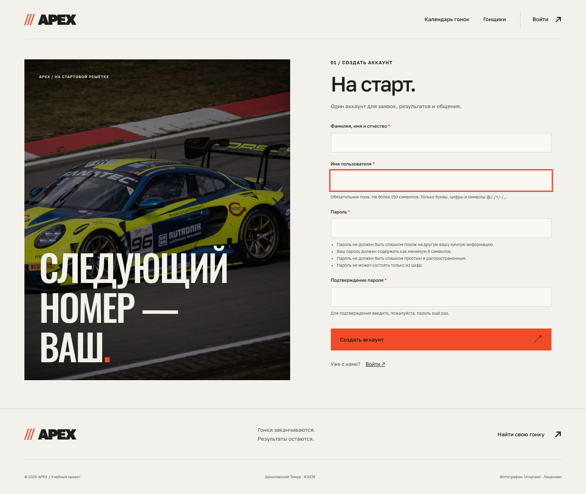

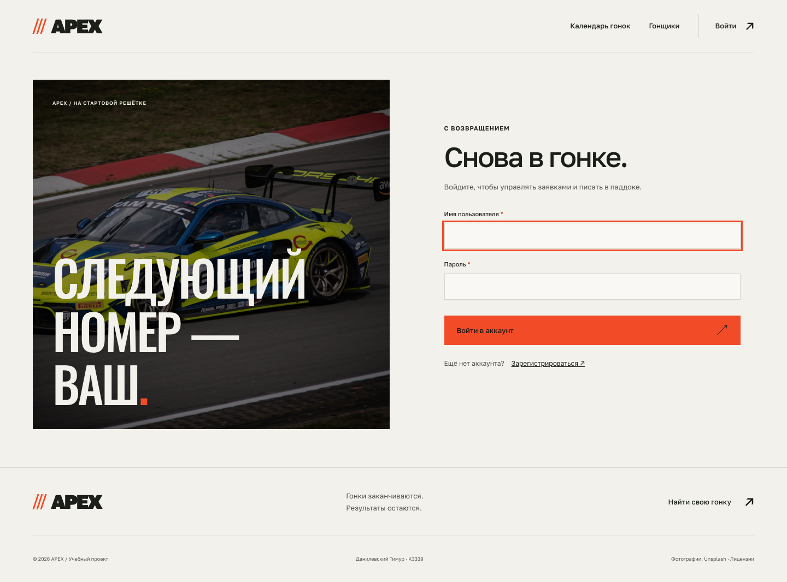

## Личные заявки

Видны только собственные регистрации. Для открытой гонки доступны изменение и страница
подтверждения отмены; при закрытии регистрации или наличии результатов — переход к протоколу.

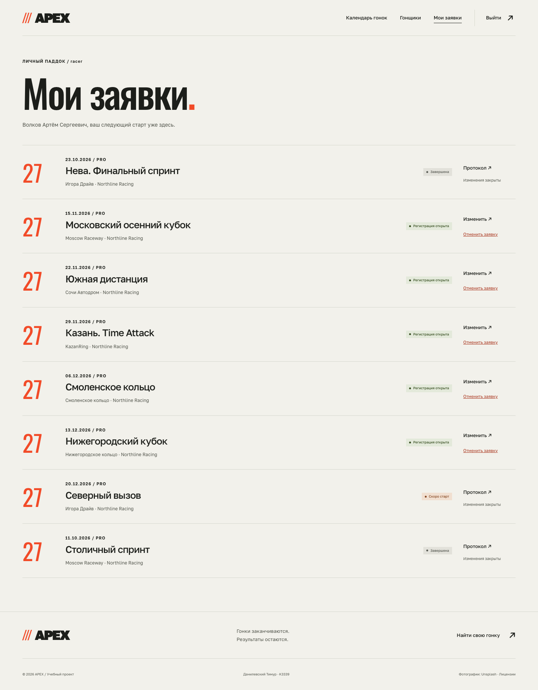

## Создание и изменение заявки

Форма состоит из профиля гонщика и стартового номера. Занятый номер отклоняется. Изменение
профиля отражается во всех заявках, что поясняется возле формы.

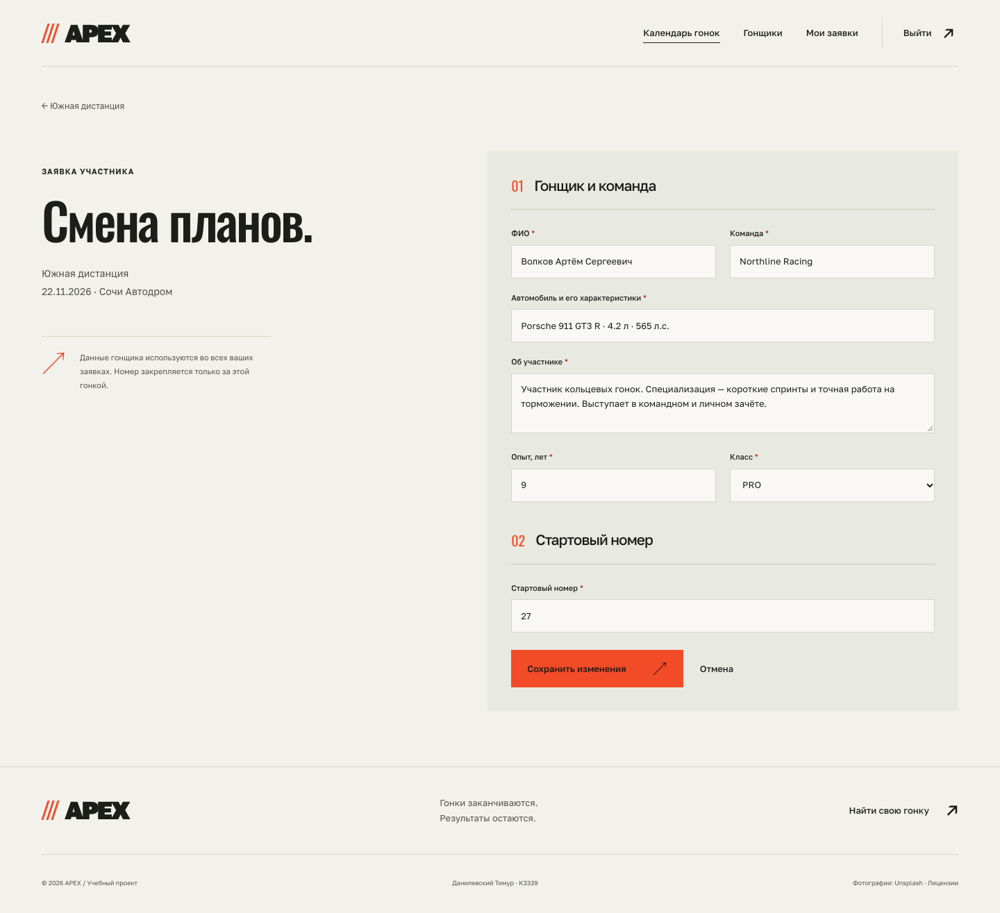

## Race control

Раздел доступен только судье. В нём перечислены гонки с количеством заявок и результатов.
Можно открыть протокол или добавить заезд, перейти к Django-admin.

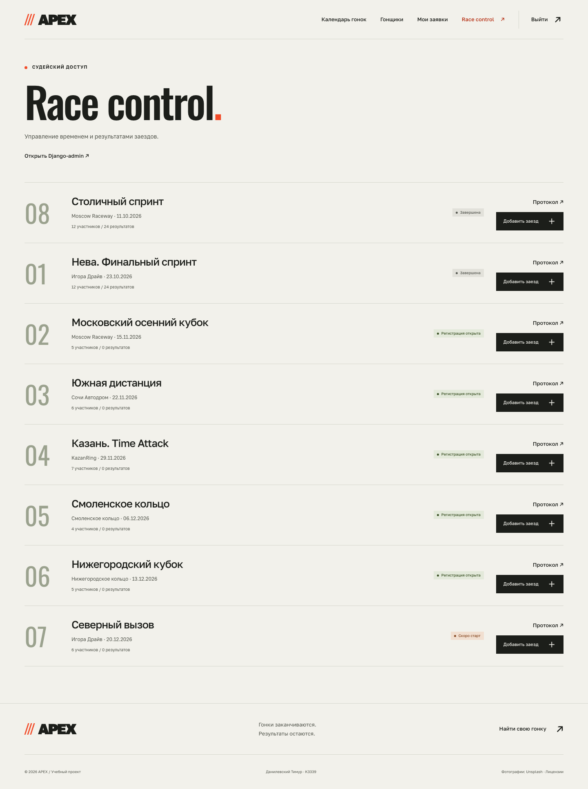

## Ввод результата

Судья выбирает участника текущей гонки, номер попытки, дату и время старта, длительность,
место и статус. Форма одинаково используется для создания и редактирования.

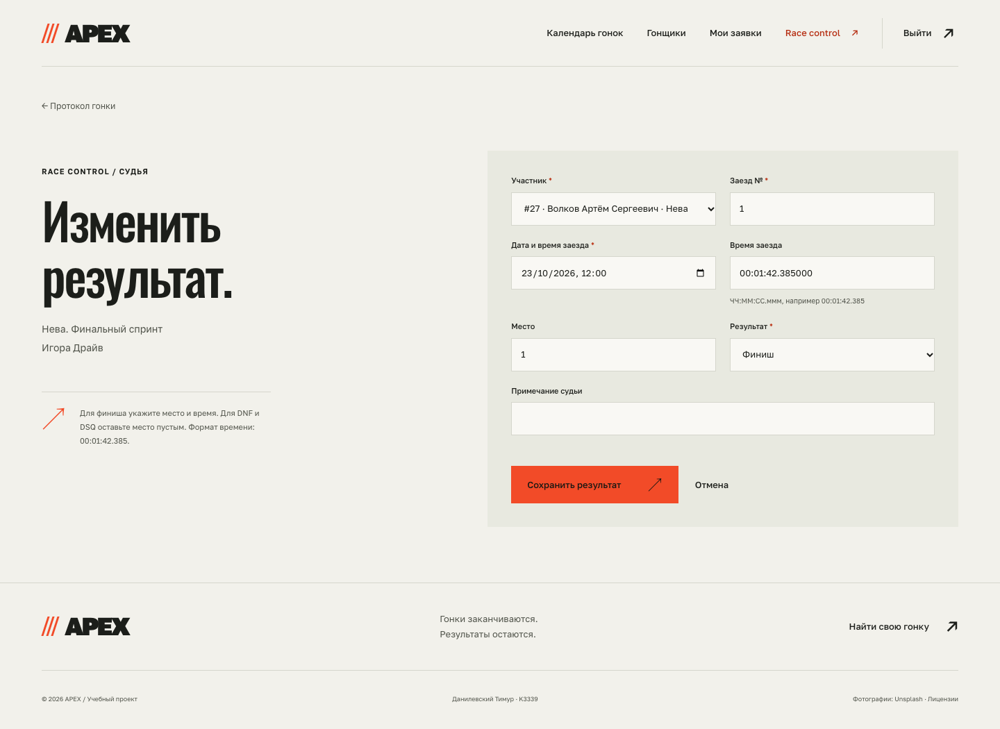

## Django-admin

Стандартная административная панель содержит все пять прикладных моделей. Для заездов
настроены список времени и места, поиск по гонщику и фильтры по гонке и результату.

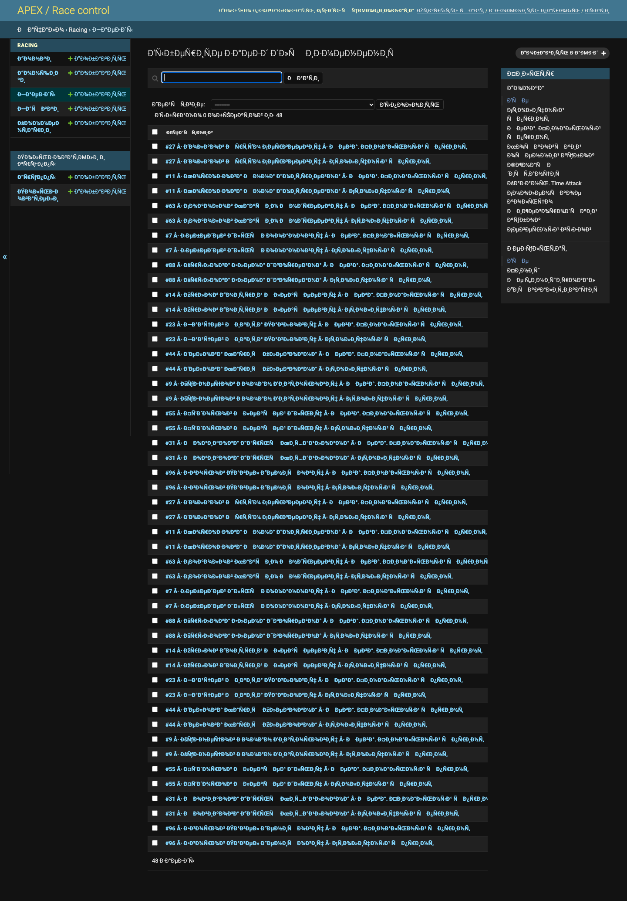

## Источники иллюстраций

Собственные фотографии соревнований не предоставлялись. Использованы три лицензированные
иллюстрации автоспорта с Unsplash, сохранённые локально:

| Файл | Автор | Источник |
|---|---|---|
| `race-orange.webp` | Boris Debusscher | [Porsche GT3 на трассе](https://unsplash.com/photos/ZmCHTylNVro) |
| `race-yellow.webp` | Benoit Fraikin | [Жёлтый GT3](https://unsplash.com/photos/YT8wt7Ek35o) |
| `race-blue.webp` | Rui Alves | [Гоночный пелотон](https://unsplash.com/photos/Mx2iwSs98rA) |

Эти кадры не выдаются за фотографии вымышленных событий. Название файла `race-blue.webp`
используется как технический ключ иллюстрации. Названия автомобилей и марки на фотографиях
принадлежат соответствующим правообладателям. Источники и лицензии доступны в футере сайта.
