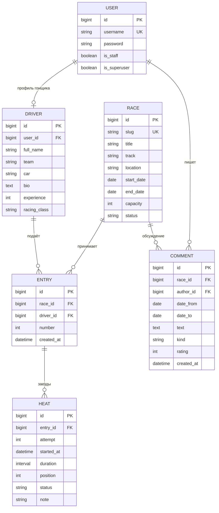

# Модель данных

## ER-диаграмма



## Назначение сущностей

| Модель | Назначение и поля |
|---|---|
| `User` | Стандартная модель Django: имя пользователя, хеш пароля, флаги роли. Полное имя аккаунта хранится в `first_name`. |
| `Driver` | Один профиль на аккаунт: ФИО, команда, описание автомобиля, биография, опыт 0–70 лет, класс. Создаётся при первой заявке. |
| `Race` | Название, slug, трасса, место, даты, этап, длина круга, повороты, вместимость, описание, статус, локальная иллюстрация. |
| `Entry` | Связь гонки и гонщика: стартовый номер и дата подачи. |
| `Heat` | Попытка зарегистрированного участника: порядковый номер, дата и время старта, длительность, место, статус и примечание. |
| `Comment` | Автор, гонка, даты заезда, тип, оценка, текст и время публикации. |

Гонка и гонщик связаны отношением многие-ко-многим через `Entry`. Отдельная `Heat` позволяет
записать несколько заездов на одну заявку. Комментарии доступны и зарегистрированным зрителям,
поэтому автор связан с `User`, а не только с профилем `Driver`.

## Ограничения

```python
class Meta:
    constraints = [
        models.UniqueConstraint(fields=['race', 'driver'], name='unique_race_driver'),
        models.UniqueConstraint(fields=['race', 'number'], name='unique_race_number'),
        models.CheckConstraint(
            check=models.Q(number__gte=1, number__lte=999), name='valid_car_number'
        ),
    ]
```

- Нельзя подать две заявки одного гонщика на одну гонку.
- Стартовый номер 1–999 уникален внутри гонки.
- Пара «заявка, номер попытки» уникальна.
- Длительность положительная, если указана; завершённый заезд обязательно имеет время и место.
- Оценка комментария ограничена 1–10 на уровне валидаторов и БД.
- Окончание гонки и периода комментария не может предшествовать началу.
- `clean()` проверяет попадание дат комментария и заезда в период гонки, а также занятость места в конкретной попытке.
- Формы для DNF / DSQ не допускают назначения места.

Уникальность места среди разных заявок проверяется на уровне модели; браузерный судейский
интерфейс дополнительно блокирует строку гонки в транзакции. Одновременное редактирование
мест через Django-admin не покрывается межтабличным ограничением PostgreSQL.

## Транзакции и владение

При создании заявки используется `transaction.atomic()` и `Race.objects.select_for_update()`.
После получения блокировки повторно проверяются статус и вместимость. Уникальные ограничения
БД защищают от конфликтов номера и повторной регистрации. `IntegrityError` превращается
в сообщение формы. Обновление профиля и сохранение заявки выполняются в одной транзакции.

Профиль гонщика общий для всех его заявок. Изменение профиля в открытой заявке обновляет
отображаемые сведения в остальных гонках; время и место результата остаются отдельными данными `Heat`.

Каскадное удаление в моделях применяется при административном управлении. В пользовательском
интерфейсе удалить заявку с записанными заездами или после закрытия регистрации нельзя.
