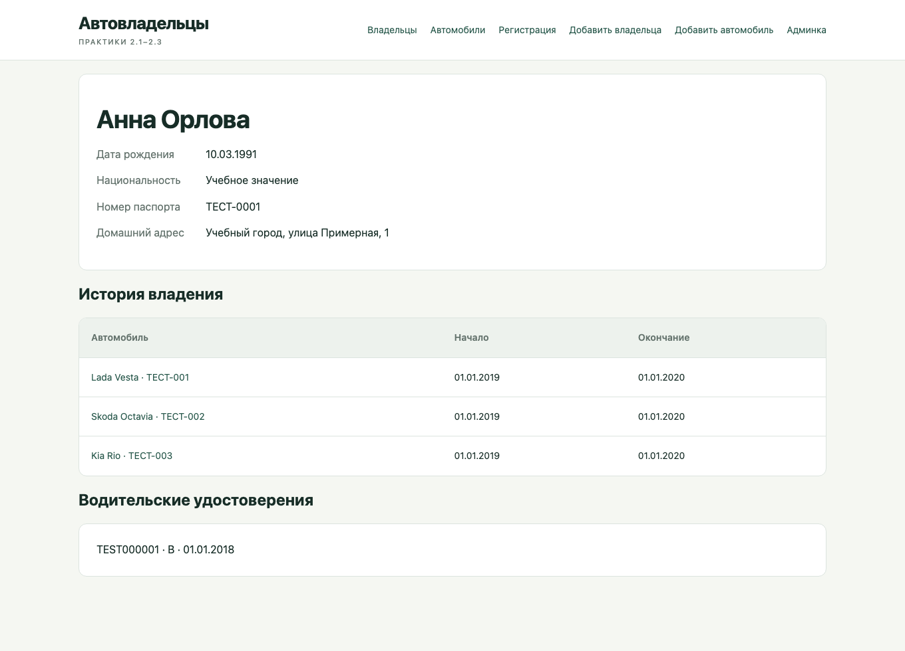
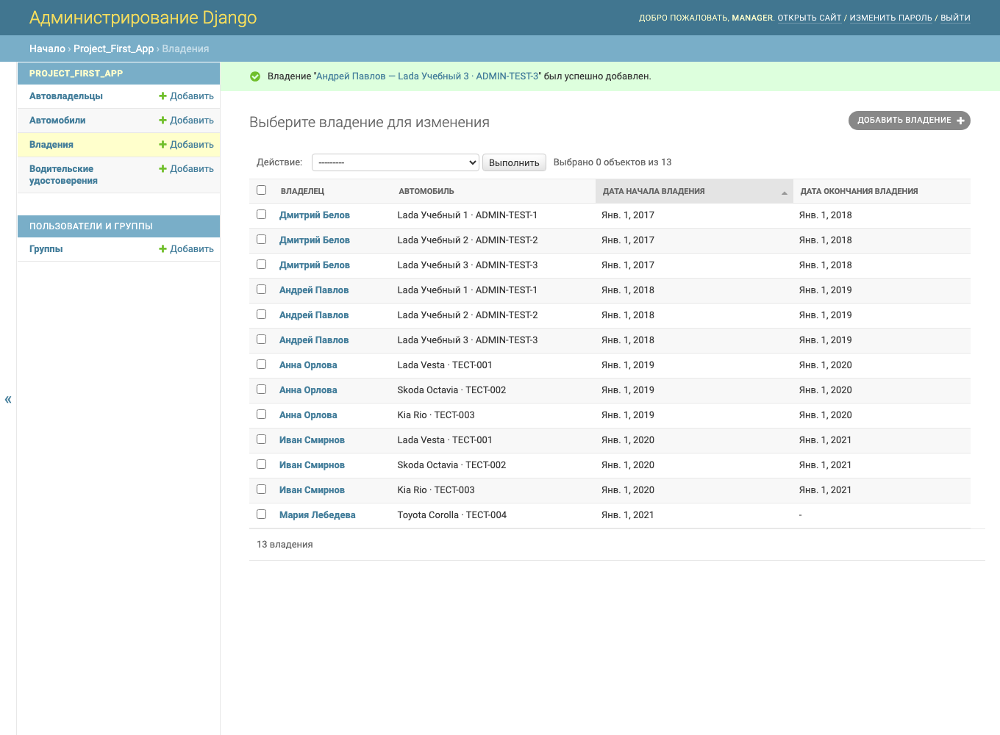
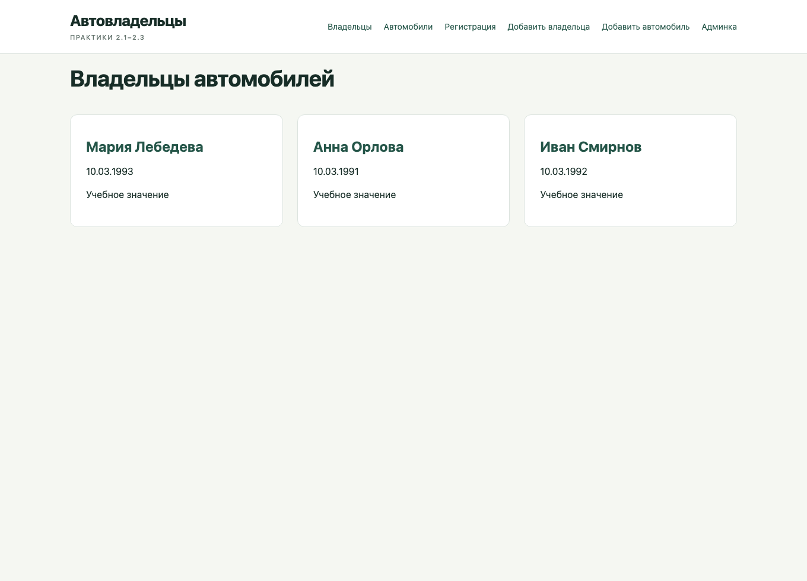
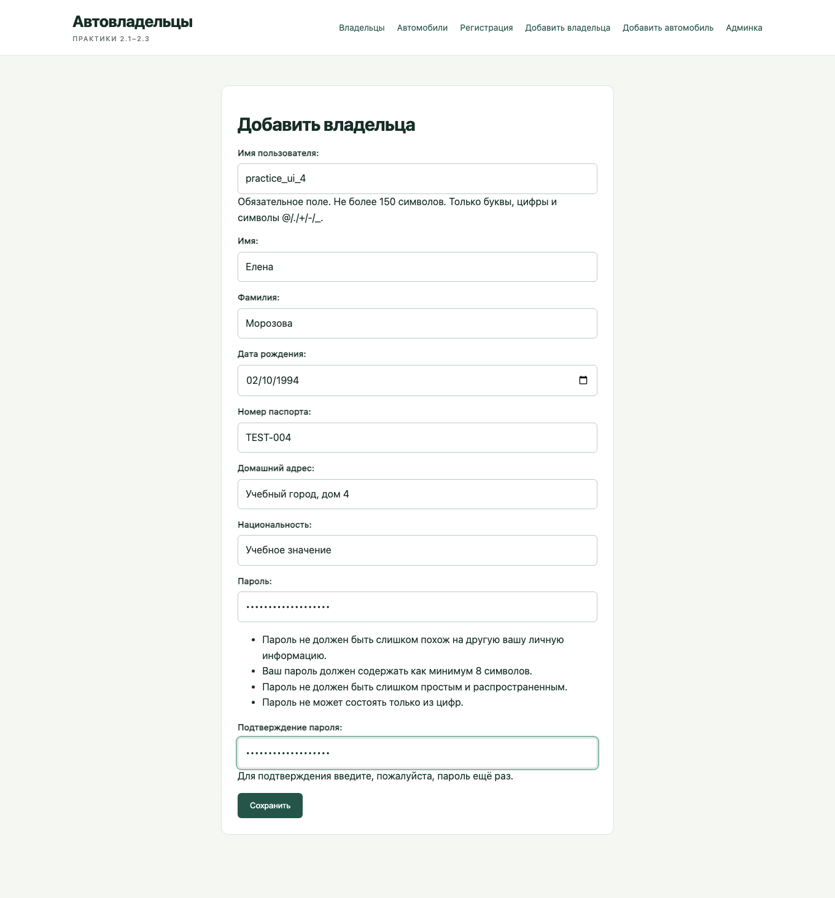
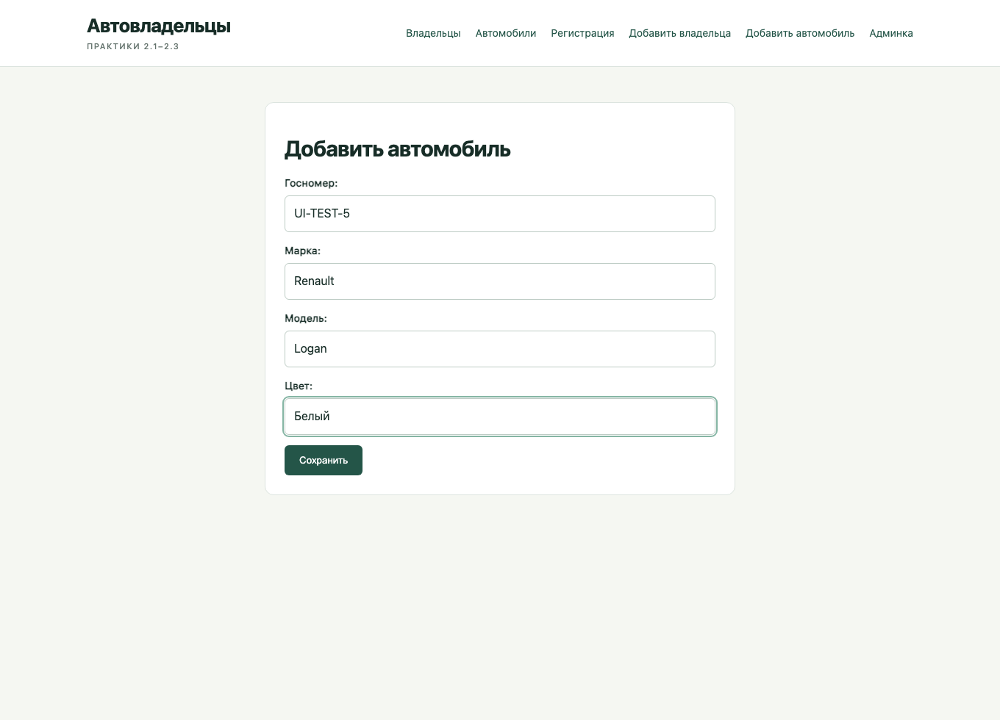
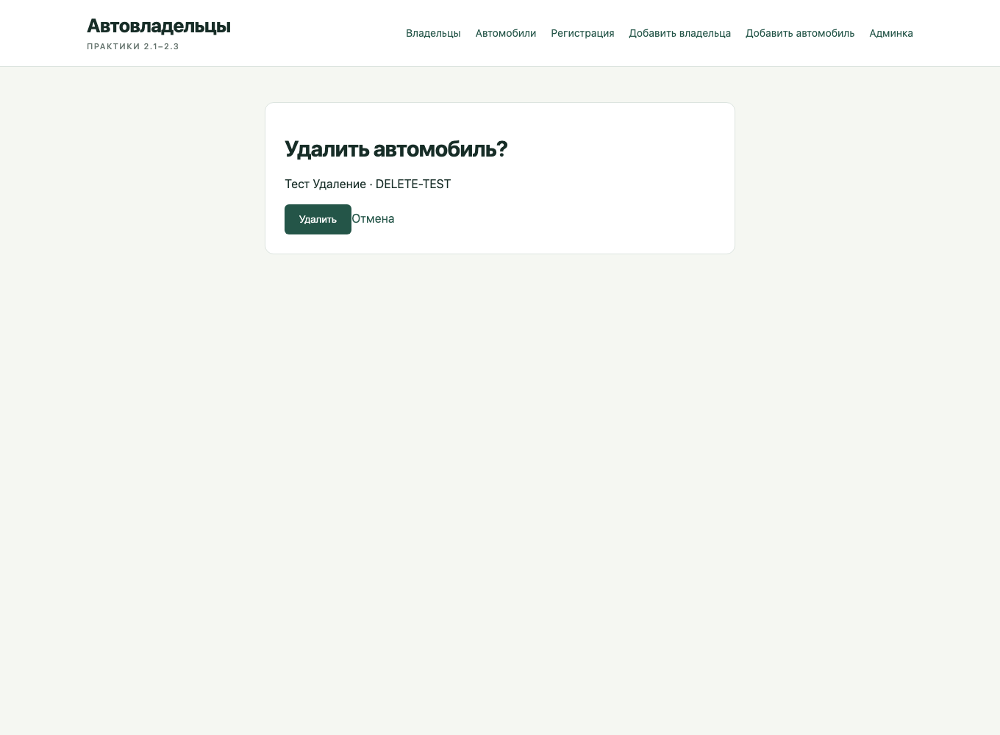
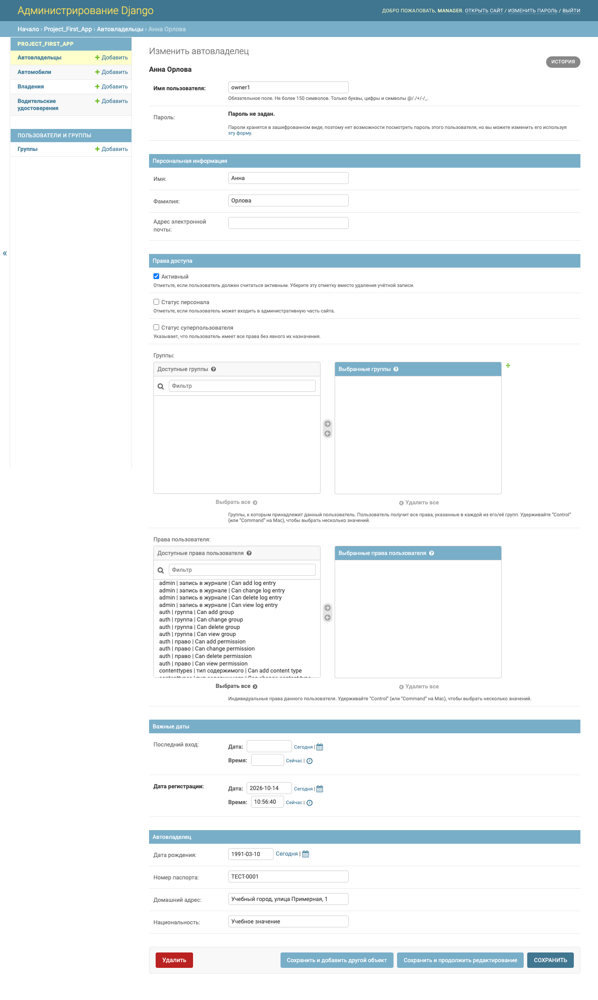

# Практические работы 2.1–2.3

Кудрявцев Кирилл Станиславович, К3342. Отдельный проект
`django_project_kudryavtsev`, приложение `project_first_app`.

[Практика 2.1](https://rendex85.github.io/ITMO_ICT_WebDevelopment_Docs/lab2/practice1/),
[практика 2.2](https://rendex85.github.io/ITMO_ICT_WebDevelopment_Docs/lab2/practice2/),
[практика 2.3](https://rendex85.github.io/ITMO_ICT_WebDevelopment_Docs/lab2/practice3/).

## Модели и миграции

| Модель | Поля и назначение |
| --- | --- |
| CarOwner(AbstractUser) | Имя, фамилия, дата рождения, паспорт, домашний адрес, национальность; стандартная аутентификация |
| Car | Госномер, марка, модель, цвет |
| Ownership | Владелец, автомобиль, даты начала и окончания владения |
| DriverLicense | Владелец, номер удостоверения, категория и дата выдачи |

Связь автомобилей и владельцев — M2M с `through='Ownership'`. Промежуточная
таблица хранит даты. Пересекающиеся периоды владения одним автомобилем отклоняются.
Дата окончания может отсутствовать для текущего владения.

```python
class Car(models.Model):
    owners = models.ManyToManyField(
        CarOwner, through='Ownership', related_name='cars'
    )
```

CarOwner наследует AbstractUser. `AUTH_USER_MODEL` задаётся до первой миграции.
Миграция `0001_initial.py` создаёт все четыре модели. Все модели зарегистрированы
в админке. Дополнительные поля пользователя включены в `fieldsets` и `add_fieldsets`.

## Практика 2.1

Созданы проект, приложение, модели, миграции и суперпользователь. Во views реализован
`owner_detail(request, pk)`, который получает владельца из базы по id и передаёт его
в `owner.html`. Маршрут `/owner/<id>/` подключён через `include()` в главном urls.py.

Через Django-admin добавлены 2 владельца и 4 автомобиля. Каждому владельцу назначены
по 3 автомобиля с последовательными периодами 2017–2018 и 2018–2019; пересечений нет.
Дополнительно `seed_practice` создаёт вымышленные исходные данные для повторяемого запуска.





## Практика 2.2

Владельцы выводятся функциональным представлением `owner_list`. Их создание
выполняется FBV `owner_create` с формой OwnerForm. В браузере через форму добавлены
3 владельца: Елена Морозова, Павел Волков и Ольга Зайцева.

```python
form = OwnerForm(request.POST if request.method == 'POST' else None)
if request.method == 'POST' and form.is_valid():
    owner = form.save()
    return redirect('owner_detail', pk=owner.pk)
```





Для автомобилей используются CBV: CarList, CarDetail, CarCreate, CarUpdate и CarDelete.
Через форму созданы 3 автомобиля: Renault Logan, Hyundai Solaris и Ford Focus.
Цвет Ford Focus изменён через UpdateView; отдельная тестовая запись удалена через
DeleteView после подтверждения.





## Практика 2.3

Автовладелец является пользователем. В модели добавлены паспорт, домашний адрес и
национальность. Эти поля есть в публичной регистрации и в форме создания владельца.
Пароль обрабатывается UserCreationForm и хранится в виде хэша.

Списки и карточки используют модель CarOwner. Паспорт, адрес и номера удостоверений
показываются самому пользователю и сотруднику, а имена и история владения — на общей странице.



## Маршруты и запуск

| URL | Представление |
| --- | --- |
| `/` | owner_list, FBV |
| `/owner/<id>/` | owner_detail, FBV |
| `/owners/create/` | owner_create, FBV |
| `/register/` | registration, создание пользователя с дополнительными полями |
| `/cars/` | CarList, CBV |
| `/cars/<id>/` | CarDetail, CBV |
| `/cars/create/` | CarCreate, CBV |
| `/cars/<id>/edit/` | CarUpdate, CBV |
| `/cars/<id>/delete/` | CarDelete, CBV |

Проект находится в `students/K3342/practical_works/Kudryavtsev_Kirill/simple_django_web_project`.
Используется отдельная PostgreSQL-база `web_practice2`, реквизиты указаны в локальном `.env`.

```sh
python manage.py migrate
python manage.py seed_practice
python manage.py createsuperuser
python manage.py runserver 127.0.0.1:9021
python manage.py test -v 2
```

Три теста проверяют создание расширенного пользователя, CRUD автомобиля и
даты владения. Все сведения в учебных данных и скриншотах вымышленные.
