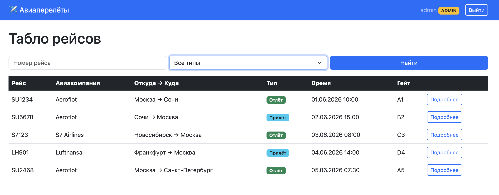
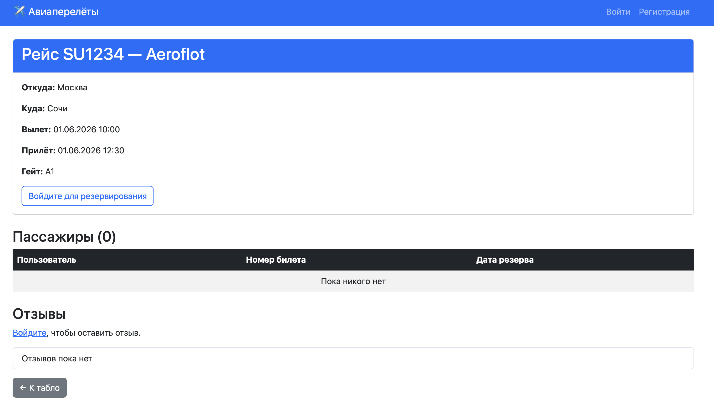
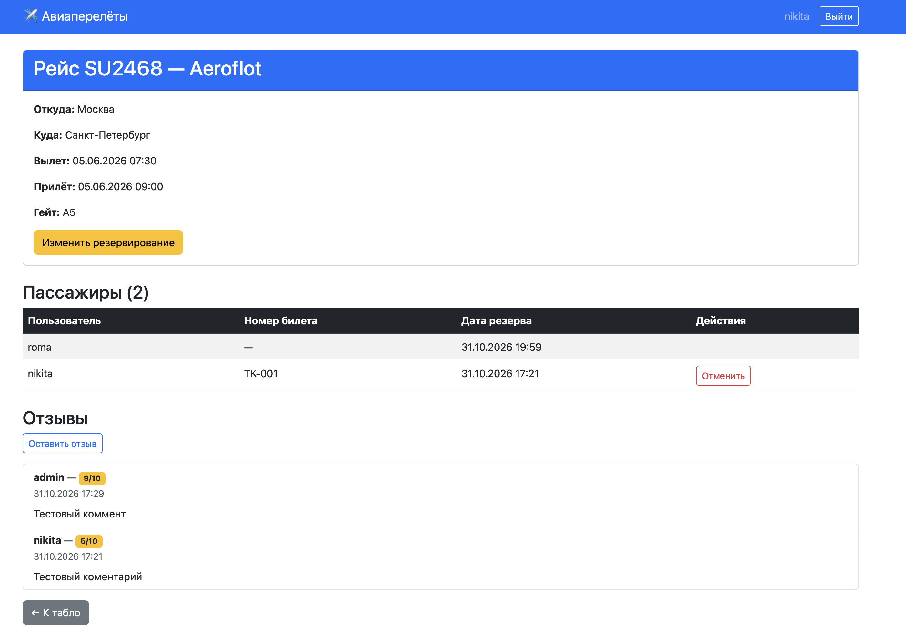
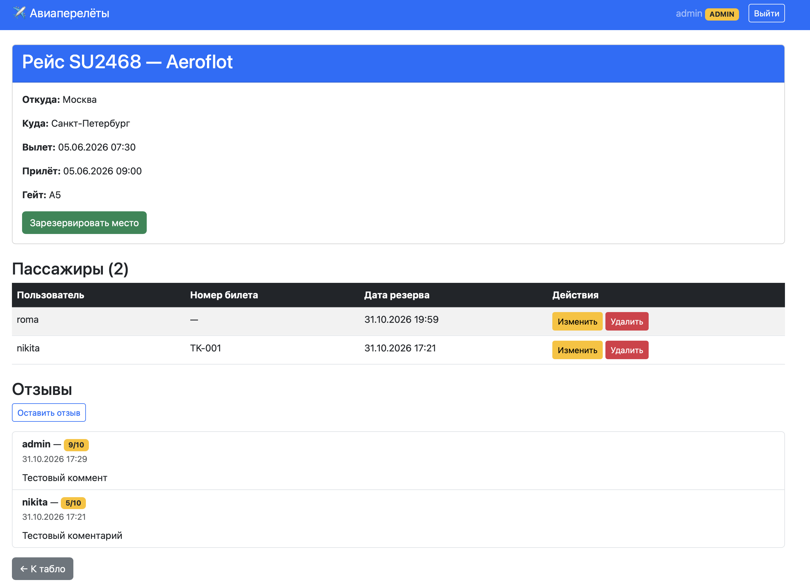
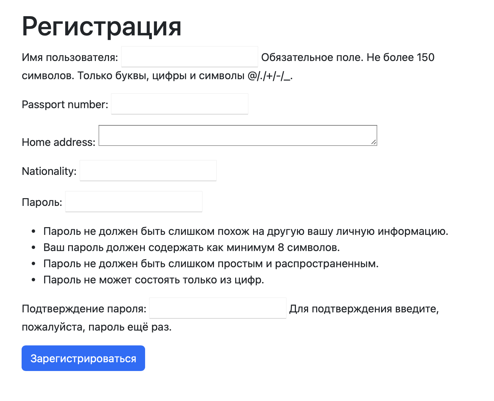
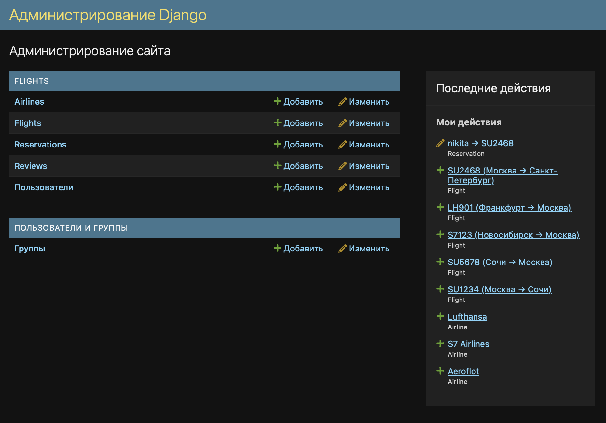
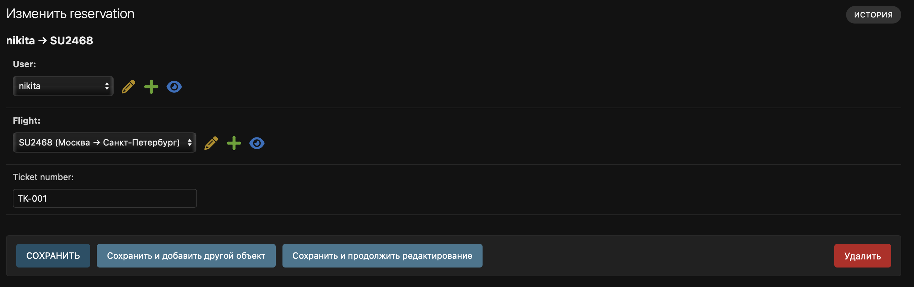

# ЛР2 — Табло авиаперелётов

**Вариант 3**

## Задание

Хранится информация о номере рейса, авиакомпании, отлёте, прилёте, типе (прилёт, отлёт), номере гейта.

Функционал:

- Регистрация новых пользователей.
- Просмотр и резервирование мест на рейсах.
- Пользователь может редактировать и удалять свои резервирования.
- Администратор регистрирует пассажира и вписывает номер билета через Django-admin.
- В клиентской части формируется таблица всех пассажиров рейса.
- Отзывы к рейсам: дата, текст, рейтинг 1–10, комментатор.
- Стилизация интерфейса (Bootstrap 5).
- Пагинация и фильтрация.
- Разграничение прав администратора и пользователя (`is_staff`).

## Стек технологий

- Python 3.13
- Django 6.1
- PostgreSQL 18
- Bootstrap 5 (CDN)
- MkDocs + Material

## Модель данных

Все модели находятся в `flights/models.py`.

### User

Расширение стандартной модели через `AbstractUser`.

| Поле | Тип | Описание |
|---|---|---|
| username | CharField | логин |
| passport_number | CharField(20) | номер паспорта |
| home_address | TextField | домашний адрес |
| nationality | CharField(50) | национальность |

### Airline

| Поле | Тип |
|---|---|
| name | CharField(100) |
| country | CharField(50) |

### Flight

| Поле | Тип | Описание |
|---|---|---|
| number | CharField(10) | номер рейса |
| airline | ForeignKey(Airline) | авиакомпания |
| departure_city | CharField(100) | город вылета |
| arrival_city | CharField(100) | город прилёта |
| departure_time | DateTimeField | время вылета |
| arrival_time | DateTimeField | время прилёта |
| flight_type | CharField(choices) | departure / arrival |
| gate_number | CharField(10) | номер гейта |

### Reservation

| Поле | Тип | Описание |
|---|---|---|
| user | ForeignKey(User) | пассажир |
| flight | ForeignKey(Flight) | рейс |
| ticket_number | CharField(20) | заполняется администратором |
| created_at | DateTimeField | дата резерва |

Ограничение: `unique_together = ('user', 'flight')` — нельзя зарезервировать одно место дважды.

### Review

| Поле | Тип | Описание |
|---|---|---|
| user | ForeignKey(User) | автор отзыва |
| flight | ForeignKey(Flight) | рейс |
| flight_date | DateField | дата рейса |
| text | TextField | текст комментария |
| rating | IntegerField(1–10) | рейтинг |
| created_at | DateTimeField | дата создания |

### Связи

- Airline 1:M Flight
- Flight 1:M Reservation
- User 1:M Reservation
- Flight 1:M Review
- User 1:M Review

## Ключевые представления (views)

Файл: `flights/views.py`.

### FlightListView

Список рейсов с пагинацией (5 на страницу), поиском по номеру и фильтром по типу.

```python
class FlightListView(ListView):
    model = Flight
    template_name = 'flights/flight_list.html'
    context_object_name = 'flights'
    paginate_by = 5

    def get_queryset(self):
        qs = Flight.objects.select_related('airline')
        search = self.request.GET.get('search')
        ftype = self.request.GET.get('type')
        if search:
            qs = qs.filter(number__icontains=search)
        if ftype:
            qs = qs.filter(flight_type=ftype)
        return qs
```

---

### FlightDetailView

Детали рейса, список пассажиров, отзывы.

```python
class FlightDetailView(DetailView):
    model = Flight
    template_name = 'flights/flight_detail.html'

    def get_context_data(self, **kwargs):
        ctx = super().get_context_data(**kwargs)
        ctx['passengers'] = Reservation.objects.filter(flight=self.object).select_related('user')
        ctx['reviews'] = self.object.review_set.select_related('user').all()
        if self.request.user.is_authenticated:
            ctx['my_reservations'] = list(
                Reservation.objects.filter(user=self.request.user).values_list('flight_id', flat=True)
            )
        else:
            ctx['my_reservations'] = []
        return ctx
```

### ReservationCreateView

Резервирование места авторизованным пользователем.

```python
class ReservationCreateView(LoginRequiredMixin, CreateView):
    model = Reservation
    fields = []
    template_name = 'flights/reservation_form.html'

    def form_valid(self, form):
        form.instance.user = self.request.user
        form.instance.flight = get_object_or_404(Flight, pk=self.kwargs['pk'])
        return super().form_valid(form)
```

### ReservationDeleteView

Удаление резервирования. Доступно только владельцу или администратору.

```python
class ReservationDeleteView(LoginRequiredMixin, UserPassesTestMixin, DeleteView):
    model = Reservation
    template_name = 'flights/reservation_confirm_delete.html'

    def test_func(self):
        return self.get_object().user == self.request.user or self.request.user.is_staff
```

### ReviewCreateView

Создание отзыва к рейсу (только для авторизованных).

```python
class ReviewCreateView(LoginRequiredMixin, CreateView):
    model = Review
    form_class = ReviewForm
    template_name = 'flights/review_form.html'

    def form_valid(self, form):
        form.instance.user = self.request.user
        form.instance.flight = get_object_or_404(Flight, pk=self.kwargs['pk'])
        return super().form_valid(form)
```

## Ключевые шаблоны

Все шаблоны находятся в flights/templates/flights/. Базовый — base.html, подключает Bootstrap 5.

### base.html

Навигация с индикатором роли: если user.is_staff, рядом с именем показывается бейдж ADMIN.

### flight_list.html

Форма поиска (номер рейса) и фильтр по типу select.

Таблица рейсов.

Пагинация с сохранением GET-параметров.

```django

    <a href="?page={{ page_obj.next_page_number }}&search={{ request.GET.search }}">→</a>

```

### flight_detail.html

Карточка рейса.

Кнопка «Зарезервировать» для авторизованных / «Войдите» для гостей.

Таблица пассажиров с разграничением действий:

```django

    <a href="">Изменить</a>
    <a href="">Удалить</a>

    <a href="">Отменить</a>

```

Список отзывов.

Кнопка «Оставить отзыв» для авторизованных.

## Скриншоты

### Табло рейсов



### Детали рейса (гость)



### Детали рейса (пользователь)



### Детали рейса (администратор)



### Форма регистрации



### Django-admin: раздел Flights



### Ввод номера билета администратором



## Пагинация и фильтрация

| Функция | Где реализована |
|---|---|
| Пагинация (5 на страницу) | FlightListView.paginate_by = 5 |
| Поиск по номеру рейса | get_queryset → number__icontains |
| Фильтр по типу рейса | get_queryset → flight_type |

## Разграничение прав

| Действие | Гость | Пользователь | Администратор |
|---|---|---|---|
| Просмотр табло | + | + | + |
| Просмотр деталей рейса | + | + | + |
| Зарезервировать место | - | + | + |
| Отменить своё резервирование | - | + | + |
| Отменить чужое резервирование | - | - | + |
| Изменить резервирование | - | - | + |
| Оставить отзыв | - | + | + |
| Вписать номер билета | - | - | + (через админку) |

Реализовано через:

- проверку `` в шаблонах (flight_detail.html);
- миксины LoginRequiredMixin и UserPassesTestMixin во views.
