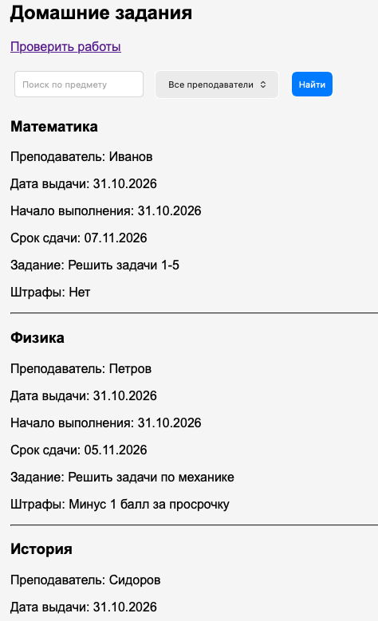
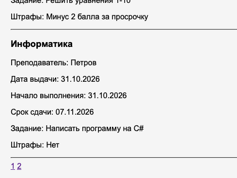
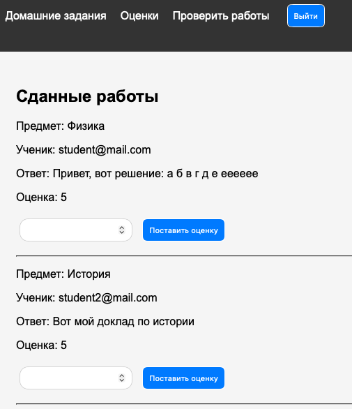
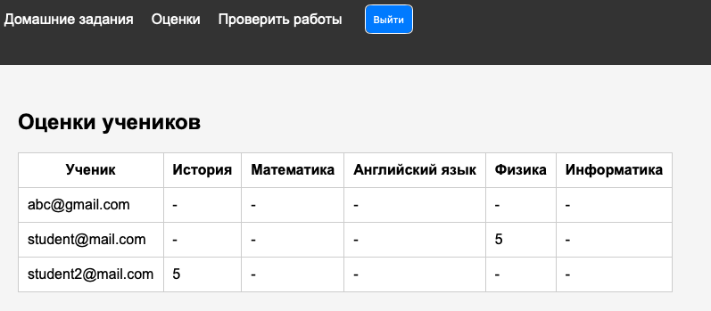

# Лабораторная работа №2. Доска домашних заданий

В лабораторной работе был реализован сайт для просмотра и сдачи домашних заданий

Для разработки использовали ASP.NET Core MVC на C#, Entity Framework Core для работы с базой данных и PostgreSQL для хранения данных

На сайте пользователи могут регистрироваться, просматривать домашние задания и отправлять свои ответы

Преподаватель может проверять работы и выставлять оценки

## 1. Создание моделей данных

Сначала создали две модели: `Homework` и `Submission`

Модель `Homework` хранит информацию о домашнем задании: предмет, преподавателя, дату выдачи, сроки выполнения, описание и штрафы

Модель `Submission` нужна для хранения сданных работ

В ней есть идентификаторы задания и ученика, текст ответа и оценка

??? info "Модель Submission"

    ```csharp
    namespace Lab2HWTable.Models;

    public class Submission
    {
        public int Id { get; set; }
        public int HomeworkId { get; set; }
        public Homework Homework { get; set; } = null!;
        public string StudentId { get; set; } = string.Empty;
        public string Answer { get; set; } = string.Empty;
        public int? Grade { get; set; }
    }
    ```

!!! note

    Оценка имеет тип `int?`, так как работа может быть сдана, но ещё не проверена преподавателем

### Настройка связей

Для настройки связей между моделями использовали Fluent API

В `SubmissionConfiguration` указали первичный ключ и настроили связи с домашним заданием и пользователем

Одному домашнему заданию может соответствовать несколько сданных работ

??? info "Конфигурация Submission"

    ```csharp
    using Microsoft.AspNetCore.Identity;
    using Microsoft.EntityFrameworkCore;
    using Microsoft.EntityFrameworkCore.Metadata.Builders;

    namespace Lab2HWTable.Models.Configuration;

    public class SubmissionConfiguration : IEntityTypeConfiguration<Submission>
    {
        public void Configure(EntityTypeBuilder<Submission> builder)
        {
            builder.HasKey(s => s.Id);
            builder.HasOne(s => s.Homework)
                .WithMany()
                .HasForeignKey(s => s.HomeworkId);
            builder.HasOne<IdentityUser>()
                .WithMany()
                .HasForeignKey(s => s.StudentId);
        }
    }
    ```

## 2. Подключение базы данных

Для работы с PostgreSQL создали класс `AppDbContext`

Он наследуется от `IdentityDbContext`, так как мы также используем ASP.NET Core Identity для хранения пользователей и ролей

В контексте объявили `DbSet` для домашних заданий и сданных работ

Далее указали строку подключения к PostgreSQL в `appsettings.Development.json` и зарегистрировали контекст в `Program.cs`

Для базы данных использовали отдельный Docker-контейнер с PostgreSQL

После настройки моделей создали миграцию `InitialCreate` и применили её к базе данных командами `dotnet ef migrations add InitialCreate` и `dotnet ef database update`

В результате были созданы таблицы домашних заданий, ответов, пользователей и ролей

## 3. Регистрация и авторизация пользователей

Для работы с пользователями подключили ASP.NET Core Identity

В `Program.cs` зарегистрировали Identity и добавили middleware для аутентификации и авторизации

??? info "Подключение Identity"

    ```csharp
    builder.Services.AddIdentity<IdentityUser, IdentityRole>()
        .AddEntityFrameworkStores<AppDbContext>(); // подключаем пользователей и роли через наш контекст
    ```

Создали `AccountController`, который отвечает за регистрацию, вход и выход пользователей

Для регистрации используются два метода `Register`: GET возвращает страницу с формой, POST получает email и пароль и создаёт пользователя через `UserManager`

Для входа используется `SignInManager`, который проверяет данные пользователя и выполняет авторизацию

??? info "AccountController"

    ```csharp
    using Microsoft.AspNetCore.Identity;
    using Microsoft.AspNetCore.Mvc;

    namespace Lab2HWTable.Controllers;

    public class AccountController : Controller
    {
        private readonly UserManager<IdentityUser> _userManager; // создание пользователей и работа с их данными
        private readonly SignInManager<IdentityUser> _signInManager; // вход пользователей в систему
        public AccountController(UserManager<IdentityUser> userManager, SignInManager<IdentityUser> signInManager)
        {
            _userManager = userManager;
            _signInManager = signInManager;
        }
        [HttpGet]
        public IActionResult Register()
        {
            return View(); // возвращаем страницу регистрации, когда гет запрос на нее
        }
        [HttpPost]
        public async Task<IActionResult> Register(string email, string password) // пост запрос, когда делаем юзера
        {
            var user = new IdentityUser
            {
                UserName = email, // имейл как юзернейм
                Email = email
            };
            // создаем пользователя в бд
            var result = await _userManager.CreateAsync(user, password);
            if (!result.Succeeded)
            {
                return View();
            }
            await _signInManager.SignInAsync(user, false);
            return RedirectToAction("Index", "Home");
        }
        [HttpGet]
        public IActionResult Login()
        {
            return View();
        }
        [HttpPost]
        public async Task<IActionResult> Login(string email, string password)
        {
            var result = await _signInManager.PasswordSignInAsync(email, password, false, false);
            if (!result.Succeeded)
            {
                return View();
            }
            return RedirectToAction("Index", "Homework");
        }
        [HttpPost]
        public async Task<IActionResult> Logout()
        {
            await _signInManager.SignOutAsync(); // выходим из аккаунта
            return RedirectToAction("Login");
        }
    }
    ```

Также создали представления `Register.cshtml` и `Login.cshtml` с обычными HTML-формами

### Роль преподавателя

Для разделения прав пользователей создали роль `Teacher`

В `Program.cs` через `RoleManager` проверяем наличие роли и создаём её, если она отсутствует

Затем через `UserManager` назначаем эту роль преподавателю

??? info "Создание роли преподавателя"

    ```csharp
    using (var scope = app.Services.CreateScope()) // вручную создаем один скоуп, чтобы до запуска приложения добавить роль преподавателя
    {
        var roleManager = scope.ServiceProvider.GetRequiredService<RoleManager<IdentityRole>>();
        var userManager = scope.ServiceProvider.GetRequiredService<UserManager<IdentityUser>>();
        if (!await roleManager.RoleExistsAsync("Teacher"))
        {
            await roleManager.CreateAsync(new IdentityRole("Teacher"));
        }
        var teacher = await userManager.FindByEmailAsync("teacher@gmail.com");
        if (teacher != null && !await userManager.IsInRoleAsync(teacher, "Teacher"))
        {
            await userManager.AddToRoleAsync(teacher, "Teacher");
        }
    }
    ```

## 4. Просмотр домашних заданий

Для отображения домашних заданий создали `HomeworkController`

Метод `Index()` получает задания из базы через `AppDbContext` и передаёт их в представление

??? info "Страница домашних заданий"

    ```cshtml
    @model List<Lab2HWTable.Models.Homework>
    <h2>Домашние задания</h2>
    @if (User.IsInRole("Teacher"))
    {
        <a href="/Teacher/Index">Проверить работы</a>
    }
    <form method="get" action="/Homework/Index">
        <input type="text" name="search" value="@ViewBag.Search" placeholder="Поиск по предмету" />
        <select name="teacher">
            <option value="">Все преподаватели</option>
            @foreach (var teacher in ViewBag.Teachers)
            {
                <option value="@teacher" selected="@(ViewBag.Teacher == teacher)">@teacher</option> // сохраняем выбранного преподавателя в фильтре
            }
        </select>
        <button type="submit">Найти</button>
    </form>
    @foreach (var homework in Model)
    {
        <h3>@homework.Subject</h3>
        <p>Преподаватель: @homework.Teacher</p>
        <p>Дата выдачи: @homework.IssueDate.ToShortDateString()</p>
        <p>Начало выполнения: @homework.StartDate.ToShortDateString()</p>
        <p>Срок сдачи: @homework.EndDate.ToShortDateString()</p>
        <p>Задание: @homework.Description</p>
        <p>Штрафы: @homework.PenaltyInfo</p>
        @if (User.Identity?.IsAuthenticated == true && !User.IsInRole("Teacher"))
        {
            <a href="/Submission/Create?id=@homework.Id">Сдать задание</a>
        }
        <hr/>
    }
    <div>
        @for (int i = 1; i <= ViewBag.TotalPages; i++)
        {
            <a href="/Homework/Index?page=@i&search=@ViewBag.Search&teacher=@ViewBag.Teacher">@i</a>
        }
    </div>
    ```

В `Views/Homework/Index.cshtml` выводим список домашних заданий с информацией о предмете, преподавателе, сроках выполнения, описании и штрафах

Для каждого задания ученик может перейти к форме сдачи

### Поиск, фильтрация и пагинация

Дополнительно реализовали поиск заданий по предмету и фильтрацию по преподавателю

Для этого используем LINQ-запросы с `Where()`, которые позволяют выбрать подходящие записи из базы

Также добавили пагинацию

На одной странице отображается не больше пяти заданий

Для этого используем методы `Skip()` и `Take()`

В представлении добавили поле поиска, выпадающий список преподавателей и ссылки для переключения страниц



## 5. Сдача домашних заданий

Для отправки ответов создали `SubmissionController`

GET-метод `Create()` открывает страницу сдачи задания, а POST-метод получает текст ответа и сохраняет его в базе данных

При сохранении указываем идентификатор домашнего задания и текущего пользователя

??? info "SubmissionController"

    ```csharp
    using System.Security.Claims;
    using Lab2HWTable.Data;
    using Lab2HWTable.Models;
    using Microsoft.AspNetCore.Authorization;
    using Microsoft.AspNetCore.Mvc;

    namespace Lab2HWTable.Controllers;
    [Authorize] // только для зареганных и вошедших пользователей
    public class SubmissionController : Controller
    {
        private readonly AppDbContext _context;
        public SubmissionController(AppDbContext context)
        {
            _context = context;
        }
        [HttpGet]
        public IActionResult Create(int id)
        {
            return View(id); // передаем id дз
        }
        [HttpPost]
        public async Task<IActionResult> Create(int homeworkId, string answer)
        {
            var submission = new Submission
            {
                HomeworkId = homeworkId,
                StudentId = User.FindFirstValue(ClaimTypes.NameIdentifier)!, // id текущего пользователя
                Answer = answer
            };
            _context.Submissions.Add(submission);
            await _context.SaveChangesAsync();
            return RedirectToAction("Index", "Homework");
        }
    }
    ```

Для ввода ответа создали представление `Views/Submission/Create.cshtml`

В нём находится форма с текстовым полем

После отправки ответ сохраняется в таблице `Submissions`

Доступ к сдаче заданий есть у авторизованных пользователей

В интерфейсе ссылка на сдачу отображается ученикам, но не преподавателю

## 6. Проверка работ преподавателем

Для преподавателя создали отдельный `TeacherController`

С помощью атрибута `[Authorize(Roles = "Teacher")]` ограничили доступ к контроллеру пользователями с ролью преподавателя

Метод `Index()` получает все сданные работы из базы

Метод `Grade()` находит нужную работу по ID, устанавливает оценку и сохраняет изменения

В представлении `Views/Teacher/Index.cshtml` выводятся email ученика, предмет, ответ и оценка

Преподаватель может ввести оценку в форму и сохранить её

??? info "Страница проверки работ"

    ```cshtml
    @model List<Lab2HWTable.Models.Submission>
    <h2>Сданные работы</h2>
    @foreach (var submission in Model)
    {
        <p>Предмет: @submission.Homework.Subject</p>
        <p>Ученик: @ViewBag.Students[submission.StudentId]</p>
        <p>Ответ: @submission.Answer</p>
        <p>Оценка: @submission.Grade</p>
        <form method="post" action="/Teacher/Grade">
            <input type="hidden" name="id" value="@submission.Id" />
            <input type="number" name="grade" required />
            <button type="submit">Поставить оценку</button>
        </form>
        <hr/>
    }
    ```



## 7. Таблица оценок

Для отображения оценок всех учеников создали метод `Grades()` в `HomeworkController`

Он получает информацию о пользователях, предметах и сданных работах

В представлении `Grades.cshtml` создали таблицу, где по строкам расположены ученики, а по столбцам предметы

Если по предмету есть оценки, они отображаются в соответствующей ячейк, если оценок нет, выводится прочерк



## 8. Навигация и оформление сайта

Для перехода между страницами использовали общий шаблон `_Layout.cshtml`

В него добавили меню со ссылками на домашние задания, таблицу оценок, вход и выход из аккаунта

Ссылка на проверку работ отображается только преподавателю

Для оформления страниц использовали CSS в файле `wwwroot/css/site.css`
