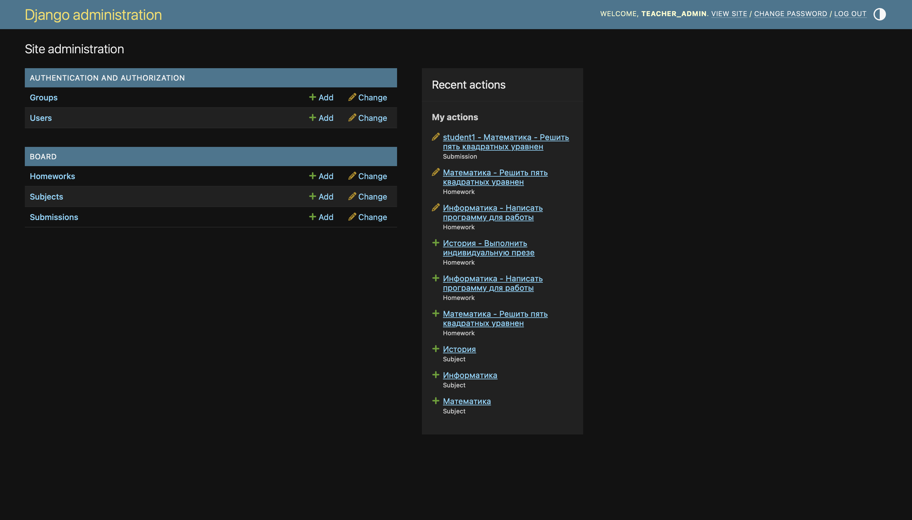
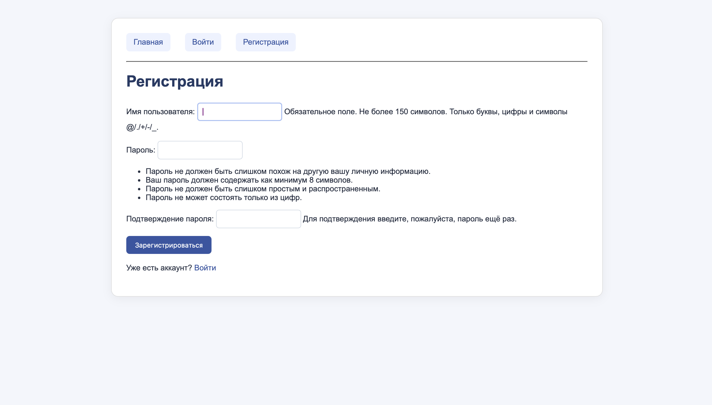
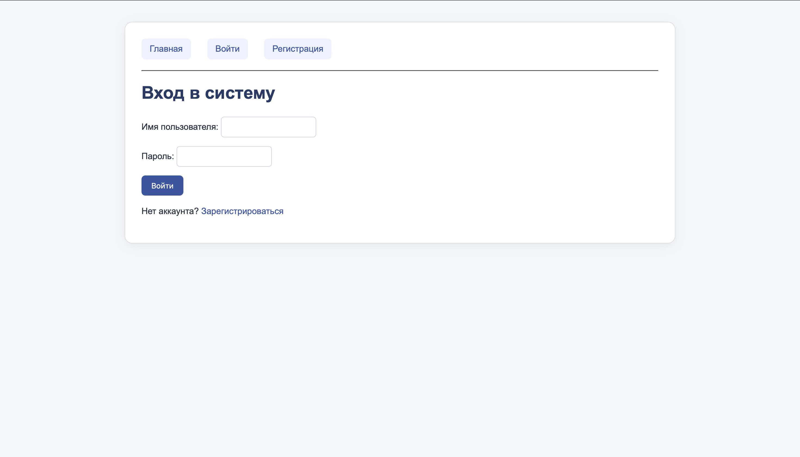
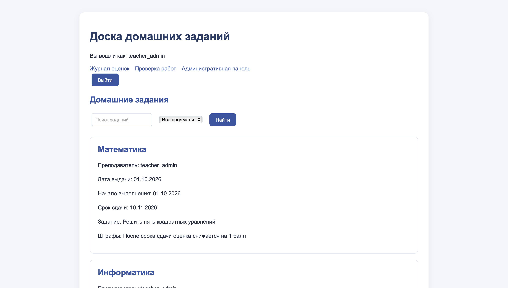
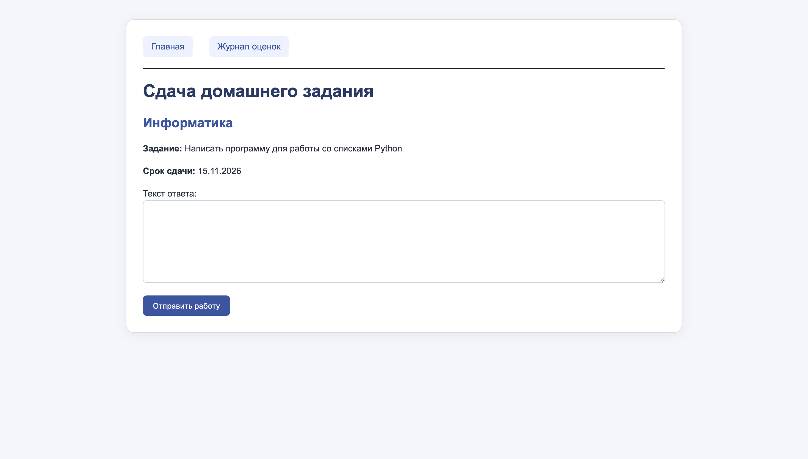
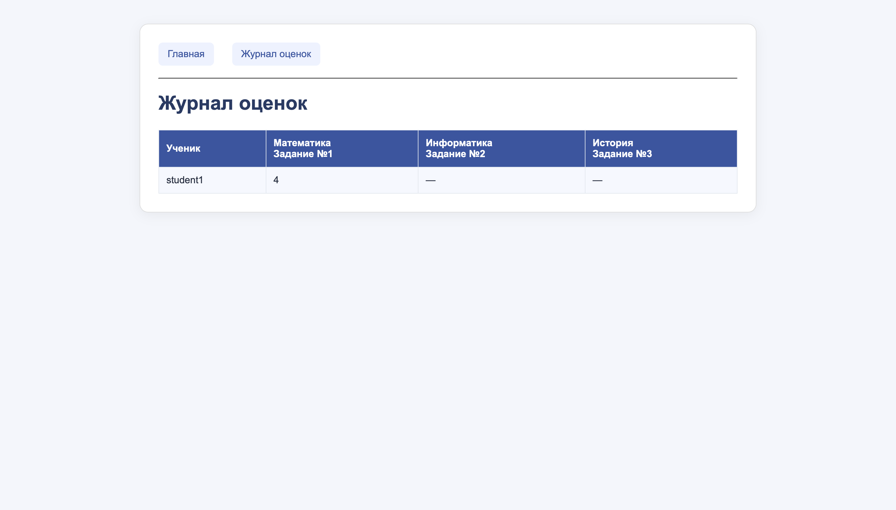
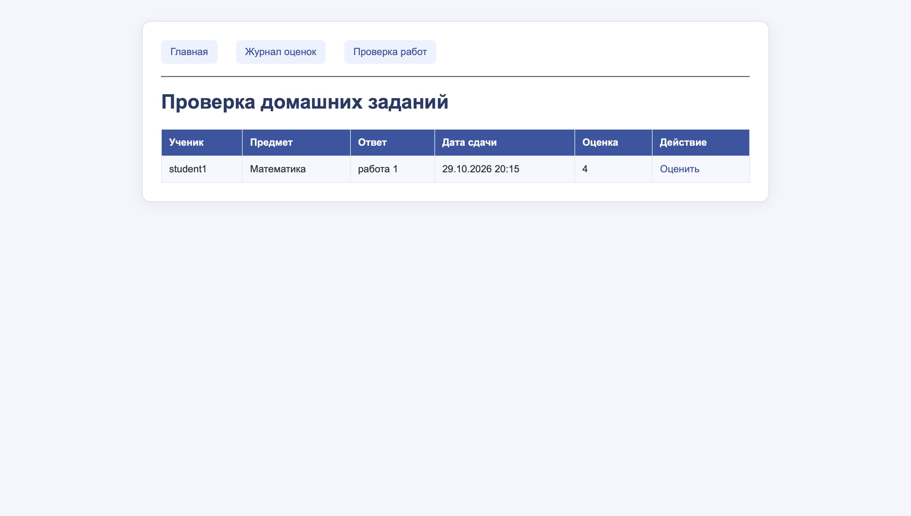
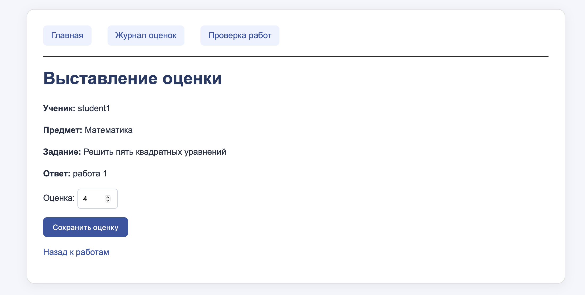

# Лабораторная работа №2. Разработка сайта на Django

**Вариант №2:** «Доска домашних заданий»  

## Цель работы

Изучить основы разработки веб-приложений с использованием фреймворка Django, шаблонизатора Jinja2 и СУБД PostgreSQL. Научиться создавать модели данных, обрабатывать HTTP-запросы, работать с формами, организовывать регистрацию и авторизацию пользователей, а также разграничивать права доступа.

В лабораторной работе реализован сайт «Доска домашних заданий», на котором ученики могут просматривать задания и сдавать текстовые ответы, а преподаватель может проверять работы и выставлять оценки.

## 1. Используемые технологии

| Технология | Назначение |
|---|---|
| Python | Язык программирования серверной части |
| Django | Фреймворк для создания сайта и обработки запросов |
| PostgreSQL | Хранение пользователей, заданий, ответов и оценок |
| Django ORM | Работа с таблицами базы данных через модели Python |
| Jinja2 | Формирование HTML-страниц с динамическими данными |
| HTML, CSS | Структура и оформление пользовательского интерфейса |
| Django-admin | Управление предметами, заданиями и оценками |


### Подготовительные практики

Перед индивидуальным заданием были выполнены практики 2.1–2.3: создан учебный Django-проект с моделями автовладельцев и автомобилей, связями через промежуточную таблицу владения, формами CRUD, административной панелью и расширенной моделью пользователя. Для основного задания был создан отдельный проект `homework_board`.

## 2. Структура проекта

Основные файлы :

```text
homework_board/
├── manage.py
├── homework_project/
│   ├── settings.py
│   ├── urls.py
│   └── jinja2.py
└── board/
    ├── models.py
    ├── views.py
    ├── forms.py
    ├── admin.py
    ├── urls.py
    ├── migrations/
    ├── jinja2/board/
    │   ├── base.html
    │   ├── homework_list.html
    │   ├── register.html
    │   ├── login.html
    │   ├── submit_homework.html
    │   ├── grade_list.html
    │   ├── teacher_submissions.html
    │   └── grade_submission.html
    └── static/board/style.css
```

`manage.py` используется для запуска сервера и миграций. В `models.py` описаны таблицы, в `views.py` логика обработки запросов, в `urls.py` адреса страниц. Шаблоны Jinja2 находятся в папке `jinja2/board/`, а стили в `static/board/style.css`.

## 3. Модель данных

Для хранения данных используется PostgreSQL. В приложении `board` созданы три модели, связанные со стандартной моделью пользователя Django.

| Модель | Основные поля | Назначение |
|---|---|---|
| `User` (Django) | `username`, `password`, `is_staff` | Ученик, преподаватель или администратор |
| `Subject` | `id`, `name` | Дисциплина |
| `Homework` | `subject`, `teacher`, `assigned_date`, `start_date`, `due_date`, `description`, `penalty_info` | Домашнее задание |
| `Submission` | `homework`, `student`, `answer_text`, `submitted_at`, `grade` | Сданная работа и её оценка |

### Связи между моделями

| Связь | Тип | Объяснение |
|---|---|---|
| `Subject` → `Homework` | Один ко многим | По одному предмету может быть несколько заданий |
| `User` (teacher) → `Homework` | Один ко многим | Один преподаватель может выдать несколько заданий |
| `Homework` → `Submission` | Один ко многим | Одно задание могут сдавать разные ученики |
| `User` (student) → `Submission` | Один ко многим | Один ученик может сдать несколько работ |

### Основные модели `models.py`

```python
class Subject(models.Model):
    name = models.CharField(max_length=100, unique=True)

    def __str__(self):
        return self.name


class Homework(models.Model):
    subject = models.ForeignKey(Subject, on_delete=models.CASCADE)
    teacher = models.ForeignKey(settings.AUTH_USER_MODEL, on_delete=models.CASCADE)
    assigned_date = models.DateField(default=timezone.localdate)
    start_date = models.DateField()
    due_date = models.DateField()
    description = models.TextField()
    penalty_info = models.TextField(blank=True)

    def __str__(self):
        return f"{self.subject} - {self.description[:30]}"


class Submission(models.Model):
    homework = models.ForeignKey(Homework, on_delete=models.CASCADE)
    student = models.ForeignKey(settings.AUTH_USER_MODEL, on_delete=models.CASCADE)
    answer_text = models.TextField()
    submitted_at = models.DateTimeField(auto_now_add=True)
    grade = models.IntegerField(null=True, blank=True)

    def __str__(self):
        return f"{self.student.username} - {self.homework}"
```

Поле `ForeignKey` задаёт связь с другой таблицей. `on_delete=models.CASCADE` означает удаление зависимых записей при удалении связанного объекта. Поле `submitted_at` заполняется автоматически при сдаче работы, а `grade` может оставаться пустым до проверки преподавателем.

### PostgreSQL и миграции

Для подключения базы данных в `settings.py` используется движок:

```python
'ENGINE': 'django.db.backends.postgresql',
'NAME': 'homework_board_db',
```

После создания моделей структура базы формируется командами:

```bash
python3 manage.py makemigrations
python3 manage.py migrate
```

Первая команда создаёт миграции, вторая применяет их к PostgreSQL.

## 4. Административная панель Django

Модели `Subject`, `Homework` и `Submission` зарегистрированы в `board/admin.py`. Для удобства используются `list_display`, `list_filter` и `search_fields`.

Пример настройки списка сданных работ:

```python
@admin.register(Submission)
class SubmissionAdmin(admin.ModelAdmin):
    list_display = ['id', 'student', 'homework', 'submitted_at', 'grade']
    list_filter = ['grade', 'homework__subject']
    search_fields = ['student__username']
```

Через административную панель преподаватель может просматривать ответы учеников и устанавливать значение поля `grade`.

#### административная панель



## 5. Регистрация и авторизация пользователей

На сайте реализованы страницы регистрации, входа и выхода. Для регистрации используется стандартная форма Django `UserCreationForm`, которая проверяет вводимые данные и сохраняет пароль в виде хеша.

### Регистрация в `views.py`

```python
def register(request):
    if request.method == 'POST':
        form = UserCreationForm(request.POST)
        if form.is_valid():
            form.save()
            return redirect('login')
    else:
        form = UserCreationForm()

    return render(request, 'board/register.html', {'form': form})
```

Для авторизации используются `LoginView` и `LogoutView` из Django. Сессия позволяет определить текущего пользователя через `request.user`.

В Jinja2-шаблонах формы отправляются методом `POST` и используют CSRF-защиту:

```html
<form method="post">
    {{ csrf_input }}
    {{ form.as_p() | safe }}
    <button type="submit">Зарегистрироваться</button>
</form>
```

#### регистрация и логин





## 6. Просмотр домашних заданий

Главная страница показывает задания по всем дисциплинам: название предмета, преподавателя, дату выдачи, начало и срок выполнения, описание и информацию о штрафах.

### Поиск, фильтрация и пагинация

Во `views.py` реализован поиск по описанию задания и названию предмета, фильтрация по дисциплине, а также разбиение результатов на страницы.

```python
def homework_list(request):
    homeworks = Homework.objects.select_related('subject', 'teacher').order_by('due_date')
    subjects = Subject.objects.all()

    search = request.GET.get('search', '').strip()
    subject_id = request.GET.get('subject', '')

    if search:
        homeworks = homeworks.filter(
            Q(description__icontains=search) |
            Q(subject__name__icontains=search)
        )

    if subject_id:
        homeworks = homeworks.filter(subject_id=subject_id)

    paginator = Paginator(homeworks, 2)
    page_obj = paginator.get_page(request.GET.get('page'))
```

`Q()` объединяет условия поиска, `icontains` позволяет искать подстроку без учёта регистра, `Paginator` показывает по два задания на одной странице.

В HTML используется Jinja2-цикл:

```html

    <div class="homework">
        <h2>{{ homework.subject.name }}</h2>
        <p>Задание: {{ homework.description }}</p>
        <p>Срок сдачи: {{ homework.due_date.strftime('%d.%m.%Y') }}</p>
    </div>

    <p>Задания не найдены</p>

```

### скрин доски



## 7. Сдача домашнего задания

Авторизованный ученик может открыть форму задания и отправить текст ответа. Для этого используется модель `Submission` и форма `SubmissionForm`, содержащая только поле `answer_text`.

### Основная логика `submit_homework()`

```python
@login_required
def submit_homework(request, homework_id):
    homework = get_object_or_404(Homework, pk=homework_id)

    if request.user.is_staff:
        messages.error(request, 'Преподаватель не может сдавать задания.')
        return redirect('homework_list')

    if Submission.objects.filter(homework=homework, student=request.user).exists():
        messages.info(request, 'Вы уже сдали это задание.')
        return redirect('homework_list')

    if request.method == 'POST':
        form = SubmissionForm(request.POST)
        if form.is_valid():
            submission = form.save(commit=False)
            submission.homework = homework
            submission.student = request.user
            submission.save()
            return redirect('homework_list')
```

Декоратор `@login_required` требует авторизации. Проверка `is_staff` запрещает преподавателю сдавать работы как ученик. Условие `exists()` не позволяет повторно отправить то же задание через это представление.

`commit=False` создаёт объект без немедленной записи в базу: сначала сервер назначает текущего ученика и домашнее задание, затем вызывает `save()`.

После отправки появляется запись в `Submission`, а оценка остаётся пустой до проверки.

### скрин формы сдачи



## 8. Журнал оценок

На странице `/grades/` формируется таблица оценок всех обычных пользователей (`is_staff=False`) по домашним заданиям.

Столбцы соответствуют заданиям, а строки ученикам. Если оценка отсутствует, выводится знак `—`.

### Формирование данных для таблицы

```python
students = User.objects.filter(is_staff=False).order_by('username')
homeworks = list(Homework.objects.select_related('subject').order_by('id'))
submissions = Submission.objects.all()

grades = {}
for submission in submissions:
    grades[(submission.student_id, submission.homework_id)] = submission.grade
```

Ключ словаря `grades` - пара `(ID ученика, ID задания)`. По этой паре определяется оценка для конкретной ячейки таблицы. При подготовке строк перебираются все ученики и все задания.

Фрагмент шаблона Jinja2:

```html

<tr>
    <td>{{ row.student.username }}</td>
    
        <td>{{ grade }}</td>
    
</tr>

```

#### скрин журнала



## 9. Интерфейс преподавателя и разграничение прав

Для преподавателя добавлены страницы просмотра сданных работ и выставления оценок прямо на сайте, помимо Django-admin.

### Проверка прав доступа

```python
@login_required
def teacher_submissions(request):
    if not request.user.is_staff:
        return HttpResponseForbidden('Доступ запрещён')

    submissions = Submission.objects.select_related(
        'student', 'homework__subject'
    ).order_by('-submitted_at')

    return render(request, 'board/teacher_submissions.html', {
        'submissions': submissions
    })
```

Доступ к странице имеют только авторизованные пользователи с `is_staff=True`. Обычный ученик получает HTTP-ответ **403 Forbidden**.

Для выставления оценки используется `GradeForm`, ограничивающая допустимое значение диапазоном от 1 до 5. При сохранении формы с `instance=submission` редактируется уже существующая работа:

```python
form = GradeForm(request.POST, instance=submission)
if form.is_valid():
    form.save()
```

В Jinja2-ссылке на работу её ID передаётся через `args`:

```html
<a href="{{ url('grade_submission', args=[submission.id]) }}">
    Оценить
</a>
```

Таким образом преподаватель может видеть текст ответа ученика и выставлять оценку непосредственно в браузере. Проверка прав выполняется не только в шаблоне, но и на сервере.

### скрины интерфейса преподавателя





## 10. Оформление интерфейса

Пользовательские страницы реализованы с помощью **Jinja2**, а оформление вынесено в CSS-файл `board/static/board/style.css`.

Используются светлый фон, карточки заданий, стилизованные кнопки и формы, таблица журнала, навигация и адаптация под небольшую ширину экрана.

Подключение CSS в Jinja2:

```html
<link rel="stylesheet" href="{{ static('board/style.css') }}">
```

Для нескольких страниц используется общий шаблон `base.html` с блоком:

```html


```

Административная панель Django продолжает использовать стандартный шаблонизатор Django; пользовательский интерфейс работает с Jinja2.

## 11. Основные страницы сайта

| URL | Метод | Назначение | Доступ |
|---|---|---|---|
| `/` | GET | Просмотр заданий, поиск, фильтрация, пагинация | Все |
| `/register/` | GET, POST | Регистрация | Все |
| `/login/` | GET, POST | Вход | Все |
| `/logout/` | POST | Выход | Авторизованные |
| `/homework/<id>/submit/` | GET, POST | Сдача текстового ответа | Ученик |
| `/grades/` | GET | Журнал оценок | Авторизованные |
| `/teacher/submissions/` | GET | Просмотр сданных работ | Преподаватель |
| `/teacher/submissions/<id>/grade/` | GET, POST | Выставление оценки | Преподаватель |
| `/admin/` | GET, POST | Администрирование данных | Администратор |

## 12. Проверка работы приложения

Для проверки функциональности предусмотрены следующие сценарии:

| Действие | Ожидаемый результат |
|---|---|
| Регистрация нового пользователя | Пользователь создаётся и может войти в систему |
| Поиск задания по названию дисциплины | Выводятся соответствующие задания |
| Выбор дисциплины в фильтре | Список ограничивается выбранным предметом |
| Переключение страниц | Отображается следующая часть списка заданий |
| Сдача ответа учеником | В базе появляется запись `Submission` |
| Повторная попытка сдачи | Отображается сообщение о ранее сданном задании |
| Выставление оценки преподавателем | Оценка сохраняется и появляется в журнале |
| Открытие страницы преподавателя учеником | Возвращается ошибка 403 |

Для запуска проекта из папки `homework_board` используются команды:

```bash
python3 manage.py check
python3 manage.py runserver
```

После запуска сайт доступен локально по адресу `http://127.0.0.1:8000/`


## Вывод

В ходе лабораторной работы был создан сайт «Доска домашних заданий» с использованием Django, PostgreSQL и Jinja2.

Были реализованы модели дисциплин, домашних заданий и сданных работ, административная панель, регистрация и авторизация пользователей, просмотр и поиск заданий, сдача текстовых ответов и выставление оценок.