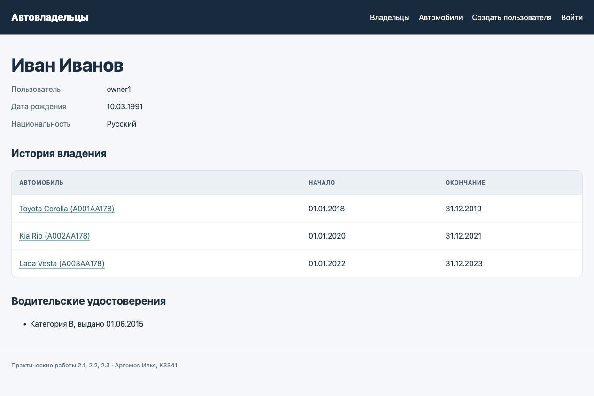
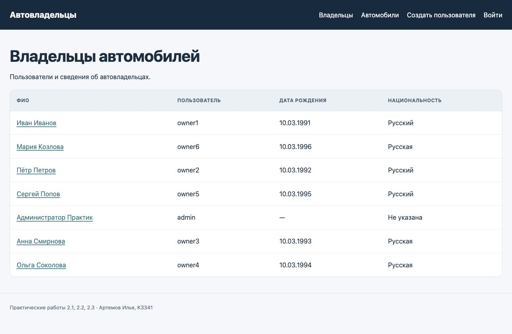
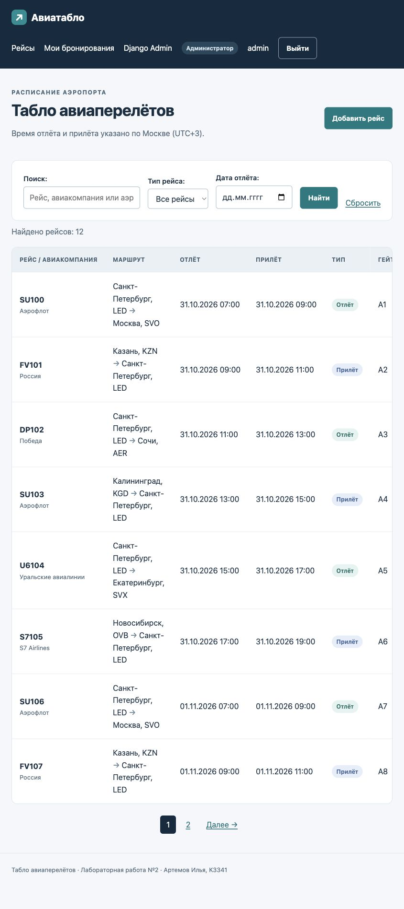
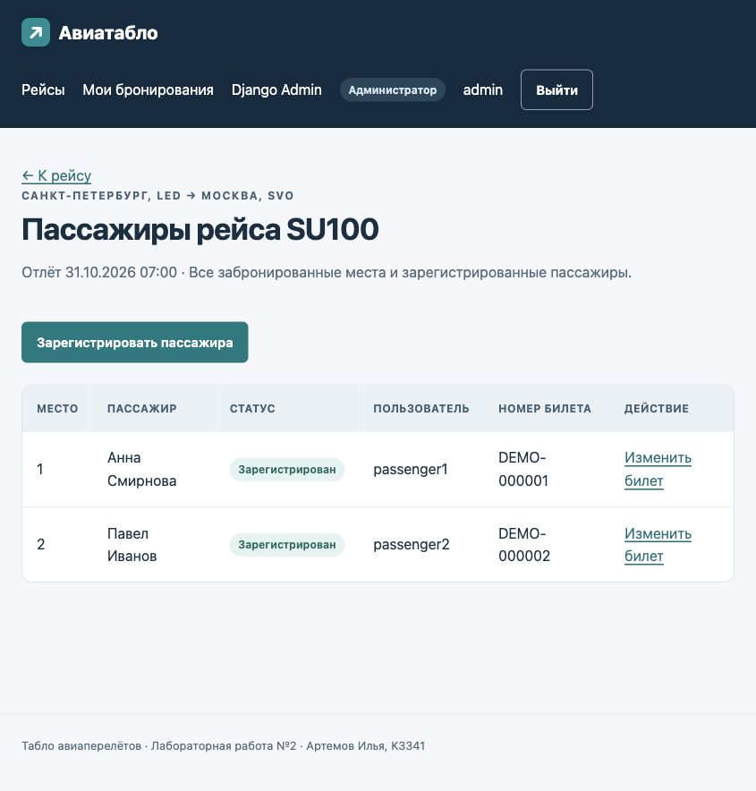
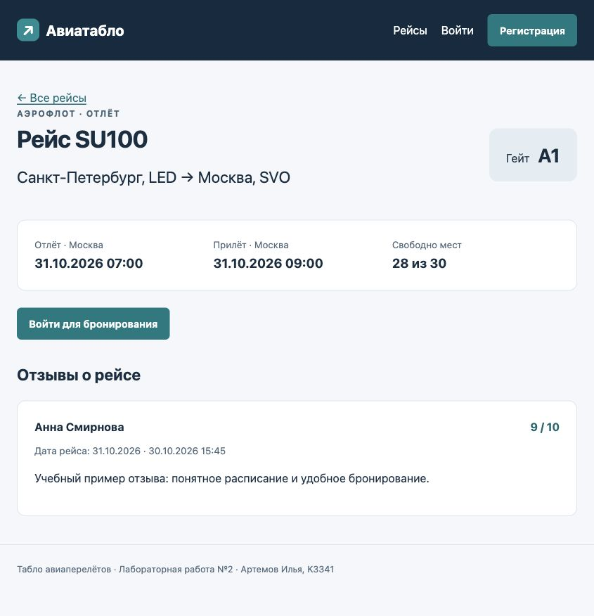

# Лабораторная работа №2. Простой сайт на Django

Выполнил. Артемов Илья, группа K3341. Вариант 3. Табло авиаперелётов.

## Цель работы

Изучить разработку веб-сервисов средствами Django. Научиться описывать модели данных, работать с PostgreSQL, обрабатывать запросы, создавать формы и шаблоны, разграничивать права пользователей.

## Задание и программное обеспечение

Задача. Выполнить практические работы [2.1](https://rendex85.github.io/ITMO_ICT_WebDevelopment_Docs/lab2/practice1/), [2.2](https://rendex85.github.io/ITMO_ICT_WebDevelopment_Docs/lab2/practice2/), [2.3](https://rendex85.github.io/ITMO_ICT_WebDevelopment_Docs/lab2/practice3/) и реализовать сайт по [варианту 3](https://rendex85.github.io/ITMO_ICT_WebDevelopment_Docs/lab2/assignment/). Использовать Django, шаблоны Jinja2 и СУБД PostgreSQL. Оформить отчёт средствами MkDocs.

Вариант 3 - табло авиаперелётов. О рейсе хранятся номер, авиакомпания, аэропорты и время отлёта и прилёта, тип рейса и гейт. Пользователь регистрируется, просматривает рейсы, бронирует места, изменяет и удаляет свои бронирования, оставляет отзывы с рейтингом 1-10. Администратор регистрирует пассажиров и указывает номера билетов. На сайте выводится таблица пассажиров рейса. Для списка рейсов реализованы поиск, фильтрация и пагинация. Интерфейс оформлен с помощью CSS, действия пользователя и администратора разделены.

Использованы Python 3.13.3, Django 5.2.18, PostgreSQL 18.3, Jinja2 3.1.6 и psycopg 3.3.6. Вместо указанной в задании Django 3 выбрана Django 5.2 LTS, совместимая с установленным Python.

## Структура работы

Код находится в `students/k3341/Artemov_Ilya/laboratory_work_2/`. Практические задания и табло авиаперелётов размещены в отдельных проектах. Отчёт добавлен в общий сайт MkDocs.

```text
laboratory_work_2/
├── requirements.txt
├── .gitignore
├── practice_django/
│   ├── manage.py
│   ├── .env.example
│   ├── django_project_artemov/   # настройки и маршруты проекта практик
│   └── project_first_app/       # модели, FBV, CBV, формы, шаблоны, тесты
└── flight_board/
    ├── manage.py
    ├── .env.example
    ├── config/                  # настройки, URL, окружение Jinja2
    ├── templates/               # клиентские шаблоны Jinja2
    └── flights/                 # модели, представления, формы, admin, тесты
```

## Практическая работа 2.1. Первое приложение Django

Задача. Создать проект `django_project_artemov` и приложение `project_first_app`. Описать модель данных об автовладельцах, выполнить миграции, зарегистрировать модели в Django Admin и вывести сведения о владельце по его идентификатору.

### Проект и модель данных

В приложении описаны четыре модели.

| Модель      | Основные поля и связи                                                                                                                                                                                     |
| ----------------- | --------------------------------------------------------------------------------------------------------------------------------------------------------------------------------------------------------------------------- |
| `CarOwner`      | Имя, фамилия, дата рождения; после выполнения практики 2.3 также учётные данные, паспорт, домашний адрес и национальность |
| `Car`           | Уникальный госномер, марка, модель, необязательный цвет                                                                                                                      |
| `Ownership`     | Внешние ключи на владельца и автомобиль, дата начала и необязательная дата окончания владения                                               |
| `DriverLicense` | Владелец, уникальный номер удостоверения, тип/категория, дата выдачи                                                                                              |

Владельцы и автомобили связаны отношением "многие ко многим" через `Ownership`. У одного владельца может быть несколько водительских удостоверений. Для дат рождения, владения и выдачи удостоверения используется `DateField`, поскольку время суток в этих данных не требуется. Категория удостоверения выбирается из списка.

Если дата окончания владения не указана, в базе хранится `NULL` - владение продолжается. Дата окончания не может быть раньше даты начала. Метод `Ownership.clean()` проверяет, чтобы периоды владения одним автомобилем не пересекались. Дни начала и окончания входят в период, поэтому новый период начинается не раньше следующего дня после окончания предыдущего.

### Миграции и Django Admin

Структура таблиц создаётся миграцией `project_first_app/migrations/0001_initial.py`. Миграция применена к базе данных. Все четыре модели зарегистрированы в Django Admin. Для модели владельца используется `CarOwnerAdmin`, унаследованный от `UserAdmin`.

Для входа в Django Admin создан суперпользователь `admin`. Через админ-панель добавлены два владельца и четыре автомобиля. Через форму с обработчиком-функцией добавлен ещё один владелец, затем ещё три. Через форму с обработчиком-классом добавлены три автомобиля. В результате в базе хранятся шесть учебных владельцев, администратор и семь автомобилей.

Первые два учебных владельца связаны каждый с тремя автомобилями.

| Владелец | Автомобиль | Начало | Окончание       |
| ---------------- | -------------------- | ------------ | ------------------------ |
| `owner1`       | А001АА178         | 01.01.2018   | 31.12.2019               |
| `owner1`       | А002АА178         | 01.01.2020   | 31.12.2021               |
| `owner1`       | А003АА178         | 01.01.2022   | 31.12.2023               |
| `owner2`       | А001АА178         | 01.01.2020   | Продолжается |
| `owner2`       | А002АА178         | 01.01.2022   | Продолжается |
| `owner2`       | А004АА178         | 01.01.2024   | Продолжается |

Пересечений по датам одного автомобиля нет. Добавлены два водительских удостоверения категории B.

### Представление владельца по идентификатору

Обработчик `owner_detail` находится в `views.py`. Адреса приложения подключены в главном `urls.py` через `include()`.

1. Браузер отправляет запрос по адресу `/owner/<int:owner_id>/`.
2. Django извлекает идентификатор из адреса и передаёт его функции `owner_detail`.
3. Функция получает владельца из базы через `get_object_or_404` и передаёт данные в шаблон `templates/owner.html`.
4. Шаблон формирует страницу с данными владельца. Если запись не найдена, сервер возвращает HTTP 404.

Адрес без завершающего `/`, например `/owner/1`, перенаправляется на `/owner/1/`.

В карточке выводятся сведения о пользователе, история владения и удостоверения. Паспорт, адрес, email и номер удостоверения видны самому владельцу и администратору.



## Практическая работа 2.2. Связи и CRUD

Задача. Связать владельцев и автомобили через промежуточную модель с датами владения. Реализовать список и форму создания владельцев с помощью функций, а просмотр, создание, изменение и удаление автомобилей - с помощью классов.

### Описание реализации

Связь владельца с автомобилем задаётся через `ManyToManyField`.

```python
owners = models.ManyToManyField(
    settings.AUTH_USER_MODEL,
    through="Ownership",
    related_name="cars",
    verbose_name="Владельцы",
)
```

Параметр `through="Ownership"` указывает промежуточную модель. В ней хранятся ссылки на владельца и автомобиль, даты начала и окончания владения. По этим записям формируется история смены владельцев.

Список владельцев выводит функция `owner_list`. Создание владельца обрабатывает функция `owner_create`.

1. При GET-запросе `owner_create` показывает пустую форму `OwnerCreationForm`.
2. При POST-запросе форма получает введённые данные и проверяет их.
3. Если данные верны, создаётся пользователь. `UserCreationForm` сохраняет пароль в виде хеша.
4. После сохранения сервер перенаправляет браузер на карточку пользователя. Если есть ошибки, форма выводится повторно с сообщениями об ошибках.

Для автомобилей используются представления на основе классов.

| Интерфейс                                     | Представление | Адрес                |
| ------------------------------------------------------ | -------------------------- | ------------------------- |
| Все владельцы                              | `owner_list`, FBV        | `/` или `/owners/` |
| Один владелец                              | `owner_detail`, FBV      | `/owner/<id>/`          |
| Создание владельца                    | `owner_create`, FBV      | `/owner/create/`        |
| Все автомобили                            | `CarListView`            | `/cars/`                |
| Автомобиль по идентификатору | `CarDetailView`          | `/car/<id>/`            |
| Добавление автомобиля              | `CarCreateView`          | `/car/create/`          |
| Изменение автомобиля                | `CarUpdateView`          | `/car/<id>/update/`     |
| Удаление автомобиля                  | `CarDeleteView`          | `/car/<id>/delete/`     |

Создание и изменение автомобиля выполняются через `CarForm` после входа пользователя. При GET-запросе страницы удаления выводится подтверждение. Запись удаляется только после POST-запроса с CSRF-токеном.



## Практическая работа 2.3. Расширение пользователя

Задача. Сделать владельца автомобиля пользователем. Добавить номер паспорта, домашний адрес и национальность, вывести эти поля в Django Admin и реализовать форму создания пользователя.

### Описание реализации

Модель `CarOwner` наследуется от `AbstractUser`. К стандартным полям пользователя добавлены дата рождения, номер паспорта, адрес и национальность.

```python
birth_date = models.DateField("Дата рождения", null=True, blank=True)
passport_number = models.CharField("Номер паспорта", max_length=20)
home_address = models.CharField("Домашний адрес", max_length=255)
nationality = models.CharField("Национальность", max_length=50)
```

В настройках до создания первой миграции установлено.

```python
AUTH_USER_MODEL = "project_first_app.CarOwner"
```

После этой настройки Django использует `CarOwner` как модель пользователя. Владелец и пользователь хранятся в одной записи. Модели `Ownership` и `DriverLicense` ссылаются на `settings.AUTH_USER_MODEL`.

Список и карточка владельца выводят данные пользователя. Форма по адресу `/owner/create/` создаёт пользователя с новыми полями и паролем. Те же поля добавлены в формы создания и изменения пользователя в Django Admin.

## Лабораторная часть. Вариант 3 - табло авиаперелётов

Задача. Реализовать просмотр рейсов, регистрацию пользователей, бронирование мест, изменение и удаление своих бронирований. Добавить регистрацию пассажиров администратором с указанием номера билета, таблицу пассажиров рейса и отзывы с датой рейса, текстом, рейтингом и автором.

### Модель данных

| Модель    | Поля                                                                                                                                                                                                                                          |
| --------------- | ------------------------------------------------------------------------------------------------------------------------------------------------------------------------------------------------------------------------------------------------- |
| `Flight`      | Номер, авиакомпания, аэропорты отправления и прибытия, время отлёта и прилёта, тип "прилёт/отлёт", гейт, количество мест                         |
| `Reservation` | Пользователь, рейс, ФИО пассажира, номер места, необязательный уникальный номер билета, признак регистрации на рейс, время создания |
| `Review`      | Рейс, пользователь-комментатор, дата рейса, текст, рейтинг 1-10, время публикации                                                                                                  |

Каждое бронирование связано с одним пользователем и одним рейсом. `User → Reservation ← Flight`. Отзыв также связан с пользователем и рейсом. `User → Review ← Flight`. Во всех случаях используется связь один ко многим.

Один пользователь может забронировать несколько мест, указав ФИО пассажиров. Каждая запись `Flight` описывает отдельный перелёт. Сочетание номера рейса и времени отлёта уникально.

Места нумеруются от 1 до `seat_count`. Ограничение `unique_flight_seat` в PostgreSQL запрещает две брони на одно место одного рейса. При сохранении проверяется, что номер места не превышает вместимость. Уменьшить вместимость нельзя, если на исключаемые места уже есть бронирования. Время прилёта должно быть позже времени отлёта. Для регистрации пассажира требуется номер билета.

### Шаблоны и обработка запросов

В Django используется архитектура MVT. Модели описывают данные, представления обрабатывают запросы, шаблоны формируют HTML. Файл `urls.py` связывает адреса с обработчиками.

Страницы табло формируются шаблонами Jinja2. В `config/jinja2.py` подключены функции для получения URL страниц и статических файлов, создания ссылок пагинации, форматирования времени и проверки роли пользователя. Значения автоматически экранируются перед выводом в HTML. Для Django Admin и виджетов форм используется движок Django Templates.

Меню, подключение стилей и вывод сообщений находятся в общем шаблоне `base.html`. Оформление задано локальным CSS-файлом. На узком экране таблица прокручивается внутри своего блока. Время на табло выводится по Москве. В базе хранятся даты со сведениями о часовом поясе.

### Регистрация и права

Для регистрации используется форма по адресу `/accounts/signup/`. Пользователь вводит имя пользователя, имя, фамилию, email и пароль. Форма проверяет совпадение и сложность паролей, уникальность имени пользователя. После сохранения выполняется вход. Новая учётная запись получает права обычного пользователя.

| Действие                                                             | Гость            | Пользователь         | Администратор                                                                               |
| ---------------------------------------------------------------------------- | --------------------- | -------------------------------- | -------------------------------------------------------------------------------------------------------- |
| Просмотр и поиск рейсов, чтение отзывов     | Да                  | Да                             | Да                                                                                                     |
| Создание бронирования и отзыва                    | После входа | Да                             | Да                                                                                                     |
| Изменение и удаление своих бронирований   | Нет                | Да                             | Да                                                                                                     |
| Таблица всех пассажиров выбранного рейса | После входа | ФИО, место, статус | Дополнительно пользователь, билет, действия регистрации |
| Регистрация пассажира, указание билета     | Нет                | Нет                           | В Django Admin и клиентском интерфейсе                                             |
| Управление рейсами                                          | Нет                | Нет                           | Через Django Admin, ссылки доступны в клиентском интерфейсе      |

При выводе страницы шаблон проверяет `is_staff`/`is_superuser` и показывает административные действия только администратору. Сервер повторно проверяет права при обработке запроса. Если обычный пользователь напрямую запрашивает административное действие, сервер возвращает HTTP 403.

Для изменения и удаления бронирование ищется среди записей текущего пользователя. Поэтому запрос чужой брони возвращает HTTP 404.

### Интерфейсы сайта

Адреса в таблице приведены относительно `http://127.0.0.1:8000`.

| Адрес                        | Интерфейс и поведение                                                                                                                                             |
| --------------------------------- | ------------------------------------------------------------------------------------------------------------------------------------------------------------------------------------ |
| `/`                             | Табло, поиск по номеру, авиакомпании и аэропортам, фильтры типа и даты отлёта, пагинация по 8 рейсов |
| `/flights/<id>/`                | Карточка рейса, свободные места, отзывы, доступные текущей роли действия                                                |
| `/accounts/signup/`             | Регистрация нового пользователя                                                                                                                         |
| `/accounts/login/`              | Вход; после входа учитывается безопасный параметр `next`                                                                                |
| `/accounts/logout/`             | Выход POST-запросом из навигационного меню                                                                                                          |
| `/flights/<id>/reserve/`        | Форма выбора рейса, ФИО пассажира и места                                                                                                          |
| `/reservations/`                | Все бронирования текущего пользователя                                                                                                            |
| `/reservations/<id>/edit/`      | Изменение собственного бронирования                                                                                                                 |
| `/reservations/<id>/delete/`    | Подтверждение и удаление собственного бронирования                                                                                     |
| `/flights/<id>/passengers/`     | Таблица всех пассажиров рейса с разграничением столбцов и действий по роли                                           |
| `/reservations/<id>/check-in/`  | Регистрация существующей брони администратором, ввод номера билета                                                        |
| `/flights/<id>/passengers/new/` | Добавление администратором нового пассажира сразу с билетом и регистрацией                                         |
| `/flights/<id>/reviews/new/`    | Добавление отзыва с текстом и оценкой от 1 до 10                                                                                                 |
| `/admin/`                       | Управление пользователями, рейсами, бронированиями и отзывами                                                                  |

Поиск не зависит от регистра, в том числе для кириллицы при UTF-8 локали PostgreSQL. Рейсы можно отфильтровать по типу и дате отлёта. На странице выводится до 8 рейсов, отсортированных по времени отлёта и идентификатору. При переходе на следующую страницу поисковая строка и фильтры сохраняются. Если дата или тип указаны неверно, форма выводит сообщение об ошибке.



### Бронирование и регистрация пассажира

Бронирование выполняется через форму.

1. Пользователь выбирает рейс, вводит ФИО пассажира и номер места.
2. Сервер получает пользователя из `request.user` и связывает с ним бронирование. Номер билета и признак регистрации обычный пользователь не задаёт.
3. Форма проверяет номер места и его доступность.
4. После сохранения сервер перенаправляет браузер на страницу "Мои бронирования".

Если пользователь меняет рейс, место или ФИО, номер билета и регистрация сбрасываются. После изменения данных администратор регистрирует пассажира повторно. Об этом сообщается на странице бронирований. Для удаления сначала выводится страница подтверждения, затем обрабатывается POST-запрос.

При сохранении бронирования открывается транзакция. Метод `select_for_update()` блокирует запись рейса до её завершения. Данные проверяются повторно, а ограничение PostgreSQL не допускает двух бронирований одного места. Если два пользователя одновременно выбирают одно место, сохраняется одна бронь, а второй пользователь получает сообщение об ошибке.

Для регистрации пассажира администратор открывает бронирование в Django Admin, указывает номер билета и отмечает "Зарегистрирован на рейс". Зарегистрировать пассажира можно и через таблицу пассажиров на сайте.

Пример работы. Второму учебному пассажиру присвоен билет `DEMO-000002`. После сохранения в таблице отображаются номер билета и статус "Зарегистрирован".



### Отзывы

В форме отзыва пользователь вводит текст и целый рейтинг от 1 до 10. Автор определяется по текущему сеансу, дата рейса - по времени отлёта выбранного рейса в московском часовом поясе. Эти значения задаются сервером и не принимаются из POST-параметров.

Дата рейса и дата публикации хранятся отдельно. Диапазон рейтинга проверяют форма, валидаторы модели и ограничение PostgreSQL. Перед выводом текст экранируется, поэтому введённые HTML-теги не выполняются в браузере.



## Запуск на macOS

### Запуск подготовленных проектов

Для локального запуска подготовлены виртуальное окружение и две базы данных. Кластер PostgreSQL находится в `.postgres` и использует порт **55432**. Он запускается отдельно от других серверов PostgreSQL.

1. В терминале VS Code (**Terminal → New Terminal**) выполняется переход в папку работы и активация окружения.

   ```bash
   cd /Users/goodkid/ITMO_ICT_WebDevelopment_2026-2027/students/k3341/Artemov_Ilya/laboratory_work_2
   source .venv/bin/activate
   ```
2. Состояние PostgreSQL проверяется командой.

   ```bash
   /Library/PostgreSQL/18/bin/pg_isready -h 127.0.0.1 -p 55432
   ```

   Если сервер остановлен, команда выводит `no response`. Для запуска кластера из папки `laboratory_work_2` используется.

   ```bash
   /Library/PostgreSQL/18/bin/pg_ctl -D "$PWD/.postgres" -l "$PWD/.postgres/server.log" -o "-h 127.0.0.1 -p 55432 -k /tmp" start
   ```
3. Перед первым входом задаётся пароль существующему администратору табло.

   ```bash
   cd flight_board
   python manage.py changepassword admin
   ```

   Новый пароль вводится дважды. Символы при вводе не отображаются. Пароль задаётся локально и не хранится в исходном коде и отчёте.
4. Сервер табло запускается командой.

   ```bash
   python manage.py runserver 127.0.0.1:8000
   ```

   После запуска доступны [табло](http://127.0.0.1:8000/) и [Django Admin табло](http://127.0.0.1:8000/admin/). Имя администратора - `admin`, пароль задаётся предыдущей командой. Обычный пользователь создаётся через форму "Регистрация".
5. Проект практических работ запускается во втором терминале.

   ```bash
   cd /Users/goodkid/ITMO_ICT_WebDevelopment_2026-2027/students/k3341/Artemov_Ilya/laboratory_work_2
   source .venv/bin/activate
   cd practice_django
   python manage.py changepassword admin
   python manage.py runserver 127.0.0.1:8001
   ```

   После запуска доступны [список владельцев](http://127.0.0.1:8001/), [автомобили](http://127.0.0.1:8001/cars/) и [Django Admin практик](http://127.0.0.1:8001/admin/). В этом проекте своя учётная запись `admin` и отдельно заданный пароль.
6. Сайт MkDocs запускается в третьем терминале из корня репозитория.

   ```bash
   cd /Users/goodkid/ITMO_ICT_WebDevelopment_2026-2027
   .venv/bin/mkdocs serve -a 127.0.0.1:8002
   ```

   Отчёт доступен по адресу [http://127.0.0.1:8002/lr2/report/](http://127.0.0.1:8002/lr2/report/).
7. Каждый веб-сервер останавливается сочетанием **Control+C** в его терминале. После остановки Django-проектов кластер PostgreSQL останавливается командой.

   ```bash
   cd /Users/goodkid/ITMO_ICT_WebDevelopment_2026-2027/students/k3341/Artemov_Ilya/laboratory_work_2
   /Library/PostgreSQL/18/bin/pg_ctl -D "$PWD/.postgres" stop -m fast
   ```

### Повторное развёртывание из исходного кода

При переносе проекта на другой компьютер сначала создаются окружение и базы данных. Для подготовленной локальной копии повторять эти действия не требуется.

1. В папке `laboratory_work_2` создаётся окружение Python 3.13 и устанавливаются зависимости.

   ```bash
   python3.13 -m venv .venv
   source .venv/bin/activate
   python -m pip install -r requirements.txt
   ```
2. В PostgreSQL создаются роль и две базы. Команды выполняются под администратором PostgreSQL через SQL Shell или pgAdmin.

   ```sql
   CREATE ROLE web_lab2 LOGIN CREATEDB;
   ```

   В `psql` пароль роли задаётся командой `\password web_lab2`. Затем создаются базы.

   ```sql
   CREATE DATABASE web_lab2_practice OWNER web_lab2 ENCODING 'UTF8';
   CREATE DATABASE web_lab2_flights OWNER web_lab2 ENCODING 'UTF8';
   ```

   Для поиска русских названий без учёта регистра используется UTF-8 локаль с поддержкой кириллицы, например `en_US.UTF-8`. Локаль `C` для этого не подходит. Право `CREATEDB` позволяет команде `manage.py test` создать отдельную тестовую базу.
3. Файлы `practice_django/.env.example` и `flight_board/.env.example` копируются в `.env` внутри соответствующих проектов. В каждом задаются `DJANGO_SECRET_KEY`, пароль роли `DB_PASSWORD` и порт `DB_PORT`. Для проектов указаны разные имена баз. Файлы `.env` исключены из Git.
4. В каждом проекте применяются миграции, добавляются учебные данные и создаётся суперпользователь.

   ```bash
   python manage.py migrate
   python manage.py seed_demo
   python manage.py createsuperuser
   ```

   Команда `seed_demo` добавляет учебные данные, сохраняя существующие записи. В практиках создаются 6 владельцев, 7 автомобилей, 6 записей владения и 2 удостоверения. В табло создаются 12 рейсов, 2 пассажира и пример отзыва. Пароли новым учебным пользователям не задаются. Для входа используется отдельная учётная запись или пароль задаётся командой `changepassword`.
5. Проекты запускаются на разных портах командами из предыдущего раздела. Файлы миграций включены в работу, поэтому повторно создавать их не требуется.

### Пример работы

1. В проекте практик открывается список пользователей. Карточка владельца показывает его данные и историю трёх автомобилей. В Django Admin доступны четыре модели и новые поля пользователя.
2. Через форму "Создать пользователя" добавляется владелец с паспортом, адресом и национальностью. После входа через раздел "Автомобили" создаётся автомобиль, изменяются его данные и открывается подтверждение удаления.
3. В табло пользователь регистрируется, ищет рейсы по авиакомпании, применяет фильтры и переходит между страницами общего списка.
4. В карточке рейса пользователь бронирует свободное место и пишет отзыв. На странице "Мои бронирования" он изменяет свою бронь. При запросе чужой брони сервер возвращает HTTP 404.
5. Администратор открывает **Табло авиаперелётов → Бронирования** в Django Admin, указывает номер билета и отмечает регистрацию пассажира. После сохранения билет и статус отображаются в таблице пассажиров. Второй способ регистрации доступен через клиентский интерфейс сайта.
6. Отчёт открывается на локальном сайте MkDocs.

## Проверка результата

Проверка выполнена с использованием PostgreSQL.

В папке каждого проекта выполняются команды.

```bash
python manage.py check
python manage.py makemigrations --check --dry-run
python manage.py test --noinput
```

Выполнены 20 функциональных тестов. Из них 6 для практик и 14 для табло. Все тесты завершились с результатом `OK`. Проверены.

- создание расширенного пользователя через FBV и Django Admin, сохранение полей и хеширование пароля;
- CBV создания, просмотра, изменения и удаления автомобилей;
- связи M2M, непересечение периодов и минимальное количество учебных данных;
- права на личные данные владельца и на собственные бронирования;
- вход, регистрация, отсутствие повышения прав через POST-параметры и выход только через POST;
- диапазон мест, занятое место, вместимость, уникальность билетов и регистрация только с билетом;
- регистрация пассажира через Django Admin и клиентский интерфейс;
- сохранение автора и даты отзыва, границы рейтинга, экранирование HTML;
- поиск кириллицей, фильтры, пагинация, некорректные параметры и CSRF;
- одновременное бронирование одного места двумя независимыми клиентами. Одна запись и корректная ошибка второй формы.

В браузере проверены страницы обоих проектов, поиск кириллицей, вход администратора, сохранение билета и статуса пассажира, история владения и оформление страниц. Сайт документации собирается из корня репозитория командой `.venv/bin/mkdocs build --strict`.

## Вывод

В ходе работы изучена разработка веб-сервисов средствами Django. Реализованы приложение об автовладельцах и табло авиаперелётов с базами PostgreSQL. В практических заданиях описаны модели, выполнены миграции, созданы представления на основе функций и классов, расширена модель пользователя. В табло реализованы бронирование мест, регистрация пассажиров, отзывы, поиск, фильтрация, пагинация и разграничение прав. Отчёт оформлен средствами MkDocs.
