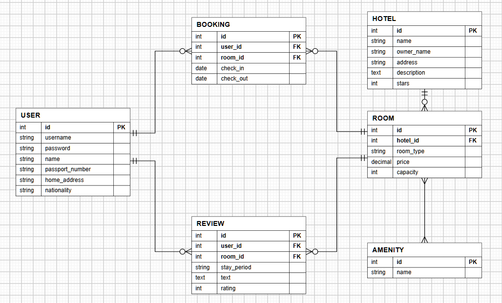
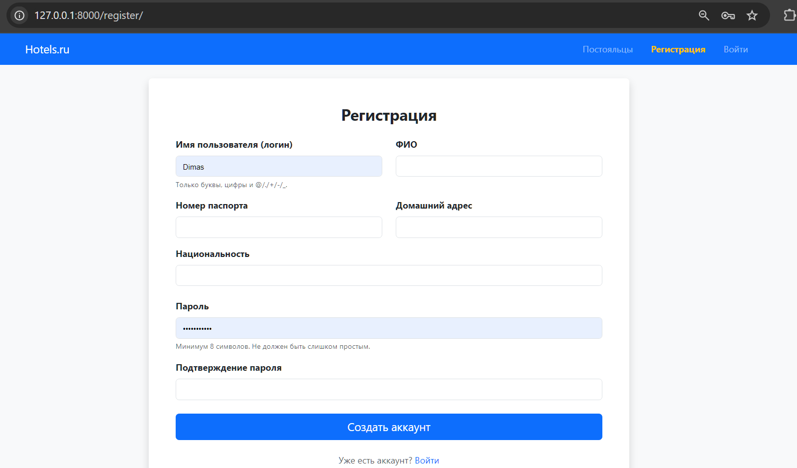
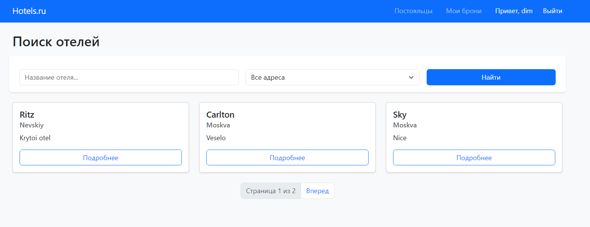
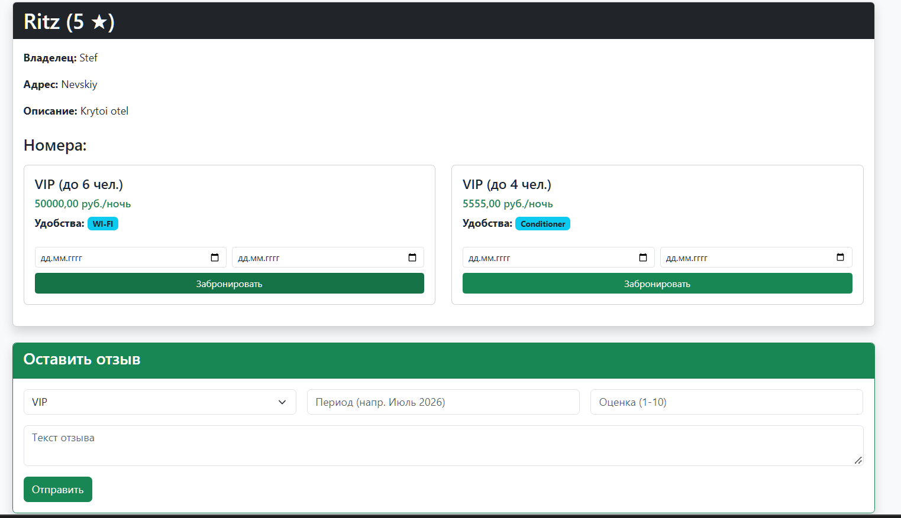
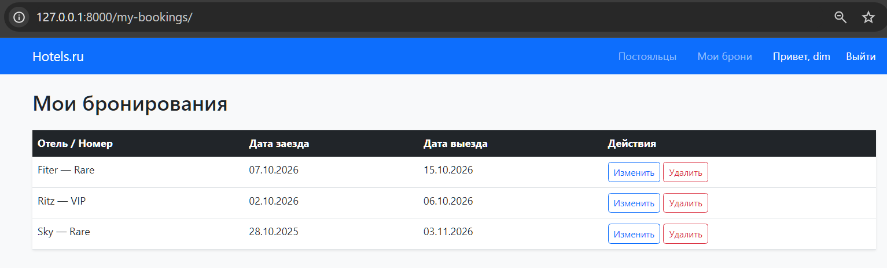
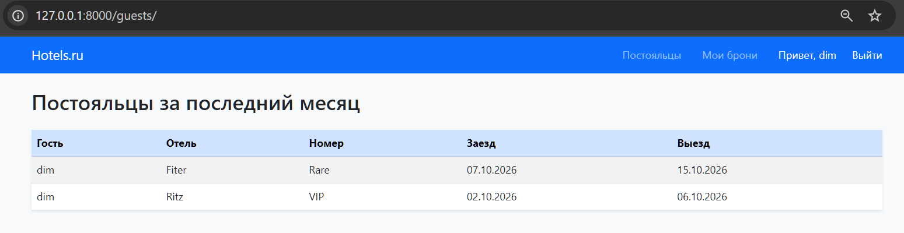
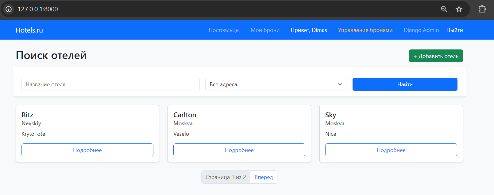
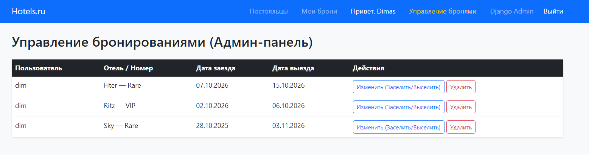

# ЛР2. Простой сайт на Django

**Вариант:** 1 — Список отелей

**Цель работы:** овладеть практическими навыками и умениями реализации web-сервисов средствами Django.

---

## Модель данных
 
Для хранения данных используется СУБД PostgreSQL. Модель данных спроектирована для удобного бронирования номеров и оставления отзывов.

### Основные сущности:
- **User** — пользователь с полями: ФИО, номер паспорта, домашний адрес, национальность.
- **Hotel** — отель (название, владелец, адрес, описание, звезды).
- **Room** — номер (привязка к отелю, тип, цена, вместимость).
- **Amenity** — удобства в номере (Wi-Fi, бассейн и т.д.).
- **Booking** — бронирование (пользователь, номер, даты заезда и выезда).
- **Review** — отзыв (пользователь, номер, текст, рейтинг 1-10, период проживания).

**ER-Диаграмма**



## Ключевые views и шаблоны

### Views:

---

**Список отелей** 

Переопределен метод get_queryset для поиска по названию и фильтрации по адресу, а также get_context_data для передачи списка городов в шаблон.
``` python
class HotelListView(ListView):
    model = Hotel
    template_name = 'hotels_app/hotel_list.html'
    context_object_name = 'hotels'
    paginate_by = 3

    def get_queryset(self):
        queryset = super().get_queryset()
        search = self.request.GET.get('search')
        city = self.request.GET.get('city')
        if search:
            queryset = queryset.filter(name__icontains=search)
        if city:
            queryset = queryset.filter(address__icontains=city)
        return queryset

    def get_context_data(self, **kwargs):
        context = super().get_context_data(**kwargs)
        context['search_query'] = self.request.GET.get('search', '')
        context['city_query'] = self.request.GET.get('city', '')
        context['cities'] = Hotel.objects.values_list('address', flat=True).distinct()
        return context
```

---

**Бронирование и отзывы** 

Функция обрабатывает POST-запросы. В зависимости от того какая кнопка нажата, создается либо объект Booking, либо объект Review.
``` python
def hotel_detail(request, pk):
    hotel = get_object_or_404(Hotel, pk=pk)
    if request.method == 'POST':
        if 'book' in request.POST:
            room = get_object_or_404(Room, pk=request.POST.get('room'))
            check_in = request.POST.get('check_in')
            check_out = request.POST.get('check_out')
            Booking.objects.create(user=request.user, room=room, check_in=check_in, check_out=check_out)
            return redirect('hotel_detail', pk=pk)
        elif 'review' in request.POST:
            room = get_object_or_404(Room, pk=request.POST.get('room'))
            Review.objects.create(
                user=request.user,
                room=room,
                text=request.POST.get('text'),
                rating=request.POST.get('rating'),
                stay_period=request.POST.get('stay_period')
            )
            return redirect('hotel_detail', pk=pk)
    return render(request, 'hotels_app/hotel_detail.html', {'hotel': hotel})
```

---

**Разграничение прав (Администратор)** 

Для управления бронями администратору доступна отдельная вьюха, защищенная декоратором @staff_member_required. Обычные пользователи не имеют права. Также при редактировании проверяется является ли пользователь админом (если да — он может редактировать любую бронь, если нет — только свою).
``` python
@staff_member_required
def all_bookings(request):
    bookings = Booking.objects.all().order_by('-check_in')
    return render(request, 'hotels_app/all_bookings.html', {'bookings': bookings})

@login_required
def booking_update(request, pk):
    if request.user.is_staff:
        booking = get_object_or_404(Booking, pk=pk)
    else:
        booking = get_object_or_404(Booking, pk=pk, user=request.user)

    if request.method == 'POST':
        booking.check_in = request.POST.get('check_in')
        booking.check_out = request.POST.get('check_out')
        booking.save()
        return redirect('all_bookings' if request.user.is_staff else 'my_bookings')
    return render(request, 'hotels_app/booking_update.html', {'booking': booking})
```

---

**Регистрация** 

Регистрация нового пользователя
``` python
class RegisterView(CreateView):
    form_class = CustomUserCreationForm
    template_name = 'hotels_app/register.html'
    success_url = reverse_lazy('login')
```

---

### Шаблоны

**Базовый шаблон и навигация (base.html)**

В шапке сайта реализовано разграничение прав: пункты меню для авторизованных пользователей, гостей и администраторов отличаются. Это реализуется с помощью проверки  и .

``` python
<nav class="navbar navbar-expand navbar-dark bg-primary mb-4">
    <div class="container">
        <a class="navbar-brand" href="">Hotels.ru</a>
        <ul class="navbar-nav ms-auto flex-row gap-3 align-items-center">
            <li class="nav-item"><a class="nav-link" href="">Постояльцы</a></li>

            
                <li class="nav-item"><a class="nav-link" href="">Мои брони</a></li>
                <li class="nav-item"><span class="nav-link text-white">Привет, {{ user.username }}</span></li>

                
                    <li class="nav-item"><a class="nav-link text-warning" href="">Управление бронями</a></li>
                    <li class="nav-item"><a class="nav-link" href="/admin/">Django Admin</a></li>
                

                <li class="nav-item">
                    <form method="post" action="/accounts/logout/" class="m-0">
                        
                        <button type="submit" class="btn btn-link nav-link text-white p-0" style="text-decoration: none;">Выйти</button>
                    </form>
                </li>
            
                <li class="nav-item"><a class="nav-link text-warning fw-bold" href="">Регистрация</a></li>
                <li class="nav-item"><a class="nav-link" href="/accounts/login/">Войти</a></li>
            
        </ul>
    </div>
</nav>
```

---

**Список отелей (hotel_list.html)**

Вывод карточек отелей и элементов, которые сохраняют параметры поиска и фильтрации при переключении страниц.

``` python
<div class="row">
    
        <div class="col-md-4 mb-4">
            <div class="card h-100 shadow-sm">
                <div class="card-body">
                    <h5 class="card-title">{{ hotel.name }}</h5>
                    <h6 class="card-subtitle mb-2 text-muted">{{ hotel.address }}</h6>
                    <p class="card-text">{{ hotel.description|truncatewords:15 }}</p>
                    <a href="" class="btn btn-outline-primary w-100">Подробнее</a>
                </div>
            </div>
        </div>
    
        <div class="col-12"><p class="text-center">Отелей не найдено.</p></div>
    
</div>

<nav>
    <ul class="pagination justify-content-center">
        
            <li class="page-item"><a class="page-link" href="?page={{ page_obj.previous_page_number }}&search={{ search_query }}&city={{ city_query }}">Назад</a></li>
        
        <li class="page-item disabled"><span class="page-link">Страница {{ page_obj.number }} из {{ page_obj.paginator.num_pages }}</span></li>
        
            <li class="page-item"><a class="page-link" href="?page={{ page_obj.next_page_number }}&search={{ search_query }}&city={{ city_query }}">Вперед</a></li>
        
    </ul>
</nav>
```

---

**Управление контентом для администратора (hotel_detail.html)**

В зависимости от роли пользователя на странице отеля отображаются либо формы бронирования/отзывов, либо кнопки редактирования и удаления.

``` python
<div class="card-header bg-dark text-white d-flex justify-content-between align-items-center">
    <h2 class="mb-0">{{ hotel.name }} ({{ hotel.stars }} ★)</h2>
    
        <div>
            <a href="" class="btn btn-warning btn-sm">Редактировать</a>
            <a href="" class="btn btn-danger btn-sm">Удалить</a>
        </div>
    
</div>
...

<form method="post" class="row g-2 mt-3">
    
    <input type="hidden" name="room" value="{{ room.id }}">
    <div class="col-6"><input type="date" name="check_in" class="form-control form-control-sm" required></div>
    <div class="col-6"><input type="date" name="check_out" class="form-control form-control-sm" required></div>
    <div class="col-12"><button type="submit" name="book" class="btn btn-sm btn-success w-100">Забронировать</button></div>
</form>

```

## Скриншоты

---

**Регистрация**



---

**Главная страница**



---

**Карточка отеля**



---

**Мои брони**



---

**Постояльцы отелей**



---

**Главная страница у админа**



---

**Администрирование броней**



---

## Вывод

В ходе выполнения лабораторной работы был разработан полноценный веб-сервис для бронирования отелей с использованием фреймворка Django и СУБД PostgreSQL. В процессе работы были освоены и применены на практике ключевые навыки веб-разработки: проектирование структуры базы данных и создание моделей с использованием Django. Кроме того, была реализована обработка POST-запросов для бронирования номеров и оставления отзывов, настроено разграничение прав доступа на уровне клиента и сервера (с использованием проверки is_staff и декораторов), а также есть фильтрация и поиск по базе данных. Интерфейс сайта стилизован с помощью CSS. Таким образом, все требования технического задания (Вариант 1 — Список отелей) выполнены в полном объеме, а созданный сайт функционирует корректно.


