# Лабораторная работа №2. Доска домашних заданий

## 1. Цель работы и индивидуальное задание

Цель работы - получить практические навыки разработки веб-приложений с использованием Django.

Индивидуальное задание: **вариант 2 - «Доска домашних заданий»**. О домашнем задании необходимо хранить предмет, преподавателя, дату выдачи, период выполнения, текст задания и информацию о штрафах.

По условиям варианта требуется реализовать:

- регистрацию новых пользователей;
- просмотр домашних заданий по всем дисциплинам с указанием сроков выполнения и описания;
- сдачу домашних заданий в текстовом виде;
- выставление оценки администратором или преподавателем средствами Django Admin;
- таблицу оценок всех учеников учебной группы в клиентской части сайта.

Дополнительные требования включают CSS-оформление интерфейса, разграничение прав в пользовательской части сайта, поиск, фильтрацию и пагинацию списков заданий.

В ходе работы использованы следующие технологии:

- **Python** обработка запросов, проверка данных и работа с моделями.
- **Django** организация проекта, маршрутизация, ORM, формы, авторизация и административная панель.
- **PostgreSQL** хранение пользователей, учебных групп, дисциплин, заданий и ответов.
- **Jinja2** формирование пользовательских HTML-страниц.
- **HTML** структура страниц, формы, карточки заданий и таблица оценок.
- **CSS** оформление сайта, розовая цветовая гамма и адаптация страниц к небольшим экранам.

## 2. Создание и настройка Django-проекта

В папке создан Django-проект `config` и приложение `homework`. Пакет `config` содержит общие настройки и корневые маршруты, а в приложении `homework` размещены модели, формы и обработчики запросов доски домашних заданий.

Основные части проекта имеют следующее назначение:

| Файл или папка | Назначение |
| --- | --- |
| `manage.py` | Выполнение команд Django, в том числе миграций и запуска сервера |
| `config/settings.py` | Подключение приложений, базы данных, шаблонизаторов и статических файлов |
| `config/urls.py` | Подключение Django Admin и маршрутов приложения `homework` |
| `config/jinja2.py` | Настройка окружения Jinja2 и функций `url` и `static` |
| `homework/models.py` | Описание структуры данных и проверок моделей |
| `homework/forms.py` | Формы регистрации, отправки ответа, создания задания и оценивания |
| `homework/views.py` | Обработка запросов и проверка прав пользователей |
| `homework/urls.py` | Маршруты пользовательских страниц |
| `homework/admin.py` | Регистрация моделей и ограничения доступа в Django Admin |
| `homework/migrations/` | Изменения структуры базы данных |
| `templates/jinja2/homework/` | Пользовательские HTML-шаблоны |
| `static/css/style.css` | Общие стили пользовательского сайта |
| `homework/tests.py` | Автоматические проверки основных сценариев приложения |

Для PostgreSQL в `DATABASES` выбран backend `django.db.backends.postgresql`. Параметры подключения `DB_NAME`, `DB_USER`, `DB_PASSWORD`, `DB_HOST` и `DB_PORT` загружаются из переменных окружения. 

В проекте настроены два движка шаблонов. Пользовательские страницы формируются Jinja2 из папки `templates/jinja2/`; при вызове `render()` для них указано `using='jinja2'`. Стандартный движок `DjangoTemplates` сохранён для Django Admin. В окружение Jinja2 добавлены функции построения маршрутов `url` и ссылок на статические файлы `static`.

Общий шаблон `base.html` содержит название «Учебный портал», навигацию и подключение CSS. Остальные пользовательские страницы наследуют его и заполняют основной блок содержимого. 

Локальный запуск приложения выполняется из папки проекта в активированном виртуальном окружении:

```bash
python manage.py runserver
```

Главная страница доступна по адресу `http://127.0.0.1:8000/`. Неавторизованный пользователь видит приветствие и две основные кнопки для входа и регистрации.

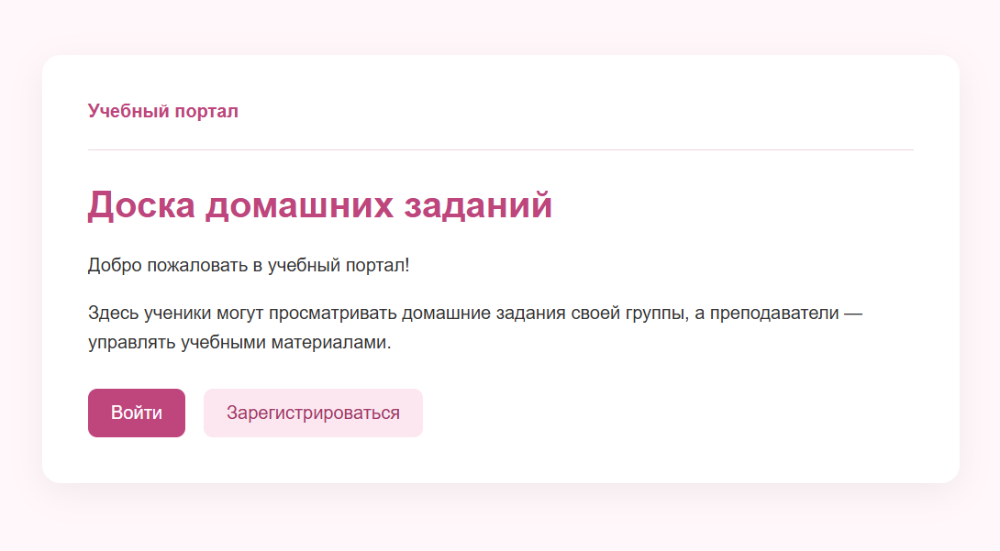

*Рисунок 1 - Главная страница сайта с приветствием и кнопками входа и регистрации.*

### Основные представления (views)

Представления в `homework/views.py` обрабатывают HTTP-запросы, проверяют данные и права пользователя, обращаются к моделям через Django ORM и передают результат в шаблоны. После успешного сохранения формы обычно выполняется перенаправление на соответствующую страницу.

| Представление | Назначение |
| --- | --- |
| `index()` | Показывает стартовую страницу гостю, а авторизованного пользователя перенаправляет в раздел его роли. |
| `register()` | Проверяет форму регистрации, создаёт пользователя и профиль ученика, выполняет вход. |
| `login_view()` | Проверяет логин и пароль через `AuthenticationForm` и авторизует пользователя. |
| `logout_view()` | Завершает сессию по защищённому POST-запросу и возвращает на главную страницу. |
| `homeworks()` | Получает задания группы ученика, применяет поиск, фильтры и пагинацию, добавляет его статусы и оценки. |
| `homework_detail()` | Показывает отдельное задание своей группы и собственный ответ; при POST-запросе проверяет и сохраняет новую сдачу. |
| `teacher()` | Показывает собственные задания преподавателя с поиском, фильтрами группы, дисциплины и статуса проверки и пагинацией. |
| `teacher_homework_form()` | Создаёт задание от имени текущего преподавателя либо редактирует его собственное задание, если передан `pk`. |
| `teacher_submissions()` | Показывает ответы учеников на выбранное собственное задание преподавателя. |
| `teacher_grade()` | Проверяет форму оценки и разрешение преподавателя, изменяет только оценку ответа на его задание. |
| `grades()` | Проверяет доступ к группе и формирует строки учеников, столбцы заданий и значения оценок для журнала. |

В списках ученика и преподавателя используется общая вспомогательная функция `paginate_homeworks()`. Она делит уже отфильтрованную выборку на страницы по пять заданий и подготавливает параметры для ссылок перехода. Самостоятельного HTTP-маршрута у этой функции нет.

### Основные шаблоны пользовательского интерфейса

Пользовательские шаблоны находятся в `templates/jinja2/homework/`. Представления передают в них формы, задания, ответы и данные журнала для формирования HTML-страниц.

| Шаблон | Назначение |
| --- | --- |
| `base.html` | Общая основа страниц: название портала, навигация, выход и подключение CSS. |
| `index.html` | Стартовая страница с приветствием и основными кнопками входа и регистрации. |
| `register.html` | Форма самостоятельной регистрации ученика и выбор группы. |
| `login.html` | Общая форма входа по логину и паролю. |
| `homeworks.html` | Кабинет ученика: группа, поиск, фильтры и карточки заданий со статусами и оценками. |
| `homework_detail.html` | Полные сведения о задании и форма отправки либо просмотр сохранённого ответа ученика. |
| `teacher.html` | Кабинет преподавателя: его задания, фильтры и переходы к созданию, редактированию, ответам, журналу и Django Admin. |
| `teacher_homework_form.html` | Общая страница формы создания и редактирования домашнего задания. |
| `teacher_submissions.html` | Список ответов учеников со статусами, оценками и переходом к оцениванию. |
| `teacher_grade.html` | Просмотр работы ученика и форма выставления или изменения оценки. |
| `grades.html` | Таблица успеваемости группы; для преподавателя также выбор доступной группы. |


## 3. Проектирование базы данных

Для учётных записей используется стандартная модель Django `User`. В ней хранятся логин, имя, фамилия, электронная почта, хеш пароля и признаки административного доступа. В приложении `homework` определены пять собственных моделей.

### Сводная таблица моделей и связей

| Модель | Основные поля | Назначение и связи |
| --- | --- | --- |
| `User` | `username`, `first_name`, `last_name`, `email`, `password`, `is_staff`, `is_superuser` | Стандартная учётная запись Django; `password` хранит хеш. С `StudentProfile` связана один к одному. Один пользователь может быть преподавателем многих `Homework` либо автором многих `Submission`. |
| `StudentProfile` | `user`, `patronymic`, `study_group` | Профиль ученика. `user` связывает его с одной учётной записью, а `study_group` указывает одну группу, в которой может быть много профилей. |
| `StudyGroup` | `group_name` | Справочник учебных групп с уникальными названиями. Одна группа объединяет много `StudentProfile` и имеет много назначенных `Homework`. |
| `Subject` | `subject_name` | Справочник дисциплин с уникальными названиями. Одна дисциплина связана со многими заданиями `Homework`. |
| `Homework` | `subject`, `teacher`, `study_group`, `issue_at`, `deadline`, `description`, `penalty_info` | Задание одной дисциплины, одного преподавателя и одной группы. Может иметь много ответов `Submission`. |
| `Submission` | `student`, `homework`, `answer_text`, `submitted_at`, `grade` | Ответ одного ученика на одно задание с временем отправки и оценкой. Каждая из двух связей со стороны ученика и задания имеет тип один ко многим; пара `student` и `homework` уникальна. |

Связь «один к одному» означает, что одному пользователю соответствует не более одного профиля ученика. При связи «один ко многим» одна запись, например учебная группа, может быть связана с несколькими записями другой модели, например профилями учеников.

### Модель StudyGroup

Модель `StudyGroup` представляет учебную группу. Её основное поле `group_name` содержит уникальное название группы. На эту модель ссылаются профили учеников и назначенные группе домашние задания.

### Модель Subject

Модель `Subject` хранит дисциплину. Поле `subject_name` содержит её уникальное название. Одна дисциплина может иметь несколько домашних заданий.

### Модель StudentProfile

Модель `StudentProfile` дополняет стандартного пользователя данными ученика:

- `user` связь один к одному с `User`;
- `patronymic` отчество;
- `study_group` ссылка на учебную группу.

Имя, фамилия и электронная почта остаются в `User` и не дублируются в профиле. 

### Модель Homework

Модель `Homework` содержит сведения о домашнем задании:

- `subject` дисциплина;
- `teacher` пользователь, указанный преподавателем;
- `study_group` группа, которой назначено задание;
- `issue_at` дата выдачи;
- `deadline` срок сдачи;
- `description` текст задания;
- `penalty_info` информация о штрафах, которая может отсутствовать.

Период выполнения определяется датой выдачи и сроком сдачи. Отдельное поле для его дублирования не создаётся. Метод `Homework.clean()` проверяет, что дедлайн не предшествует дате выдачи, а преподаватель имеет признак `is_staff=True`.

### Модель Submission

Модель `Submission` связывает ученика с конкретным заданием и хранит результат сдачи:

- `student` пользователь, отправивший работу;
- `homework` домашнее задание;
- `answer_text` текст ответа;
- `submitted_at` автоматически записываемые дата и время отправки;
- `grade` оценка от 2 до 5, которая до проверки может быть пустой (`NULL`).

Для пары `student` и `homework` задано ограничение уникальности `unique_student_homework_submission`. Оно запрещает создание нескольких сдач одного задания одним учеником. В `Submission.clean()` проверяются наличие профиля ученика, отсутствие у автора признака преподавателя и совпадение группы ученика с группой задания.

### Связи между моделями и миграции

Основные связи структуры данных:

- `User` - `StudentProfile`: один к одному;
- `StudyGroup`- `StudentProfile`: один ко многим;
- `Subject`- `Homework`: один ко многим;
- `User`- `Homework`: один ко многим, преподаватель и его задания;
- `StudyGroup`- `Homework`: один ко многим;
- `User`- `Submission`: один ко многим, ученик и его ответы;
- `Homework`- `Submission`: один ко многим, задание и отправленные работы.

Таким образом, `Submission` позволяет хранить отдельный ответ и отдельную оценку для каждого ученика по каждому заданию. Оценки не копируются в `Homework`, а статусы сдачи вычисляются по существующим данным.

Создание таблиц и изменение их структуры выполняются миграциями Django.  Основные команды работы с миграциями:

```bash
python manage.py makemigrations
python manage.py migrate
```

Записи сохраняются в PostgreSQL через Django ORM. Собственные таблицы приложения имеют имена `homework_studygroup`, `homework_subject`, `homework_studentprofile`, `homework_homework` и `homework_submission`.

## 4. Реализация авторизации и разграничения прав

В приложении используется общая система авторизации Django. Отдельные модели ролей или разные формы входа для ученика и преподавателя не создаются. Права определяются по текущему пользователю, признакам `is_staff` и `is_superuser`, связанному профилю и стандартным разрешениям Django.

### Регистрация ученика

Страница `/register/` использует форму `StudentRegistrationForm`, основанную на `UserCreationForm`. Пользователь указывает логин, имя, фамилию, отчество, электронную почту, учебную группу и дважды вводит пароль. Список групп загружается из `StudyGroup`, поэтому произвольное название группы вводить нельзя.

Форма проверяет обязательные поля, уникальность логина, формат почты, пароли и выбранную группу. При успешной регистрации обработчик `register()` создаёт `User` и связанный `StudentProfile` внутри одной транзакции. Новому пользователю явно задаются `is_staff=False` и `is_superuser=False`; выбора административной роли в форме нет. Пароль сохраняется средствами Django в виде хеша.

После регистрации ученик автоматически авторизуется и переходит к домашним заданиям своей группы.

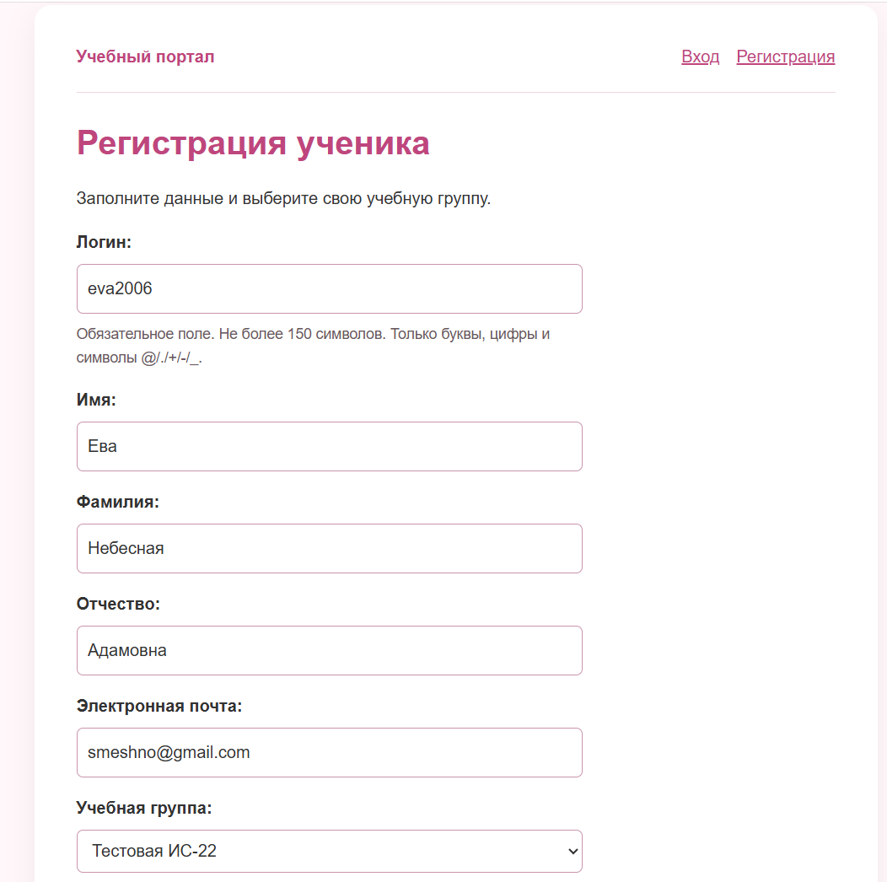

*Рисунок 2 - Ввод данных ученика и выбор существующей учебной группы при регистрации.*

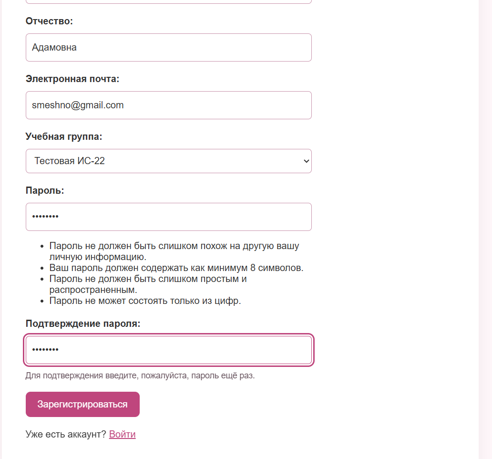

*Рисунок 3 - Поля пароля, подтверждения пароля и кнопка завершения регистрации.*

### Вход преподавателя, ученика и администратора

Страница `/login/` использует стандартную `AuthenticationForm` и содержит только логин и пароль. После входа обработчик главной страницы определяет направление перехода: ученик попадает на `/homeworks/`, преподаватель - на `/teacher/`, суперпользователь - в Django Admin.

Преподаватель не регистрируется самостоятельно. Его учётную запись создаёт или настраивает администратор через Django Admin, устанавливая `is_staff=True`, `is_superuser=False` и необходимые разрешения на модели. Например, для создания заданий требуется `homework.add_homework`, а для оценивания - `homework.change_submission`. Преподаватель может работать с разными учебными группами и не нуждается в `StudentProfile`.

Суперпользователь имеет полный доступ к административной панели, пользователям и данным приложения. Для него не создаётся отдельная пользовательская административная панель.

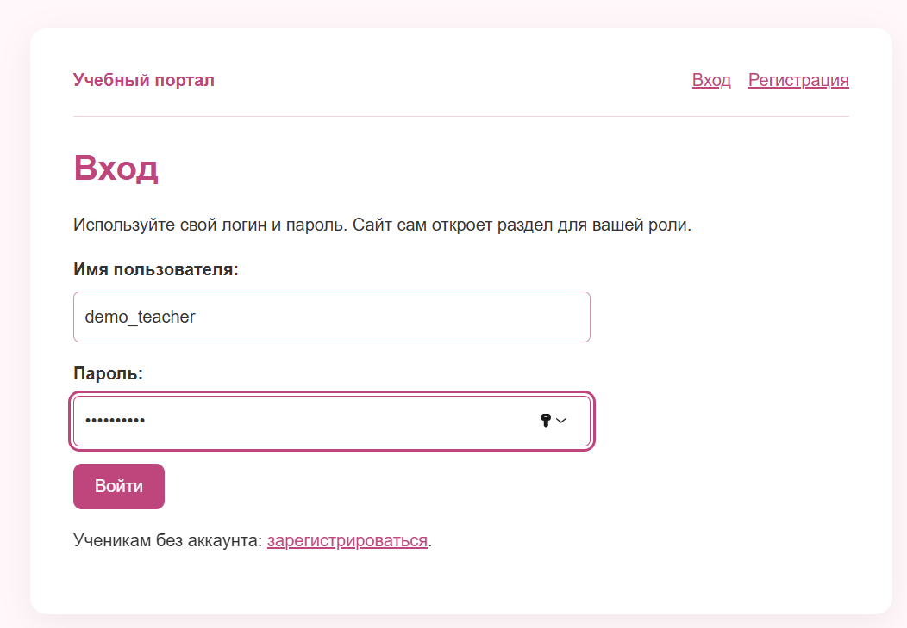

*Рисунок 4 - Общая форма авторизации; на примере введён логин преподавателя.*

### Проверки доступа и выход

Защищённые обработчики используют `login_required`. Проверки выполняются в Python-коде: ученик должен иметь `StudentProfile`, а преподаватель - признак `is_staff` и разрешение на соответствующее действие. Для преподавательских операций используется функция `check_teacher_access()`. В шаблонах также скрываются действия, недоступные текущему пользователю.

Выход выполняется обработчиком `logout_view()` через POST-запрос с CSRF-защитой. В пользовательских Jinja2-формах используется `{{ csrf_input }}`. После завершения сессии открывается стартовая страница, а защищённые разделы снова требуют входа.

## 5. Интерфейс ученика

### Список домашних заданий

После входа ученик открывает страницу `/homeworks/`. Она содержит приветствие, название его учебной группы, ссылку на журнал оценок, форму поиска и фильтров и карточки домашних заданий.

Обработчик `homeworks()` определяет группу через `request.user.student_profile.study_group`. Из PostgreSQL выбираются задания всех дисциплин, назначенные этой группе. Передача идентификатора другой группы в параметрах запроса не меняет эту выборку.

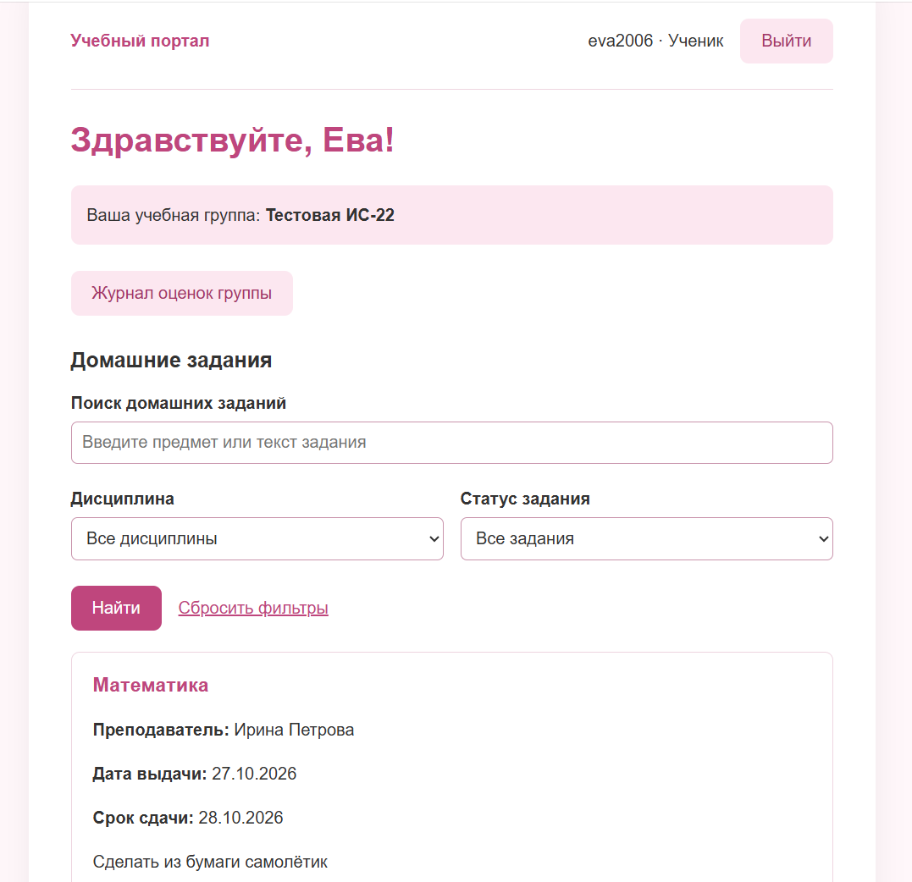

*Рисунок 5 - Страница ученика с названием группы, переходом в журнал и фильтрами домашних заданий.*

Карточка содержит дисциплину, преподавателя, дату выдачи, срок сдачи, описание, штрафы, собственный статус сдачи и оценку ученика. Для перехода к полному заданию предусмотрена кнопка «Подробнее».

Статус вычисляется функцией `get_submission_status()`. Если ответа нет, выводится «Не сдано» либо «Не сдано, срок истёк». Для отправленного ответа показывается «Сдано в срок» или «Сдано с опозданием».

Функция `get_grade_display()` выводит прочерк для несданной работы, «На проверке» для ответа без оценки и числовое значение после проверки преподавателем. На карточках используются только собственные записи `Submission` текущего пользователя.

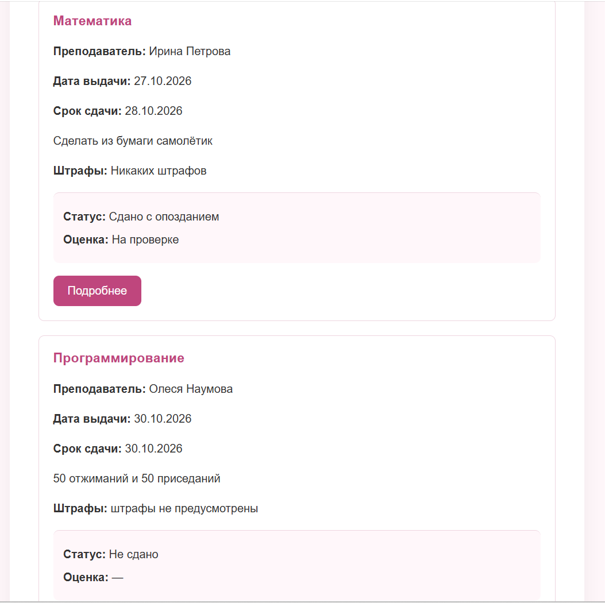

*Рисунок 6 - Карточки заданий с разными состояниями: ответ на проверке и работа без отправленного ответа.*

### Просмотр задания и отправка ответа

Отдельная страница `/homeworks/<pk>/` формируется обработчиком `homework_detail()`. На ней показаны полные сведения о задании и блок «Мой ответ». Пока ответ не отправлен, в этом блоке доступна форма `SubmissionForm` с многострочным текстовым полем и кнопкой «Сдать задание».

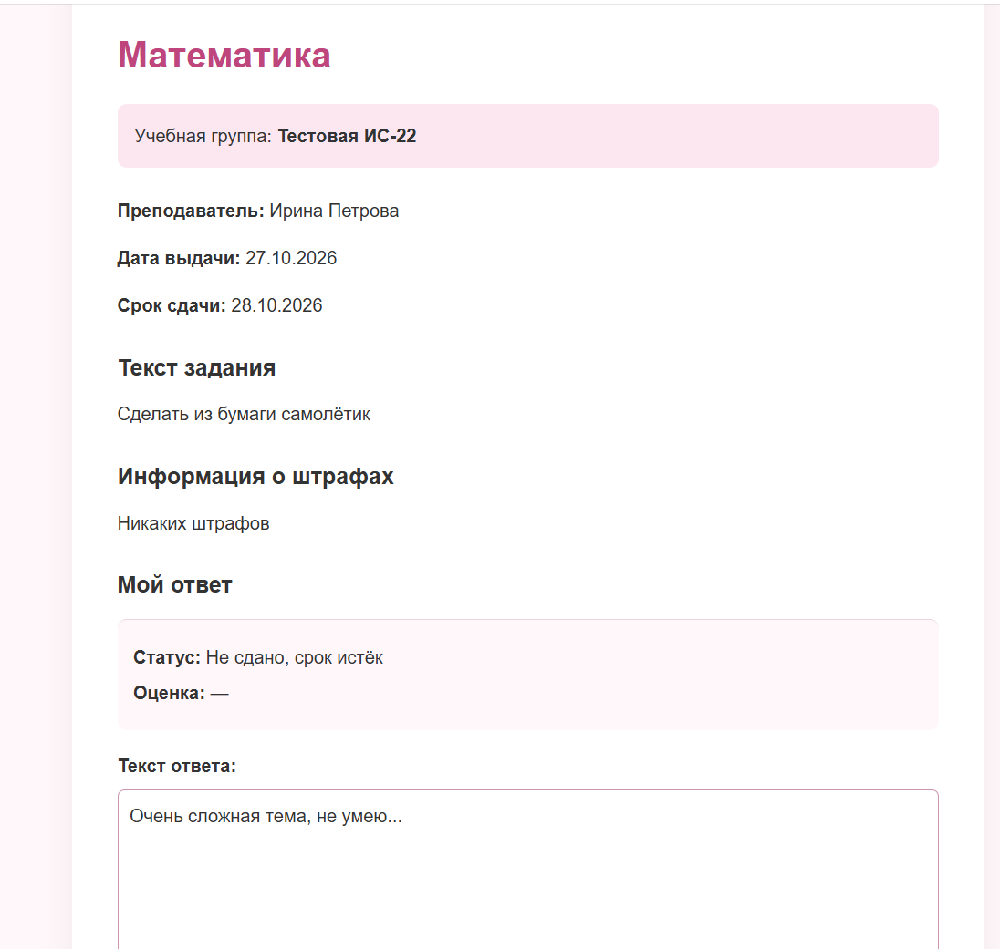

*Рисунок 7 - Просмотр полного задания и заполнение текстового ответа после истечения дедлайна.*

При отправке проверяются авторизация, роль ученика, наличие профиля, принадлежность задания его группе, непустой текст и отсутствие предыдущей сдачи. Автор определяется через `request.user`, а задание — по защищённому маршруту. Поля автора, времени и оценки ученик не выбирает.

Перед сохранением вызывается валидация модели. Затем в таблице `homework_submission` создаётся запись с текстом ответа, автоматически установленным временем отправки и пустой оценкой. После успешного POST-запроса выполняется перенаправление на ту же страницу задания.

После сдачи форма заменяется сохранённым ответом, датой и временем отправки, статусом и оценкой. Повторная отправка, редактирование и удаление ответа через ученический интерфейс не предусмотрены.

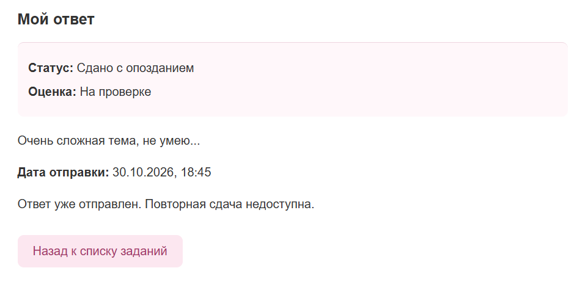

*Рисунок 8 - Сохранённый ответ, время отправки и статус «Сдано с опозданием».*

Дедлайн включает весь календарный день. Для сравнения с `submitted_at` используется локальная дата Django, полученная через `timezone.localdate()`. В текущих настройках проекта выбран часовой пояс `UTC`. Просроченные ответы разрешены; автоматического снижения оценки нет, штрафы остаются текстовой информацией для преподавателя.

При прямом открытии задания по идентификатору `get_object_or_404()` также ограничивает выборку группой ученика. Чужое или несуществующее задание возвращает 404. Тексты ответов других учеников на этой странице не отображаются. Для возврата предусмотрена ссылка «Назад к списку заданий».

## 6. Интерфейс преподавателя и Django Admin

### Кабинет и управление заданиями

Кабинет преподавателя расположен по маршруту `/teacher/`. Он содержит приветствие, кнопки создания задания и перехода в Django Admin, отдельный переход в журнал и раздел «Мои домашние задания».

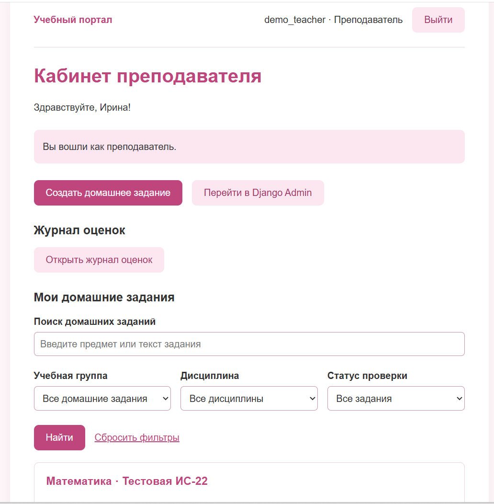

*Рисунок 9 - Кабинет преподавателя с основными действиями и общей формой поиска и фильтрации.*

В список включаются только задания, у которых `Homework.teacher` совпадает с текущим пользователем. На карточке отображаются дисциплина, группа, краткое описание, даты, количество отправленных ответов и действия «Посмотреть ответы» и «Редактировать». Доступность действий зависит от разрешений преподавателя.

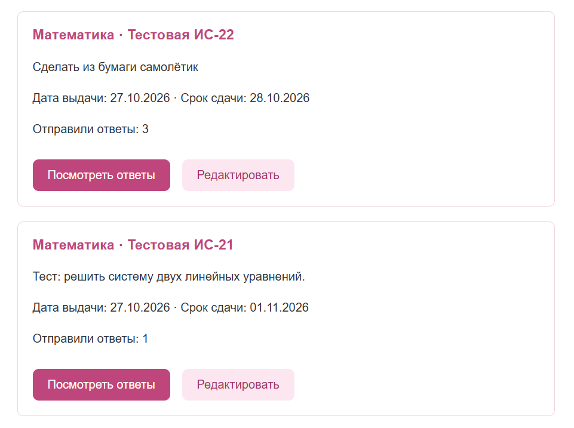

*Рисунок 10 - Задания одного преподавателя для разных учебных групп и кнопки работы с ними.*

Создание выполняется на `/teacher/homeworks/create/`. Форма `HomeworkForm` содержит дисциплину, учебную группу, дату выдачи, срок сдачи, описание и информацию о штрафах. Дисциплина и группа выбираются из существующих записей PostgreSQL. Преподаватель в форме не выбирается: обработчик `teacher_homework_form()` задаёт `teacher=request.user`.

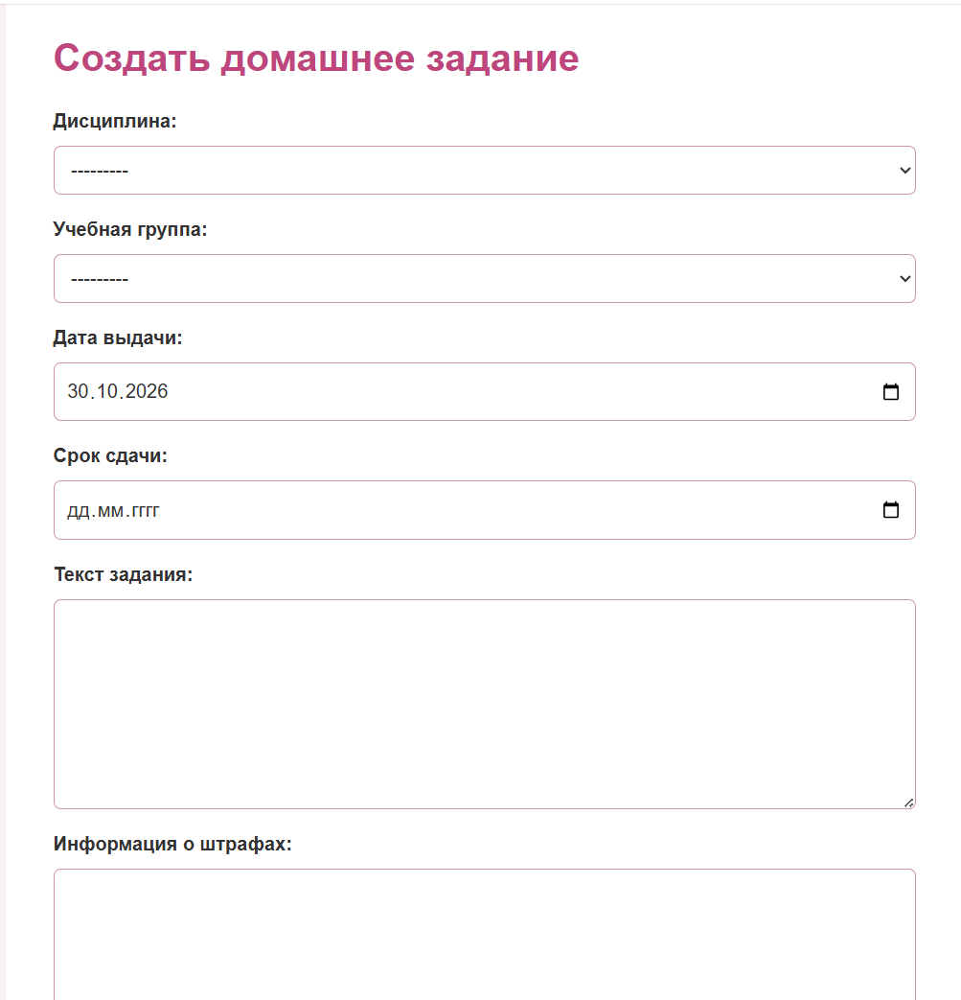

*Рисунок 11 - Выбор дисциплины и группы, заполнение дат, описания и штрафов при создании задания.*

Для изменения используется `/teacher/homeworks/<pk>/edit/` и тот же обработчик формы. Открыть и изменить можно только собственное задание. После появления хотя бы одной сдачи группа, дисциплина и даты блокируются на сервере; текст задания и штрафы остаются доступными для редактирования. Это сохраняет принадлежность уже отправленных работ и смысл их статусов.

### Ответы учеников и оценивание через сайт

Кнопка «Посмотреть ответы» открывает `/teacher/homeworks/<pk>/submissions/`. Обработчик `teacher_submissions()` показывает ответы на выбранное собственное задание: имя ученика, текст работы, время отправки, своевременность сдачи и текущую оценку. Для задания другого преподавателя доступ к этой странице запрещён выборкой по владельцу.

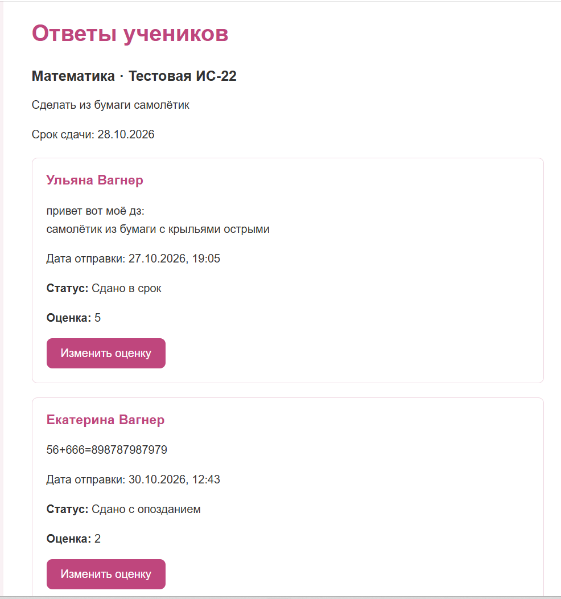

*Рисунок 12 - Своевременный и просроченный ответы учеников с оценками и действиями для их изменения.*

По кнопке «Оценить» или «Изменить оценку» открывается `/teacher/submissions/<pk>/grade/`. Страница содержит сведения о работе и форму `GradeForm`, в которой доступно только поле `grade`. Проверяются разрешение `homework.change_submission`, принадлежность задания преподавателю и допустимость оценки от 2 до 5.

Обработчик `teacher_grade()` сохраняет только `Submission.grade`. Автор, текст и время отправки ответа не изменяются. После сохранения преподаватель возвращается к списку ответов, где отображается сообщение об успешном оценивании. Ученик видит новое значение при следующей загрузке карточки или страницы задания.

### Стандартная административная панель

Административная панель доступна по `/admin/`. В `homework/admin.py` зарегистрированы `StudyGroup`, `Subject`, `StudentProfile`, `Homework` и `Submission`. Для списков настроены стандартные `list_display`, `list_filter` и `search_fields`.

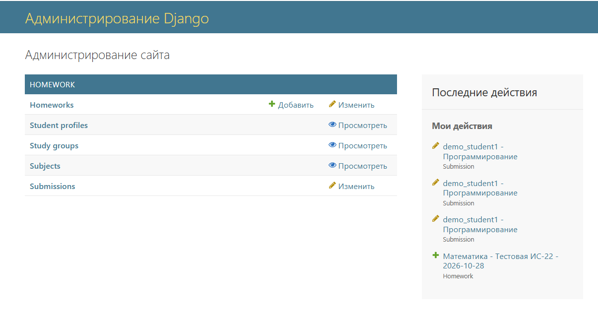

*Рисунок 13 - Главная страница стандартной Django Admin с разделами приложения и доступными преподавателю действиями.*

Выставление оценок через Django Admin сохранено в соответствии с условием варианта. Преподаватель с необходимыми правами открывает раздел `Submissions`, выбирает работу, изменяет `grade` и сохраняет запись. Здесь используется то же поле `Submission.grade`, что и в обычном кабинете, поэтому оценки между интерфейсами не дублируются.

В `HomeworkAdmin` выборка обычного преподавателя ограничена собственными заданиями. В `SubmissionAdmin` ему доступны только ответы на эти задания; автор, задание, текст и время ответа доступны только для чтения. Ограничения действуют также при прямом открытии URL. Суперпользователь сохраняет полный доступ ко всем объектам.

## 7. Журнал успеваемости

Страница `/grades/` предназначена для просмотра оценок учебной группы. Её формирует обработчик `grades()`, а представление таблицы находится в шаблоне `grades.html`.

Таблица строится по следующему принципу:

- строки - все ученики выбранной группы;
- столбцы - отдельные домашние задания этой группы;
- ячейки - оценки соответствующих учеников за соответствующие задания.

В заголовке столбца указываются дисциплина, номер задания на основе его идентификатора и срок сдачи. Несколько заданий одного предмета имеют отдельные столбцы. Если сдачи нет или её оценка равна `None`, выводится прочерк «—».

Список учеников получается из `StudentProfile`, поэтому в журнале присутствуют и ученики без отправленных работ. Задания выбираются из `Homework`, а оценки - из `Submission`. Обработчик формирует словарь по паре идентификаторов ученика и задания и обычными циклами собирает строки таблицы. Отдельной модели журнала и копирования оценок нет.

Ученики сортируются по фамилии, имени и идентификатору пользователя. Задания - по дисциплине, дедлайну и идентификатору. Для широкой таблицы предусмотрена горизонтальная прокрутка.

### Журнал ученика

Ученик открывает журнал кнопкой «Журнал оценок группы». Группа определяется только по его профилю. Он видит оценки всех учеников своей группы, а собственная строка выделяется. Тексты чужих ответов, электронные адреса и пароли в таблицу не передаются. Запрос журнала другой группы отклоняется на сервере.

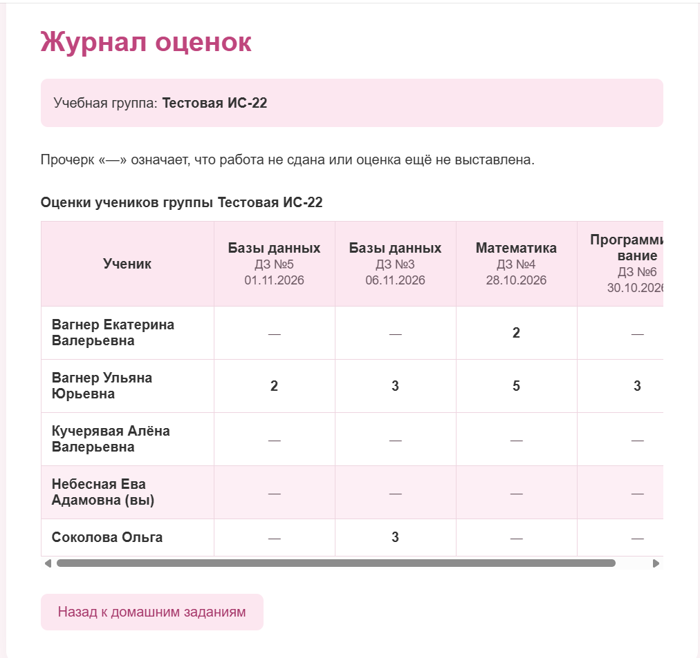

*Рисунок 14 - Журнал своей группы: ученики, отдельные задания, оценки, прочерки и выделенная строка текущего пользователя.*

### Журнал преподавателя

Преподаватель открывает журнал отдельной кнопкой из кабинета. Ему доступны группы, которым он назначил хотя бы одно задание, при наличии разрешений на просмотр заданий и сдач. После выбора группы таблица обновляется обычным GET-запросом: выпадающий список автоматически отправляет форму.

В журнале доступны все задания выбранной группы, в том числе задания других преподавателей. Ссылка «Посмотреть ответы» показывается только для собственных заданий текущего преподавателя. Журнал служит для просмотра: изменение оценок выполняется через существующие страницы проверки ответа или Django Admin.

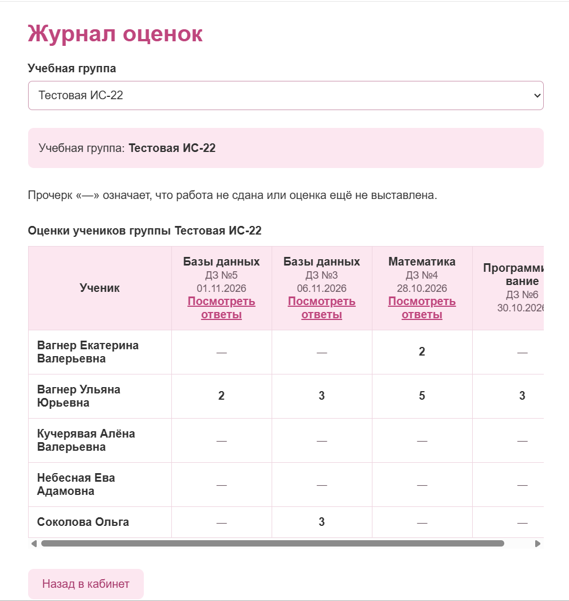

*Рисунок 15 - Выбор доступной группы преподавателем и переход к ответам по собственным заданиям.*

Для суперпользователя доступны журналы всех групп. При отсутствии учеников, заданий или доступных преподавателю групп выводятся соответствующие сообщения вместо ошибки страницы.

## 8. Поиск, фильтрация и пагинация

### Поиск и совместная фильтрация

В списках ученика и преподавателя предусмотрено поле «Поиск домашних заданий» с подсказкой «Введите предмет или текст задания». Поиск выполняется средствами Django ORM по `Subject.subject_name` и `Homework.description`. Условия объединяются через `Q`, а `icontains` позволяет искать без учёта регистра.

Ученик может выбрать дисциплину и один из трёх вариантов статуса:

- «Все задания» - все доступные задания его группы;
- «Не сдано» - задания без собственной записи `Submission`, независимо от дедлайна;
- «Сдано» - задания с собственной записью `Submission`, независимо от своевременности ответа и наличия оценки.

Эти упрощённые варианты фильтра не заменяют подробные статусы на карточках. У преподавателя вместо статуса личной сдачи используется статус проверки:

- «Все задания»;
- «Есть отправленные ответы»;
- «Нет отправленных ответов»;
- «Есть непроверенные ответы», то есть сдачи с `grade=None`.

Дополнительно преподаватель выбирает учебную группу и дисциплину. В списке групп доступны только группы его собственных заданий, а по умолчанию выбран вариант «Все домашние задания». Дисциплины в обеих формах загружаются из PostgreSQL среди доступных пользователю заданий.

Поиск, группа, дисциплина и статус применяются совместно. Базовая выборка ученика всегда ограничена его группой, а преподавателя - его собственными заданиями. Поэтому параметры фильтров не позволяют получить чужие задания.

Для передачи условий используется одна GET-форма на каждой странице. Параметры имеют имена `q`, `subject`, `status` и, у преподавателя, `group`. Кнопка «Найти» отправляет поисковый запрос. Выпадающие списки автоматически отправляют ту же форму через `onchange="this.form.submit()"`, сохраняя остальные введённые значения. Ссылка «Сбросить фильтры» открывает исходный список без условий.

Интерфейс фильтров ученика показан на рисунке 5, преподавателя - на рисунке 9.

### Базовая пагинация

Пагинация реализована в функции `paginate_homeworks()` стандартным классом `django.core.paginator.Paginator`. На одной странице отображается **5 домашних заданий**. Сначала применяются поиск и фильтры, затем задания сортируются по `deadline` и `pk`, после чего результат делится на страницы.

Под карточками выводятся элементы «Назад», «Страница N из M» и «Далее». На границах списка соответствующее направление недоступно. Если результат помещается на одной странице, блок переключения не показывается. Некорректный номер обрабатывается стандартным методом `get_page()` без ошибки сервера.

Номер страницы передаётся в параметре `page`. Для ссылок перехода создаётся копия `request.GET`, из неё исключается прежний `page`, а остальные параметры кодируются методом `urlencode()`. Поэтому русские буквы, пробелы и выбранные фильтры сохраняются при переходах. Например, при 12 найденных заданиях страницы содержат 5, 5 и 2 карточки одного и того же отфильтрованного списка.

В форме поиска и фильтров параметра `page` нет. При смене условия выполняется новый GET-запрос с первой страницы. Если подходящих заданий не найдено, выводится сообщение «По вашему запросу домашние задания не найдены», а пустой блок пагинации не отображается.

## 9. Заключение

В ходе лабораторной работы разработано веб-приложение «Доска домашних заданий» с использованием Django, PostgreSQL и Jinja2. Реализованы регистрация и авторизация учеников, просмотр заданий своей группы, однократная отправка текстовых ответов и отображение статусов и оценок.
Преподавателю доступен кабинет для управления собственными заданиями, просмотра ответов и оценивания. При этом сохранена возможность выставлять оценки через стандартную Django Admin. На пользовательском сайте формируется журнал оценок всех учеников учебной группы. Поиск, совместная фильтрация и базовая пагинация помогают работать со списками домашних заданий, а CSS обеспечивает единое оформление страниц.


