# ЛР2. Простой сайт на Django

## Цель работы

Овладеть практическими навыками и умениями реализации web-сервисов средствами Django.

Программное обеспечение: Python 3.12, Django 6, PostgreSQL.

## Задачи

Реализовать сайт, используя фреймворк Django, паттерн MVC, технологию шаблонизации Jinja2 и СУБД PostgreSQL, в соответствии с вариантом и техническим заданием. Вариант определяется по порядковому номеру в журнале группы.

---

## Быстрый старт

Для запуска нужен Python 3.12 и установленные зависимости Django, `python-dotenv` и `uuid6`.

В PowerShell выполните команды из папки проекта:

```powershell
cd students\k3341\laboratory_works\Danilova_Ayaana\laboratory_work_2
python -m venv .venv
.\.venv\Scripts\Activate.ps1
python -m pip install Django python-dotenv uuid6
python manage.py migrate
python manage.py createsuperuser
python manage.py runserver
```

Сайт будет доступен по адресу `http://127.0.0.1:8000/`, панель управления — по адресу `http://127.0.0.1:8000/admin/`.

Если переменная `DB_NAME` не задана, приложение использует SQLite. Для подключения PostgreSQL параметры базы данных можно указать в файле `.env` (`DB_NAME`, `DB_USER`, `DB_PASSWORD`, `DB_HOST`, `DB_PORT` и при необходимости `DB_ENGINE`).

## Пояснение архитектуры и структуры

Проект разделён на конфигурацию Django и приложение `flights`:

- `config/settings.py` содержит настройки проекта, подключение приложения, пользовательской модели и базы данных.
- `config/urls.py` подключает административную панель, страницы входа и маршруты приложения.
- `flights/models.py` описывает данные и связи между ними.
- `flights/forms.py` проверяет и отображает формы.
- `flights/views.py` обрабатывает запросы и формирует страницы.
- `flights/selectors.py` собирает запросы на чтение и заранее загружает связанные записи.
- `flights/services.py` выполняет операции изменения данных, например создание брони и билетов.
- `flights/admin.py` настраивает управление данными через Django Admin.
- `templates/` содержит HTML-страницы.
- `flights/migrations/` хранит изменения структуры базы данных.

Основные модели:

- `User` — учётная запись пользователя.
- `Passenger` и `Passport` — пассажир и его паспортные данные.
- `Flight` — рейс, его время, тип, гейт и вместимость.
- `Reservation` — заказ пользователя на рейс.
- `Ticket` — билет пассажира с номером места и данными регистрации.
- `Review` — отзыв о рейсе.

Для идентификаторов используется UUIDv7. Связи с важными записями настроены с `on_delete=PROTECT`, чтобы нельзя было случайно удалить рейс, пользователя или пассажира, если с ними связаны билеты и история. Ограничения `CheckConstraint` и `UniqueConstraint` защищают данные на уровне базы: например, время прибытия должно быть позже времени отправления, место должно быть допустимым, а два билета не могут занять одно место на одном рейсе.

При бронировании сервис открывает транзакцию и блокирует строку выбранного рейса через `select_for_update()`. Он проверяет, что пассажиры принадлежат пользователю, имеют действующий паспорт и ещё не записаны на этот рейс, после чего назначает свободные места. Это помогает не продать одно место двум пассажирам при одновременных запросах.

Для уменьшения числа запросов к базе данных селекторы используют `select_related()` для связей «один к одному» и «многие к одному», а `prefetch_related()` — для связанных списков билетов и паспортов. Списки рейсов и бронирований выводятся постранично.

## Ход работы

### 1. Уточнение требований

На первом этапе предложенные практики проектирования были сопоставлены с существующими моделями. Был рассмотрен вопрос: следует ли добавлять цену и статус билета, которых нет в текущей структуре, и заменять первичные ключи. Было решено не вводить новые бизнес-поля без заданных значений и правил. В итоговой версии проекта для идентификаторов используются UUIDv7.

### 2. Проверка структуры данных

Затем были изучены связи между пользователем, пассажиром, паспортом, рейсом, бронированием и билетом. Было установлено, что бронь связывает покупателя с рейсом, а пассажиры и места указываются в отдельных билетах. Поэтому список пассажиров рейса формируется по билетам, а не по прямой связи с бронью.

### 3. Защита целостности

Далее был рассмотрен вопрос, достаточно ли проверок формы для защиты данных. Таких проверок недостаточно: массовые операции и параллельные запросы могут их обходить. Поэтому правила дополнительно закреплены ограничениями базы данных: проверяются время рейса, рейтинг, диапазон места, а также уникальность места и пассажира на одном рейсе. Для важных связей установлен `PROTECT`, чтобы сохранять историю.

### 4. Разделение чтения и записи

Чтобы логика не скапливалась во views и моделях, операции чтения были вынесены в `selectors.py`, а операции записи — в `services.py`. В сервисном слое сосредоточены создание брони, обработка билетов и транзакционные действия.

### 5. Защита бронирования от одновременных запросов

При рассмотрении сценария «осталось одно место, поступают одновременные запросы на бронирование» было установлено, что простой проверки свободных мест недостаточно. В сервисе рейс блокируется внутри транзакции, после чего занятость мест проверяется повторно. Бронь и билеты создаются только при наличии свободных мест; в противном случае операция отменяется без сохранения частичной брони.

### 6. Проверка производительности и интерфейса

Затем была проверена загрузка связанных данных. Для связанных объектов применяются `select_related()` и `prefetch_related()`, а для часто используемых запросов предусмотрены индексы. Через формы и шаблоны реализованы регистрация, добавление пассажиров, бронирование мест и просмотр бронирований.

### 7. Запуск проекта

Для запуска проекта устанавливаются зависимости, применяются миграции и выполняется команда `python manage.py runserver`. Если подключение к базе данных не задано через `.env`, используется SQLite. Для PostgreSQL параметры подключения указываются в переменных окружения.

## Скриншоты работы приложения

### Гостевой режим

**Рисунок 1 — Табло рейсов с пагинацией**

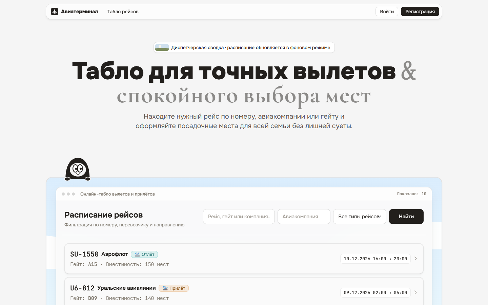

**Рисунок 2 — Поиск и фильтрация рейсов**

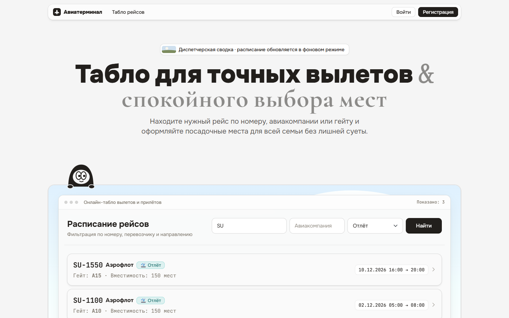

**Рисунок 3 — Форма регистрации пользователя**

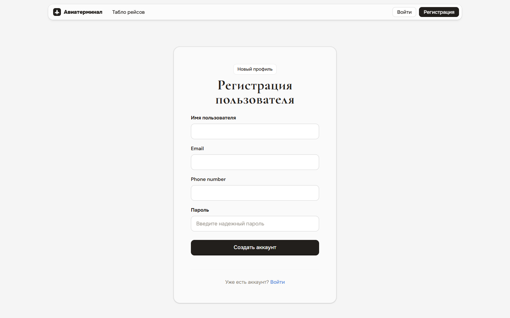

### Клиент

**Рисунок 4 — Страница рейса SU-1024**

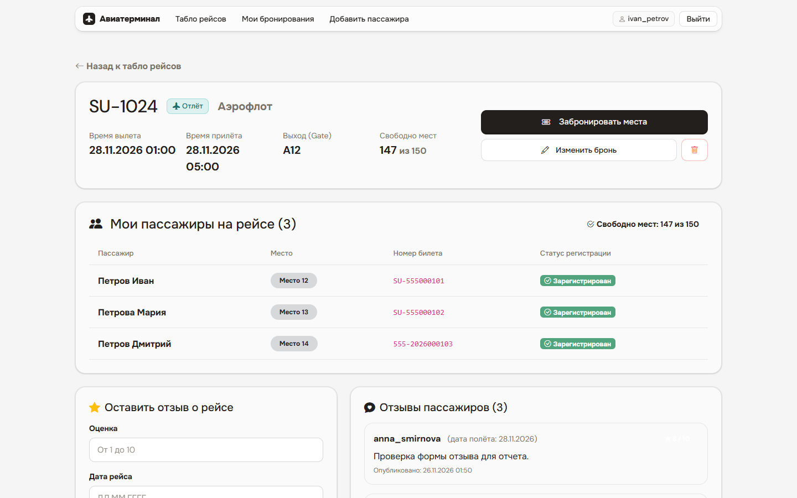

**Рисунок 5 — Бронирования клиента**

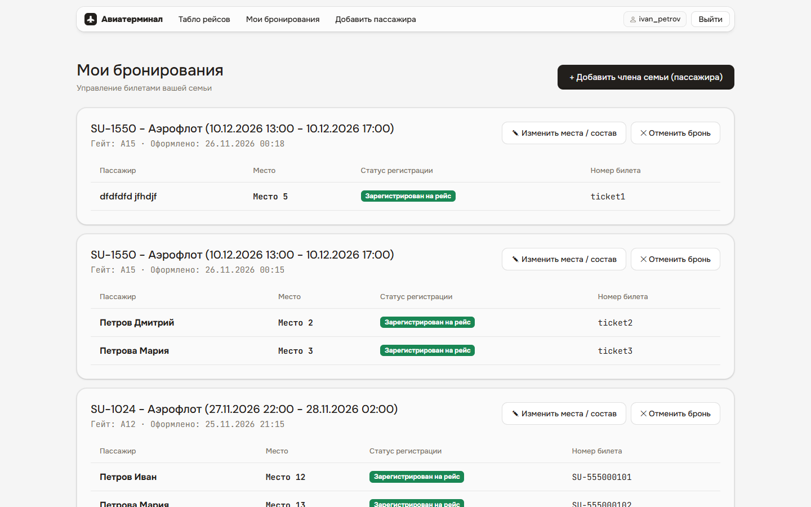

**Рисунок 6 — Изменение мест в бронировании**

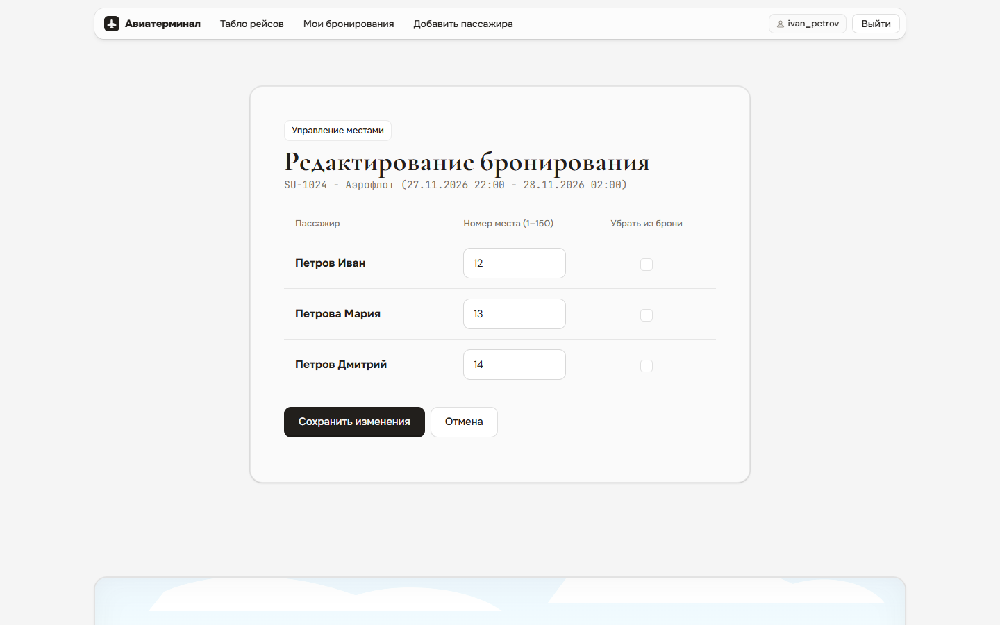

### Сотрудник аэропорта

**Рисунок 7 — Регистрация пассажиров на рейс**

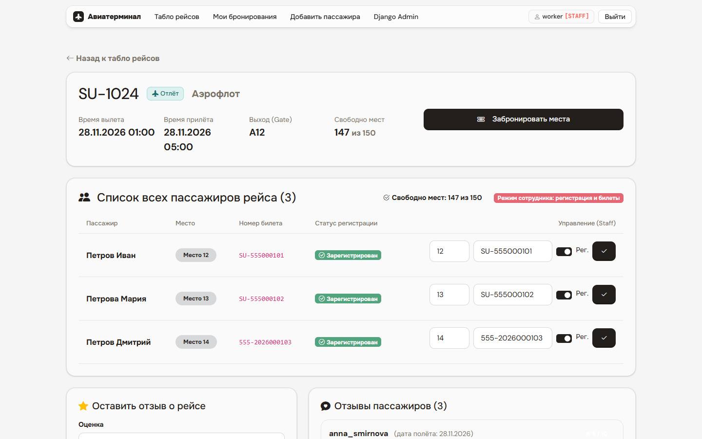

### Django Admin

**Рисунок 8 — Список билетов в Django Admin**

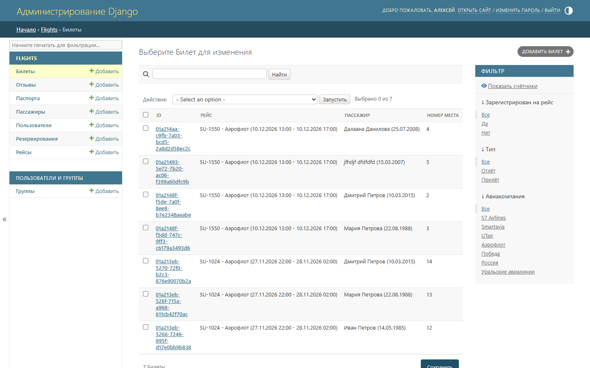


## Вывод

В ходе лабораторной работы было разработано веб-приложение на Django для просмотра расписания авиарейсов и бронирования билетов. В системе реализованы регистрация и авторизация пользователей, поиск и фильтрация рейсов с пагинацией, полный цикл управления бронированиями (создание, изменение мест, отмена), публикация отзывов, а также разграничение прав доступа между клиентами и сотрудниками аэропорта как в клиентском интерфейсе, так и в панели Django Admin.

Разделение логики на слои чтения (`selectors.py`) и записи (`services.py`), оптимизация запросов через `select_related()` и `prefetch_related()`, а также использование транзакционных блокировок и ограничений на уровне базы данных позволили избежать дублирования кода и гарантировать целостность данных при параллельном бронировании мест.

## Выполненные 4 задачи на литкод за просрочку дедлайна по работу:

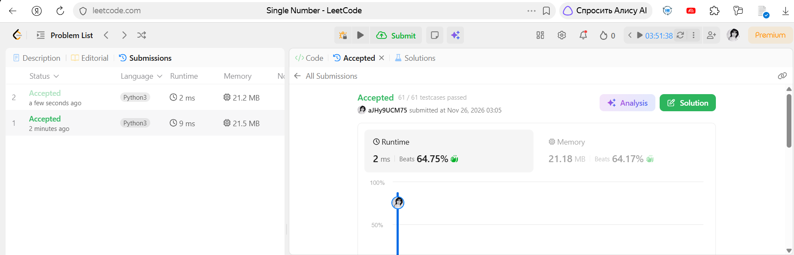
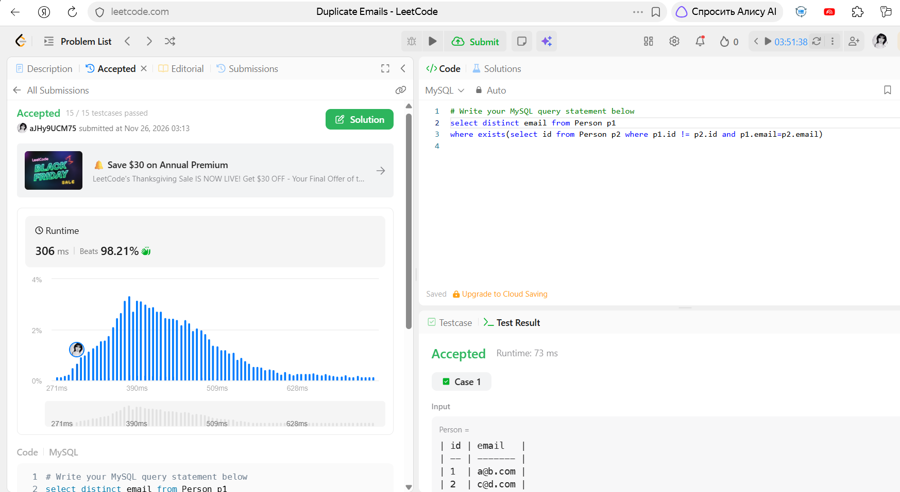
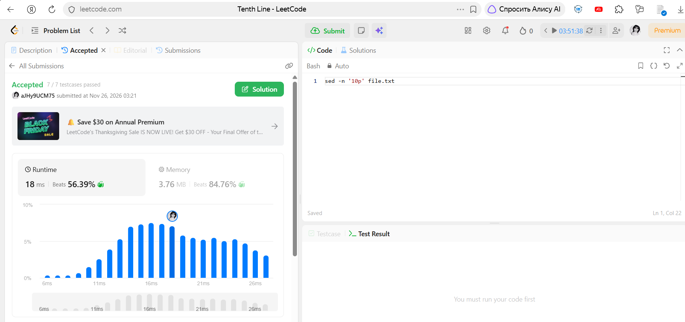
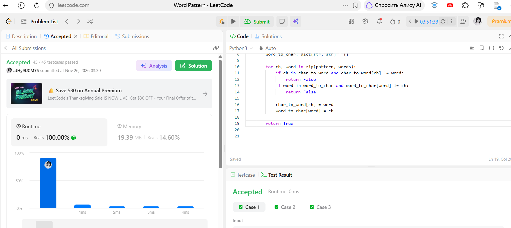