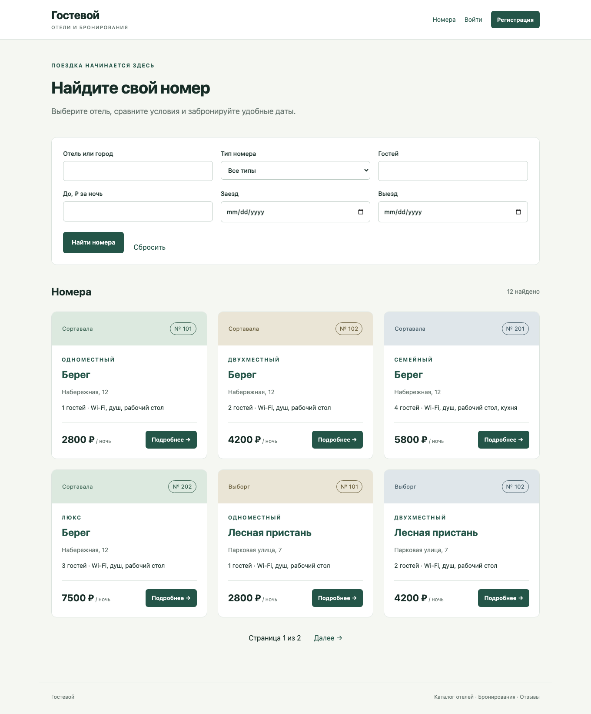

# Лабораторная работа 2. Простой сайт на Django

**Студент:** Кудрявцев Кирилл Станиславович. **Группа:** К3342. **Поток:** WEB 2.3.

Цель — реализовать веб-сервис средствами Django, связать модель данных, представления
и шаблоны. [Условие работы](https://rendex85.github.io/ITMO_ICT_WebDevelopment_Docs/lab2/assignment/).

## Вариант и реализация

Номер в журнале — 13. Вариант: `(13 - 1) % 6 + 1 = 1`, **список отелей**.
Реализован сайт «Гостевой». В каталоге представлены физические номера отелей:
у каждого свой номер комнаты, тип, вместимость, цена и удобства.

| Требование | Реализация |
| --- | --- |
| Название, владелец, адрес, описание отеля | Модель Hotel и страница номера |
| Типы номеров, цена, вместимость, удобства | Модель Room и карточки каталога |
| Регистрация пользователей | UserCreationForm с именем, фамилией и email |
| Просмотр и резервирование | Каталог, форма дат и числа гостей |
| Редактирование и удаление своих резервирований | «Мои бронирования», отдельная форма изменения и подтверждение удаления |
| Отзывы с периодом, текстом, рейтингом 1–10 и автором | Отзыв о своём завершённом проживании, даты и пользователь сохраняются в Review |
| Заселение и выселение через Django-admin | Действия в списке бронирований |
| Таблица постояльцев за последний месяц | Страница сотрудника с фактическими проживаниями за последние 30 дней |
| Разные права в клиентской части | Сотруднику доступны заселение, выселение и постояльцы; гостю — собственные бронирования |
| Оформление, поиск и пагинация | Адаптивный CSS, фильтры и страницы каталога по 6 номеров |



## Среда и структура

Работа проверена на Python 3.10.22, Django 3.2.25, Jinja2 3.1.6 и PostgreSQL 15.17.
Версия Django соответствует ветке 3 из условия. Клиентские страницы используют
Jinja2; стандартная админка и рендеринг полей Django Forms используют штатный
Django Template Language.

```text
laboratory_work_2/
  manage.py
  hotel_site/           настройки, маршрутизация, подключение Jinja2
  hotels/              модели, формы, views, admin, тесты и миграции
  templates/           Jinja2-шаблоны клиентской части
  static/style.css     оформление и адаптация под мобильный экран
  requirements.txt
  compose.yml          локальная PostgreSQL 15
  .env.example         образец настроек
```

В архитектуре MVT модели отвечают за данные, views — за обработку HTTP-запросов,
а шаблоны — за представление. URL-маршрутизация связывает адрес с view. Это
соответствует разделению обязанностей MVC в Django.

## Модель данных

| Модель | Основные поля | Связи |
| --- | --- | --- |
| User | username, first_name, last_name, email, password, is_staff | Пользователь имеет много бронирований и отзывов |
| Hotel | name, owner, city, address, description | Один отель — много номеров |
| Room | number, room_type, price, capacity, amenities | FK на Hotel; номер комнаты уникален внутри отеля |
| Booking | arrival, departure, guests, status, checked_in_at, checked_out_at | FK на Room и User |
| Review | arrival, departure, text, rating, created_at | FK на Room и User, OneToOne на Booking |

Удаление отеля, номера или пользователя, на которых ссылается история проживания,
ограничено через `PROTECT`. Бронирование можно удалить до заселения. Завершённое
проживание остаётся в истории, поэтому отзыв и таблица постояльцев сохраняют свои основания.

У бронирования три состояния: **забронировано → заселён → выселен**.
Плановые даты и фактические моменты заселения/выселения хранятся отдельно.
После завершения проживания Review сохраняет фактический период и автора;
повторный отзыв по тому же бронированию запрещён связью OneToOne.

В PostgreSQL заданы ограничения: выезд позже заезда, положительная стоимость,
вместимость и число гостей, рейтинг от 1 до 10. В формах дополнительно проверяются
даты в прошлом, число гостей и пересечение бронирований.

## Бронирование и обработка форм

Период бронирования полуоткрытый: `[заезд, выезд)`. Поэтому выезд одного гостя
и заезд следующего могут быть в один день. Пересечение проверяется условием:

```python
conflicts = Booking.objects.filter(
    room_id=self.room_id,
    status__in=[self.BOOKED, self.IN],
    arrival__lt=self.departure,
    departure__gt=self.arrival,
).exclude(pk=self.pk)
```

Проверка и сохранение выполняются в одной транзакции. `select_for_update()`
блокирует строку номера, поэтому два параллельных запроса не проходят проверку
доступности одновременно. Во views изменения и удаления бронирование выбирается
с условием `user=request.user`. Передача чужого id не даёт доступа к записи.

После успешного POST выполняется перенаправление. Повторная загрузка страницы
не отправляет форму ещё раз. Все изменяющие запросы защищены CSRF, включая выход
из аккаунта. GET не заселяет, не выселяет и не удаляет данные.

## Шаблоны и разграничение прав

В `hotel_site/jinja2.py` создаётся окружение Jinja2 с функциями `url`, `static`
и `get_messages`. В шаблоны передаётся текущий `request`. Меню сотрудника:

```jinja

  <a href="{{ url('staff_bookings') }}">Заселение</a>
  <a href="{{ url('guests') }}">Постояльцы</a>

```

Скрытия меню недостаточно: соответствующие views отдельно проверяют права
и возвращают 403 обычному авторизованному пользователю. Поля автора отзыва,
комнаты и дат заполняются сервером из бронирования и отсутствуют в форме.
Пользовательский текст экранируется при выводе Jinja2.

## Поиск, пагинация и таблица постояльцев

Поиск работает по отелю и городу. Есть фильтры типа номера, вместимости,
максимальной цены и периода. Если указаны обе даты, занятые номера исключаются.
При неверном периоде форма показывает ошибку. При переходе между страницами
параметры поиска сохраняются в строке запроса.

Список бронирований сотрудника фильтруется по отелю и статусу. В таблице постояльцев
показаны фактические проживания, пересекающие последние 30 дней: в неё входят
и уже выселенные, и ещё проживающие гости. Незаселённые бронирования не попадают
в таблицу. Дополнительно можно выбрать один отель.

## Интерфейсы и запуск

[Все страницы и скриншоты](interfaces.md), [выполненные практики 2.1–2.3](practice.md).

Установка и запуск подробно описаны в README папки лабораторной. После подготовки
Python 3.10, `.env` и PostgreSQL выполняются:

```sh
python -m pip install -r requirements.txt
python manage.py migrate
python manage.py seed_demo
python manage.py createsuperuser
python manage.py runserver 127.0.0.1:9020
```

Сайт доступен на `http://127.0.0.1:9020/`, админка — `/admin/`.
Для PostgreSQL добавлен `compose.yml`; также можно подключить установленный сервер
через параметры DB_NAME, DB_USER, DB_PASSWORD, DB_HOST и DB_PORT.
Секреты, виртуальное окружение и база данных не включены в репозиторий.

## Проверка и вывод

[Результаты проверок](testing.md): 10 тестов лабораторной, 3 теста практик и
браузерный проход по пользовательским и административным действиям.

Реализован сайт с PostgreSQL, Django ORM и шаблонами Jinja2. Модель связывает
каталог, бронирования и фактическое проживание. Валидация дат и прав выполняется
на сервере, а транзакция защищает номер от одновременного резервирования.
