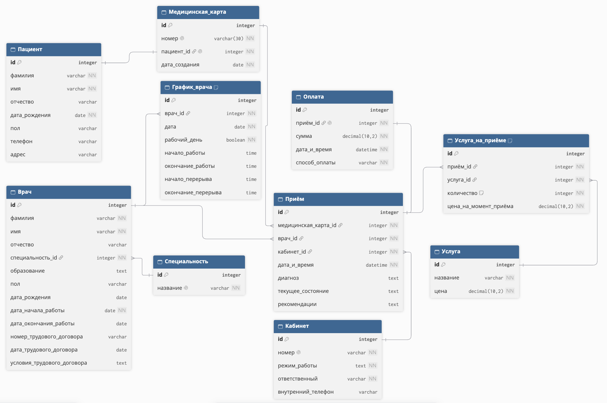
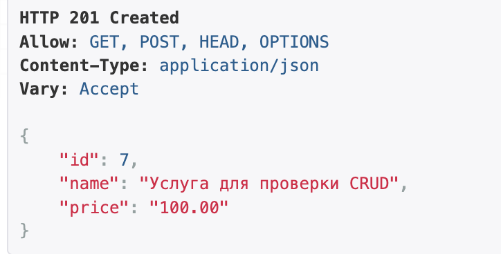
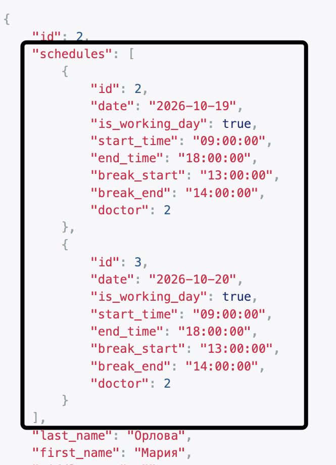
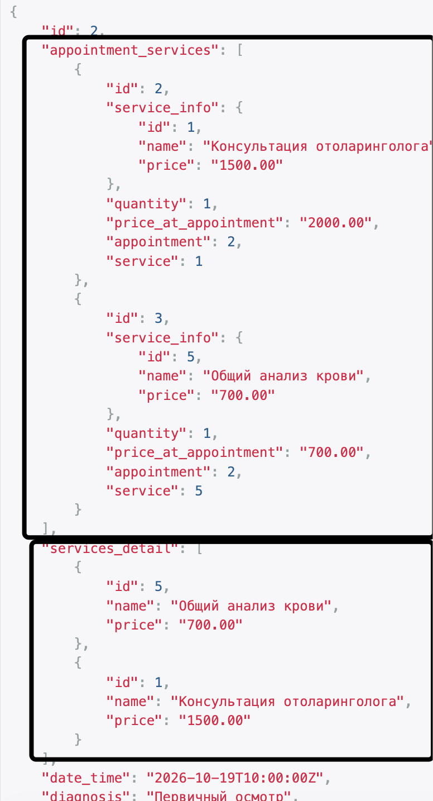

# Лабораторная работа №3. Django REST Framework

## 1. Цель работы

Овладеть практическими навыками по реализации REST API средствами Django REST Framework.

## 2. Постановка задачи

**Вариант №10 — «Лечебная клиника».**
Реализовать серверную часть приложения, используя фреймворк Django, Django REST Framework, Djoser и СУБД PostgreSQL, в соответствии с вариантом задания лабораторной работы.

## 3. Проектирование базы данных

### 3.1. ER-диаграмма

Для проектирования базы данных была разработана ER-диаграмма, содержащая 10 взаимосвязанных сущностей. Диаграмма отражает структуру хранения данных лечебной клиники, основные атрибуты таблиц и связи между ними.


### 3.2. Реализация моделей Django ORM

На основе разработанной ER-диаграммы были реализованы модели базы данных средствами Django ORM. Все модели описаны в файле `clinic/models.py` и соответствуют сущностям предметной области лечебной клиники.

Всего реализовано 10 моделей:

| Модель | Назначение |
|---|---|
| `Patient` | Хранение персональных данных пациентов |
| `MedicalCard` | Медицинские карты пациентов |
| `Specialty` | Справочник врачебных специальностей |
| `Doctor` | Информация о врачах клиники |
| `Cabinet` | Информация о кабинетах |
| `DoctorSchedule` | Графики работы врачей |
| `Appointment` | Приёмы пациентов |
| `Service` | Прейскурант медицинских услуг |
| `AppointmentService` | Услуги, оказанные на приёме |
| `Payment` | Информация об оплате приёмов |

Для реализации связей между моделями используются `ForeignKey`, `OneToOneField` и `ManyToManyField`.

**Связь один к одному (1:1)**

Каждому пациенту соответствует одна медицинская карта. Для реализации данной связи используется `OneToOneField`.

```python
class MedicalCard(models.Model):
    number = models.CharField(max_length=30, unique=True)
    patient = models.OneToOneField(
        Patient,
        on_delete=models.CASCADE,
        related_name='medical_card'
    )
    created_at = models.DateField()
```

Параметр `unique=True` обеспечивает уникальность номера медицинской карты. При удалении пациента связанная медицинская карта также удаляется благодаря `on_delete=models.CASCADE`.

**Связь один ко многим (1:N)**

Один врач может иметь несколько записей в графике работы. Для реализации данной связи используется `ForeignKey`.

```python
class DoctorSchedule(models.Model):
    doctor = models.ForeignKey(
        Doctor,
        on_delete=models.CASCADE,
        related_name='schedules'
    )

    date = models.DateField()
    is_working_day = models.BooleanField()

    start_time = models.TimeField(null=True, blank=True)
    end_time = models.TimeField(null=True, blank=True)
    break_start = models.TimeField(null=True, blank=True)
    break_end = models.TimeField(null=True, blank=True)

    class Meta:
        constraints = [
            models.UniqueConstraint(
                fields=['doctor', 'date'],
                name='unique_doctor_schedule'
            )
        ]
```

Ограничение `UniqueConstraint` исключает создание нескольких записей графика одного врача на одну дату.

**Связь многие ко многим (M:N)**

Один приём может включать несколько медицинских услуг, а одна услуга может оказываться на разных приёмах.

Для реализации данной связи используется `ManyToManyField` с промежуточной моделью `AppointmentService`.

В модели `Appointment` связь задаётся следующим образом:

```python
services = models.ManyToManyField(
    'Service',
    through='AppointmentService',
    related_name='appointments',
    blank=True
)
```

Промежуточная модель содержит ссылки на приём и услугу, количество оказанных услуг и цену на момент приёма:

```python
class AppointmentService(models.Model):
    appointment = models.ForeignKey(
        Appointment,
        on_delete=models.CASCADE,
        related_name='appointment_services'
    )

    service = models.ForeignKey(
        Service,
        on_delete=models.PROTECT,
        related_name='appointment_services'
    )

    quantity = models.PositiveIntegerField(default=1)

    price_at_appointment = models.DecimalField(
        max_digits=10,
        decimal_places=2
    )

    class Meta:
        constraints = [
            models.UniqueConstraint(
                fields=['appointment', 'service'],
                name='unique_appointment_service'
            )
        ]
```

Поле `price_at_appointment` позволяет сохранять стоимость услуги на момент её оказания независимо от последующего изменения прейскуранта.

Таким образом, реализованные модели обеспечивают хранение данных лечебной клиники, поддерживают необходимые связи между сущностями и ограничения целостности базы данных.


### 3.3. Подключение PostgreSQL

Для хранения данных приложения используется система управления базами данных PostgreSQL 16.

В PostgreSQL была создана база данных `clinic_db` и отдельный пользователь `clinic_user` для подключения Django-приложения.

Настройка подключения выполняется в файле `clinic_project/settings.py`:

```python
DATABASES = {
    'default': {
        'ENGINE': 'django.db.backends.postgresql',
        'NAME': os.getenv('DB_NAME'),
        'USER': os.getenv('DB_USER'),
        'PASSWORD': os.getenv('DB_PASSWORD'),
        'HOST': '127.0.0.1',
        'PORT': '5432',
    }
}
```

Параметры подключения загружаются из файла `.env` с помощью библиотеки `python-dotenv`. Это позволяет хранить конфиденциальные данные отдельно от исходного кода приложения.

Для создания таблиц базы данных на основе моделей Django ORM были выполнены следующие команды:

```bash
python manage.py makemigrations clinic
python manage.py migrate
```

Команда `makemigrations` создаёт файлы миграций на основе описанных моделей, а команда `migrate` применяет их к базе данных.

В результате миграции были успешно выполнены:

```text
Applying clinic.0001_initial... OK
```

После применения миграций в PostgreSQL были созданы таблицы, соответствующие моделям приложения, а также служебные таблицы Django для авторизации и управления пользователями.

Таким образом, подключение PostgreSQL настроено, а структура базы данных успешно создана средствами Django ORM.


## 4. Реализация REST API

### 4.1. Сериализаторы

Для преобразования объектов Django ORM в формат JSON и проверки входящих данных используются сериализаторы Django REST Framework.

Сериализаторы реализованы в файле `clinic/serializers.py`. Для каждой из 10 моделей был создан сериализатор на основе класса `serializers.ModelSerializer`.

Пример сериализатора пациента:

```python
class PatientSerializer(serializers.ModelSerializer):
    class Meta:
        model = Patient
        fields = '__all__'
```

Класс `ModelSerializer` автоматически создаёт поля сериализатора на основе полей модели `Patient`. Параметр `fields = '__all__'` указывает, что при сериализации используются все поля модели.

Для отображения связанных данных были реализованы вложенные сериализаторы.

Например, сериализатор врача включает информацию о его графике работы:

```python
class DoctorSerializer(serializers.ModelSerializer):
    schedules = DoctorScheduleSerializer(
        many=True,
        read_only=True
    )

    class Meta:
        model = Doctor
        fields = '__all__'
```

Параметр `many=True` позволяет возвращать несколько записей графика одного врача, а `read_only=True` указывает, что вложенные данные доступны только для чтения через данный сериализатор.

Аналогичным образом реализован сериализатор приёма, который возвращает информацию об оказанных медицинских услугах:

```python
class AppointmentSerializer(serializers.ModelSerializer):
    appointment_services = AppointmentServiceSerializer(
        many=True,
        read_only=True
    )

    services_detail = ServiceSerializer(
        source='services',
        many=True,
        read_only=True
    )

    class Meta:
        model = Appointment
        fields = '__all__'
```

Поле `appointment_services` содержит записи промежуточной таблицы с количеством и стоимостью оказанных услуг. Поле `services_detail` предоставляет информацию о самих услугах.

Таким образом, сериализаторы обеспечивают преобразование данных между объектами Django ORM и JSON, проверку поступающих данных и получение вложенных объектов связанных моделей.


### 4.2. Представления и маршрутизация

Для обработки API-запросов в файле `clinic/views.py` использовался класс `ModelViewSet` из Django REST Framework.

Он позволяет выполнять основные CRUD-операции: получение, создание, изменение и удаление записей.

Пример представления для пациентов:

```python
class PatientViewSet(viewsets.ModelViewSet):
    queryset = Patient.objects.all()
    serializer_class = PatientSerializer
```

Здесь `queryset` указывает, с какими данными работает представление, а `serializer_class` определяет используемый сериализатор.

Для создания URL-адресов использовался `DefaultRouter`. Маршруты находятся в файле `clinic/urls.py`.

```python
router = DefaultRouter()

router.register('patients', PatientViewSet)
router.register('medical-cards', MedicalCardViewSet)
router.register('specialties', SpecialtyViewSet)
router.register('doctors', DoctorViewSet)
router.register('cabinets', CabinetViewSet)
router.register('schedules', DoctorScheduleViewSet)
router.register('appointments', AppointmentViewSet)
router.register('services', ServiceViewSet)
router.register('appointment-services', AppointmentServiceViewSet)
router.register('payments', PaymentViewSet)
```

Все маршруты подключены к основному проекту через префикс `/api/`.

Например, по адресу `/api/patients/` можно получить список пациентов или добавить нового пациента, а по адресу `/api/patients/1/` — получить, изменить или удалить пациента с ID 1.

Таким образом, для всех 10 моделей были созданы API-маршруты с поддержкой CRUD-операций.


### 4.3. CRUD-операции

Для проверки работы REST API были выполнены CRUD-операции с медицинскими услугами.

Тестирование проводилось через интерфейс Django REST Framework по адресу `/api/services/`.

Были проверены следующие HTTP-методы:

| Метод | Назначение | Код ответа |
|---|---|---|
| GET | Получение данных | 200 OK |
| POST | Создание записи | 201 Created |
| PUT | Полное изменение записи | 200 OK |
| PATCH | Частичное изменение записи | 200 OK |
| DELETE | Удаление записи | 204 No Content |

Для проверки POST-запроса была создана тестовая услуга:

```json
{
    "name": "Тестовая услуга",
    "price": "100.00"
}
```

После отправки запроса сервер вернул статус `201 Created`, что означает успешное создание записи.

Затем с помощью PATCH-запроса была изменена стоимость услуги:

```json
{
    "price": "150.00"
}
```

С помощью PUT-запроса были изменены название и стоимость услуги. После этого запись была удалена методом DELETE.

Повторный GET-запрос к удалённой записи вернул статус `404 Not Found`.

В результате проверки все основные CRUD-операции работали корректно.

Пример создания медицинской услуги через POST-запроc:


### 4.4. Вложенные объекты

В приложении были реализованы вложенные объекты для связанных моделей.

Для связи **один ко многим (1:N)** был проверен запрос к врачу, который возвращает не только информацию о самом враче, но и его график работы.

Например, GET-запрос к `/api/doctors/{id}/` возвращает поле `schedules`, содержащее список рабочих дней врача.

Для связи **многие ко многим (M:N)** был проверен запрос к приёму, который возвращает информацию об оказанных услугах.

GET-запрос к `/api/appointments/{id}/` возвращает:
- `appointment_services` — данные из промежуточной таблицы;
- `services_detail` — информацию о самих услугах.

Таким образом, API позволяет получать не только отдельные записи, но и связанные с ними данные, что делает ответы более удобными для использования.

Пример получения информации о враче вместе с его графиком работы


Пример получения информации о приёме и оказанных медицинских услугах


## 5. Реализация аналитических запросов

### 5.1. Пациенты заданного врача

Первый запрос выводит список пациентов выбранного врача по алфавиту с указанием даты и стоимости каждого приёма.

Для получения данных используется следующий код:

```python
appointments = (
    Appointment.objects
    .filter(doctor_id=doctor_id)
    .select_related('medical_card__patient')
    .annotate(
        total=Coalesce(
            Sum(
                F('appointment_services__quantity') *
                F('appointment_services__price_at_appointment'),
                output_field=MONEY
            ),
            Value(Decimal('0.00'), output_field=MONEY)
        )
    )
    .order_by(
        'medical_card__patient__last_name',
        'medical_card__patient__first_name',
        'date_time'
    )
)
```

Метод `filter()` выбирает приёмы указанного врача, `Sum()` рассчитывает стоимость приёмов, а `order_by()` сортирует пациентов по алфавиту.

Для проверки был выполнен GET-запрос:

`/api/analytics/doctor-patients/?doctor_id=2`

В результате сервер возвращает список пациентов врача с датами и стоимостью приёмов.

Пример ответа:

```json
[
    {
        "patient": "Кузнецов Максим",
        "date": "2026-10-20",
        "cost": "2000.00"
    },
    {
        "patient": "Сидоров Артём",
        "date": "2026-10-19",
        "cost": "2700.00"
    }
]
```


### 5.2. Пациенты отоларинголога

Второй запрос выводит телефоны пациентов, которые посещали отоларингологов и год рождения которых больше 1987.

Для выполнения запроса используется следующий код:

```python
patients = (
    Patient.objects
    .filter(
        birth_date__year__gt=1987,
        medical_card__appointments__doctor__specialty__name__iexact='Отоларинголог'
    )
    .distinct()
    .order_by('last_name', 'first_name')
)
```

Метод `filter()` выбирает пациентов по году рождения и специальности врача. `distinct()` убирает повторения, если пациент посещал отоларинголога несколько раз.

Для проверки был выполнен GET-запрос:

`/api/analytics/ent-patients/`

В результате сервер возвращает JSON со списком подходящих пациентов, их датами рождения и номерами телефонов.

Пример ответа:

```json
[
    {
        "patient": "Иванов Иван",
        "birth_date": "1995-05-15",
        "phone": "+79991234567"
    },
    {
        "patient": "Кузнецов Максим",
        "birth_date": "2002-01-22",
        "phone": "+79000000003"
    },
    {
        "patient": "Сидоров Артём",
        "birth_date": "1994-07-12",
        "phone": "+79000000001"
    }
]
```

В результате были получены пациенты, которые посещали отоларинголога и родились после 1987 года.


### 5.3. Врачи, работающие в заданный день

Третий запрос выводит список врачей, у которых в графике работы указан заданный день.

Для выполнения запроса используется следующий код:

```python
doctors = (
    Doctor.objects
    .filter(
        schedules__date=date,
        schedules__is_working_day=True
    )
    .select_related('specialty')
    .order_by('last_name', 'first_name')
)
```

Метод `filter()` выбирает врачей, которые работают в указанную дату. Дополнительно проверяется поле `is_working_day`, чтобы исключить нерабочие дни. Метод `order_by()` сортирует врачей по алфавиту.

Для проверки был выполнен GET-запрос:

`/api/analytics/working-doctors/?date=2026-10-21`

Пример ответа:

```json
[
    {
        "doctor": "Климов Дмитрий",
        "specialty": "Кардиолог"
    },
    {
        "doctor": "Соколова Анна",
        "specialty": "Терапевт"
    }
]
```

В результате сервер возвращает список врачей и их специальностей, которые работают 21 октября 2026 года.


### 5.4. Количество приёмов по датам

Четвёртый запрос выводит количество приёмов пациентов за каждую дату.

Для выполнения запроса используется следующий код:

```python
result = (
    Appointment.objects
    .annotate(day=TruncDate('date_time'))
    .values('day')
    .annotate(count=Count('id'))
    .order_by('day')
)
```

Функция `TruncDate()` выделяет дату из поля `date_time`, а `Count()` подсчитывает количество приёмов за каждый день. Метод `order_by()` сортирует результаты по дате.

Для проверки был выполнен GET-запрос:

`/api/analytics/appointments-by-date/`

Пример ответа:

```json
[
    {
        "day": "2026-10-19",
        "count": 1
    },
    {
        "day": "2026-10-20",
        "count": 2
    },
    {
        "day": "2026-10-21",
        "count": 2
    },
    {
        "day": "2026-10-22",
        "count": 2
    },
    {
        "day": "2026-10-23",
        "count": 1
    }
]
```

В результате сервер возвращает количество приёмов за каждую дату. Всего за указанные дни было проведено 8 приёмов.


### 5.5. Суммарная стоимость лечения

Пятый запрос рассчитывает суммарную стоимость лечения пациентов по дням и врачам.

Для выполнения запроса используется следующий код:

```python
result = (
    AppointmentService.objects
    .annotate(day=TruncDate('appointment__date_time'))
    .values(
        'day',
        'appointment__doctor_id',
        'appointment__doctor__last_name',
        'appointment__doctor__first_name'
    )
    .annotate(
        total=Sum(
            F('quantity') * F('price_at_appointment'),
            output_field=MONEY
        )
    )
    .order_by('day', 'appointment__doctor__last_name')
)
```

Функция `TruncDate()` выделяет дату приёма, а `Sum()` рассчитывает общую стоимость оказанных услуг с учётом их количества. Результаты группируются по дате и врачу.

Для проверки был выполнен GET-запрос:

`/api/analytics/treatment-costs/`

Пример ответа (фрагмент):

```json
[
    {
        "date": "2026-10-19",
        "doctor_id": 2,
        "doctor": "Орлова Мария",
        "total": "2700.00"
    },
    {
        "date": "2026-10-20",
        "doctor_id": 2,
        "doctor": "Орлова Мария",
        "total": "2000.00"
    },
    {
        "date": "2026-10-20",
        "doctor_id": 4,
        "doctor": "Соколова Анна",
        "total": "2400.00"
    }
]
```

В результате сервер возвращает стоимость оказанных услуг по каждому врачу за каждую дату. Общая стоимость всех 8 приёмов в тестовых данных составила 18 700 рублей.


### 5.6. Пациенты, оплатившие лечение

Шестой запрос выводит список пациентов, которые уже оплатили лечение.

Для выполнения запроса используется следующий код:

```python
patients = (
    Patient.objects
    .filter(
        medical_card__appointments__payment__isnull=False
    )
    .distinct()
    .order_by('last_name', 'first_name')
)
```

Метод `filter()` выбирает пациентов, у которых есть оплаченные приёмы. Условие `payment__isnull=False` проверяет наличие оплаты, а `distinct()` исключает повторение пациентов в списке.

Для проверки был выполнен GET-запрос:

`/api/analytics/paid-patients/`

Пример ответа (фрагмент):

```json
[
    {
        "id": 1,
        "patient": "Иванов Иван",
        "phone": "+79991234567"
    },
    {
        "id": 5,
        "patient": "Морозова Елена",
        "phone": "+79000000004"
    },
    {
        "id": 2,
        "patient": "Сидоров Артём",
        "phone": "+79000000001"
    }
]
```

В результате сервер возвращает список пациентов, у которых имеется хотя бы один оплаченный приём. Повторяющиеся пациенты в ответе отсутствуют.

## 6. Отчёт о работе врачей

Для получения информации о работе врачей был реализован отдельный отчёт за выбранный период.

Отчёт содержит список врачей, принятых пациентов, диагнозы, оказанные услуги, их стоимость и суммарный доход каждого врача.

Для формирования отчёта используется функция `doctors_report` из файла `clinic/analytics.py`.

Основной фрагмент кода:

```python
appointments = (
    Appointment.objects
    .filter(date_time__date__range=(start_date, end_date))
    .select_related('medical_card__patient', 'payment')
    .prefetch_related('appointment_services__service')
    .order_by('date_time')
)

for doctor in doctors:
    doctor_income = Decimal('0.00')
    accepted_patients = []

    for appointment in doctor.period_appointments:
        total_cost = Decimal('0.00')

        for item in appointment.appointment_services.all():
            total_cost += item.quantity * item.price_at_appointment

        payment = getattr(appointment, 'payment', None)

        if payment is not None:
            doctor_income += payment.amount
```

В коде выбираются приёмы за указанный период, рассчитывается стоимость оказанных услуг и суммируются полученные оплаты.

Для проверки был выполнен GET-запрос:

`/api/reports/doctors/?start_date=2026-10-19&end_date=2026-10-23`

Пример ответа (фрагмент):

```json
{
    "doctor": "Климов Дмитрий",
    "specialty": "Кардиолог",
    "appointments_count": 2,
    "patients": [
        {
            "patient": "Смирнова Ирина",
            "diagnosis": "Первичный осмотр",
            "total_cost": "3400.00",
            "is_paid": true
        },
        {
            "patient": "Сидоров Артём",
            "diagnosis": "Первичный осмотр",
            "total_cost": "2500.00",
            "is_paid": true
        }
    ],
    "total_income": "5900.00"
}
```

По результатам выполнения запроса были получены следующие данные:

| Врач | Количество приёмов | Доход, руб. |
|---|---:|---:|
| Климов Дмитрий | 2 | 5900 |
| Орлова Мария | 2 | 2700 |
| Петров Алексей | 1 | 2000 |
| Соколова Анна | 3 | 2400 |
| **Итого** | **8** | **13000** |

Общая стоимость оказанных услуг составила 18 700 рублей, из которых 13 000 рублей были оплачены.

Таким образом, реализованный отчёт позволяет посмотреть работу каждого врача за выбранный период и полученный доход.


## 7. Регистрация и авторизация через Djoser

Для регистрации и авторизации пользователей использовалась библиотека Djoser, которая работает совместно с Django REST Framework.

В файле `clinic_project/urls.py` были добавлены маршруты:

```python
path('auth/', include('djoser.urls')),
path('auth/', include('djoser.urls.authtoken')),
```

Для авторизации используется токен, который пользователь получает после входа в систему.

**Регистрация пользователя**

Для создания нового пользователя был выполнен POST-запрос:

`/auth/users/`

Тело запроса:

```json
{
    "username": "testuser",
    "password": "TestPass2026!abc",
    "email": "testuser@example.com"
}
```

После отправки запроса сервер вернул статус `201 Created`, что означает успешную регистрацию пользователя.

**Получение токена**

Для входа в систему использовался POST-запрос:

`/auth/token/login/`

```json
{
    "username": "testuser",
    "password": "TestPass2026!abc"
}
```

В ответ сервер вернул токен авторизации:

```json
{
    "auth_token": "<токен пользователя>"
}
```

**Получение информации о пользователе**

Для проверки авторизации был выполнен GET-запрос:

`/auth/users/me/`

В заголовке запроса передавался полученный токен:

```text
Authorization: Token <токен пользователя>
```

После успешной авторизации сервер вернул информацию о текущем пользователе.

**Выход из системы**

Для выхода использовался POST-запрос:

`/auth/token/logout/`

При успешном выполнении сервер вернул статус `204 No Content`, а токен был удалён.

Таким образом, с помощью Djoser были реализованы и проверены регистрация пользователей, вход по токену, получение информации о текущем пользователе и выход из системы.


## 8. Тестирование REST API

Для проверки работы приложения использовался встроенный интерфейс Django REST Framework. Через него выполнялись запросы к API и проверялись полученные JSON-ответы.

### 8.1. Основные эндпоинты

Для всех 10 моделей реализованы CRUD-операции.

| Метод | URL | Параметры | Ответ |
|---|---|---|---|
| GET, POST | `/api/patients/` | Данные пациента для POST | 200 — список, 201 — создание |
| GET, PUT, PATCH, DELETE | `/api/patients/{id}/` | ID, данные для изменения | 200 — данные, 204 — удаление |
| GET, POST | `/api/medical-cards/` | Номер карты, пациент, дата | 200, 201 |
| GET, PUT, PATCH, DELETE | `/api/medical-cards/{id}/` | ID, данные карты | 200, 204 |
| GET, POST | `/api/specialties/` | Название специальности | 200, 201 |
| GET, PUT, PATCH, DELETE | `/api/specialties/{id}/` | ID, данные специальности | 200, 204 |
| GET, POST | `/api/doctors/` | Данные врача | 200, 201 |
| GET, PUT, PATCH, DELETE | `/api/doctors/{id}/` | ID, данные врача | 200, 204 |
| GET, POST | `/api/cabinets/` | Данные кабинета | 200, 201 |
| GET, PUT, PATCH, DELETE | `/api/cabinets/{id}/` | ID, данные кабинета | 200, 204 |
| GET, POST | `/api/schedules/` | Врач, дата, время работы | 200, 201 |
| GET, PUT, PATCH, DELETE | `/api/schedules/{id}/` | ID, данные графика | 200, 204 |
| GET, POST | `/api/appointments/` | Врач, карта, кабинет, дата | 200, 201 |
| GET, PUT, PATCH, DELETE | `/api/appointments/{id}/` | ID, данные приёма | 200, 204 |
| GET, POST | `/api/services/` | Название, цена | 200, 201 |
| GET, PUT, PATCH, DELETE | `/api/services/{id}/` | ID, данные услуги | 200, 204 |
| GET, POST | `/api/appointment-services/` | Приём, услуга, количество, цена | 200, 201 |
| GET, PUT, PATCH, DELETE | `/api/appointment-services/{id}/` | ID, данные услуги на приёме | 200, 204 |
| GET, POST | `/api/payments/` | Приём, сумма, дата, способ оплаты | 200, 201 |
| GET, PUT, PATCH, DELETE | `/api/payments/{id}/` | ID, данные оплаты | 200, 204 |

Для GET, PUT и PATCH успешный ответ имеет статус `200 OK`, для POST — `201 Created`, для DELETE — `204 No Content`.

### 8.2. Аналитические запросы

Для выполнения запросов по индивидуальному варианту были созданы отдельные GET-эндпоинты.

| Метод | URL | Параметры | Ответ |
|---|---|---|---|
| GET | `/api/analytics/doctor-patients/` | `doctor_id` | Пациенты врача, даты и стоимость приёмов |
| GET | `/api/analytics/ent-patients/` | — | Пациенты отоларинголога после 1987 года рождения |
| GET | `/api/analytics/working-doctors/` | `date` | Врачи, работающие в заданный день |
| GET | `/api/analytics/appointments-by-date/` | — | Количество приёмов по датам |
| GET | `/api/analytics/treatment-costs/` | — | Стоимость лечения по дням и врачам |
| GET | `/api/analytics/paid-patients/` | — | Список оплативших пациентов |
| GET | `/api/reports/doctors/` | `start_date`, `end_date` | Отчёт о работе врачей за период |

При корректном выполнении запросы возвращают статус `200 OK` и результат в формате JSON.

### 8.3. Авторизация

Для работы с пользователями использовались следующие эндпоинты Djoser.

| Метод | URL | Параметры | Ответ |
|---|---|---|---|
| POST | `/auth/users/` | username, email, password | 201 — пользователь создан |
| POST | `/auth/token/login/` | username, password | 200 — токен |
| GET | `/auth/users/me/` | Токен в заголовке | 200 — данные пользователя |
| POST | `/auth/token/logout/` | Токен в заголовке | 204 — выход |

В таблице приведены маршруты Djoser, которые использовались при выполнении лабораторной.

### 8.4. Результаты тестирования

При проверке приложения были получены следующие результаты:

| Проверка | Результат |
|---|---|
| Создание записей через POST | Успешно |
| Получение записей через GET | Успешно |
| Вложенные объекты 1:N и M:N | Успешно |
| Шесть аналитических запросов | Успешно |
| Формирование отчёта по врачам | Успешно |
| Регистрация пользователя | Успешно |
| Авторизация по токену | Успешно |
| Получение текущего пользователя | Успешно |
| Выход из системы | Успешно |

В ходе тестирования приложение корректно обрабатывало запросы и возвращало данные в формате JSON.

## 9. Вывод

В ходе лабораторной работы была разработана серверная часть приложения для лечебной клиники с использованием Django, Django REST Framework, PostgreSQL и Djoser.

Была спроектирована база данных из 10 взаимосвязанных моделей, реализованы CRUD-операции и получение вложенных объектов. Также были выполнены 6 аналитических запросов и реализовано формирование отчёта о работе врачей за выбранный период.

С помощью Djoser была настроена регистрация и авторизация пользователей по токенам. Работа API была проверена на тестовых данных.

В результате лабораторной работы были получены практические навыки работы с Django ORM, REST API, сериализаторами и авторизацией пользователей.
