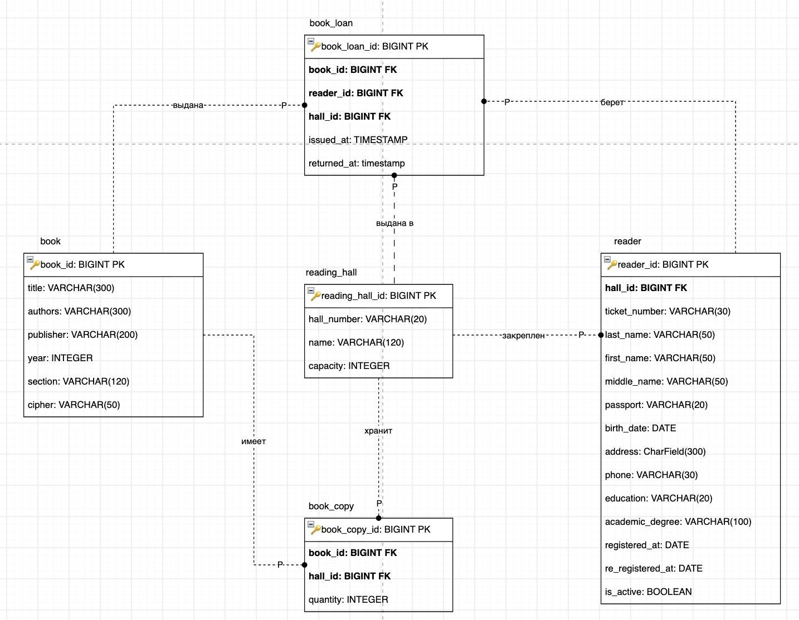
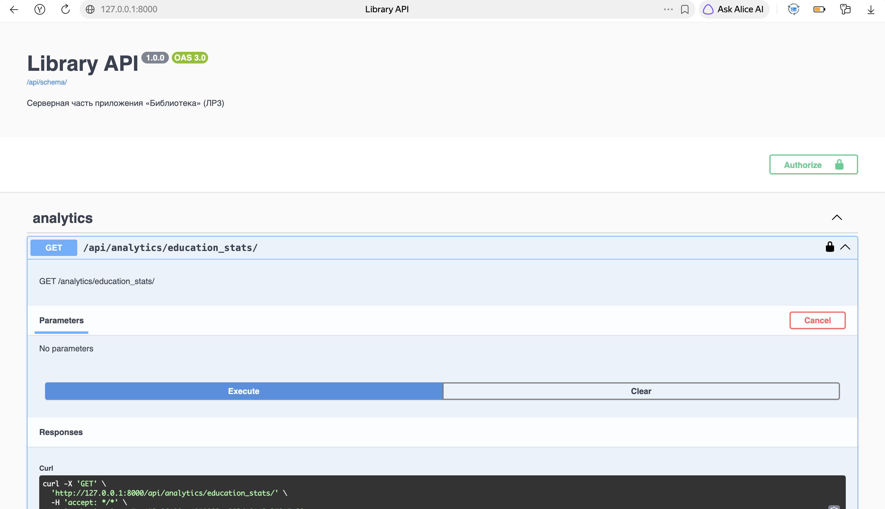

# ЛР3. Реализация серверной части приложения средствами Django и Django REST Framework
**Вариант 2 — «Библиотека»**

**Студент:** Блинова Полина  
**Группа:** К3339  
**Стек:** Python 3.13, Django 5, Django REST Framework, Djoser, PostgreSQL, drf-spectacular, MkDocs.

---

## 1. Модель данных (ER-диаграмма)

Схема базы данных спроектирована в нотации **IDEF1X** с использованием суррогатных первичных ключей. Все связи являются неидентифицирующими (пунктирные линии на диаграмме).



### Описание сущностей и связей:
- **ReadingHall (Читальный зал)** — справочник залов.
- **Reader (Читатель)** — связан с залом связью 1:N (`hall_id`).
- **Book (Книга)** — справочник книг.
- **BookCopy (Экземпляры)** — ассоциативная сущность, разрешающая M:N между `Book` и `ReadingHall`. Содержит атрибут `quantity` (количество экземпляров).
- **BookLoan (Выдача)** — ассоциативная сущность, разрешающая M:N между `Book` и `Reader`. Содержит атрибуты `issued_at` и `returned_at`.

*Примечание:* Использование чистого `ManyToManyField` невозможно, так как у связей есть собственные атрибуты. В Django это реализовано через промежуточные модели (эквивалент `through`).

---

## 2. Таблица эндпоинтов

Базовый URL: `http://127.0.0.1:8000/api/`
Для методов `POST`, `PUT`, `PATCH`, `DELETE` требуется заголовок: `Authorization: Token <ваш_токен>`.

### 2.1. Аутентификация (Djoser)

| Метод | URL | Параметры (body/path) | Формат ответа (успех) |
| :--- | :--- | :--- | :--- |
| POST | `/api/auth/users/` | `username`, `password` | `201 Created` + JSON с `id`, `username` |
| POST | `/api/auth/token/login/` | `username`, `password` | `200 OK` + `{"auth_token": "..."}` |
| POST | `/api/auth/token/logout/` | — (только токен в заголовке) | `204 No Content` |
| GET | `/api/auth/users/me/` | — | `200 OK` + JSON с данными профиля |

### 2.2. CRUD-операции (ViewSets + Router)

Для всех сущностей доступны стандартные методы (список, создание, чтение, обновление, удаление).

| Метод | URL | Параметры (body/path) | Формат ответа (успех) |
| :--- | :--- | :--- | :--- |
| GET | `/api/halls/` | — | `200 OK` + массив залов |
| POST | `/api/halls/` | `hall_number`, `name`, `capacity` | `201 Created` + объект зала |
| GET | `/api/halls/{id}/` | `id` (path) | `200 OK` + объект зала |
| PUT | `/api/halls/{id}/` | `id` (path), полные данные | `200 OK` + обновленный объект |
| PATCH | `/api/halls/{id}/` | `id` (path), частичные данные | `200 OK` + обновленный объект |
| DELETE | `/api/halls/{id}/` | `id` (path) | `204 No Content` |
| GET | `/api/readers/` | — | `200 OK` + массив (вложенные `loans`, `hall_name`) |
| POST | `/api/readers/` | Данные читателя | `201 Created` |
| GET | `/api/books/` | — | `200 OK` + массив книг |
| POST | `/api/books/` | Данные книги | `201 Created` |
| GET | `/api/copies/` | — | `200 OK` + массив экземпляров |
| POST | `/api/copies/` | `book`, `hall`, `quantity` | `201 Created` |
| GET | `/api/loans/` | — | `200 OK` + массив выдач |
| POST | `/api/loans/` | `book`, `reader`, `hall`, `issued_at` | `201 Created` |

### 2.3. Вложенные GET-запросы (Требование ЛР)

| Метод | URL | Параметры | Формат ответа (успех) |
| :--- | :--- | :--- | :--- |
| GET | `/api/halls/{id}/readers/` | `id` (path) | `200 OK` + массив читателей этого зала |
| GET | `/api/halls/{id}/books/` | `id` (path) | `200 OK` + массив экземпляров в этом зале |
| GET | `/api/readers/{id}/books/` | `id` (path) | `200 OK` + массив активных выдач читателя |
| GET | `/api/books/{id}/` | `id` (path) | `200 OK` + книга с вложенными `copies` и `loans` |

### 2.4. Аналитические запросы

| Метод | URL | Параметры | Формат ответа (успех) |
| :--- | :--- | :--- | :--- |
| GET | `/api/analytics/readers_under_20/` | — | `200 OK` + `{"readers_under_20": 1}` |
| GET | `/api/analytics/education_stats/` | — | `200 OK` + JSON с процентами |
| GET | `/api/analytics/rare_books_readers/` | — | `200 OK` + массив читателей |
| GET | `/api/analytics/overdue_loans/` | — | `200 OK` + массив просроченных выдач |
| GET | `/api/analytics/monthly_report/` | — | `200 OK` + JSON с отчётом |
| POST | `/api/readers/deactivate_old/` | — | `200 OK` + `{"deactivated_count": 0}` |

---

## 3. Примеры запросов и ответов



### 3.1. Регистрация и получение токена (Djoser)
**Запрос (POST):** `/api/auth/token/login/`
```json
{
  "username": "admin",
  "password": "StrongPass123"
}
```
Ответ (200 OK):
```json
{
  "auth_token": "7aa453c06190ec4950023aa983d48142c37917a2"
}
```

### 3.2. Создание читального зала (POST)
**Запрос (POST):** `/api/halls/`
**Заголовки: Authorization: Token 7aa453...**
```json
{
  "hall_number": "101",
  "name": "Гуманитарный",
  "capacity": 30
}
```
Ответ (201 Created):
```json
{
  "id": 1,
  "hall_number": "101",
  "name": "Гуманитарный",
  "capacity": 30
}
```

### 3.3. Вложенный GET (Читатели зала)
**Запрос (GET):** `/api/halls/1/readers/`
Ответ (200 OK):
```json
[
  {
    "id": 1,
    "ticket_number": "TB-0001",
    "last_name": "Иванов",
    "first_name": "Иван",
    "hall": 1
  }
]
```

### 3.4. Аналитика (Проценты по образованию)
**Запрос (GET):** `/api/analytics/education_stats/`
Ответ (200 OK):
```json
{
  "total": 3,
  "stats": [
    {
      "education": "secondary",
      "education_name": "Среднее",
      "count": 1,
      "percent": 33.33
    },
    {
      "education": "higher",
      "education_name": "Высшее",
      "count": 1,
      "percent": 33.33
    },
    {
      "education": "degree",
      "education_name": "Учёная степень",
      "count": 1,
      "percent": 33.33
    }
  ]
}
```

### 3.5. Аналитика (Просроченные выдачи)
**Запрос (GET):** `/api/analytics/overdue_loans/`
Ответ (200 OK):
```json
[
  {
    "id": 1,
    "book": 1,
    "book_title": "Война и мир",
    "reader": 1,
    "reader_name": "Иванов Иван (TB-0001)",
    "issued_at": "2026-09-27T12:22:23Z",
    "returned_at": null
  }
]
```

### 3.6. Кастомная операция (Исключение старых читателей)
**Запрос (POST):** `/api/readers/deactivate_old/`
Ответ (200 OK):
```json
{
  "deactivated_count": 0
}
```

# 4. Вывод
В ходе работы была спроектирована и реализована серверная часть приложения. Схема БД соответствует нотации IDEF1X. Связи M:N разрешены через ассоциативные сущности. Реализованы все CRUD-операции, вложенные GET-запросы (1:N), токен-аутентификация (Djoser) и 5 аналитических запросов согласно варианту задания. API протестировано, документация сгенерирована.

