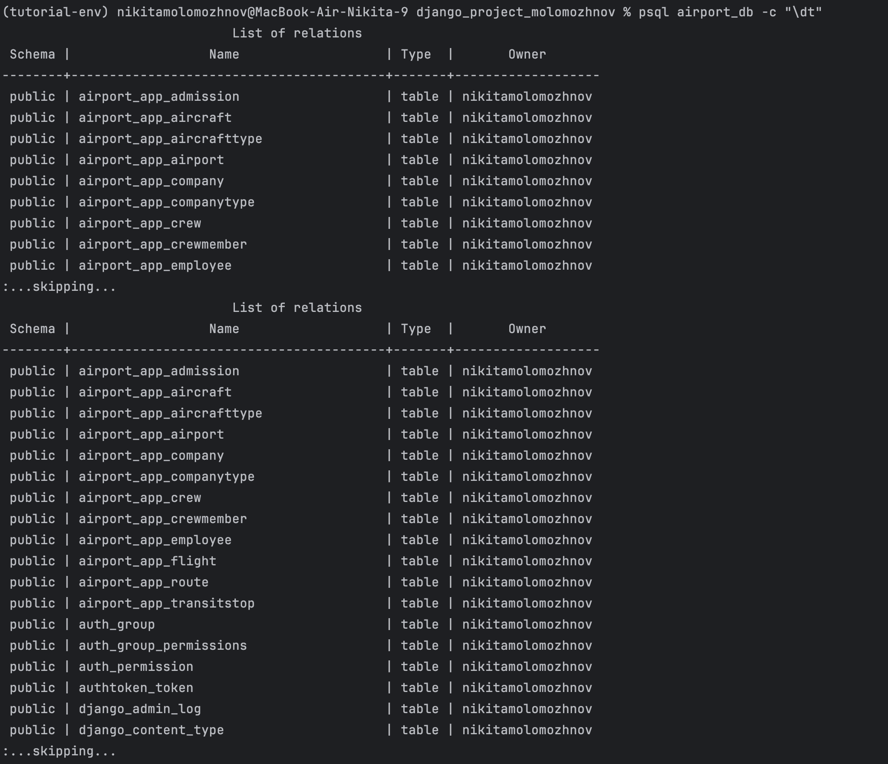
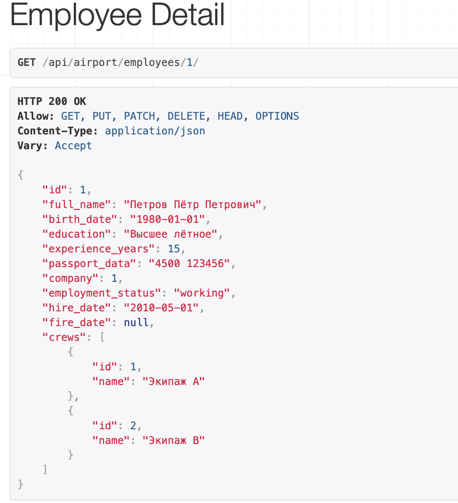
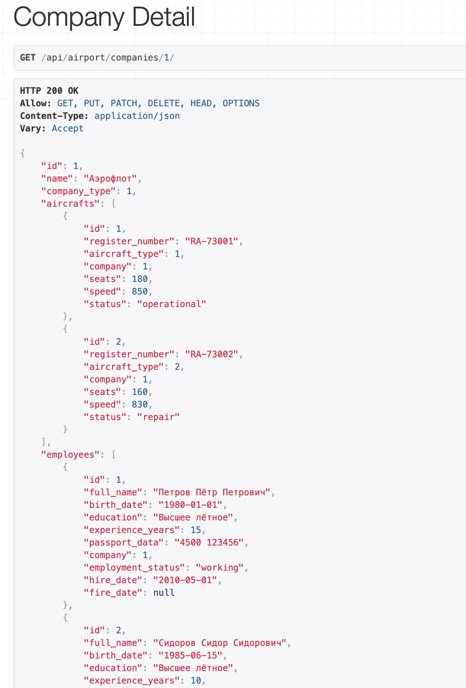
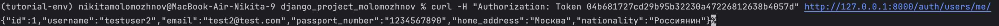
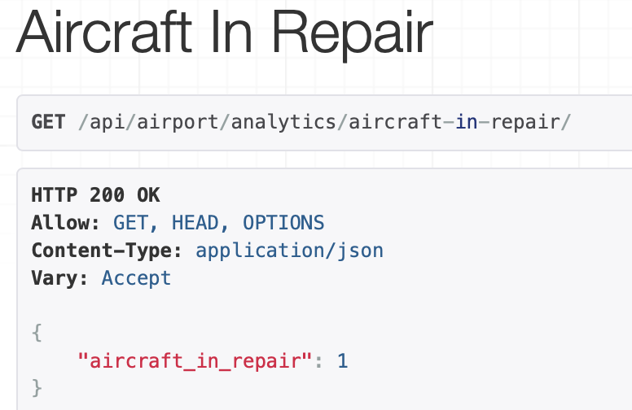

# Лабораторная работа №3 — Аэропорт 

**Студент:** Моломожнов Никита Владимирович  
**Группа:** к3340  
**Вариант:** 14 — Аэропорт

---

## 1. Предметная область

Программная система для администрации аэропорта компании-авиаперевозчика.

Функционал:
- учёт авиакомпаний, самолётов, типов самолётов;
- маршруты, рейсы, транзитные посадки;
- экипажи, сотрудники, допуски к рейсам;
- CRUD через REST API;
- 6 аналитических запросов из варианта;
- регистрация/авторизация по токенам через Djoser.

---

## 2. Модель данных

12 таблиц, 15 FK-связей, 1 m2m через `through`.

| Модель | Поля | Связи |
|---|---|---|
| **CompanyType** | name | — |
| **Company** | name | company_type → CompanyType (`related_name="companies"`) |
| **AircraftType** | model, manufacturer | — |
| **Aircraft** | register_number, seats, speed, status (choices: operational / repair) | aircraft_type → AircraftType (`aircrafts`), company → Company (`aircrafts`) |
| **Airport** | name, city | — |
| **Route** | distance | departure_airport → Airport (`departure_routes`), destination_airport → Airport (`destination_routes`) |
| **Flight** | flight_number, departure_dt, arrival_dt, tickets_sold | route → Route (`flights`), aircraft → Aircraft (`flights`), crew → Crew (`flights`) |
| **TransitStop** | arrival_dt, departure_dt | flight → Flight (`transit_stops`), airport → Airport (`transit_stops`) |
| **Crew** | name | employees = `ManyToManyField(Employee, through='CrewMember', related_name='crews')` |
| **CrewMember** | role | crew → Crew (`members`), employee → Employee (`crew_memberships`) |
| **Employee** | full_name, birth_date, education, experience_years, passport_data, employment_status, hire_date, fire_date | company → Company (`employees`) |
| **Admission** | is_allowed, issue_date | employee → Employee (`admissions`), flight → Flight (`admissions`) |

### Связи

- CompanyType (1) → Company (N)
- Company (1) → Aircraft (N), Employee (N)
- AircraftType (1) → Aircraft (N)
- Airport (1) → Route (N) — departure_airport, destination_airport
- Route (1) → Flight (N)
- Aircraft (1) → Flight (N)
- Crew (1) → Flight (N)
- Flight (1) → TransitStop (N)
- Airport (1) → TransitStop (N)
- **Crew (M) ↔ Employee (M)** — через CrewMember
- Employee (1) → Admission (N)
- Flight (1) → Admission (N)

### `related_name`

| Поле | related_name |
|---|---|
| Company.company_type | companies |
| Aircraft.aircraft_type | aircrafts |
| Aircraft.company | aircrafts |
| Route.departure_airport | departure_routes |
| Route.destination_airport | destination_routes |
| Flight.route / aircraft / crew | flights |
| TransitStop.flight / airport | transit_stops |
| CrewMember.crew | members |
| CrewMember.employee | crew_memberships |
| Employee.company | employees |
| Admission.employee / flight | admissions |
| Crew.employees (m2m) | crews |



---

## 3. API

Базовый префикс: `/api/airport/`

### CRUD

| Метод | URL | Описание |
|---|---|---|
| GET, POST | `/companies/` | список / создание |
| GET, PUT, PATCH, DELETE | `/companies/<id>/` | компания + aircrafts + employees |
| GET, POST | `/aircrafts/` | список / создание |
| GET, PUT, PATCH, DELETE | `/aircrafts/<id>/` | самолёт + flights |
| GET, POST | `/flights/` | список / создание |
| GET, PUT, PATCH, DELETE | `/flights/<id>/` | рейс + route + aircraft + crew + transit_stops |
| GET, POST | `/crews/` | список / создание |
| GET, PUT, PATCH, DELETE | `/crews/<id>/` | экипаж + members[].employee |
| GET, POST | `/employees/` | список / создание |
| GET, PUT, PATCH, DELETE | `/employees/<id>/` | сотрудник + crews (m2m) |
| GET, POST | `/airports/` | список / создание |
| GET, PUT, PATCH, DELETE | `/airports/<id>/` | |
| GET, POST | `/routes/` | список / создание |
| GET, PUT, PATCH, DELETE | `/routes/<id>/` | |
| GET, POST | `/crew-members/` | список / создание |
| GET, PUT, PATCH, DELETE | `/crew-members/<id>/` | |
| GET, POST | `/admissions/` | список / создание |
| GET, PUT, PATCH, DELETE | `/admissions/<id>/` | |
| GET, POST | `/transit-stops/` | список / создание |
| GET, PUT, PATCH, DELETE | `/transit-stops/<id>/` | |
| GET, PUT, PATCH, DELETE | `/company-types/<id>/` | |
| GET, PUT, PATCH, DELETE | `/aircraft-types/<id>/` | |

### Вложенные объекты (требование ЛР3)

**o2m:**
- `GET /api/airport/companies/<id>/` → `aircrafts[]`, `employees[]`
- `GET /api/airport/flights/<id>/` → `transit_stops[]`, `crew.members[].employee`
- `GET /api/airport/crews/<id>/` → `members[].employee`

**m2m:**
- `GET /api/airport/employees/<id>/` → `crews[]` (через `ManyToManyField(through='CrewMember')`)

Пример ответа `/api/airport/employees/1/`:

```json
{
    "id": 1,
    "full_name": "Петров Пётр Петрович",
    "crews": [
        {"id": 1, "name": "Экипаж A"},
        {"id": 2, "name": "Экипаж B"}
    ]
}
```




### Djoser

| Метод | URL | Описание |
|---|---|---|
| POST | `/auth/users/` | регистрация (с кастомными полями User) |
| POST | `/auth/token/login/` | получение токена |
| POST | `/auth/token/logout/` | выход |
| GET | `/auth/users/me/` | текущий пользователь (нужен Authorization: Token <token>) |

Пример регистрации:

```bash
curl -X POST http://127.0.0.1:8000/auth/users/ \
  -d "username=testuser&password=testpass123&email=test@test.com&passport_number=1234567890&home_address=Москва&nationality=Россиянин"
```

Ответ:

```json
{"id":1,"username":"testuser","email":"test@test.com","passport_number":"1234567890","home_address":"Москва","nationality":"Россиянин"}
```

---

## 4. Аналитические запросы (вариант 14)

| № | Формулировка | Эндпоинт |
|---|---|---|
| 1 | Марка самолёта, чаще всего летающая по маршруту | `/analytics/aircraft-most-frequent-route/` |
| 2 | Маршруты, заполненные менее чем на XX% | `/analytics/underfilled-routes/?percent=90` |
| 3 | Свободные места на рейс | `/analytics/flights/<id>/free-seats/` |
| 4 | Количество самолётов в ремонте | `/analytics/aircraft-in-repair/` |
| 5 | Количество работников по компаниям | `/analytics/company-employees/` |
| 6 | Отчёт о бортах: всего и по маркам | `/analytics/company-aircrafts-report/` |


Примеры ответов:

```json
// /analytics/aircraft-in-repair/
{"aircraft_in_repair": 1}

// /analytics/flights/1/free-seats/
{"flight_id": 1, "flight_number": "SU-100", "seats_total": 180, "tickets_sold": 150, "free_seats": 30}

// /analytics/company-employees/
[
    {"company__name": "Администрация аэропорта", "count": 1},
    {"company__name": "Аэрофлот", "count": 3}
]

// /analytics/company-aircrafts-report/
{
    "total_aircrafts": 3,
    "by_type": [
        {"aircraft_type__model": "737-800", "aircraft_type__manufacturer": "Boeing", "count": 1},
        {"aircraft_type__model": "A320", "aircraft_type__manufacturer": "Airbus", "count": 1},
        {"aircraft_type__model": "SSJ-100", "aircraft_type__manufacturer": "Sukhoi", "count": 1}
    ]
}
```

---

## 5. Важные блоки кода

### Модель с m2m через through

```python
class Crew(models.Model):
    name = models.CharField(max_length=50)
    employees = models.ManyToManyField(
        'Employee', through='CrewMember', related_name='crews'
    )

    def __str__(self):
        return self.name
```

### Вложенный сериализатор (m2m)

```python
class EmployeeFullSerializer(serializers.ModelSerializer):
    crews = CrewSerializer(many=True, read_only=True)

    class Meta:
        model = Employee
        fields = ["id", "full_name", "birth_date", "education",
                  "experience_years", "passport_data", "company",
                  "employment_status", "hire_date", "fire_date", "crews"]
```

### Generic-вьюха

```python
class EmployeeDetailView(generics.RetrieveUpdateDestroyAPIView):
    queryset = Employee.objects.all()
    serializer_class = EmployeeFullSerializer
    permission_classes = [IsAuthenticatedOrReadOnly]
```

### Аналитика: агрегация + аннотация

```python
class CompanyEmployeesCountView(APIView):
    def get(self, request):
        rows = (
            Employee.objects
            .values("company__name")
            .annotate(count=Count("id"))
            .order_by("company__name")
        )
        return Response(list(rows))
```

### Аналитика: свободные места

```python
class FlightFreeSeatsView(APIView):
    def get(self, request, pk):
        flight = Flight.objects.select_related("aircraft").get(pk=pk)
        free = flight.aircraft.seats - flight.tickets_sold
        return Response({
            "flight_id": flight.id,
            "flight_number": flight.flight_number,
            "seats_total": flight.aircraft.seats,
            "tickets_sold": flight.tickets_sold,
            "free_seats": free,
        })
```

### Кастомный UserSerializer для Djoser

```python
class UserSerializer(serializers.ModelSerializer):
    class Meta:
        model = User
        fields = ["id", "username", "email",
                  "passport_number", "home_address", "nationality"]
```

### Настройки

```python
REST_FRAMEWORK = {
    "DEFAULT_AUTHENTICATION_CLASSES": (
        "rest_framework.authentication.TokenAuthentication",
    ),
}

DJOSER = {
    "SERIALIZERS": {
        "user_create": "project_first_app.serializers.UserCreateSerializer",
        "current_user": "project_first_app.serializers.UserSerializer",
        "user": "project_first_app.serializers.UserSerializer",
    },
}
```

### PostgreSQL

```python
DATABASES = {
    "default": {
        "ENGINE": "django.db.backends.postgresql",
        "NAME": "airport_db",
        "USER": "nikitamolomozhnov",
        "PASSWORD": "",
        "HOST": "localhost",
        "PORT": "5432",
    }
}
```

---

## 6. Практика 3.1 — запросы Django ORM

Схема: автовладельцы (`project_first_app`). Данные: 6 владельцев, 5 машин, 6 удостоверений, 7 владений.

### Фильтрация

```python
Car.objects.filter(brand="Toyota")
CarOwner.objects.filter(first_name="Никита")[0].license
CarOwner.objects.filter(cars__color="red").distinct()
Ownership.objects.filter(start_date__year=2010)
```

### Агрегация

```python
DriverLicense.objects.aggregate(oldest=Min("issue_date"))
Ownership.objects.filter(car__model_name="Camry").aggregate(latest=Max("start_date"))
CarOwner.objects.annotate(cars_count=Count("ownerships"))
Car.objects.values("brand").annotate(count=Count("id"))
CarOwner.objects.order_by("license__issue_date").distinct()
```

### Результаты

| Запрос | Результат |
|---|---|
| Toyota | 2 (Camry, Corolla) |
| Удостоверение Никиты | CC333333 |
| Владельцы красных машин | Иванов, Моломожнов, Романов |
| 2010 год | 1 (Иванов — Camry) |
| Самое старое удостоверение | 2000-02-20 |
| Позднее владение Camry | 2018-02-11 |
| Кол-во машин по маркам | Toyota: 2, BMW: 1, Lada: 1, Kia: 1 |

---

## 7. Практика 3.2 — Django REST Framework

### Установка

```bash
pip install djangorestframework djoser
```

### Сериализаторы

- `CarOwnerFullSerializer` — вложенные `license` (OneToOne) и `ownerships` (o2m).
- `CarFullSerializer` — вложенные `owners` (m2m) и `ownerships` (o2m).

### Generics

- `ListCreateAPIView` — список + создание.
- `RetrieveUpdateDestroyAPIView` — чтение / обновление / удаление.

### Djoser

```bash
curl -X POST http://127.0.0.1:8000/auth/users/ -d "username=testuser&password=testpass123&email=test@test.com"

curl -X POST http://127.0.0.1:8000/auth/token/login/ -d "username=testuser&password=testpass123"

curl -H "Authorization: Token <TOKEN>" http://127.0.0.1:8000/auth/users/me/
```

### Проверка вложенности

- `/api/owners/1/` → `license`, `ownerships[].car`.
- `/api/cars/<id>/` → `owners[]`, `ownerships[]`.

---