# Отчёт по лабораторной работе
## Дисциплина: Веб-программирование
## Тема: Сетевое программирование на Python (сокеты, UDP, TCP, HTTP)

**Выполнил:** студент группы K3341 

**ФИО:** Мульдияров Арсений Алексеевич

**Вариант вычислений (зад. 2):** 2 (Решение квадратного уравнения)  

**Дата выполнения:** 25.09.2026 (забыл сразу всё загрузить)

---

## Цель работы

Изучить принципы клиент-серверного взаимодействия на низком уровне, освоить работу с модулем `socket` в Python, понять различия между протоколами транспортного уровня (UDP и TCP), а также разобраться в устройстве HTTP-протокола путём ручной сборки запросов и ответов без использования высокоуровневых библиотек (`requests`, `Flask` и т.п.).

---

## Задание 1. Обмен сообщениями по UDP

### Описание
Реализован простой обмен сообщениями между клиентом и сервером по протоколу UDP. Клиент отправляет сообщение `«Hello, server»`, сервер выводит его на экран и отвечает `«Hello, client»`.

### Особенности реализации
- Используется `socket.SOCK_DGRAM` (датаграммный сокет).
- На стороне сервера — `bind()` + `recvfrom()` (возвращает данные и адрес отправителя).
- На стороне клиента — `sendto()` + `recvfrom()` без предварительного `connect()`.

### Листинг сервера (`task1_server.py`)
```python
import socket

# Создаем UDP сокет (SOCK_DGRAM)
server_socket = socket.socket(socket.AF_INET, socket.SOCK_DGRAM)

# Привязываем сокет к локальному адресу и порту
server_address = ('localhost', 8080)
server_socket.bind(server_address)

print(f"UDP сервер запущен на {server_address}...")

while True:
    # recvfrom возвращает кортеж: (данные, адрес_отправителя)
    message, client_address = server_socket.recvfrom(1024)
    print(f"Получено от {client_address}: {message.decode('utf-8')}")
    
    # Формируем и отправляем ответ
    response = "Hello, client"
    server_socket.sendto(response.encode('utf-8'), client_address)
```

### Листинг клиента (`task1_client.py`)
```python
import socket

client_socket = socket.socket(socket.AF_INET, socket.SOCK_DGRAM)
server_address = ('localhost', 8080)

try:
    message = "Hello, server"
    print(f"Отправляю: {message}")
    # В UDP мы не делаем connect(), а сразу шлем на адрес
    client_socket.sendto(message.encode('utf-8'), server_address)
    
    # Ждем ответ
    response, _ = client_socket.recvfrom(1024)
    print(f"Получен ответ: {response.decode('utf-8')}")
finally:
    client_socket.close()
```

### Результат работы
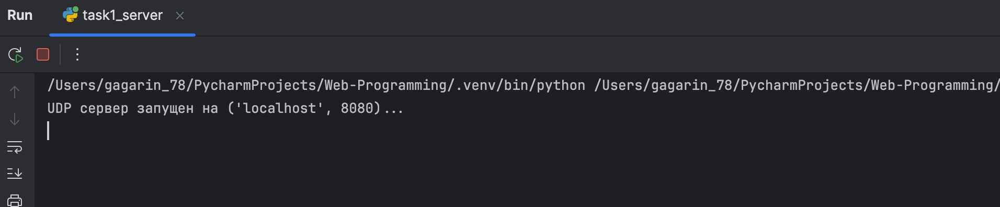
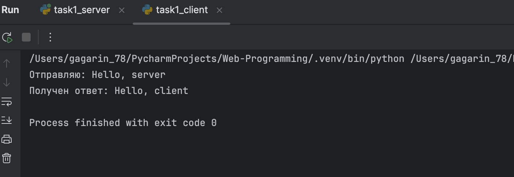

---

## Задание 2. Вычисления через TCP

### Описание
Реализовано клиент-серверное приложение, в котором клиент вводит параметры математической операции, отправляет их на сервер, а сервер выполняет вычисление и возвращает результат.

**Мой вариант — №2:** решение квадратного уравнения `ax² + bx + c = 0`.

### Особенности реализации
- Используется `socket.SOCK_STREAM` (надёжный поток байтов).
- Параметры и результат передаются в формате JSON — это позволяет избежать проблем с «склеиванием» сообщений в TCP-потоке и упрощает парсинг.
- Сервер вычисляет дискриминант и корни; если D < 0 — возвращает текстовое сообщение.

### Листинг сервера (`task2_server.py`)
```python
import socket
import json
import math

def calculate(variant, params):
    if variant == 1:  # Пифагор
        a, b = params
        return math.sqrt(a**2 + b**2)
    elif variant == 2:  # Квадратное уравнение (ax^2 + bx + c = 0)
        a, b, c = params
        d = b**2 - 4*a*c
        if d < 0:
            return "Действительных корней нет"
        x1 = (-b + math.sqrt(d)) / (2*a)
        x2 = (-b - math.sqrt(d)) / (2*a)
        return f"x1 = {x1:.2f}, x2 = {x2:.2f}"
    elif variant == 3:  # Трапеция
        a, b, h = params
        return ((a + b) / 2) * h
    elif variant == 4:  # Параллелограмм
        a, h = params
        return a * h

# УКАЖИ СВОЙ ВАРИАНТ ЗДЕСЬ (1, 2, 3 или 4)
MY_VARIANT = 2 

server_socket = socket.socket(socket.AF_INET, socket.SOCK_STREAM)
server_socket.bind(('localhost', 8081))
server_socket.listen(1)
print("TCP сервер запущен, жду подключения...")

conn, addr = server_socket.accept()
print(f"Клиент {addr} подключился.")

try:
    while True:
        data = conn.recv(1024).decode('utf-8')
        if not data:
            break
        
        params = json.loads(data)
        result = calculate(MY_VARIANT, params)
        
        conn.sendall(json.dumps({"result": str(result)}).encode('utf-8'))
except ConnectionResetError:
    print("Клиент отключился.")
finally:
    conn.close()
```

### Листинг клиента (`task2_client.py`)
```python
import socket
import json

client_socket = socket.socket(socket.AF_INET, socket.SOCK_STREAM)
client_socket.connect(('localhost', 8081))

# Ввод параметров для Варианта 2 (ax^2 + bx + c = 0)
print("Введите коэффициенты квадратного уравнения (a, b, c):")
a = float(input("a = "))
b = float(input("b = "))
c = float(input("c = "))

params = [a, b, c]

# Отправляем JSON
client_socket.sendall(json.dumps(params).encode('utf-8'))

# Получаем ответ
response = client_socket.recv(1024).decode('utf-8')
result = json.loads(response)
print(f"Результат вычислений: {result['result']}")

client_socket.close()
```

### Результат работы
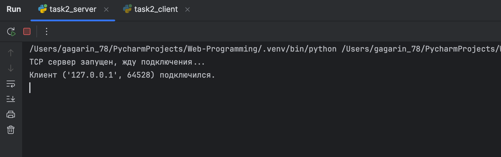
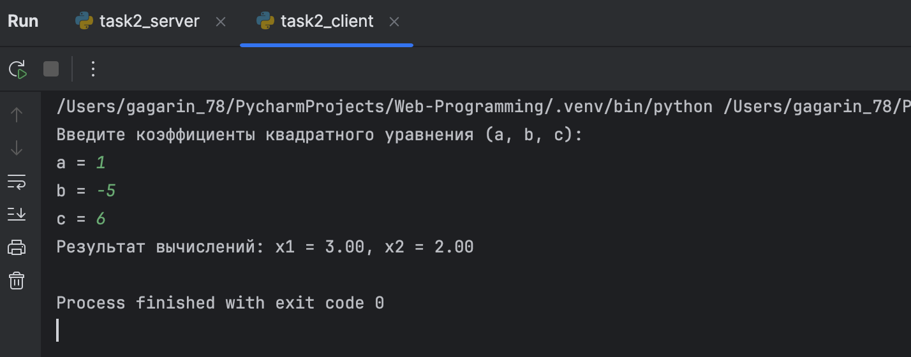

---

## Задание 3. Раздача HTML-страницы по HTTP

### Описание
Реализован HTTP-сервер, который при любом GET-запросе отдаёт содержимое файла `index.html`, корректно сформировав HTTP-ответ: строка статуса, заголовки, пустая строка, тело.

### Особенности реализации
- Сервер вручную формирует ответ по стандарту HTTP/1.1.
- Обязательный заголовок `Content-Length` — вычисляется как длина тела в байтах.
- Между заголовками и телом — пустая строка `\r\n\r\n` (иначе браузер не поймёт, где заканчивается метаинформация).

### Файл `index.html`
```html
<!DOCTYPE html>
<html>
<head><meta charset="utf-8"><title>Тест</title></head>
<body>
    <h1>Привет из сокета!</h1>
    <p>Эта страница отдана моим собственным HTTP-сервером.</p>
</body>
</html>
```

### Листинг сервера (`task3_http_server.py`)

```python
import socket
import os

server_socket = socket.socket(socket.AF_INET, socket.SOCK_STREAM)
server_socket.bind(('localhost', 8082))
server_socket.listen(1)
print("HTTP сервер запущен на http://localhost:8082")

while True:
   conn, addr = server_socket.accept()
   try:
      # Читаем запрос (нам он особо не нужен, просто чтобы сбросить буфер)
      request = conn.recv(1024)

      # Читаем файл
      file_path = 'task_3_http/index.html'
      if os.path.exists(file_path):
         with open(file_path, 'rb') as f:
            body = f.read()

         # Формируем HTTP заголовки
         headers = (
            "HTTP/1.1 200 OK\r\n"
            "Content-Type: text/html; charset=utf-8\r\n"
            f"Content-Length: {len(body)}\r\n"
            "Connection: close\r\n"
            "\r\n"  # Пустая строка, отделяющая заголовки от тела
         )
         # Отправляем заголовки (текстом) и тело (байтами)
         conn.sendall(headers.encode('utf-8') + body)
      else:
         conn.sendall(b"HTTP/1.1 404 Not Found\r\n\r\nFile not found")
   finally:
      conn.close()
```

### Результат работы
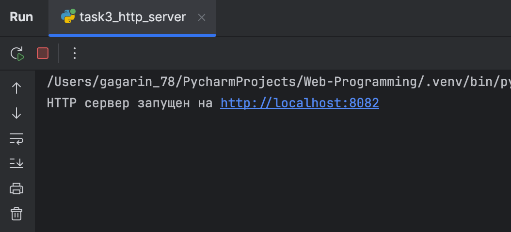
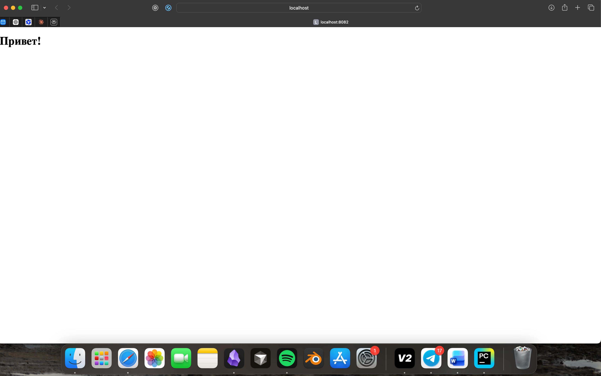

---

## Задание 4. Многопользовательский чат (TCP + threading)

### Описание
Реализован многопользовательский чат. Сервер может одновременно обслуживать несколько клиентов, рассылает каждому входящее сообщение всем остальным участникам. Пользователь идентифицируется по нику, есть команда `/exit` для выхода.

### Особенности реализации
- На сервере — отдельный поток (`threading.Thread`) на каждого подключённого клиента.
- Общий список активных сокетов `clients` защищён `threading.Lock` — это предотвращает состояние гонки при одновременном добавлении/удалении клиентов.
- На клиенте тоже два потока: один читает ввод с клавиатуры, второй — принимает сообщения из сети.
- Один и тот же клиентский скрипт может запускаться в нескольких терминалах — жёсткой привязки к пользователю нет.

### Листинг сервера (`chat_server.py`)
```python
import socket
import threading

# Список активных клиентов и блокировка для безопасного изменения из потоков
clients = []
clients_lock = threading.Lock()

def handle_client(conn, addr):
    print(f"[{addr}] подключился.")
    try:
        while True:
            message = conn.recv(1024).decode('utf-8')
            if not message:
                break
            
            # Рассылаем сообщение всем, кроме отправителя
            with clients_lock:
                for client in clients:
                    if client != conn:
                        try:
                            client.sendall(message.encode('utf-8'))
                        except:
                            pass  # Если клиент отвалился, пропускаем
    except:
        pass
    finally:
        with clients_lock:
            if conn in clients:
                clients.remove(conn)
        conn.close()
        print(f"[{addr}] отключился.")

server_socket = socket.socket(socket.AF_INET, socket.SOCK_STREAM)
server_socket.bind(('localhost', 8083))
server_socket.listen()
print("Чат-сервер запущен...")

while True:
    conn, addr = server_socket.accept()
    with clients_lock:
        clients.append(conn)
    
    # Запускаем поток для обработки конкретного клиента
    thread = threading.Thread(target=handle_client, args=(conn, addr))
    thread.start()
```

### Листинг клиента (`chat_client.py`)
```python
import socket
import threading
import sys

def receive_messages(sock):
    """Поток для приема сообщений"""
    while True:
        try:
            message = sock.recv(1024).decode('utf-8')
            if not message:
                break
            print(f"\n{message}")
            print(f"{username}> ", end="", flush=True)  # Возвращаем приглашение ввода
        except:
            print("\nОшибка соединения.")
            break

username = input("Введите ваш ник: ")
client_socket = socket.socket(socket.AF_INET, socket.SOCK_STREAM)
client_socket.connect(('localhost', 8083))

# Запускаем поток для чтения входящих
recv_thread = threading.Thread(target=receive_messages, args=(client_socket,), daemon=True)
recv_thread.start()

print("Вы в чате. Введите /exit для выхода.")

try:
    while True:
        msg = input(f"{username}> ")
        if msg.lower() == '/exit':
            break
        # Форматируем сообщение, чтобы все видели, кто написал
        formatted_msg = f"[{username}]: {msg}"
        client_socket.sendall(formatted_msg.encode('utf-8'))
except KeyboardInterrupt:
    pass
finally:
    client_socket.close()
    sys.exit()
```

### Результат работы
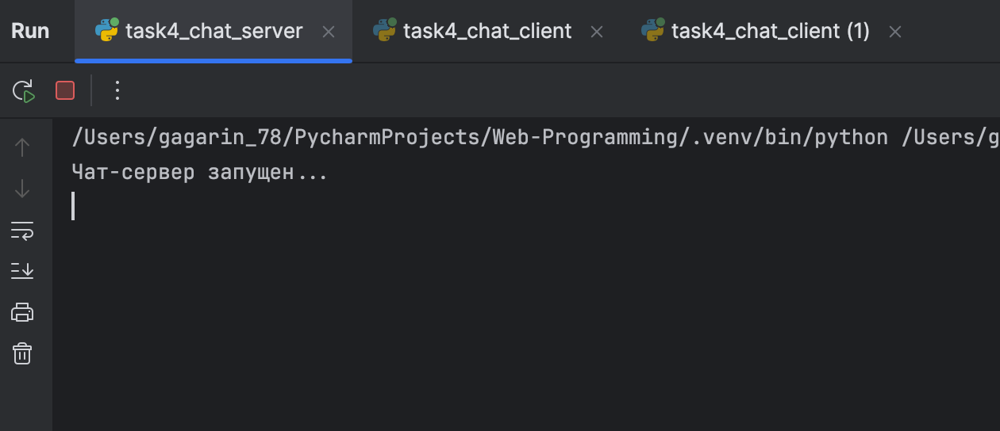
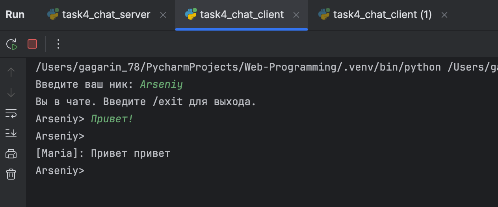
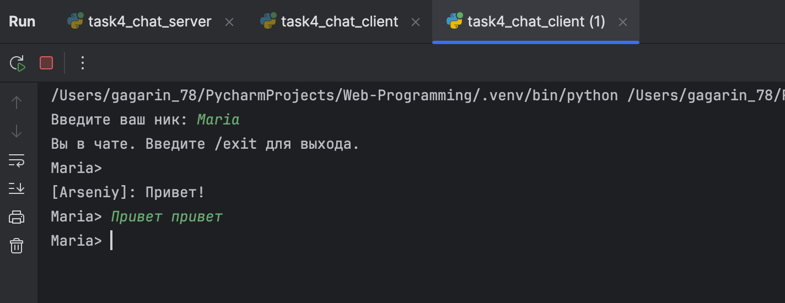

---

## Задание 5. Простой веб-сервер (GET/POST)

### Описание
Реализован веб-сервер, который:
- по `GET /` отдаёт HTML-страницу со списком всех оценок, сгруппированных по дисциплинам;
- по `POST /add` принимает форму с новым предметом и оценкой, добавляет её в журнал и возвращает обновлённую страницу.

### Особенности реализации
- HTTP-запрос разбирается вручную: первая строка даёт метод и путь, тело POST-запроса отделяется от заголовков последовательностью `\r\n\r\n`.
- Тело формы парсится через `urllib.parse.parse_qs` (формат `application/x-www-form-urlencoded`).
- Для хранения используется **словарь** вида `{"Предмет": [оценка1, оценка2, ...]}` — это естественным образом обеспечивает группировку оценок по дисциплине.
- Данные сохраняются в `grades.json`, чтобы не теряться при перезапуске сервера.

### Листинг сервера (`web_server.py`)
```python
import socket
import json
import os
from urllib.parse import parse_qs, unquote

GRADES_FILE = 'grades.json'

# Загружаем журнал из файла, если он есть
if os.path.exists(GRADES_FILE):
    with open(GRADES_FILE, 'r', encoding='utf-8') as f:
        grades_db = json.load(f)
else:
    grades_db = {}  # Структура: {"Предмет": [оценка1, оценка2]}

def save_db():
    with open(GRADES_FILE, 'w', encoding='utf-8') as f:
        json.dump(grades_db, f, ensure_ascii=False, indent=2)

def generate_html():
    html = "<html><head><meta charset='utf-8'><title>Журнал</title></head><body>"
    html += "<h1>Журнал оценок</h1>"
    
    if not grades_db:
        html += "<p>Журнал пуст.</p>"
    else:
        for subject, marks in grades_db.items():
            html += f"<h3>{subject}</h3><ul>"
            for mark in marks:
                html += f"<li>{mark}</li>"
            html += "</ul>"
            
    html += """
    <hr>
    <h2>Добавить оценку</h2>
    <form action="/add" method="POST">
        Предмет: <input type="text" name="subject"><br><br>
        Оценка: <input type="text" name="mark"><br><br>
        <input type="submit" value="Добавить">
    </form>
    </body></html>
    """
    return html.encode('utf-8')

def handle_request(request_text):
    lines = request_text.split('\r\n')
    request_line = lines[0]
    words = request_line.split()
    method, path = words[0], words[1]
    
    if method == 'GET' and path == '/':
        body = generate_html()
        headers = f"HTTP/1.1 200 OK\r\nContent-Type: text/html; charset=utf-8\r\nContent-Length: {len(body)}\r\n\r\n"
        return headers.encode('utf-8') + body
        
    elif method == 'POST' and path == '/add':
        # Ищем тело запроса (оно идет после пустой строки)
        body_start = request_text.find('\r\n\r\n') + 4
        body_str = request_text[body_start:]
        
        # Парсим данные формы (application/x-www-form-urlencoded)
        params = parse_qs(body_str)
        subject = unquote(params.get('subject', [''])[0])
        mark = unquote(params.get('mark', [''])[0])
        
        if subject and mark:
            # Группируем по предмету
            if subject not in grades_db:
                grades_db[subject] = []
            grades_db[subject].append(mark)
            save_db()
            
        # После POST отдаем обновленную страницу
        body = generate_html()
        headers = f"HTTP/1.1 200 OK\r\nContent-Type: text/html; charset=utf-8\r\nContent-Length: {len(body)}\r\n\r\n"
        return headers.encode('utf-8') + body

    # Если путь неверный
    return b"HTTP/1.1 404 Not Found\r\n\r\nNot Found"

server_socket = socket.socket(socket.AF_INET, socket.SOCK_STREAM)
server_socket.bind(('localhost', 8084))
server_socket.listen(1)
print("Веб-сервер запущен на http://localhost:8084")

while True:
    conn, addr = server_socket.accept()
    try:
        request_data = conn.recv(4096).decode('utf-8')
        response = handle_request(request_data)
        conn.sendall(response)
    except Exception as e:
        print(f"Ошибка: {e}")
    finally:
        conn.close()
```

### Результат работы
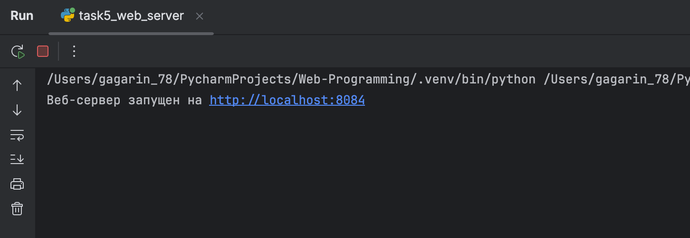
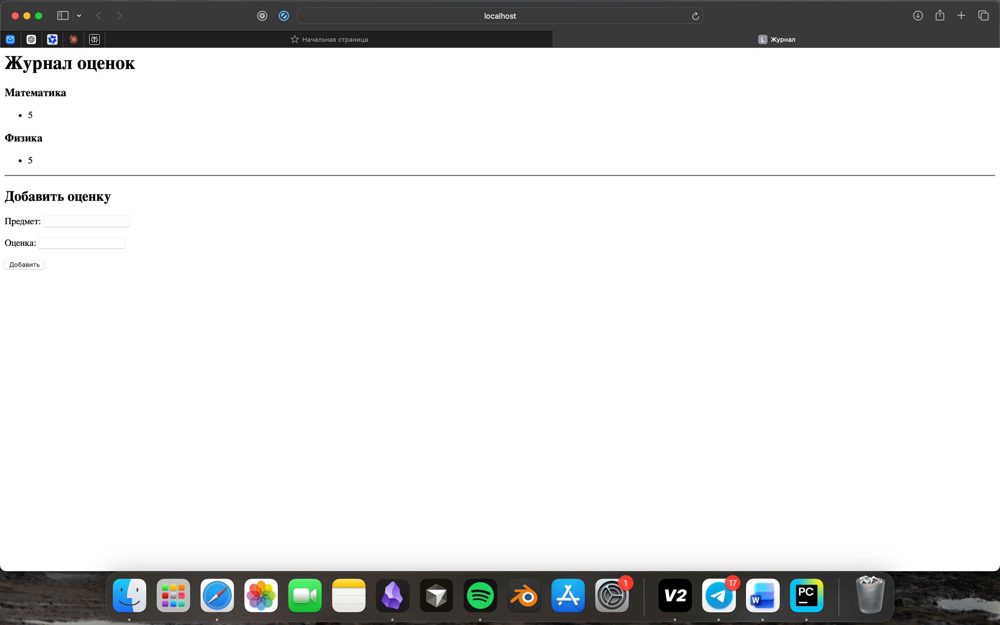

---

## Выводы

В ходе выполнения лабораторной работы я:

1. **Закрепил различия между UDP и TCP.** На практике увидел, что UDP действительно не требует рукопожатия и работает «дёрнул — забыл», но из-за этого на сервере адрес клиента приходится получать из каждого принятого пакета (`recvfrom`). TCP же даёт надёжный поток, но требует аккуратной работы с границами сообщений — я решил это через JSON-сериализацию.

2. **Понял внутреннее устройство HTTP.** Ручная сборка ответа (строка статуса → заголовки → `\r\n\r\n` → тело) показала, что HTTP — это просто текст поверх TCP. Особенно важно было не забыть `Content-Length`: без него браузер не знает, когда заканчивается ответ, и может «подвиснуть».

3. **Освоил многопоточность в сетевых приложениях.** В чате без `threading` сервер бы обслуживал только одного клиента — остальные стояли бы в очереди. Блокировка `Lock` понадобилась, чтобы потоки не ломали общий список клиентов при одновременном обращении.

4. **Научился разбирать «сырой» HTTP-запрос.** В задании 5 пришлось вручную отделять заголовки от тела запроса и парсить данные формы. Для хранения оценок выбрал словарь со списками в значениях — это даёт естественную группировку по предмету без лишних проверок.

5. **Сталкнулся с типичными проблемами:**
   - в TCP иногда приходило «склеенное» сообщение от клиента — решил буфером и JSON;
   - в чате при резком закрытии клиента сервер падал с исключением — добавил `try/except` в рассылку;
   - в веб-сервере кириллица в именах предметов ломала парсинг — использовал `unquote` из `urllib.parse`.

Работа показала, что понимание протоколов на низком уровне сильно упрощает отладку сетевых приложений и даёт осознанное понимание того, что под капотом у библиотек вроде `requests` или `Flask`

---
