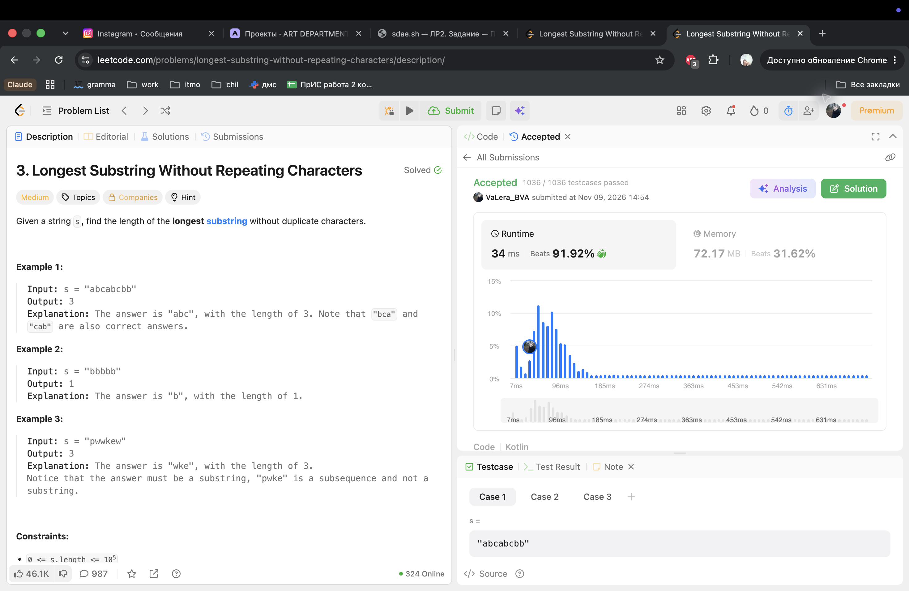
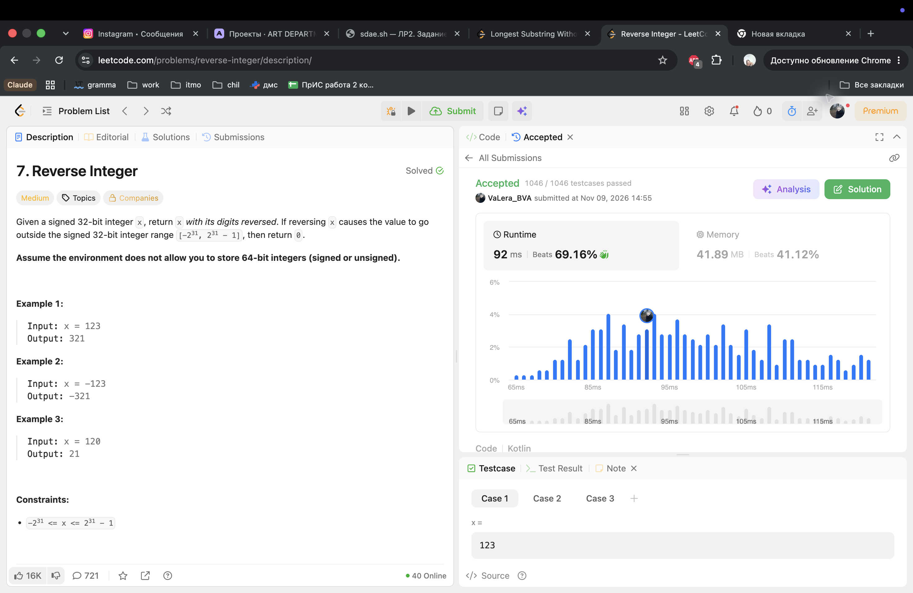

# LeetCode — допуск к ЛР2

Аккаунт: [VaLera_BVA](https://leetcode.com/u/VaLera_BVA/). Язык: Kotlin. Оба решения приняты 09.11.2026.

## 3. Longest Substring Without Repeating Characters

[Условие](https://leetcode.com/problems/longest-substring-without-repeating-characters/). Accepted: 1036 / 1036, время отправки 14:54.

## 7. Reverse Integer

[Условие](https://leetcode.com/problems/reverse-integer/). Accepted: 1046 / 1046, время отправки 14:55.

