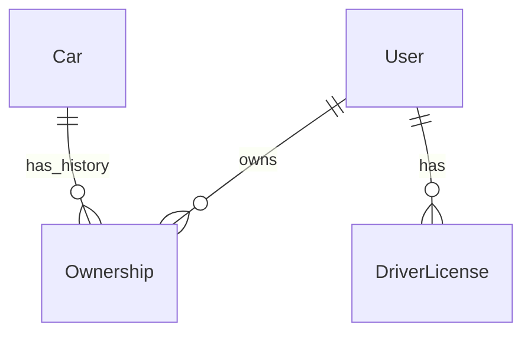
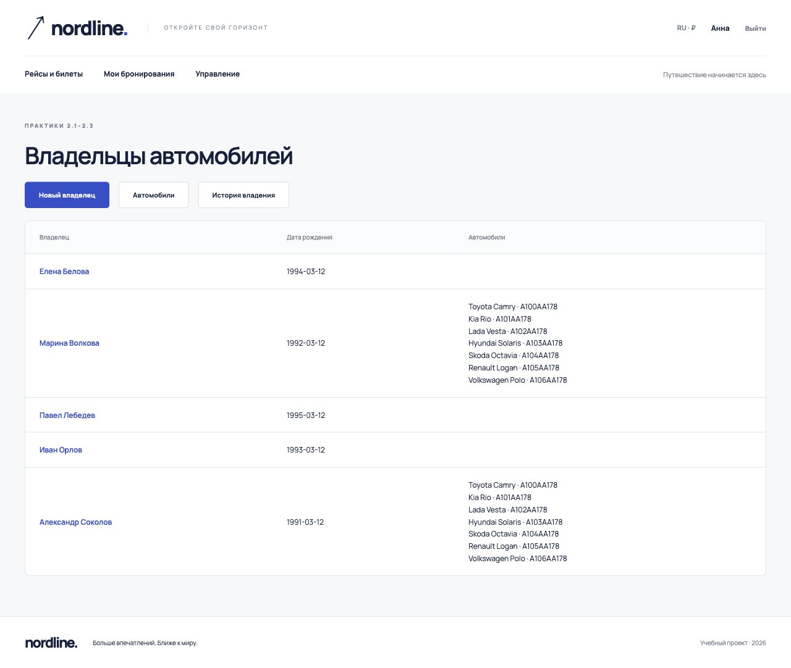

# Практические работы 2.1–2.3

**Беляева Валерия Андреевна, K3339.**

Практики находятся в приложении `project_first_app` проекта `django_project_belyaeva`. Интерфейс доступен сотруднику по адресу `/practice/`. Основной сайт ЛР2 находится в приложении `flights`.

## Практика 2.1 — модели, миграции, админка, FBV

Модель владельца реализована расширением пользователя (`flights.User`). Сохраняются имя, фамилия, дата рождения. Дополнительные модели:

| Модель | Поля |
|---|---|
| Car | registration_number, brand, model, color |
| Ownership | owner, car, start_date, end_date |
| DriverLicense | owner, number, category, issued_at |

`Car.owners` — `ManyToManyField` с `through='Ownership'`. Это позволяет хранить несколько владельцев одного автомобиля в разные периоды, а не терять историю при смене владельца.

В демонстрационных данных семь автомобилей. Для каждого есть два последовательных периода владения: Александр Соколов — 01.01.2020–31.12.2021, Марина Волкова — с 01.01.2022. Пересечений нет; у каждого из двух владельцев более трёх автомобилей.

Все таблицы зарегистрированы в Django Admin; внутри автомобиля используется inline истории владения. Миграции находятся в `flights/migrations/` и `project_first_app/migrations/` и применены к PostgreSQL.

`owner_detail` — функциональное представление: `get_object_or_404(User, pk=pk)` находит владельца, `render()` передаёт его в `practice/owner.html`. URL `/practice/owners/<id>/` принимает идентификатор через `<int:pk>`; маршруты приложения включены в корневой `urls.py` через `include()`.

## Практика 2.2 — связи, FBV и CBV, формы

| Задание | Реализация |
|---|---|
| Связь автомобиль–владелец с периодом | Ownership и ManyToManyField через неё |
| Список владельцев, FBV | `owners`, `practice/owners.html` |
| Создание владельца, FBV | `owner_create`, `OwnerForm` |
| Список автомобилей, CBV | `CarList(ListView)` |
| Автомобиль по id, CBV | `CarDetail(DetailView)` |
| Создание автомобиля | `CarCreate(CreateView)` |
| Изменение автомобиля | `CarUpdate(UpdateView)` |
| Удаление автомобиля | `CarDelete(DeleteView)`, подтверждение POST |

В базе пять обычных пользователей и семь автомобилей. В рамках проверки через формы созданы ещё три пользователя и три автомобиля; проверены изменение и удаление автомобиля. Временные записи проверки отменены транзакцией, исходные демонстрационные данные сохранены.

## Практика 2.3 — расширение пользователя

`flights.User` наследуется от `AbstractUser`. До первой миграции задано `AUTH_USER_MODEL = 'flights.User'`.

Добавлены поля:

- `birth_date` — дата рождения;
- `passport_number` — номер паспорта;
- `home_address` — домашний адрес;
- `nationality` — национальность.

`PassengerAdmin(UserAdmin)` расширяет `fieldsets` и `add_fieldsets`, поэтому дополнительные атрибуты можно менять в админке. `OwnerForm` наследуется от формы регистрации, включает новые поля и используется функциональным представлением `owner_create`. Шаблон `practice/owner.html` выводит эти сведения.

Связи на пользователя описаны через `settings.AUTH_USER_MODEL`. Пароли проходят стандартную валидацию Django и сохраняются хешированными. Все документы в демонстрационной базе вымышленные.

## Источники

- [Практика 2.1](https://rendex85.github.io/ITMO_ICT_WebDevelopment_Docs/lab2/practice1/)
- [Практика 2.2](https://rendex85.github.io/ITMO_ICT_WebDevelopment_Docs/lab2/practice2/)
- [Практика 2.3](https://rendex85.github.io/ITMO_ICT_WebDevelopment_Docs/lab2/practice3/)
