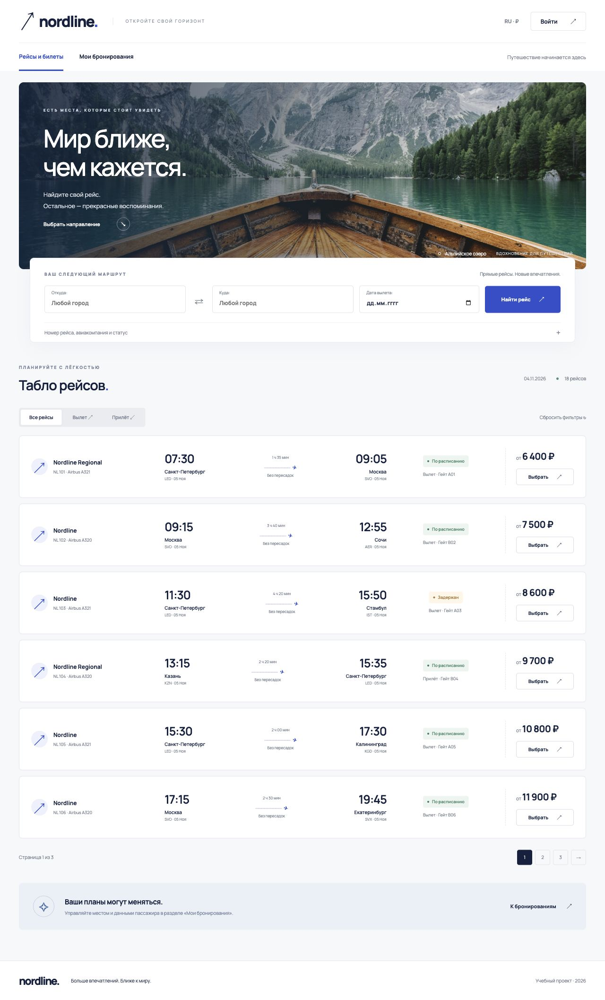
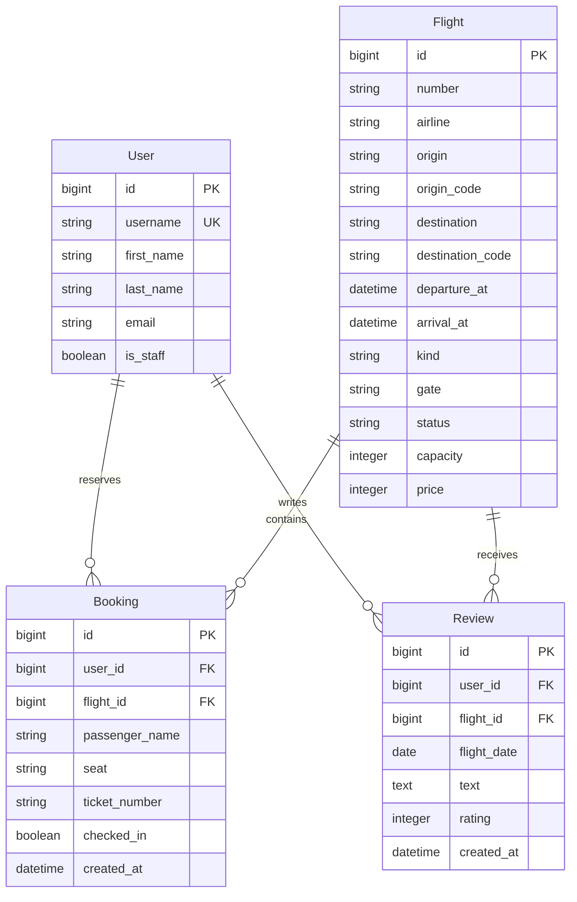
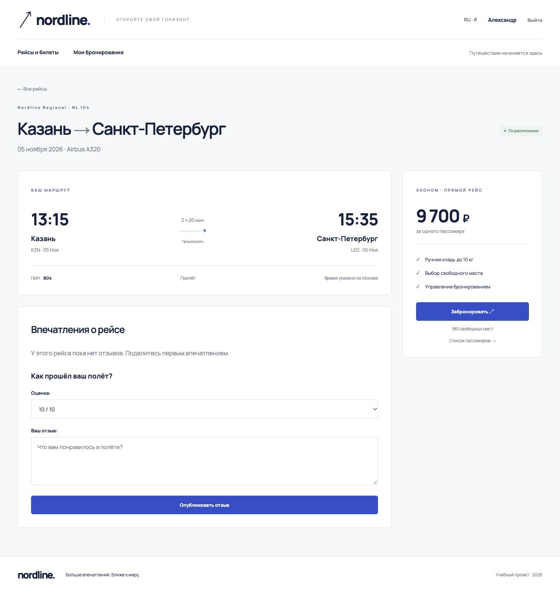
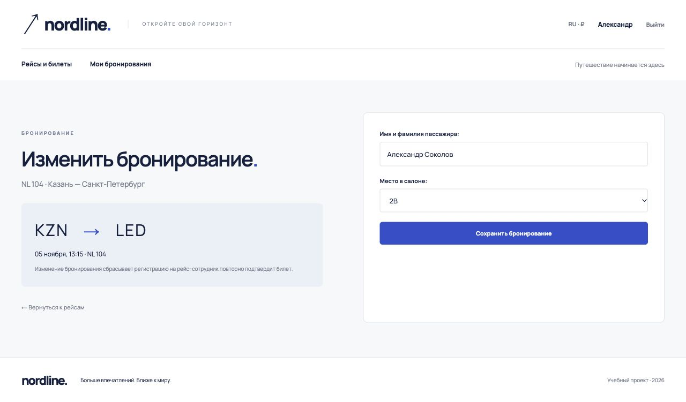
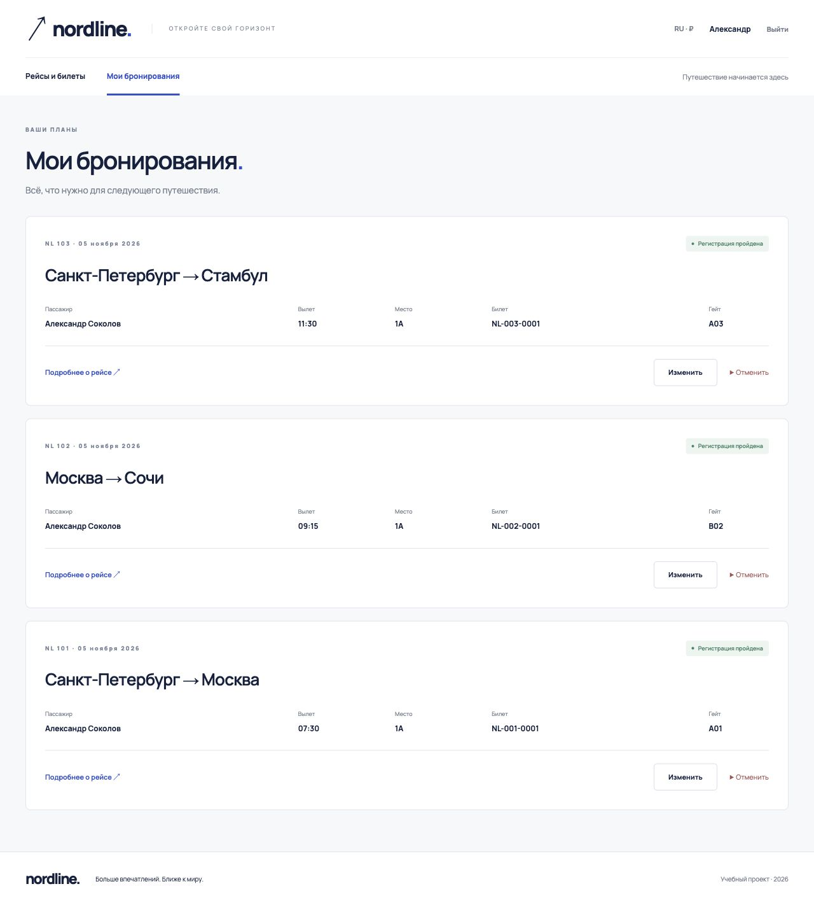
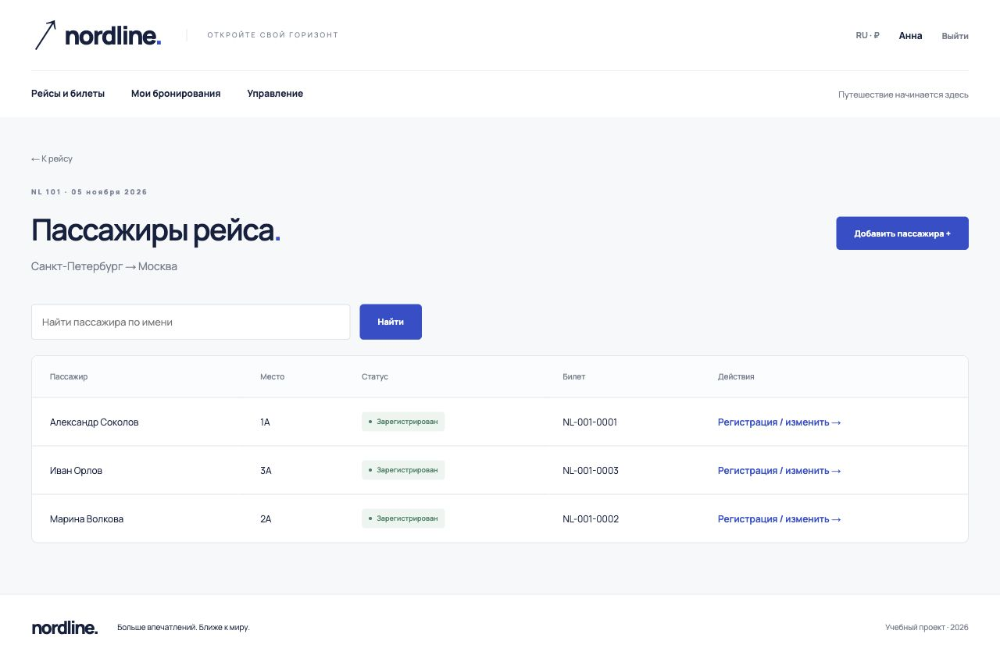
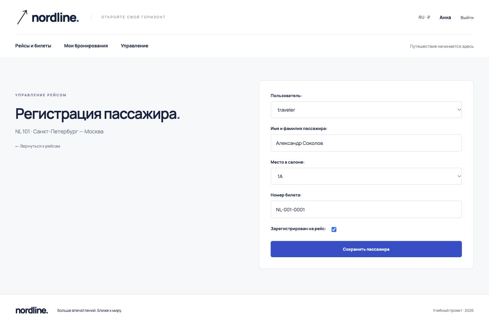
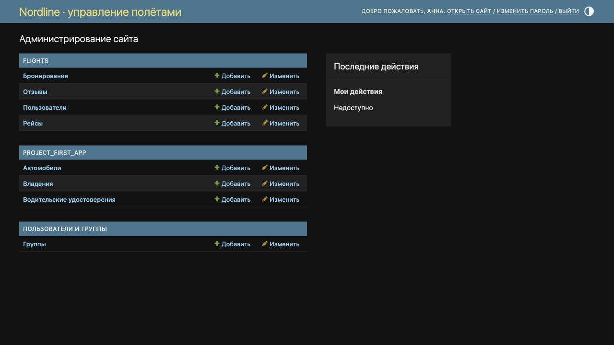

# ЛР2. Табло авиаперелётов

**Студент:** Беляева Валерия Андреевна. **Группа:** K3339. **Вариант:** 3.

## 1. Цель и задание

Разработать сайт средствами Django и PostgreSQL с серверной генерацией страниц. Вариант 3 предполагает хранение рейсов, бронирование мест, регистрацию пассажиров сотрудником, таблицу пассажиров и отзывы.

Рейс содержит номер, авиакомпанию, отправление, прибытие, тип «вылет/прилёт» и гейт. Пользователь регистрируется на сайте, выбирает место, изменяет или удаляет своё бронирование и оставляет отзыв. Сотрудник указывает билет и регистрирует пассажира на рейс.

[Исходное задание](https://rendex85.github.io/ITMO_ICT_WebDevelopment_Docs/lab2/assignment/).

## 2. Средства разработки

- Python 3.14; Django 5.2.19 LTS.
- PostgreSQL 16.14; psycopg 3.3.8.
- Jinja2 3.1.6 для интерфейса, Django Templates для встроенной админ-панели и виджетов форм.
- HTML, CSS, адаптивная сетка без клиентского фреймворка.
- MkDocs Material для отчёта.

Вместо устаревшего Django 3 из вводного описания использована LTS-ветка 5.2, совместимая с установленным Python. Архитектура и требуемые возможности сохранены.

## 3. Дизайн

Визуальный ориентир — [сайт Finnair](https://www.finnair.com/en): светлая палитра, тёмная типографика, синий акцент, крупная форма поиска и навигация между поиском и управлением бронированием. В проекте используется собственное название Nordline, собственная вёрстка и локальная фотография альпийского озера. Логотип и исходный код Finnair не используются.

Карточка рейса группирует авиакомпанию, маршрут и время, статус, цену и переход к бронированию. На телефоне блоки перестраиваются вертикально; проверена ширина 390 px, горизонтального переполнения главной страницы нет.

## 4. Архитектура

Поток обработки запроса: URL → view → форма/ORM → PostgreSQL → Jinja2 → HTML.

| Компонент | Файлы | Назначение |
|---|---|---|
| Конфигурация | `django_project_belyaeva/settings.py`, `urls.py`, `jinja2.py` | PostgreSQL, маршрутизация, шаблоны |
| Данные | `flights/models.py`, `migrations/0001_initial.py` | Рейсы, пользователи, бронирования, отзывы |
| Проверка ввода | `flights/forms.py` | Регистрация, фильтры, место, отзыв, регистрация пассажира |
| Логика | `flights/views.py` | Поиск, CRUD бронирований, отзывы, права доступа |
| Интерфейс | `templates/`, `static/css/style.css` | Страницы и адаптивные стили |
| Администрирование | `flights/admin.py` | Управление рейсами и пассажирами |
| Начальные данные | `flights/management/commands/seed_demo.py` | Демонстрационные рейсы и учётные записи |

## 5. Модель данных

| Сущность | Ключевые ограничения |
|---|---|
| Flight | Уникальна пара номера и времени вылета; прилёт позже вылета |
| Booking | Одно место — одно бронирование на рейсе; одно бронирование пользователя на рейс |
| Booking | Место должно существовать в салоне; подтверждение регистрации требует номера билета |
| Review | Оценка от 1 до 10; автор определяется текущим пользователем, дата — временем выбранного рейса |

Бронирование — связь между пользователем и рейсом с собственными атрибутами места, имени пассажира и билета. Поле `checked_in` отделяет бронирование от завершённой регистрации на рейс.

## 6. Поиск и табло

Главная страница `/` показывает шесть рейсов на странице. Фильтры: отправление и назначение (город либо код аэропорта), дата вылета, номер рейса/авиакомпания, тип и статус. Фильтрация выполняется в PostgreSQL через ORM, а не скрытием элементов на клиенте. Пагинация сохраняет выбранные фильтры.

Для поиска нескольких полей используются `Q`, например номер рейса или авиакомпания. Пустая выдача содержит ссылку сброса фильтров. Неверная дата возвращает ошибки формы.

## 7. Страница рейса и отзывы

`/flights/<id>/` показывает маршрут, длительность, гейт, свободные места, цену, отзывы и форму публикации отзыва. Время отображается в часовом поясе Москвы; это явно подписано.

Авторизованный пользователь отправляет оценку и текст. Сервер устанавливает автора и дату рейса. После сохранения выполняется redirect, поэтому обновление страницы не повторяет отправку.

## 8. Регистрация и бронирования

На `/signup/` используется `UserCreationForm`: пароли проверяются стандартными валидаторами Django и сохраняются в виде хеша. Вход — через `LoginView`, выход — POST-запросом.

Выбор места выполняется через `BookingForm`. Список содержит только свободные места салона. Создание, изменение и отмена брони доступны авторизованному пользователю; изменение и удаление ищут запись одновременно по идентификатору и владельцу. Изменение данных пассажира или места сбрасывает регистрацию и билет, чтобы сотрудник подтвердил их заново.

Сохранение выполняется в транзакции; уникальность места проверяется также ограничением PostgreSQL. Если другой пассажир занял место между показом формы и отправкой, форма предлагает выбрать другое место.

На `/bookings/` отображаются собственные бронирования: пассажир, место, рейс, время, гейт и билет. Отмена требует подтверждения и POST-запроса с CSRF-токеном.

## 9. Таблица пассажиров и права сотрудника

`/flights/<id>/passengers/` отображает пассажиров рейса с поиском по имени и пагинацией по десять записей. Для пользователя доступны имя, место и статус. Сотрудник дополнительно видит номер билета, добавление и изменение пассажира.

Представление `staff_booking` проверяет `is_staff` на сервере. Оно позволяет выбрать пользователя, указать пассажира, место и билет, поставить отметку регистрации. Скрытие кнопки в шаблоне не заменяет эту серверную проверку.

Та же операция доступна в Django Admin. В админ-панели зарегистрированы все модели, есть фильтры и поиск.

## 10. Основные маршруты

| Метод | Адрес | Операция |
|---|---|---|
| GET | `/` | Поиск, фильтрация, пагинация |
| GET, POST | `/signup/`, `/login/` | Регистрация и вход |
| POST | `/logout/` | Выход |
| GET, POST | `/flights/<id>/` | Рейс и публикация отзыва |
| GET, POST | `/flights/<id>/book/` | Бронирование |
| GET | `/bookings/` | Мои бронирования |
| GET, POST | `/bookings/<id>/edit/` | Изменение собственной брони |
| POST | `/bookings/<id>/delete/` | Отмена собственной брони |
| GET | `/flights/<id>/passengers/` | Пассажиры рейса |
| GET, POST | `/flights/<id>/passengers/add/` | Добавление сотрудником |
| GET, POST | `/flights/<id>/passengers/<booking_id>/` | Регистрация сотрудником |
| GET, POST | `/admin/` | Django Admin |
| GET, POST | `/practice/…` | Практики 2.1–2.3 |

## 11. Запуск и проверка

На macOS — `start.command`. Подробный ручной запуск и параметры подключения описаны в README проекта. Демонстрационные данные: 18 рейсов, девять бронирований, шесть пользователей и семь автомобилей. Доступы генерируются локально; в исходный код и отчёт пароли не включаются.

Проверено:

- миграции PostgreSQL и `manage.py check`;
- отсутствие неприменённых изменений моделей;
- регистрация пользователя, создание/изменение/отмена брони и публикация отзыва;
- недоступность чужого бронирования и операций сотрудника обычному пользователю;
- сохранение билета и регистрации сотрудником; ошибка при регистрации без билета;
- формы владельцев и CRUD автомобилей;
- работа основных страниц, поиск, пагинация;
- визуальная проверка страниц в браузере и главной страницы при ширине 390 px.

## 12. Вывод

Реализовано серверное приложение с хранением данных в PostgreSQL, разделением прав и шаблонами Jinja2. Основная логика сосредоточена в моделях, формах и представлениях Django; HTML отвечает за представление, CSS — за адаптивный интерфейс. Практики 2.1–2.3 выполнены в отдельном приложении и описаны в [соседнем отчёте](practices.md).
