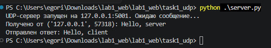
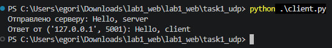
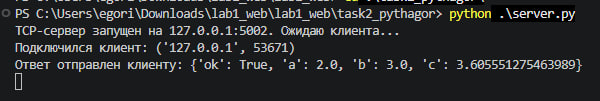
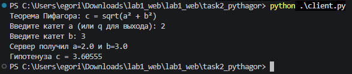
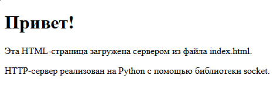
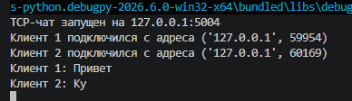
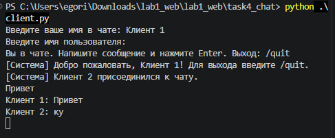
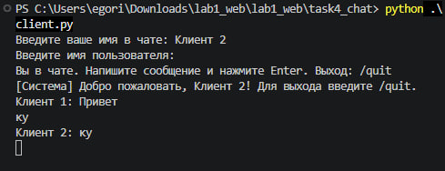
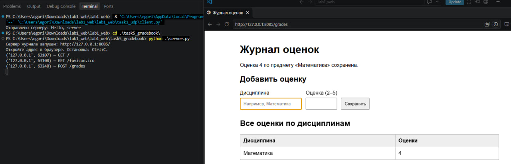

# Лабораторная работа №1. Работа с сокетами

**Выполнил:** Кондилеев Егор Юрьевич\
**Группа:** К3339

## Цель работы
Понять принципы межсокетного взаимодейсвтия в вебе. Научиться реализовывать базовую архитектуру клиент-сервер.

## Задание 1. Обмен сообщениями по UDP

Реализованы UDP-клиент и UDP-сервер с использованием стандартной
библиотеки `socket`. Для создания сокетов используется семейство адресов
IPv4 (`socket.AF_INET`) и тип `socket.SOCK_DGRAM`, соответствующий
протоколу UDP.

Сервер привязывается к адресу `127.0.0.1:5001` с помощью `bind()` и
ожидает входящее сообщение методом `recvfrom()`. Клиент отправляет
строку `Hello, server` на этот адрес с помощью `sendto()`. Получив
сообщение, сервер выводит его в терминал и отправляет клиенту ответ
`Hello, client`.

Перед отправкой строки преобразуются в байты с помощью
`encode("utf-8")`, а принятые данные декодируются методом
`decode("utf-8")`. На клиенте установлен тайм-аут в 5 секунд
(`settimeout(5)`), чтобы программа не ожидала ответ бесконечно, если
сервер не запущен или ответ не пришёл.

### Результат

*Работа сервера:*

*Работа клиента:*

## Задание 2. Вычисление гипотенузы по TCP

Реализованы TCP-клиент и TCP-сервер для вычисления гипотенузы
прямоугольного треугольника по двум катетам. Используется теорема
Пифагора:

**c = √(a² + b²)**,

где `a` и `b` --- длины катетов, `c` --- длина гипотенузы.

Сервер принимает подключения на адресе `127.0.0.1:5002`. Для TCP
используются сокеты типа `socket.SOCK_STREAM`. Сервер ожидает
подключения методом `listen()`, принимает клиента через `accept()` и
обрабатывает запрос.

Клиент запрашивает у пользователя значения катетов `a` и `b`,
преобразует их в числа типа `float` и формирует JSON-объект. Запрос
отправляется серверу в UTF-8 с завершающим символом новой строки. Сервер
считывает строку до `\n`, разбирает JSON с помощью `json.loads()`,
извлекает значения катетов и вычисляет гипотенузу функцией
`math.sqrt(a * a + b * b)`.

Перед вычислением сервер проверяет, что катеты не являются
отрицательными. При корректных данных клиент получает JSON-ответ с
результатом, а при ошибке --- сообщение с описанием проблемы. Для выхода
из клиента вместо первого катета можно ввести `q`.

### Результат

*Работа сервера:*

*Работа клиента:*

## Задание 3. Передача HTML-страницы по HTTP

Реализован минимальный HTTP-сервер на основе TCP-сокетов. Сервер
работает по адресу `127.0.0.1:8080`, а в качестве клиента можно
использовать обычный браузер или дополнительный тестовый скрипт
`client.py`.

HTML-страница хранится в отдельном файле `task3_http/index.html`. После
получения запроса сервер анализирует первую строку HTTP-запроса. Для
запросов `GET /` и `GET /index.html` сервер считывает HTML-файл и
формирует ответ со статусом `200 OK`. Для остальных адресов возвращается
ответ `404 Not Found`.

HTTP-ответ состоит из строки статуса, заголовков и тела. В заголовке
`Content-Type` указывается тип содержимого `text/html` и кодировка
UTF-8. В `Content-Length` передаётся размер тела ответа в байтах. Между
заголовками и телом располагается пустая строка (`\r\n\r\n`). После
формирования ответа данные отправляются клиенту методом `sendall()`.

Сервер работает в цикле и может последовательно обрабатывать несколько
запросов. Для повторного запуска сервера используется параметр
`SO_REUSEADDR`.

### Результат

## Задание 4. Многопользовательский TCP-чат

Реализован многопользовательский чат на TCP с использованием библиотеки
`threading`. Сервер принимает подключения по адресу `127.0.0.1:5004`.
Один и тот же клиентский скрипт `client.py` можно запускать в нескольких
терминалах, чтобы подключить разных пользователей.

После подключения сервер запрашивает имя пользователя. Имя и
соответствующий сокет сохраняются в общем словаре `clients`. Для каждого
нового подключения создаётся отдельный поток с помощью
`threading.Thread()`, поэтому сервер может одновременно обслуживать
нескольких участников.

Полученные от клиентов сообщения сервер рассылает остальным подключённым
пользователям. Перед отправкой к сообщению добавляется имя автора. Для
безопасной работы с общим словарём используется блокировка
`threading.Lock()`. При отключении клиента его соединение удаляется из
словаря, а остальным участникам отправляется системное уведомление.

На стороне клиента отдельный поток отвечает за приём и вывод сообщений,
а основной поток обрабатывает ввод пользователя. Для выхода из чата
используется команда `/quit`. Пустые сообщения не рассылаются, а длина
одного сообщения ограничивается 1000 символами.

### Результат

*Сервер чата:*

*Первый клиент:*

*Второй клиент:*

## Задание 5. Веб-сервер с обработкой GET и POST

Реализован HTTP-сервер журнала оценок с использованием библиотеки
`socket`. Сервер работает по адресу `127.0.0.1:8085`. Он поддерживает
методы GET и POST, а также предоставляет HTML-форму для добавления
оценок по дисциплинам.

При GET-запросе к `/` или `/grades` сервер отображает страницу журнала и
форму добавления оценки. При POST-запросе к `/grades` сервер получает
название дисциплины и оценку. Поддерживается отправка данных как из
HTML-формы, так и в формате JSON.

Для чтения HTTP-запроса реализована функция `read_request()`: она
считывает заголовки до последовательности `\r\n\r\n`, определяет длину
тела по заголовку `Content-Length` и получает всё тело запроса. Данные
HTML-формы разбираются с помощью `parse_qs()`, JSON --- с помощью
`json.loads()`.

Оценки хранятся в словаре `gradebook`: ключом является название
дисциплины, а значением --- список оценок. При добавлении оценки
используется `setdefault(subject, []).append(grade)`, поэтому новые
оценки по уже существующему предмету добавляются в его список.

Сервер проверяет наличие названия дисциплины и корректность оценки:
допускаются только целые значения от 2 до 5. Для безопасного отображения
пользовательского текста в HTML применяется `escape()`. В случае
корректного запроса сервер возвращает страницу со статусом `200 OK`, при
некорректных данных --- `400 Bad Request`. Для неподдерживаемых методов
предусмотрен ответ `405 Method Not Allowed`, для неизвестных адресов ---
`404 Not Found`.

Данные журнала хранятся в оперативной памяти и очищаются после остановки
сервера.

### Результат

## Вывод

В ходе лабораторной работы были разработаны клиентские и серверные
приложения на Python с использованием библиотеки `socket`. Реализован
обмен сообщениями по UDP, вычисление гипотенузы по TCP с применением
теоремы Пифагора, передача HTML-страницы по HTTP, многопользовательский
TCP-чат и веб-сервер журнала оценок с обработкой GET- и POST-запросов.

В результате работы изучены различия между UDP и TCP, принципы
установления TCP-соединения, передача и обработка данных в текстовом и
JSON-форматах, структура HTTP-сообщений и применение потоков для
одновременного обслуживания нескольких клиентов.
