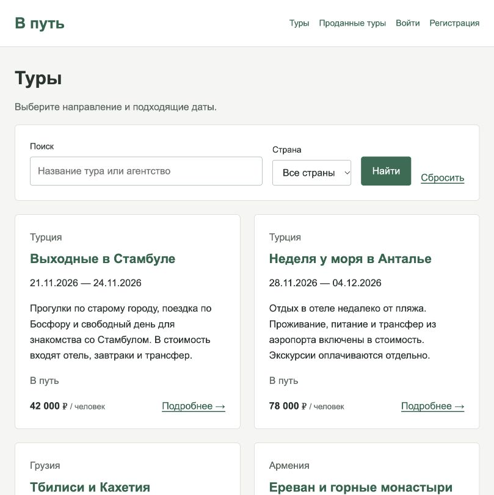
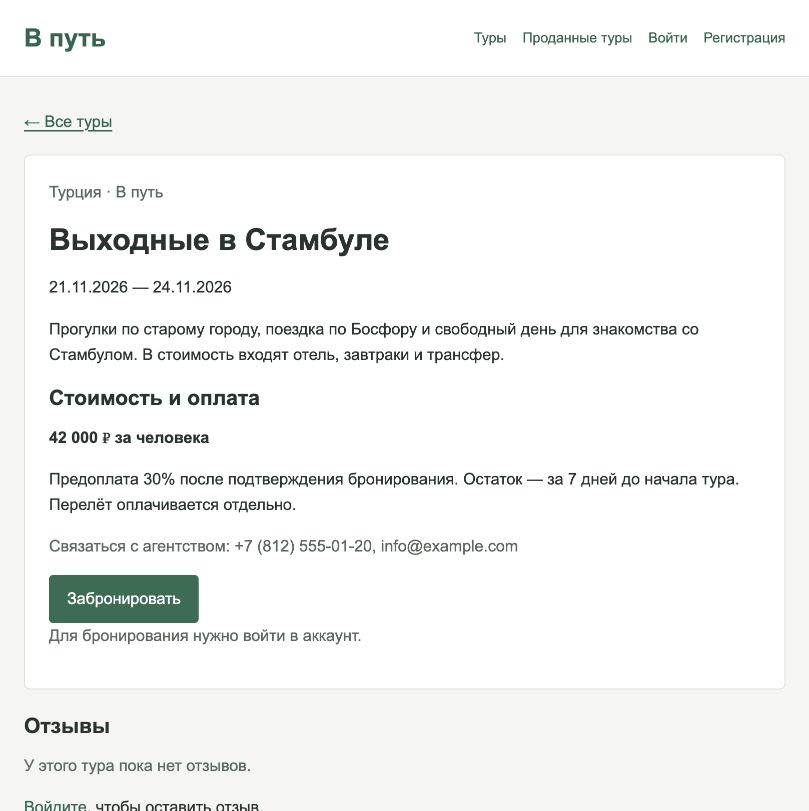

# Лабораторная работа № 2

**Вариант 4: список туров туристической фирмы.**

Цель работы — научиться создавать сайт на Django с базой данных и пользовательскими интерфейсами.

В работе используются Django 5.2, PostgreSQL и Jinja2. Шаблоны клиентской части
написаны на Jinja2, а встроенная админка использует стандартные шаблоны Django.
Для оформления написан небольшой CSS-файл без сторонних библиотек.

## Задание

На сайте должна храниться информация о турах: название, турагентство,
описание, даты и условия оплаты. Пользователи регистрируются, бронируют туры,
редактируют и удаляют свои бронирования, оставляют отзывы с оценкой от 1 до 10.
Администратор подтверждает бронирования. В клиентской части выводится таблица
проданных туров по странам.

[Условие лабораторной работы](https://rendex85.github.io/ITMO_ICT_WebDevelopment_Docs/lab2/assignment/).

## Модель данных

| Модель | Данные и связи |
| --- | --- |
| User | Стандартный пользователь Django: логин, имя, фамилия, почта, пароль и права доступа |
| Country | Название страны |
| Agency | Название турагентства, телефон, почта |
| Tour | Название, страна, агентство, описание, даты, условия оплаты и цена за человека |
| Booking | Пользователь, тур, количество туристов, телефон, пожелания, цена при бронировании, статус и дата создания |
| Review | Автор, тур, даты тура, текст, оценка и дата публикации |

Каждый тур связан с одной страной и одним агентством. У пользователя может быть
несколько бронирований разных туров. Повторное бронирование одного и того же тура
заменяется переходом к редактированию существующей заявки.

Даты тура сохраняются в отзыве при его создании. Если администратор позже изменит
даты в каталоге, в старом отзыве останутся прежние значения. Цена также сохраняется
в бронировании отдельно от текущей цены тура.

В базе заданы ограничения для дат, цены, количества туристов и оценки.
Страну или агентство нельзя удалить, пока на них ссылается тур.
Тур с бронированиями также защищён от удаления.

## Страницы сайта

### Каталог

Главная страница `/` содержит карточки туров со страной, датами, описанием,
названием агентства и ценой. Можно искать по названию, описанию и агентству,
а также выбирать страну. На странице выводится до шести туров. При переходе
между страницами параметры поиска и фильтра сохраняются.

### Страница тура

По адресу `/tours/<id>/` открывается полное описание тура, его даты, стоимость,
условия оплаты, контакты агентства и отзывы. Здесь же находится кнопка бронирования.
Для туров, которые уже начались, бронирование закрыто.

У каждого отзыва выводятся автор, даты тура, текст и оценка. Форма добавления отзыва
доступна после входа. Автор и даты назначаются на сервере, пользователь вводит
только оценку и текст.

### Регистрация и вход

На странице `/register/` пользователь задаёт логин, имя, фамилию, почту и пароль.
После регистрации вход выполняется автоматически. Для проверки пароля используются
стандартные валидаторы Django. Повторный вход доступен на `/login/`, выход выполняется
через POST-запрос.

### Бронирования

Форма `/tours/<id>/book/` содержит количество туристов, телефон и пожелания.
Количество туристов ограничено диапазоном от 1 до 20. Новая заявка получает статус
«Ожидает подтверждения».

На странице `/bookings/` пользователь видит только свои заявки, их статус и стоимость.
Ссылки «Изменить» и «Удалить» открывают соответствующие формы. Перед удалением
показывается отдельная страница подтверждения. Просмотр этой страницы не удаляет запись.

После редактирования подтверждённой заявки она снова отправляется на подтверждение.
Попытка изменить или удалить чужую заявку возвращает 404.

### Управление заявками

Раздел `/manage/bookings/` доступен сотрудникам и суперпользователям.
В таблице показаны тур, пользователь, контакты, пожелания, количество туристов,
сумма и статус. Для ожидающих заявок есть кнопка «Подтвердить».

Обычный пользователь не видит ссылку на управление и не может подтвердить заявку
прямым запросом: права проверяются также в представлении.

В `/admin/` зарегистрированы все модели. В разделе бронирований можно изменить
статус отдельной заявки или подтвердить несколько заявок общим действием.

### Проданные туры

Страница `/sales/` доступна посетителям сайта. Первая таблица показывает число
подтверждённых бронирований, количество туристов и сумму по каждой стране.
Вторая таблица перечисляет все проданные туры с датами и теми же показателями.
Личные данные покупателей в таблицах не выводятся.

Продажей считается подтверждённое бронирование. Например, заявка на двух туристов
при цене 50 000 рублей за человека добавляет в статистику одно бронирование,
двух туристов и 100 000 рублей. Ожидающие заявки не учитываются.

## Проверка

Для проверки написаны тесты основных сценариев: регистрация и вход, создание,
изменение и удаление бронирований, запрет работы с чужими заявками, подтверждение
сотрудником и через Django-admin, проверка оценок, сохранение автора и дат отзыва,
поиск, фильтрация и пагинация. Отдельно проверяются CSRF-защита и экранирование
пользовательского текста.

Команды запуска и настройки PostgreSQL приведены в README проекта.
