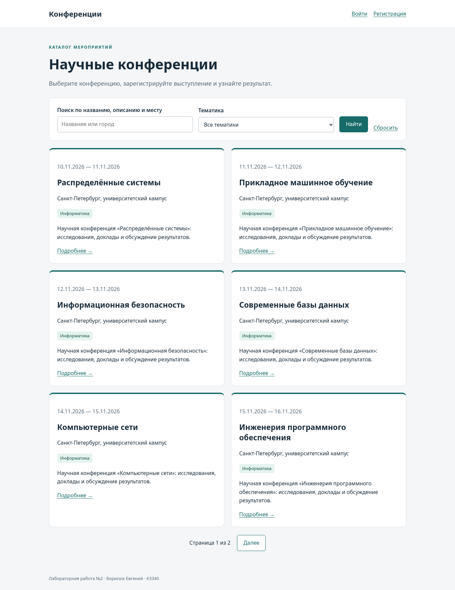
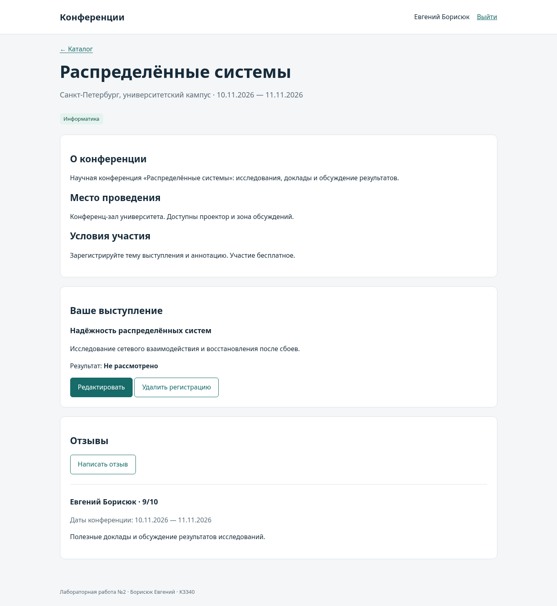
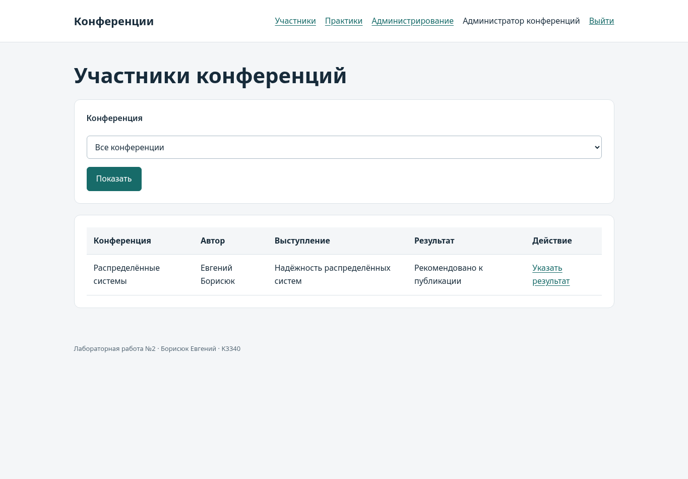
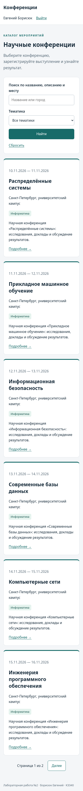

# Отчёт по лабораторной работе №2

Борисюк Евгений, K3340. Вариант №5 — «Список научных конференций».
Номер в списке группы — 5.

Подробные разделы: [установка и запуск](setup.md), [архитектура и модели](models.md),
[интерфейсы и обработка запросов](interfaces.md), [проверки и подготовка к защите](testing.md).

## Цель работы

Освоить разработку сайта средствами Django, работу с PostgreSQL,
серверную обработку форм, шаблоны Jinja2 и разграничение прав.

## Условие варианта

Хранить название конференции, тематики, место и период проведения,
описание конференции и места, условия участия. Реализовать регистрацию
пользователей и авторов выступлений, редактирование и удаление своих регистраций,
отзывы с датами конференции, текстом, рейтингом 1–10 и автором.
Администратор указывает результат выступления: рекомендовано к публикации или нет.
В клиентской части формируется таблица участников по конференциям.

Источник: [актуальное условие ЛР2](https://rendex85.github.io/ITMO_ICT_WebDevelopment_Docs/lab2/assignment/).

## Используемые технологии

Python 3.10.21, Django 3.2.25, PostgreSQL 18.6, Jinja2 3.1.6,
psycopg2-binary 2.9.11; собственный CSS.
Используется ветка Django 3, указанная в условии. Поскольку Django 3.2
больше не поддерживается, приложение предназначено для локальной учебной демонстрации.

В архитектуре MVT модели отвечают за данные, представления — за обработку запросов,
шаблоны — за HTML, а urls.py — за маршрутизацию. Все пользовательские страницы
рендерятся через Jinja2. Django-admin использует штатный DjangoTemplates.

## Модель данных

| Модель | Основные поля и связи |
|---|---|
| Topic | Уникальное название тематики |
| Conference | Название, место, начало и окончание, описания, условия; M2M с Topic |
| User | Стандартные поля AbstractUser и атрибуты автовладельца для практик |
| Registration | Конференция, автор, тема выступления, аннотация, результат |
| Review | Конференция, автор, сохранённые даты, текст, рейтинг |

Один автор регистрируется на одну конференцию один раз. Уникальность пары
проверяется PostgreSQL. Даты конференции упорядочены; рейтинг отзыва ограничен
диапазоном 1–10 в форме, валидаторах и ограничении БД.
Даты сохраняются в отзыве на момент написания: последующее изменение карточки
конференции не переписывает контекст уже написанного отзыва.

Модели практик описаны на [отдельной странице](../practice.md).

## Каталог и карточка конференции

Каталог показывает по шесть конференций на странице. Поиск работает по названию,
описанию и месту проведения; фильтр ограничивает результат тематикой.
Пагинация сохраняет поисковый запрос и выбранную тематику.
Некорректный номер страницы обрабатывается Paginator.get_page; для пустой выборки
отображается сообщение.

Идентификаторы фильтров принимаются только как положительные ASCII-числа
в диапазоне PostgreSQL bigint (до 9223372036854775807). Пустые, отрицательные,
нечисловые и слишком длинные значения игнорируются; они не вызывают ошибку сервера.

Карточка показывает все поля варианта, тематики, отзывы и собственное выступление
пользователя. Отсутствующий идентификатор возвращает 404.

## Регистрация пользователя и выступления

Посетитель создаёт учётную запись через /accounts/signup/ и входит через
/accounts/login/. Пароли обрабатываются штатными средствами Django.
Форма регистрации пользователя не принимает is_staff и is_superuser.

Автор вводит тему и аннотацию выступления. Поля автора и конференции назначает
сервер. Автор может изменить или удалить только свою регистрацию; обращение
к чужому идентификатору возвращает 404. GET удаления показывает подтверждение,
а само удаление выполняется через POST.

Первоначальный результат — «Не рассмотрено». Изменение темы или аннотации
сбрасывает прежнее решение: оно относилось к предыдущему содержанию выступления.
Сохранение без изменения текста результат не сбрасывает.

## Отзывы

Автор заполняет текст и рейтинг. Сервер сохраняет текущего пользователя и даты
конференции; подставить другого автора через POST нельзя. Пустой текст и рейтинг
вне диапазона отклоняются. Пользовательский HTML экранируется Jinja2.

## Администрирование и таблица участников

Администратор управляет конференциями и тематиками в Django-admin. В форме
регистрации выступления выставляет результат: «Рекомендовано к публикации» или
«Не рекомендовано к публикации».

В клиентской части /participants/ показывает конференцию, автора, тему и
результат. Таблица фильтруется по конференции. Через «Указать результат»
администратор меняет результат также в обычном интерфейсе сайта.

| Роль | Возможности |
|---|---|
| Гость | Каталог, карточки и чтение отзывов; регистрация и вход |
| Пользователь | Дополнительно свои регистрации и написание отзывов |
| Администратор (is_staff) | Дополнительно таблица всех участников, результаты и учебные практики |

Привилегированные маршруты проверяют is_staff на сервере и возвращают 403
обычному пользователю. Шаблоны скрывают недоступные ссылки. Доступ к Django-admin
дополнительно определяется стандартными разрешениями Django.

## Оформление

Интерфейс использует общий шаблон base.html и локальный CSS без внешних CDN.
Карточки, формы, кнопки, таблицы и навигация имеют единое оформление.
На узком экране каталог переходит в одну колонку; широкие таблицы прокручиваются
внутри контейнера.

## Соответствие условию

| Требование | Реализация | Проверка |
|---|---|---|
| Данные конференций и тематики | Conference, Topic, каталог и карточка | ORM, просмотр в Chromium |
| Регистрация пользователей | SignupForm, signup | Тест регистрации и запрета назначения роли |
| Регистрация авторов, изменение и удаление | Registration и три представления | Своя/чужая запись, повтор, подтверждение удаления |
| Отзывы и рейтинг | Review, ReviewForm | Автор, даты, границы рейтинга, экранирование |
| Результаты через Django-admin | RegistrationAdmin | POST формы администратора |
| Таблица участников | participants.html, фильтр конференции | Доступ администратора и запрет обычному пользователю |
| Стилизация и права на клиенте | base.html, style.css | Chromium, роли и мобильный экран |
| Поиск, фильтрация и пагинация | conference_list | Выборка и переход со сохранением параметров |
| Практики 2.1–2.3 | project_first_app | FBV, CBV, Django-admin, миграции и модели |

## Тестирование

44 автоматических теста выполнены на PostgreSQL. Дополнительно проверены
Django system checks, применение миграций, отсутствие новых несозданных миграций,
компиляция Python, оформление кода и строгая сборка MkDocs.

Регрессионные тесты покрывают фильтры длиной 5000 цифр, выход за диапазон bigint,
не-ASCII цифры, нулевые и отрицательные идентификаторы, а также обязательную дату
рождения автовладельца. Для Ruff закреплены версия и набор правил в проекте;
команды проверки приведены в README.

Отдельно проверены admin-формы создания и изменения владения: обычного автора
с неполными данными нельзя назначить владельцем. После назначения нельзя очистить
ни одно обязательное поле владельца, включая одновременное удаление паспорта
и даты рождения. Аналогичные правила действуют для водительского удостоверения.

В Chromium проверены регистрация и вход, создание и редактирование выступления,
отзыв, доступ к таблице участников, выставление результатов в клиентской части
и Django-admin, создание владельцев и автомобилей, поиск, страницы каталога
и мобильное отображение. Скриншоты сделаны с работающего приложения.

Команды установки, подключения к PostgreSQL и запуска проверок приведены в README.md.

## Сценарий защиты

1. Запустить PostgreSQL и приложение по README, загрузить seed_demo.
2. Показать каталог, поиск, тематики и вторую страницу.
3. Зарегистрировать автора и выступление, изменить аннотацию, написать отзыв.
4. Войти администратором, отфильтровать таблицу участников и выставить результат.
5. Показать тот же результат через Django-admin.
6. Войти автором и показать результат; удалить собственную регистрацию через подтверждение.
7. Показать модели и интерфейсы практик, затем запустить тесты.

## Ограничения

Сайт рассчитан на локальную учебную демонстрацию. Открытый локальный SECRET_KEY
и DEBUG по умолчанию требуют замены перед публичным запуском.
Почтовое подтверждение регистрации, загрузка файлов и удалённый деплой
не входят в условие и не реализованы. Срок сдачи в исходном условии не указан.
