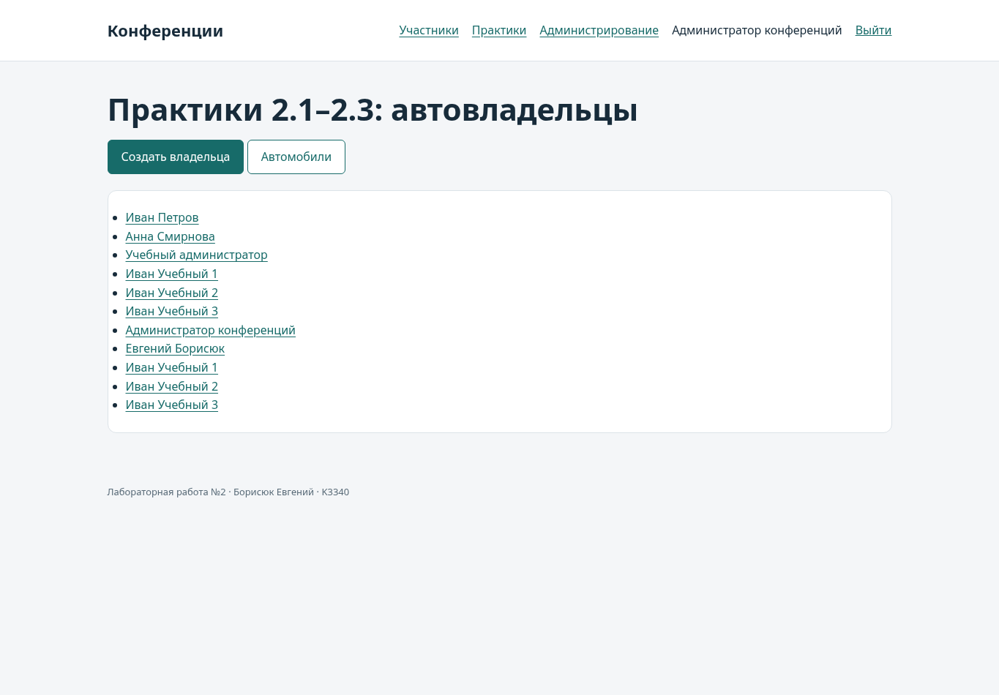

# Практические работы 2.1–2.3

## Общая структура

Проект называется django_project_borisuk, учебное приложение — project_first_app.
Оно подключено к тому же PostgreSQL и отделено от моделей конференций.
Практические результаты хранятся вместе с лабораторной, как отдельный модуль;
их страницы доступны в разделе /practice/.

## Практика 2.1

| Задание | Результат |
|---|---|
| Установить Django, создать проект и приложение | django_project_borisuk, project_first_app, закреплённые зависимости |
| Описать схему автовладельцев | User, Car, Ownership, DriverLicense |
| Создать и применить миграции | project_first_app/migrations/0001_initial.py, команда migrate |
| Зарегистрировать таблицы в admin | OwnerAdmin и регистрация остальных трёх моделей |
| Два владельца, четыре автомобиля, по три связи | seed_demo и тест admin-форм с шестью владениями |
| Вывести владельца через представление и шаблон | owner_detail, jinja2/owner.html |
| Подключить urls.py через include | /practice/owner/<id> |

Модель сохраняет сущности и связи рисунка из условия, с адаптацией под AbstractUser.
User содержит имя, фамилию и дату
рождения, DriverLicense — владельца, номер, категорию и дату выдачи. Car содержит
госномер, марку, модель и цвет. Ownership содержит владельца, автомобиль и
начало/окончание владения. Все таблицы и поля именуются латиницей.

На рисунке поля дат обозначены datetime. Здесь применён DateField, как в примерах
практики 2.2: задания оперируют календарными датами, а не временем суток.
Необязательный цвет хранится пустой строкой по соглашению Django для CharField.
Длины имени и фамилии сохранены стандартными для AbstractUser, вместо ограничения
в 30 символов на исходном рисунке.

Общая User используется и автовладельцами, и авторами конференций. Поэтому дата
рождения и паспортные атрибуты не требуются у автора без автомобиля. При создании
владельца через OwnerForm дата рождения, имя, фамилия, паспорт, адрес и национальность
обязательны. Ownership.clean проверяет данные выбранного владельца при создании
и изменении владения, а DriverLicense.clean — при выдаче удостоверения.
User.clean проверяет их при заполненном паспорте, наличии истории владения
или удостоверения. Поэтому назначить владельцем автора с неполными данными
и затем удалить обязательные данные владельца через Django-admin нельзя.
Проверка отвергает и строки, содержащие только пробелы.
Ограничение PostgreSQL owner_requires_birth_date запрещает запись
с паспортом и отсутствующей датой рождения даже при прямом обращении через ORM.
Это осознанное отличие от безусловного NOT NULL на рисунке: автор конференции
не обязан быть автовладельцем.

Связанные требования проверяются в моделях и стандартных admin-формах;
при собственных записях через ORM необходимо вызывать full_clean перед save.
Проверки межтабличных связей не заявляются как ограничения PostgreSQL.

Первый учебный владелец связан с автомобилями 1–3 в 2023–2024 годах, второй —
с автомобилями 2–4 с 2025 года. По три связи у каждого; даты по одному автомобилю
не пересекаются. Это проверяется валидацией модели при сохранении через admin-формы.
Дополнительно БД запрещает окончание периода раньше начала. Проверка пересечений
в clean предназначена для последовательных учебных операций и не является
защитой от конкурентных записей напрямую через ORM.

Автоматический тест test_admin_creates_two_owners_and_four_cars выполняет создание
двух пользователей, четырёх автомобилей и шести владений именно через
POST-формы Django-admin. Повторяемые данные для личной демонстрации загружаются
отдельной командой seed_demo.

## Практика 2.2

Связь Car.owners реализована ManyToManyField через Ownership с датами владения.
Список всех владельцев — FBV owner_list; создание владельца — FBV owner_create
и OwnerForm. Список и карточка автомобилей — CarList и CarDetail; создание,
редактирование и удаление — CarCreate, CarUpdate, CarDelete на стандартных CBV.

В тестах через формы добавляются минимум три новых владельца и три автомобиля.
Проверяются карточка, список, обновление цвета и удаление с подтверждением.
Создание трёх владельцев и трёх автомобилей также пройдено в Chromium.

## Практика 2.3

User наследует AbstractUser и добавляет passport_number, address, nationality
и birth_date. AUTH_USER_MODEL задаётся до первой миграции. Ссылки других моделей
направлены на settings.AUTH_USER_MODEL, а не на встроенную модель auth.User.

Новые поля отображаются в OwnerAdmin при создании и редактировании.
Форма OwnerForm создаёт полноценного пользователя, хеширует пароль и запрашивает
атрибуты владельца. Списки и карточки работают с обновлённой пользовательской моделью.
Обычная регистрация автора конференции не требует паспортных данных;
учебные страницы с ними доступны только администратору.

## Воспроизведение

1. Выполнить migrate, createsuperuser и seed_demo по README.
2. Войти администратором и открыть /practice/owners/.
3. Открыть карточку владельца и историю владения автомобилями.
4. Создать ещё трёх владельцев через «Создать владельца».
5. Открыть /practice/cars/, добавить три автомобиля, изменить и удалить одну запись.
6. В /admin/ проверить расширенную модель пользователя и остальные учебные таблицы.
7. Запустить python manage.py test project_first_app --verbosity 2.

Все демонстрационные паспортные номера и адреса являются вымышленными.

## Материалы

- [Практика 2.1](https://rendex85.github.io/ITMO_ICT_WebDevelopment_Docs/lab2/practice1/)
- [Практика 2.2](https://rendex85.github.io/ITMO_ICT_WebDevelopment_Docs/lab2/practice2/)
- [Практика 2.3](https://rendex85.github.io/ITMO_ICT_WebDevelopment_Docs/lab2/practice3/)
