# ЛР2. Простой сайт на Django

Цель работы: овладеть практическими навыками и умениями реализации web-сервисов средствами Django.

Мой вариант первый, «Список отелей». Сайт называется HotelBook. Нужно было учитывать название отеля, владельца, адрес, описание, типы номеров, стоимость, вместимость и удобства, а из функций:

- регистрация новых пользователей;
- просмотр и резервирование номеров, редактирование и удаление своих резервирований;
- отзывы к номерам с периодом проживания, текстом, рейтингом 1-10 и информацией о комментаторе;
- заселение и выселение пользователя администратором через Django-admin;
- таблица постояльцев отеля за последний месяц.

Стек: Python 3.13, Django 5.2, PostgreSQL 18, Bootstrap 5.

## Структура проекта

Проект лежит в папке `hotels_project`, в нем одно приложение `hotels`.

```
laboratory_work_2/
├── requirements.txt
├── report.md
├── screens/
└── hotels_project/
    ├── manage.py
    ├── hotels_project/
    │   ├── settings.py
    │   └── urls.py
    └── hotels/
        ├── admin.py
        ├── forms.py
        ├── models.py
        ├── urls.py
        ├── views.py
        ├── management/commands/fill_db.py
        └── templates/
            ├── base.html
            ├── includes/
            ├── hotels/
            └── registration/
```

## Запуск

```bash
pip install -r requirements.txt
createdb --template=template0 --locale-provider=icu --icu-locale=ru-RU hotels_db
cd hotels_project
python manage.py migrate
python manage.py fill_db
python manage.py runserver
```

Параметры подключения к базе берутся из переменных окружения `DB_NAME`, `DB_USER`, `DB_PASSWORD`, `DB_HOST`, `DB_PORT`, по умолчанию база `hotels_db` на `localhost` от имени текущего пользователя системы:

```python
DATABASES = {
    'default': {
        'ENGINE': 'django.db.backends.postgresql',
        'NAME': os.getenv('DB_NAME', 'hotels_db'),
        'USER': os.getenv('DB_USER', ''),
        'PASSWORD': os.getenv('DB_PASSWORD', ''),
        'HOST': os.getenv('DB_HOST', 'localhost'),
        'PORT': os.getenv('DB_PORT', '5432'),
    }
}
```

Базу я создавал с ICU-локалью `ru-RU`. Сначала создал обычной командой `createdb`, и на macOS русские названия сортировались неправильно (например, «Кронверк» оказывался раньше «Арбат Хаус»), потому что системная libc-локаль плохо сравнивает кириллицу. С ICU сортировка нормальная.

Команда `fill_db` очищает таблицы и заполняет базу тестовыми данными: 9 отелей в 4 городах, по 5 номеров в каждом, 8 гостей, бронирования в прошлом, текущие и будущие, и отзывы. Даты считаются от сегодняшнего дня, поэтому таблица постояльцев за месяц всегда не пустая. Также создается суперпользователь `admin` с паролем `admin`, у гостей пароль `password123`.

## Модель данных

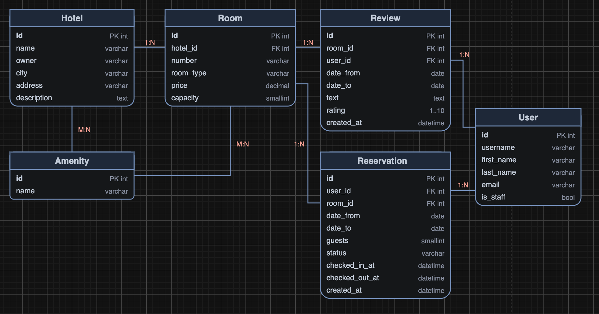

Получилось пять моделей, пользователь стандартный `django.contrib.auth.models.User`.

**Amenity** - удобство (Wi-Fi, парковка, бассейн и т.д.). Вынес в отдельную таблицу, а не строкой в описании, чтобы по удобствам можно было фильтровать. Связь многие-ко-многим и с отелем (общие удобства отеля), и с номером (что есть в самом номере).

**Hotel** - отель: название, владелец, город, адрес, описание. Город отдельным полем, чтобы по нему фильтровать.

**Room** - номер отеля: номер комнаты, тип (одноместный, двухместный, семейный, люкс), цена за ночь и вместимость. Я сделал номер отдельной сущностью, а не просто «тип номера», потому что бронируется конкретная комната и для нее надо проверять занятость по датам. Пара `hotel` + `number` уникальна.

**Reservation** - бронирование: кто, какой номер, даты заезда и выезда, число гостей и статус. Статусы: забронировано, заселен, выселен, отменено. Отдельно хранится время фактического заселения и выселения, их ставит администратор.

**Review** - отзыв к номеру: период проживания, текст, рейтинг от 1 до 10, автор и дата отзыва.

```python
class Room(models.Model):
    TYPES = [
        ('single', 'Одноместный'),
        ('double', 'Двухместный'),
        ('family', 'Семейный'),
        ('suite', 'Люкс'),
    ]

    hotel = models.ForeignKey(Hotel, on_delete=models.CASCADE, related_name='rooms', verbose_name='Отель')
    number = models.CharField('Номер', max_length=10)
    room_type = models.CharField('Тип', max_length=20, choices=TYPES)
    price = models.DecimalField('Цена за ночь', max_digits=8, decimal_places=2)
    capacity = models.PositiveSmallIntegerField('Вместимость', validators=[MinValueValidator(1)])
    amenities = models.ManyToManyField(Amenity, verbose_name='Удобства в номере', blank=True)

    class Meta:
        verbose_name = 'Номер'
        verbose_name_plural = 'Номера'
        ordering = ['hotel', 'number']
        unique_together = ['hotel', 'number']


class Reservation(models.Model):
    STATUSES = [
        ('booked', 'Забронировано'),
        ('checked_in', 'Заселен'),
        ('checked_out', 'Выселен'),
        ('cancelled', 'Отменено'),
    ]

    user = models.ForeignKey(settings.AUTH_USER_MODEL, on_delete=models.CASCADE, related_name='reservations', verbose_name='Гость')
    room = models.ForeignKey(Room, on_delete=models.CASCADE, related_name='reservations', verbose_name='Номер')
    date_from = models.DateField('Дата заезда')
    date_to = models.DateField('Дата выезда')
    guests = models.PositiveSmallIntegerField('Количество гостей', default=1, validators=[MinValueValidator(1)])
    status = models.CharField('Статус', max_length=20, choices=STATUSES, default='booked')
    checked_in_at = models.DateTimeField('Время заселения', null=True, blank=True)
    checked_out_at = models.DateTimeField('Время выселения', null=True, blank=True)
    created_at = models.DateTimeField('Создано', auto_now_add=True)

    @property
    def nights(self):
        return (self.date_to - self.date_from).days

    @property
    def total_price(self):
        return self.room.price * self.nights

    def can_edit(self):
        return self.status == 'booked'


class Review(models.Model):
    room = models.ForeignKey(Room, on_delete=models.CASCADE, related_name='reviews', verbose_name='Номер')
    user = models.ForeignKey(settings.AUTH_USER_MODEL, on_delete=models.CASCADE, related_name='reviews', verbose_name='Автор')
    date_from = models.DateField('Проживание с')
    date_to = models.DateField('Проживание по')
    text = models.TextField('Текст отзыва')
    rating = models.PositiveSmallIntegerField('Рейтинг', validators=[MinValueValidator(1), MaxValueValidator(10)])
    created_at = models.DateTimeField('Дата отзыва', auto_now_add=True)
```

## Адреса

```python
urlpatterns = [
    path('', views.hotel_list, name='hotel_list'),
    path('hotels/<int:pk>/', views.hotel_detail, name='hotel_detail'),
    path('rooms/<int:pk>/', views.room_detail, name='room_detail'),
    path('rooms/<int:room_id>/reserve/', views.reservation_create, name='reservation_create'),
    path('rooms/<int:room_id>/review/', views.review_create, name='review_create'),
    path('reservations/', views.my_reservations, name='my_reservations'),
    path('reservations/<int:pk>/edit/', views.reservation_edit, name='reservation_edit'),
    path('reservations/<int:pk>/delete/', views.reservation_delete, name='reservation_delete'),
    path('reviews/<int:pk>/delete/', views.review_delete, name='review_delete'),
    path('guests/', views.guests, name='guests'),
    path('manage/', views.manage_reservations, name='manage_reservations'),
    path('manage/<int:pk>/<str:action>/', views.change_status, name='change_status'),
    path('register/', views.register, name='register'),
    path('login/', auth_views.LoginView.as_view(), name='login'),
    path('logout/', auth_views.LogoutView.as_view(), name='logout'),
]
```

Все представления функциональные. Для входа и выхода использую готовые `LoginView` и `LogoutView`, шаблон входа лежит в `templates/registration/login.html`. Выход сделан POST-формой, так как в новых версиях Django `LogoutView` не принимает GET.

## Пагинация и фильтрация

Пагинация есть на всех списках: отели (по 6), номера отеля (по 5), отзывы (по 5), мои бронирования (по 8), постояльцы и панель администратора (по 10). Для этого одна вспомогательная функция:

```python
def paginate(request, queryset, per_page):
    paginator = Paginator(queryset, per_page)
    return paginator.get_page(request.GET.get('page'))
```

`get_page` сам обрабатывает неправильный номер страницы и возвращает первую или последнюю.

Блок с номерами страниц вынесен в `includes/pagination.html` и подключается через ``. Чтобы при переходе по страницам не терялись параметры фильтра, ссылки строятся тегом ``, который появился в Django 5.1. Он берет текущие GET-параметры и заменяет только `page`:

```html
<a class="page-link" href="">&raquo;</a>
```

Фильтры сделаны обычными GET-формами. Например, список отелей можно искать по названию, адресу и описанию, фильтровать по городу и удобству:

```python
def hotel_list(request):
    hotels = Hotel.objects.annotate(
        min_price=Min('rooms__price'),
        rooms_count=Count('rooms', distinct=True),
    )

    q = request.GET.get('q', '').strip()
    city = request.GET.get('city', '')
    amenity = request.GET.get('amenity', '')

    if q:
        hotels = hotels.filter(Q(name__icontains=q) | Q(address__icontains=q) | Q(description__icontains=q))
    if city:
        hotels = hotels.filter(city=city)
    if amenity:
        hotels = hotels.filter(amenities__id=amenity)
    ...
```

Через `annotate` сразу считается минимальная цена номера и количество номеров, чтобы показать их на карточке отеля без лишних запросов.

## Интерфейсы

### Список отелей

Главная страница. Карточки отелей с городом, адресом, удобствами и ценой «от». Сверху поиск и фильтры, снизу пагинация.

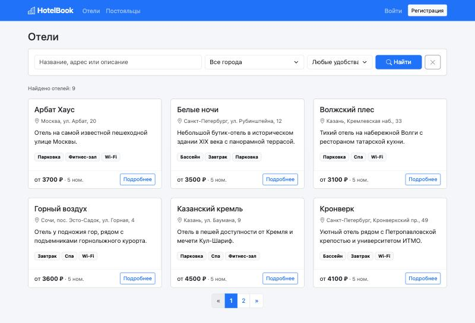

### Страница отеля

Информация об отеле, владелец, удобства и список номеров. Номера фильтруются по типу, минимальной вместимости и максимальной цене. У каждого номера показан средний рейтинг по отзывам. На скриншоте выбраны двухместные номера на двоих.

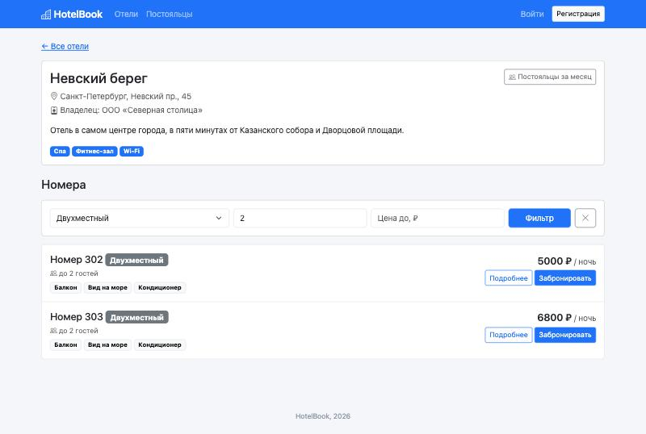

### Регистрация

Форма унаследована от `UserCreationForm`, к логину и паролю добавлены имя, фамилия и email. Имя и фамилия нужны, чтобы показывать их в отзывах и в таблице постояльцев. После регистрации пользователь сразу авторизуется.

```python
class RegisterForm(BootstrapMixin, UserCreationForm):
    first_name = forms.CharField(label='Имя', max_length=150)
    last_name = forms.CharField(label='Фамилия', max_length=150)
    email = forms.EmailField(label='Email')

    class Meta:
        model = User
        fields = ['username', 'first_name', 'last_name', 'email']
```

`BootstrapMixin` - маленький класс, который проставляет всем полям формы классы `form-control` или `form-select`, чтобы не прописывать виджеты у каждого поля.

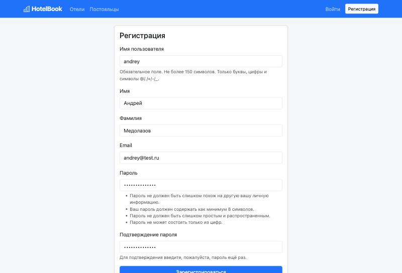

### Бронирование номера

Бронировать могут только авторизованные пользователи (`@login_required`). В форме дата заезда, дата выезда и количество гостей. В `clean()` формы проверяется, что:

- заезд не в прошлом;
- выезд позже заезда;
- гостей не больше, чем вместимость номера;
- номер не занят на эти даты другим активным бронированием.

```python
if date_from and date_to and not self.errors:
    busy = Reservation.objects.filter(
        room=self.room,
        status__in=['booked', 'checked_in'],
        date_from__lt=date_to,
        date_to__gt=date_from,
    ).exclude(pk=self.instance.pk)
    if busy.exists():
        raise forms.ValidationError('Номер уже занят на выбранные даты')
```

Два интервала пересекаются, если начало одного раньше конца другого и наоборот. `exclude(pk=...)` нужен при редактировании, чтобы бронирование не конфликтовало само с собой.

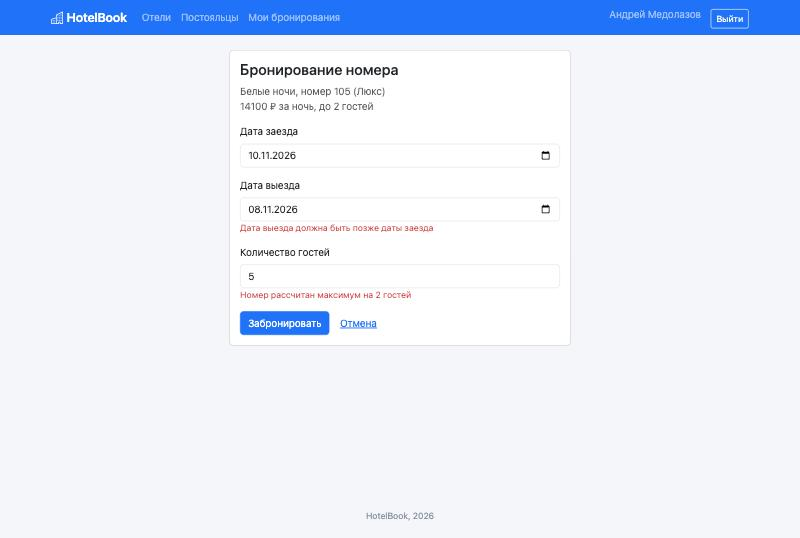

### Мои бронирования

Таблица бронирований текущего пользователя с фильтром по статусу. Считается число ночей и итоговая стоимость. Изменить или удалить можно только бронирование в статусе «Забронировано»: если гость уже заселен, менять даты нельзя. Для завершенного проживания вместо этого появляется кнопка «Отзыв».

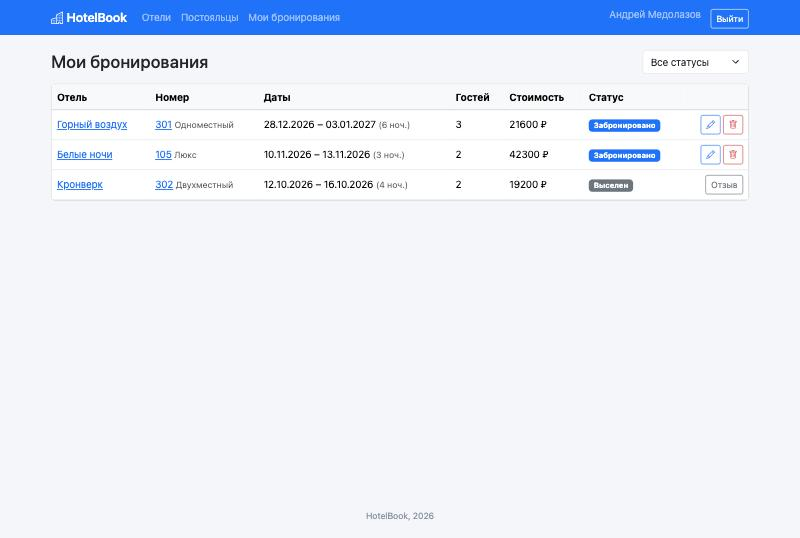

Редактирование использует ту же форму с теми же проверками. Чужое бронирование открыть нельзя: объект ищется сразу с условием `user=request.user`, поэтому для чужого будет 404.

```python
@login_required
def reservation_edit(request, pk):
    reservation = get_object_or_404(Reservation, pk=pk, user=request.user)
    if not reservation.can_edit():
        messages.error(request, 'Это бронирование уже нельзя изменить')
        return redirect('my_reservations')
    ...
```

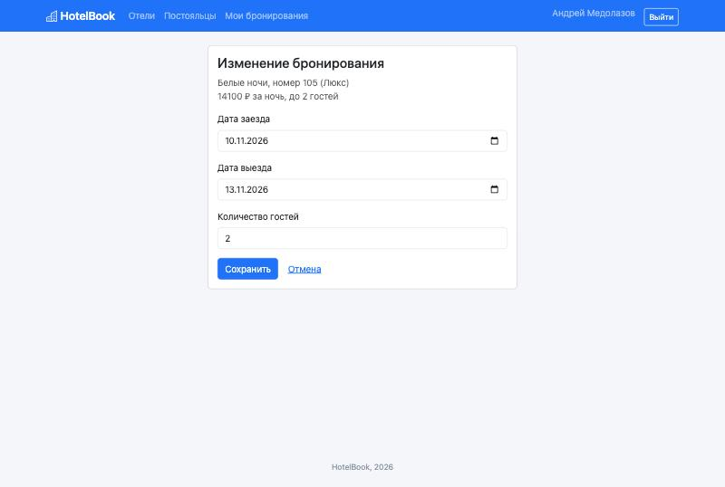

Удаление происходит после подтверждения на отдельной странице, сам объект удаляется только по POST.

### Отзывы

Отзыв оставляется на странице номера. В форме период проживания, рейтинг от 1 до 10 и текст, автор берется из `request.user`. Если пользователь уже жил в этом номере, даты подставляются из его последнего проживания. Дата начала не может быть в будущем.

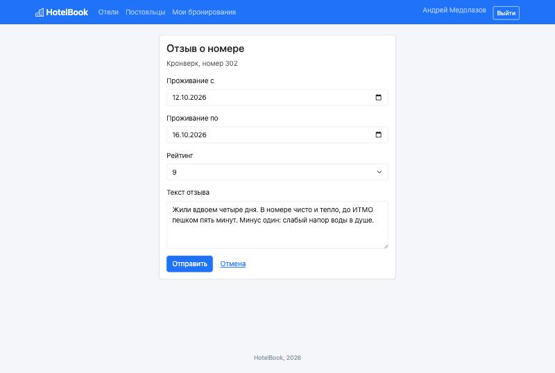

На странице номера видны его параметры, средний рейтинг и отзывы с пагинацией. Свой отзыв можно удалить. Справа обычный пользователь видит, на какие даты номер уже занят.

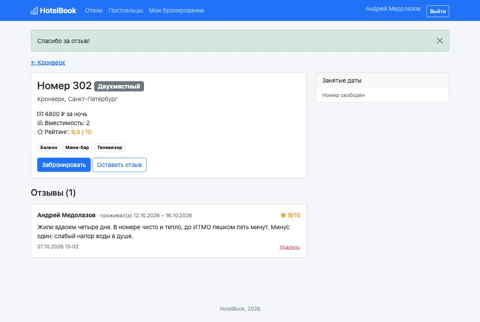

### Постояльцы за последний месяц

Таблица гостей, которые жили в отеле в последние 30 дней. Берутся бронирования со статусом «Заселен» или «Выселен», у которых период проживания пересекается с последним месяцем. Таблицу можно отфильтровать по отелю и поиском по имени гостя. На страницу отеля добавлена кнопка, которая открывает эту таблицу уже с фильтром по нему.

```python
def guests(request):
    today = timezone.localdate()
    month_ago = today - timedelta(days=30)
    stays = Reservation.objects.filter(
        status__in=['checked_in', 'checked_out'],
        date_from__lte=today,
        date_to__gte=month_ago,
    ).select_related('user', 'room__hotel').order_by('room__hotel__name', 'date_from')
    ...
```

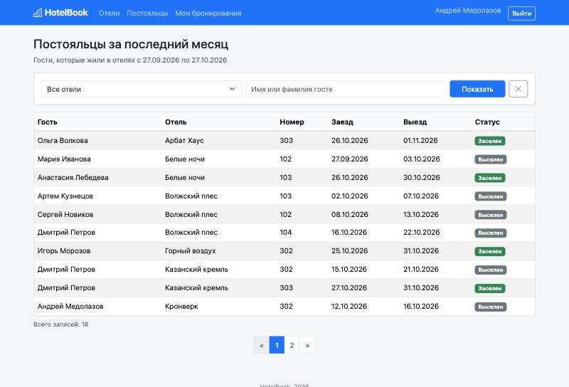

## Права администратора в клиентском интерфейсе

Администратором считается пользователь с `is_staff`. В шаблонах это проверяется через ``, а в представлениях через декоратор:

```python
staff_required = user_passes_test(lambda u: u.is_staff)
```

Что администратор видит дополнительно:

- в меню пункты «Заселение» и «Админка», возле имени метка «администратор»;
- на страницах отеля и номера кнопки перехода к редактированию в Django-admin;
- на странице номера вместо занятых дат полный список бронирований с именами гостей и кнопками «Заселить» и «Выселить»;
- в таблице постояльцев дополнительные колонки: email гостя и точное время заселения и выселения;
- может удалить любой отзыв, а не только свой;
- страницу «Заселение и выселение».

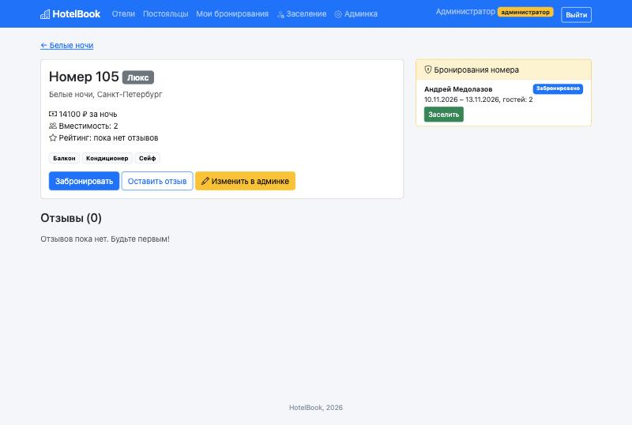

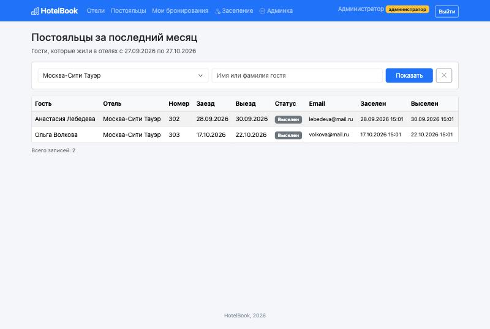

### Заселение и выселение

На этой странице все бронирования с фильтрами по статусу, отелю и гостю. По умолчанию показываются ожидающие заселения. Для каждого бронирования кнопки зависят от статуса: «Заселить» и «Отменить» для забронированных, «Выселить» для заселенных.

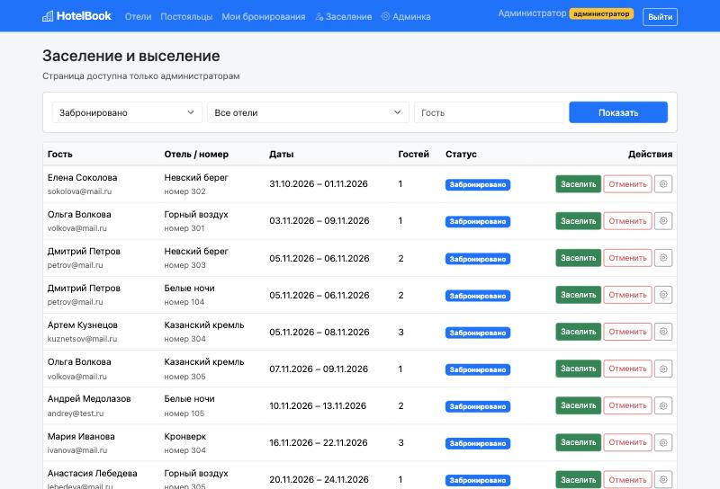

Кнопки отправляют POST на `change_status`. Представление проверяет, что переход допустим (выселить можно только заселенного), ставит время и возвращает на ту же страницу с теми же фильтрами. Адрес возврата проверяется через `url_has_allowed_host_and_scheme`, чтобы нельзя было подставить чужой сайт.

```python
@staff_required
@require_POST
def change_status(request, pk, action):
    reservation = get_object_or_404(Reservation, pk=pk)
    if action == 'check_in' and reservation.status == 'booked':
        reservation.status = 'checked_in'
        reservation.checked_in_at = timezone.now()
        reservation.save()
        messages.success(request, f'{reservation.user.get_full_name()} заселен(а)')
    elif action == 'check_out' and reservation.status == 'checked_in':
        ...
```

После заселения Елены Соколовой она появилась в списке заселенных:

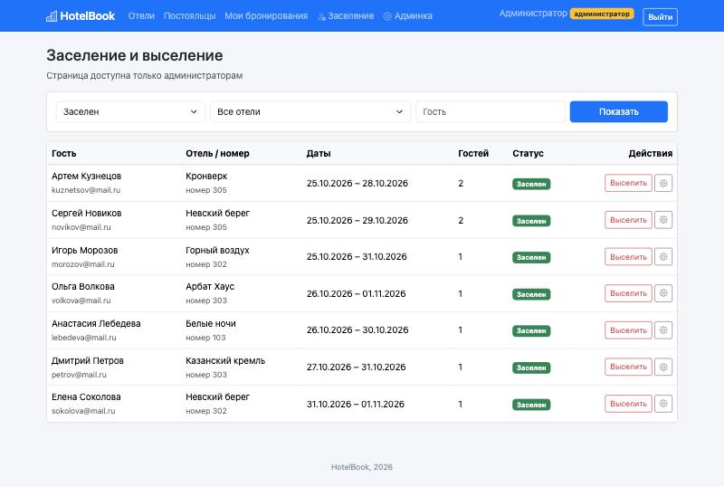

Если обычный пользователь попробует открыть `/manage/`, его перенаправит на страницу входа.

## Django-admin

В админке зарегистрированы все модели. У отеля номера редактируются прямо на его странице через `TabularInline`, удобства выбираются через `filter_horizontal`. У бронирований фильтры по статусу, отелю и дате заезда, поиск по гостю.

Для заселения и выселения средствами Django-admin я добавил два действия. Нужно отметить бронирования галочками, выбрать действие и нажать «Выполнить». Действие меняет статус только тем бронированиям, у которых подходящий текущий статус, так что выселить незаселенного не получится.

```python
@admin.register(Reservation)
class ReservationAdmin(admin.ModelAdmin):
    list_display = ['user', 'room', 'date_from', 'date_to', 'guests', 'status', 'checked_in_at', 'checked_out_at']
    list_filter = ['status', 'room__hotel', 'date_from']
    search_fields = ['user__username', 'user__first_name', 'user__last_name', 'room__hotel__name']
    date_hierarchy = 'date_from'
    readonly_fields = ['created_at']
    actions = ['check_in', 'check_out']

    @admin.action(description='Заселить выбранных гостей')
    def check_in(self, request, queryset):
        count = queryset.filter(status='booked').update(status='checked_in', checked_in_at=timezone.now())
        self.message_user(request, f'Заселено гостей: {count}')

    @admin.action(description='Выселить выбранных гостей')
    def check_out(self, request, queryset):
        count = queryset.filter(status='checked_in').update(status='checked_out', checked_out_at=timezone.now())
        self.message_user(request, f'Выселено гостей: {count}')
```

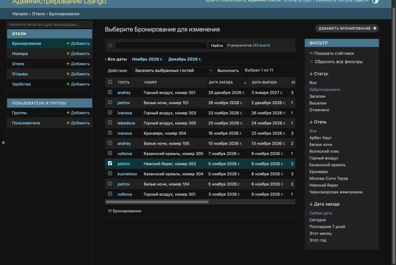

После выполнения бронирование petrov в «Невском береге» перешло в статус «Заселен»:

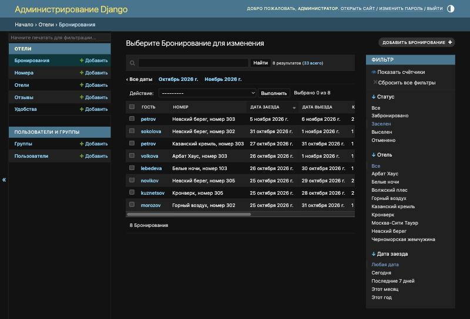

## Оформление

Для стилей подключен Bootstrap 5 и Bootstrap Icons с CDN в `base.html`, остальные шаблоны наследуются от него через ``. В базовом шаблоне навигация, вывод сообщений из `django.contrib.messages` (успешное бронирование, ошибки) и подвал. Поля форм выводятся общим шаблоном `includes/form_fields.html` с подписями и ошибками под каждым полем.

## Вывод

В ходе работы я сделал сайт бронирования отелей на Django с базой PostgreSQL. Спроектировал модель данных из пяти таблиц, сделал регистрацию, бронирование номеров с проверкой занятости, редактирование и удаление своих бронирований, отзывы с рейтингом и таблицу постояльцев за месяц. Заселение и выселение доступно администратору и в Django-admin через действия, и прямо на сайте. Разобрался с пагинацией, фильтрацией через GET-параметры, тегом `querystring`, проверкой прав через `is_staff` и валидацией в формах.
