# ЛР2. Отчёт — Сайт на Django

## Цель работы

Освоить разработку веб-сервиса на Django: описать модель данных, реализовать клиентские интерфейсы и логику сайта по паттерну MVC (в Django — MVT) с шаблонизацией Jinja2 и СУБД PostgreSQL.

## Вариант

Порядковый номер 17. Вариант: `((17-1) % 6) + 1 = 5` — **список научных конференций**.

## Средства разработки

Python 3.10+, Django 5.2 LTS, Jinja2, PostgreSQL 16 (в Docker), `psycopg`, `python-dotenv`, Bootstrap 5 (CDN).

- **PostgreSQL**, а не SQLite — так требует задание. Ограничения (`UniqueConstraint`) и сортировка с `NULLS LAST` проверяются на той же СУБД, что и в рабочей среде.
- **Jinja2** — по заданию. Django-admin остаётся на родных `DjangoTemplates`, поэтому в проекте два движка шаблонов.
- **Django 5.2 LTS вместо 3.x из задания.** «Python 3.6+, Django 3» задаёт нижнюю границу, а ветка 3.2 снята с поддержки в апреле 2024 и не получает исправлений безопасности. Код не использует ничего, что появилось позже Django 3. Весь набор тестов проходит и на Django 3.2.25 / Python 3.10 (проверено в Docker; для 3.2 вместо `psycopg` нужен `psycopg2-binary`, потому что `psycopg` 3 Django поддерживает с версии 4.2).
- **Bootstrap** даёт готовые компоненты (меню, формы, таблицы, пагинацию) без собственной вёрстки: стилизация нужна для максимального балла.

## Как устроен запрос

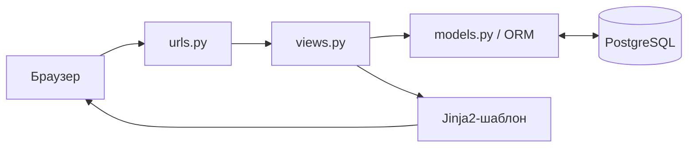

`urls.py` по адресу выбирает представление. Представление через ORM читает или пишет данные в PostgreSQL и передаёт их в шаблон, а шаблон возвращает HTML.

## Запуск

```bash
cp .env.example .env                 # заполните DJANGO_SECRET_KEY и DB_PASSWORD
docker compose up -d                 # PostgreSQL, параметры из .env
python -m venv .venv && source .venv/bin/activate
pip install -r requirements.txt
python manage.py migrate
python manage.py seed                # демо-данные; пароли берёт из .env или генерирует и печатает
python manage.py runserver
python manage.py test                # 64 теста
```

Секреты (`DJANGO_SECRET_KEY`, пароль БД, пароли демо-пользователей) лежат в `.env`, а сам `.env` — в `.gitignore`. В репозитории только образец `.env.example`, поэтому пароли не попадают в историю git. Если `.env` нет, Django сразу сообщает, какой переменной не хватает (`ImproperlyConfigured`). Пароли в тестах генерируются случайно при каждом запуске.

## Модель данных

- `User(AbstractUser)` + `organization`, `academic_degree` (`AUTH_USER_MODEL`, как в практике 2.3). Свою модель пользователя задают до первой миграции: в готовой схеме БД её заменить очень трудно.
- `Topic` — тематика с уникальным названием.
- `Conference` — название, тематики (`topics`, «многие ко многим»), место (`venue_name`, `city`), даты начала и окончания, описания конференции и места, условия участия.
- `Participation` — регистрация автора: конференция, пользователь, название и тезисы доклада, результат (`pending` / `recommended` / `not_recommended`). Одна регистрация на автора и конференцию.
- `Review` — отзыв: конференция, автор, период участия, текст, рейтинг 1–10.

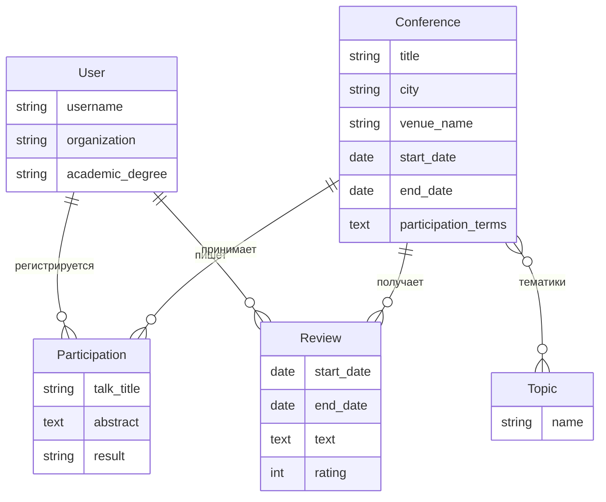

Ключевые ограничения:

```python
class Participation(models.Model):
    class Result(models.TextChoices):
        PENDING = "pending", "Не рассмотрено"
        RECOMMENDED = "recommended", "Рекомендован к публикации"
        NOT_RECOMMENDED = "not_recommended", "Не рекомендован к публикации"
    ...
    class Meta:
        constraints = [
            models.UniqueConstraint(fields=["conference", "user"], name="unique_participation_per_user")
        ]


class Review(models.Model):
    ...
    rating = models.PositiveSmallIntegerField("Рейтинг", validators=RATING_VALIDATORS)
```

## Интерфейсы

| URL | Что делает | Кто |
| --- | --- | --- |
| `/` | список конференций: поиск, фильтры, сортировка, пагинация по 5 | все |
| `/conferences/<id>/` | описание, средний рейтинг, отзывы с пагинацией, кнопка регистрации | все |
| `/conferences/<id>/register/` | регистрация автора с докладом | авторизованный пользователь |
| `/participations/` | мои регистрации | авторизованный пользователь |
| `/participations/<id>/edit/`, `/participations/<id>/delete/` | изменить или удалить свою регистрацию | её владелец |
| `/conferences/<id>/review/` | оставить отзыв | авторизованный пользователь |
| `/reviews/<id>/delete/` | удалить отзыв | автор отзыва или администратор |
| `/participants/` | таблицы участников по конференциям: поиск, фильтры, пагинация по 3 конференции | все |
| `/participations/<id>/result/` | указать результат выступления | администратор |
| `/conferences/new/`, `/conferences/<id>/edit/`, `/conferences/<id>/delete/` | создание, правка и удаление конференций | администратор |
| `/register/`, `/login/` | регистрация, вход | все |
| `/logout/` | выход | авторизованный пользователь |

## Соответствие заданию

| Требование варианта 5 | Где реализовано |
| --- | --- |
| Хранить название, тематики, место, период, описания конференции и места, условия участия | `Conference`, `Topic` |
| Регистрация | `RegisterView`, `User(AbstractUser)` |
| Просмотр конференций | `ConferenceListView`, `ConferenceDetailView` |
| Регистрация авторов, редактирование и удаление регистраций | `ParticipationCreateView`, `ParticipationUpdateView`, `ParticipationDeleteView` без ограничений по статусу |
| Отзывы с датами, текстом, рейтингом 1–10 и данными автора | `Review`; в отзыве показаны ФИО, организация и учёная степень автора |
| Результат выступления указывает администратор через Django-admin | `ParticipationAdmin` (`list_editable = ("result",)`), а также форма в клиентской части |
| Таблица всех участников по конференциям | `ParticipantsView`: у каждой конференции своя таблица |
| Стилизация | Bootstrap 5 |
| Права администратора в клиентской части | `is_staff` в шаблонах и `StaffRequiredMixin` в представлениях |
| Пагинация, фильтрация, поиск | список конференций и таблицы участников |

Ограничений сверх задания нет: автор может изменять и удалять свою регистрацию в любом статусе, отзывы оставляются без ограничений. Результат при правке автором не меняется: его ставит только администратор.

## Структура кода

Код разделён на слои, чтобы логику, защиту и проверки можно было менять и тестировать отдельно.

| Модуль | За что отвечает |
| --- | --- |
| `models.py` | поля, связи, ограничения БД |
| `validators.py` | **защита данных**: порядок дат, рейтинг 1–10 |
| `permissions.py` | **защита доступа**: `is_admin`, `StaffRequiredMixin`, `OwnerOnlyMixin`, `reviews_manageable_by` |
| `services.py` | **логика**: поиск, сортировка, регистрация автора, группировка участников |
| `forms.py` | формы сайта и формы-фильтры, которые проверяют параметры адресной строки |
| `views.py` | тонкий слой: параметры запроса, вызов `services`, проверка прав, ответ шаблона |
| `tests/` | тесты по слоям (см. раздел «Тесты») |

Представление остаётся на несколько строк, логику проверяют без HTTP и шаблонов, а правила доступа лежат в одном месте.

## Поиск, фильтры, сортировка, пагинация

- **Список конференций.** Поиск `q` по названию, описанию, месту и тематикам; фильтры по тематике, городу и диапазону дат; сортировка по дате (в обе стороны), названию, рейтингу и числу докладов. Конференции без оценок при сортировке по рейтингу идут в конце (`NULLS LAST`).
- **Таблицы участников.** Поиск по ФИО, организации и названию доклада; фильтры по конференции и результату. Пагинация идёт по конференциям, а не по строкам, поэтому таблица одной конференции не делится на две страницы.
- **Ссылки пагинации** сохраняют параметры поиска, фильтров и сортировки (`querystring_without_page`), иначе на следующей странице фильтр пропал бы.

Параметры адресной строки приходят от пользователя, поэтому их проверяет форма-фильтр. Всё некорректное (`?date_from=abc`, несуществующая тематика, чужое значение `sort`) молча выпадает из `cleaned_data`, и страница открывается без этого фильтра:

```python
# forms.py
class ConferenceFilter(forms.Form):
    q = forms.CharField(required=False)
    topic = forms.ModelChoiceField(Topic.objects.all(), required=False)
    city = forms.CharField(required=False)
    date_from = forms.DateField(required=False)
    date_to = forms.DateField(required=False)
    sort = forms.ChoiceField(choices=[(key, label) for key, (label, _) in SORT_OPTIONS.items()], required=False)
```

Сервис получает уже проверенные значения. Сортировка выбирается по белому списку, а условия фильтров собираются по таблице:

```python
# services.py
SORT_OPTIONS = {
    "date": ("Сначала ближайшие", ("start_date", "title")),
    "-date": ("Сначала поздние", ("-start_date", "title")),
    "title": ("По названию", ("title",)),
    "rating": ("По рейтингу", (F("avg_rating").desc(nulls_last=True), "title")),
    "participants": ("По числу докладов", ("-participants_count", "title")),
}
CONFERENCE_LOOKUPS = {
    "topic": "topics",
    "city": "city__iexact",
    "date_from": "end_date__gte",
    "date_to": "start_date__lte",
}


def search_conferences(filters):
    qs = Conference.objects.prefetch_related("topics").annotate(
        avg_rating=Avg("reviews__rating"), participants_count=Count("participations", distinct=True)
    )
    q = filters.get("q")
    if q:
        qs = qs.filter(
            Q(title__icontains=q) | Q(description__icontains=q)
            | Q(venue_name__icontains=q) | Q(topics__name__icontains=q)
        ).distinct()
    for name, lookup in CONFERENCE_LOOKUPS.items():
        if filters.get(name):
            qs = qs.filter(**{lookup: filters[name]})
    return qs.order_by(*SORT_OPTIONS[filters.get("sort") or DEFAULT_SORT][1])
```

Таблицы по конференциям: сначала выбираются конференции, у которых есть подходящие участники. Затем список разбивается на страницы, и участников одним запросом подгружают только для конференций текущей страницы:

```python
def conferences_with_participants(participations):
    return Conference.objects.filter(pk__in=participations.values("conference_id")).order_by("start_date", "title")


def group_by_conference(conferences, participations):
    rows = {conference.pk: [] for conference in conferences}
    ordered = participations.filter(conference__in=list(conferences)).select_related("user").order_by(
        "user__last_name", "user__username"
    )
    for participation in ordered:
        rows[participation.conference_id].append(participation)
    return [(conference, rows[conference.pk]) for conference in conferences]
```

## Защита

**Данные** (`validators.py`). Проверки описаны в одном месте и срабатывают как в формах, так и при `full_clean()` моделей:

```python
RATING_MIN = 1
RATING_MAX = 10
RATING_VALIDATORS = [MinValueValidator(RATING_MIN), MaxValueValidator(RATING_MAX)]


def validate_date_range(start, end):
    if start and end and end < start:
        raise ValidationError({"end_date": "Дата окончания не может быть раньше начала."})
```

Дубль регистрации не создаётся ни при повторной отправке формы, ни при одновременных запросах: `register_author` использует `get_or_create`, а в БД стоит `UniqueConstraint(conference, user)`.

**Доступ** (`permissions.py`). Скрыть кнопку в шаблоне недостаточно: адрес можно открыть вручную. Поэтому шаблон лишь убирает лишнее из интерфейса, а доступ закрывает представление:

```python
def is_admin(user):
    return user.is_authenticated and user.is_staff


class StaffRequiredMixin(UserPassesTestMixin):
    def test_func(self):
        return is_admin(self.request.user)


class OwnerOnlyMixin(LoginRequiredMixin):
    owner_field = "user"

    def get_queryset(self):
        return super().get_queryset().filter(**{self.owner_field: self.request.user})
```

- Неавторизованного пользователя закрытая страница перенаправляет на вход, обычный пользователь на страницах администратора получает 403.
- Чужие регистрации дают 404, а не 403, чтобы не раскрывать, что такая запись существует.
- Отзыв удаляет его автор или администратор (`reviews_manageable_by`).
- Результат выступления администратор может поставить и в Django-admin.

## Jinja2

В `TEMPLATES` два движка: `DjangoTemplates` для Django-admin и `Jinja2` для сайта. Шаблоны лежат в `conferences/jinja2/conferences/`. `csrf_input`, `request`, `user` и `messages` подставляют сам бэкенд и контекстные процессоры, а окружение добавляет функцию `url` и фильтр `date`:

```python
def environment(**options):
    env = Environment(**options)
    env.globals["url"] = reverse
    env.filters["date"] = lambda value: value.strftime("%d.%m.%Y")
    return env
```

## Ключевые представления

Представления тонкие: проверяют параметры формой, вызывают `services` и подключают права из `permissions`. Фрагменты сокращены.

```python
class FilteredListView(ListView):
    filter_form = None

    def get_queryset(self):
        form = self.filter_form(self.request.GET)
        form.is_valid()  # ошибочные параметры отбрасываются, остальные остаются в cleaned_data
        return self.apply_filters(form.cleaned_data)
    ...


class ConferenceListView(FilteredListView):
    paginate_by = 5
    filter_form = ConferenceFilter

    def apply_filters(self, filters):
        return services.search_conferences(filters)


class ParticipantsView(FilteredListView):
    paginate_by = 3
    filter_form = ParticipantFilter

    def apply_filters(self, filters):
        self.participations = services.filter_participations(filters)
        return services.conferences_with_participants(self.participations)

    def get_context_data(self, **kwargs):
        ctx = super().get_context_data(**kwargs)
        ctx["groups"] = services.group_by_conference(ctx["page_obj"].object_list, self.participations)
        ...
```

Регистрация автора, правка своей регистрации и результат выступления:

```python
class ParticipationCreateView(ForConferenceMixin, CreateView):
    ...
    def form_valid(self, form):
        _, created = services.register_author(self.conference, self.request.user, **form.cleaned_data)
        if created:
            messages.success(self.request, "Вы зарегистрированы как автор доклада.")
        else:
            messages.info(self.request, "Вы уже зарегистрированы на эту конференцию.")
        return redirect("my-participations")


class ParticipationUpdateView(OwnerOnlyMixin, UpdateView):
    model = Participation
    form_class = ParticipationForm


class ParticipationResultView(StaffRequiredMixin, UpdateView):
    model = Participation
    form_class = ResultForm
```

## Ключевые шаблоны (Jinja2)

Меню в `base.html`: пункты администратора показываются по `user.is_staff`:

```jinja

<li class="nav-item"><a class="nav-link text-nowrap" href="{{ url('my-participations') }}">Мои регистрации</a></li>


<li class="nav-item"><a class="nav-link text-nowrap" href="{{ url('conference-create') }}">+ Конференция</a></li>
<li class="nav-item"><a class="nav-link text-nowrap" href="{{ url('admin:index') }}">Админка</a></li>

```

Макрос пагинации из `macros.html` (упрощённо). Параметр `query` переносит фильтры на другие страницы:

```jinja

  
  
  <ul class="pagination justify-content-center">
    
    <li class="page-item {{ 'active' if num == page_obj.number }}">
      <a class="page-link" href="{{ base }}page={{ num }}">{{ num }}</a>
    </li>
    
  </ul>
  

```

Таблицы участников (упрощённо): цикл по конференциям, у каждой своя таблица. Столбец с кнопкой «Результат» виден только администратору:

```jinja

<div class="card mb-4">
  <div class="card-header">
    <a href="{{ conference.get_absolute_url() }}">{{ conference.title }}</a>
    <span>участников: {{ rows|length }}</span>
  </div>
  <table class="table">
    <tr><th>Участник</th><th>Организация</th><th>Доклад</th><th>Результат</th><th></th></tr>
    
    <tr>
      <td>{{ p.user }}</td>
      <td>{{ p.user.organization }}</td>
      <td>{{ p.talk_title }}</td>
      <td>{{ result_badge(p) }}</td>
      
      <td><a href="{{ url('participation-result', args=[p.pk]) }}">Результат</a></td>
      
    </tr>
    
  </table>
</div>

<div class="alert alert-info">Участников не найдено.</div>

```

## Скриншоты

Список конференций: поиск «конференция» и фильтр по городу «Санкт-Петербург»:

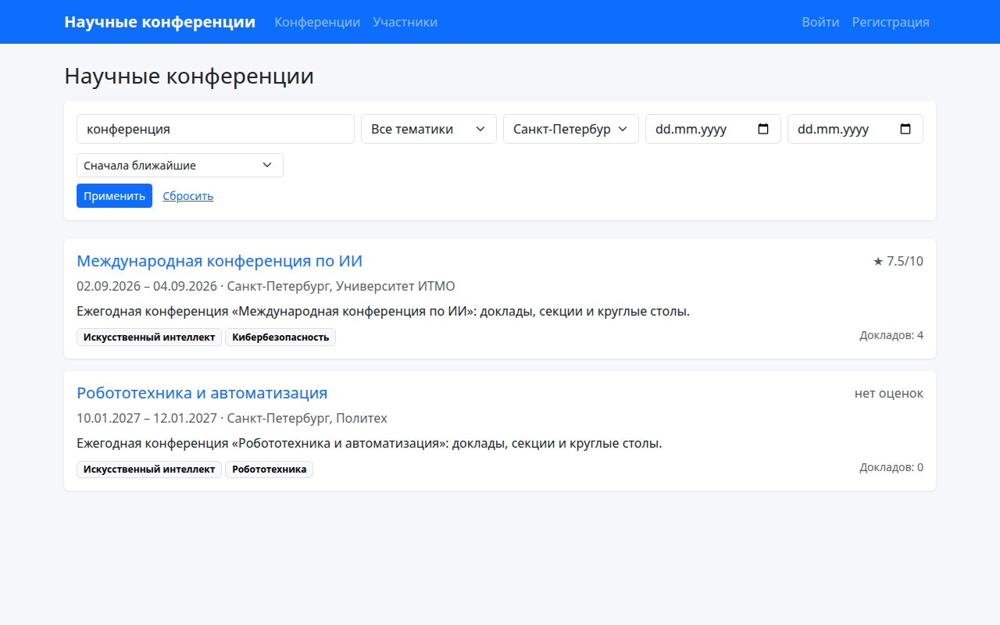

Сортировка по рейтингу (конференции без оценок в конце):

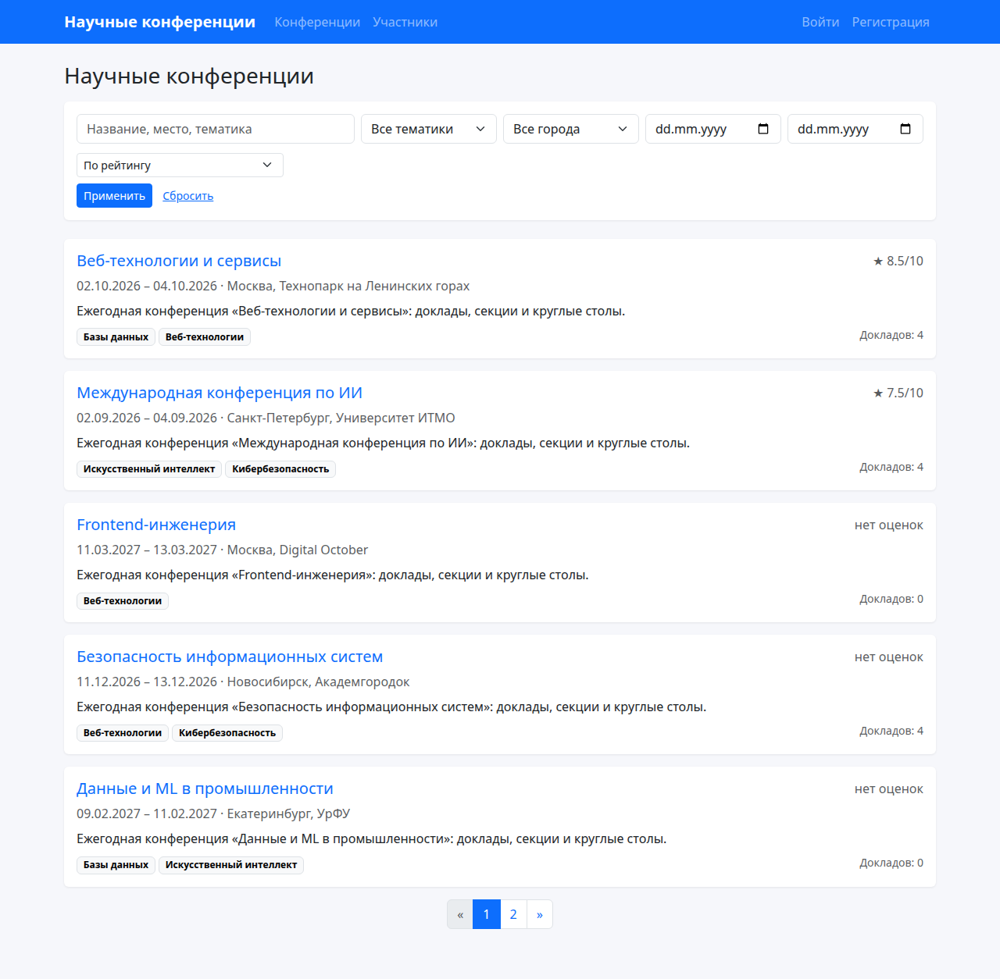

Вторая страница пагинации:

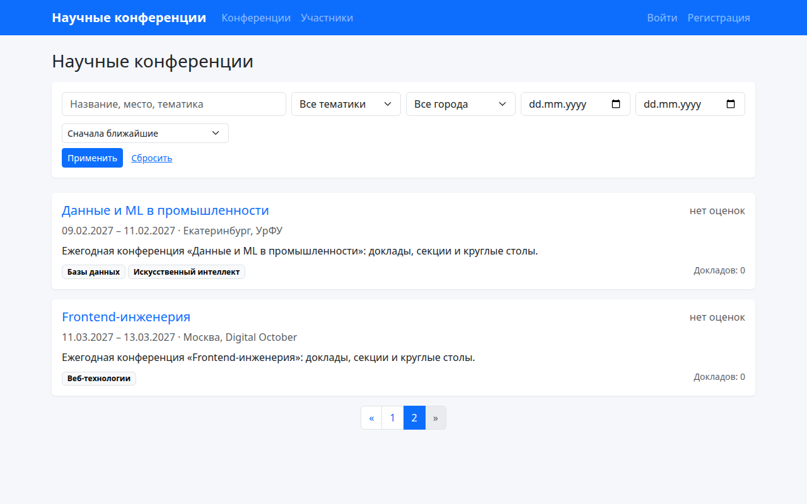

Страница конференции у обычного пользователя (кнопок администратора нет):

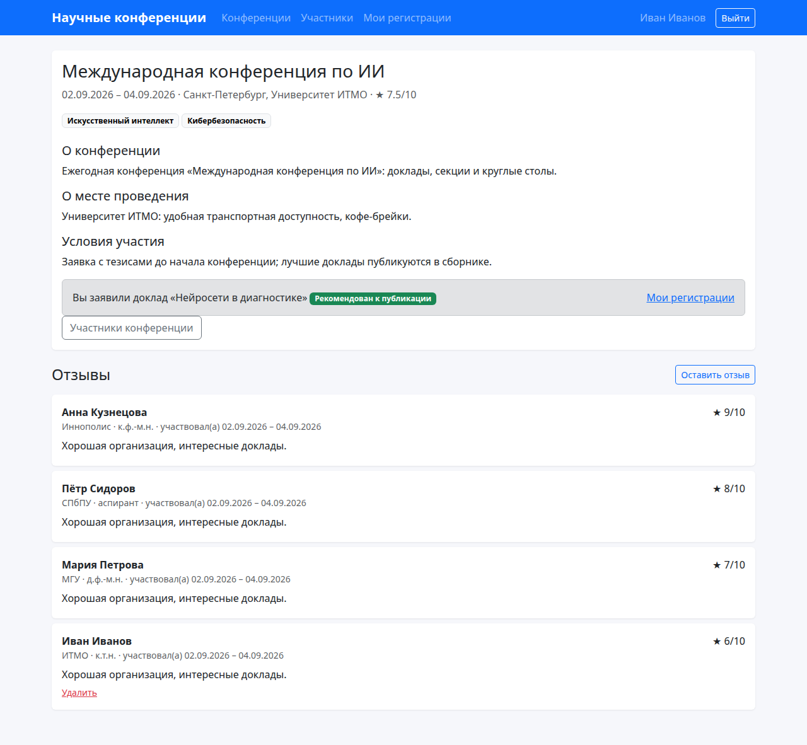

Страница той же конференции у администратора (есть «Изменить» и «Удалить»):

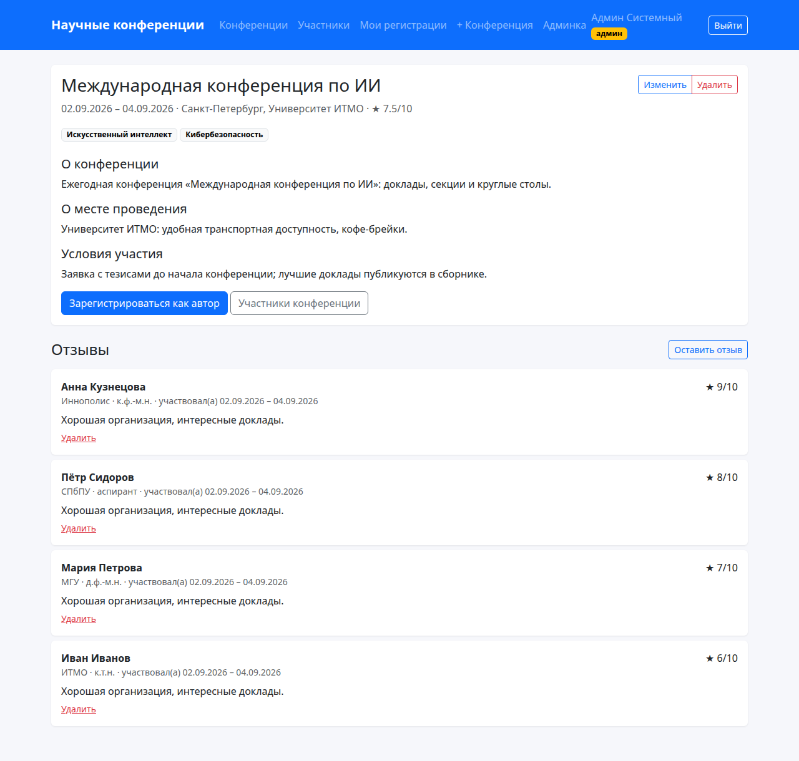

Регистрация автора на конференцию и результат в списке «Мои регистрации»:

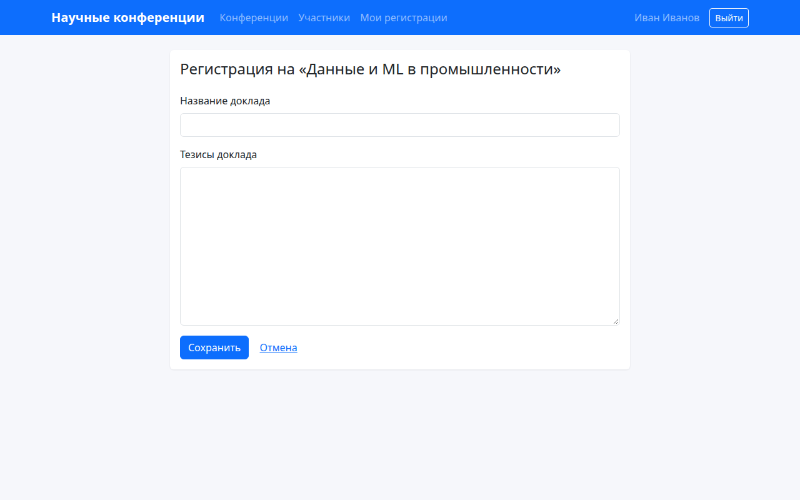

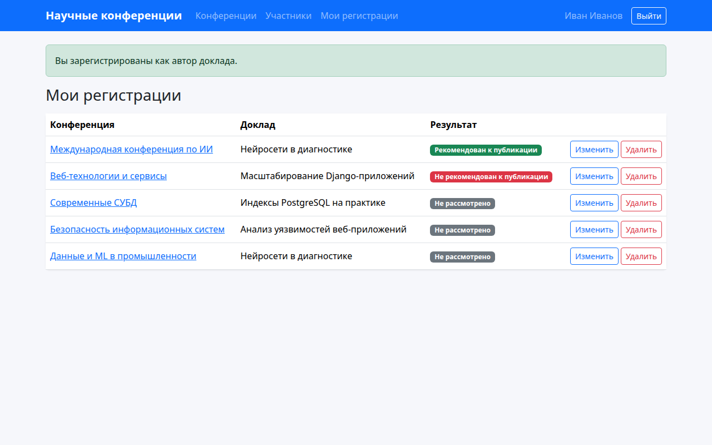

Таблицы участников: у каждой конференции своя таблица, пагинация идёт по конференциям:

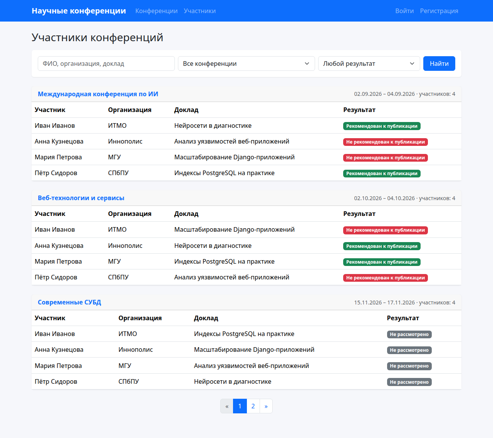

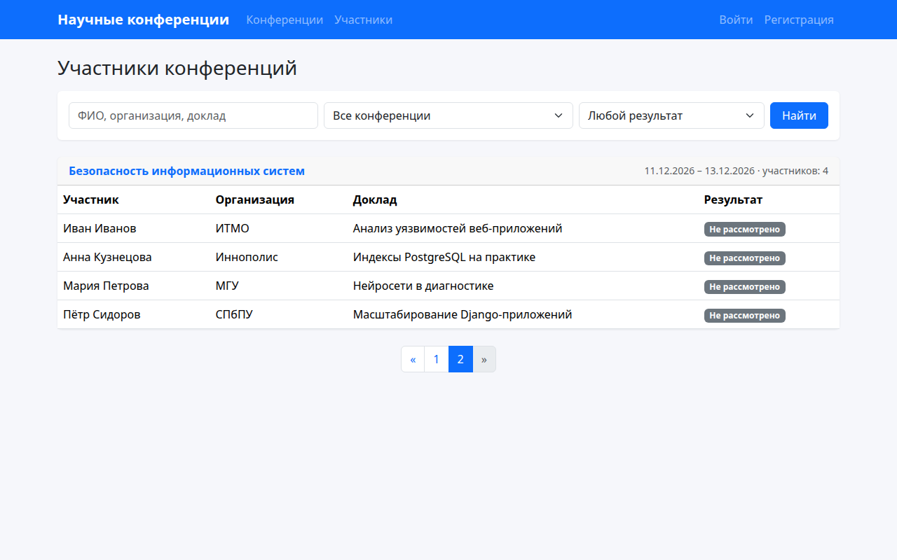

Те же таблицы у администратора: появляется столбец с кнопкой «Результат»:

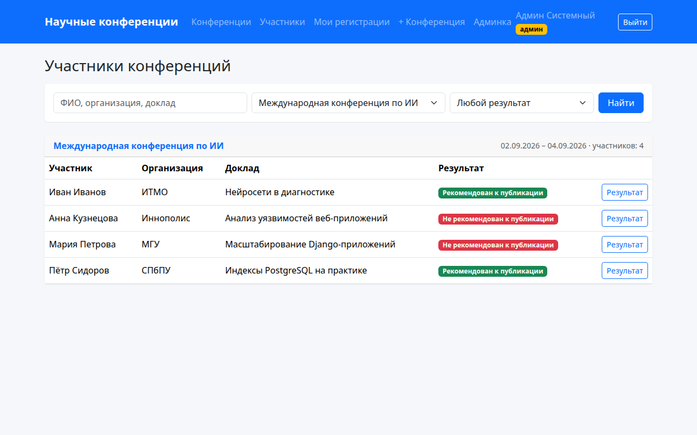

Форма отзыва с рейтингом 1–10 и форма регистрации пользователя:

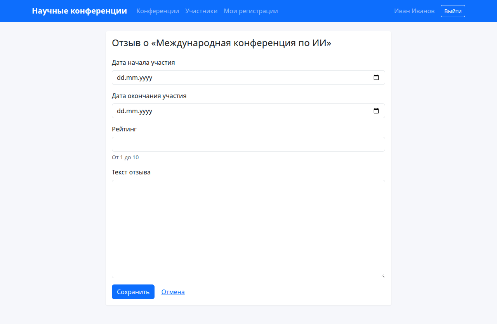

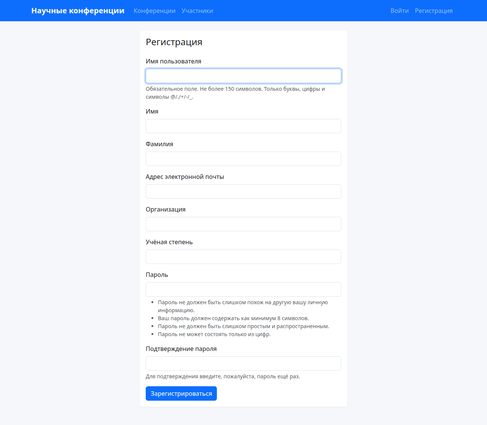

Создание конференции администратором и Django-admin (результат выступления редактируется прямо в списке):

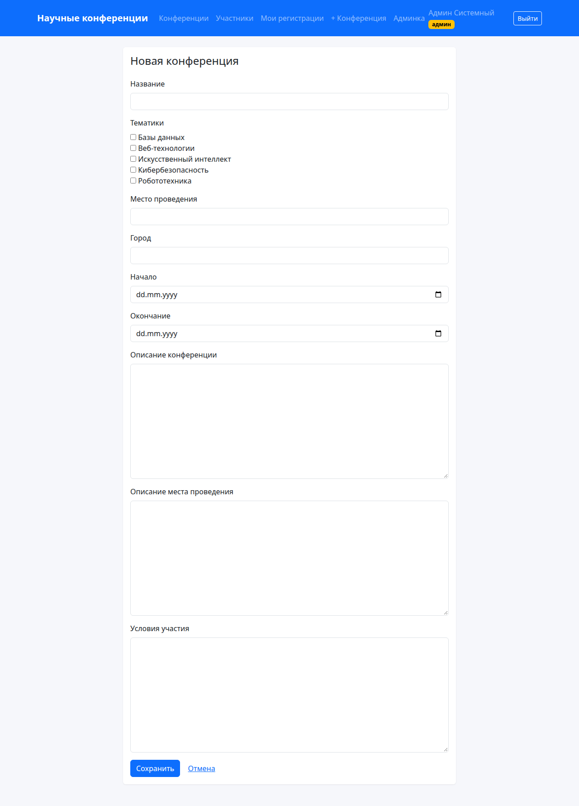

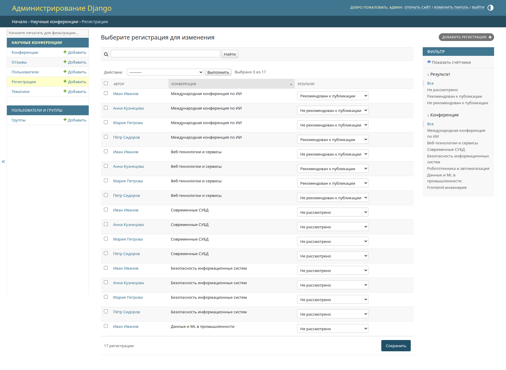

## Тесты

64 теста в пакете `conferences/tests/`, разложенные по слоям:

| Файл | Что проверяет | Тестов |
| --- | --- | --- |
| `test_validators.py` | защита данных: порядок дат, рейтинг 1–10 (границы включены), проверки в моделях | 8 |
| `test_services.py` | логика: поиск, фильтры, сортировка, мусорные параметры, регистрация без дубля, группировка участников | 17 |
| `test_permissions.py` | защита доступа: неавторизованный, обычный пользователь и администратор на закрытых страницах; чужие регистрации и отзывы | 12 |
| `test_views.py` | страницы целиком: отрисовка, пагинация, регистрация, сценарии автора и администратора, таблицы по конференциям, отзывы, мусорные параметры | 25 |
| `test_seed.py` | демо-данные: повторный запуск ничего не дублирует, отзывы только у прошедших конференций | 2 |

Общие фабрики (`make_conference`, `make_participation`, `make_review`) и базовый класс лежат в `tests/base.py`. Запуск: `python manage.py test` (весь набор) или, например, `python manage.py test conferences.tests.test_services` (один слой). Тесты работают на PostgreSQL; тот же набор проходит и на Django 3.2.

## Вывод

Реализован сайт научных конференций на Django с Jinja2 и PostgreSQL. Есть регистрация и вход, просмотр конференций с поиском, фильтрами, сортировкой и пагинацией, регистрация авторов с правкой и удалением своих заявок, отзывы с рейтингом 1–10 и таблицы участников по конференциям. Администратор в клиентской части создаёт и правит конференции и указывает результат выступления. Кнопки администратора показываются по `is_staff` в шаблонах, а доступ проверяется в представлениях. Код разделён на слои (модели, проверки, права, логика, представления), секреты вынесены в `.env`, поведение подтверждено 64 тестами по слоям.

## Источники

- [Задание ЛР2](https://rendex85.github.io/ITMO_ICT_WebDevelopment_Docs/lab2/assignment/)
- [Практика 2.1](https://rendex85.github.io/ITMO_ICT_WebDevelopment_Docs/lab2/practice1/), [2.2](https://rendex85.github.io/ITMO_ICT_WebDevelopment_Docs/lab2/practice2/), [2.3](https://rendex85.github.io/ITMO_ICT_WebDevelopment_Docs/lab2/practice3/)
- [Django: шаблонизаторы, в том числе Jinja2](https://docs.djangoproject.com/en/5.2/topics/templates/)
- [Django: class-based views](https://docs.djangoproject.com/en/5.2/topics/class-based-views/)
- [Django: миксины доступа](https://docs.djangoproject.com/en/5.2/topics/auth/default/#the-loginrequired-mixin)
- [Django: пагинация](https://docs.djangoproject.com/en/5.2/topics/pagination/)
- [Django: расширение модели пользователя](https://docs.djangoproject.com/en/5.2/topics/auth/customizing/)
