# Практики 2.1–2.3 — Django: автовладельцы

## Цель работы

Познакомиться с Django: описать модели и связи, работать с админ-панелью, написать представления на функциях и на классах, подключить шаблоны и формы, расширить модель пользователя.

Проект `django_project_murashov`, приложение `project_first_app`. СУБД — SQLite, как в практике: для учебного проекта не нужен отдельный сервер, а файл `db.sqlite3` лежит в `.gitignore`.

## Как устроен запрос

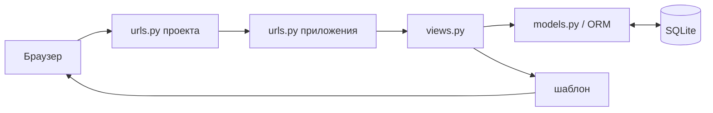

Проектный `urls.py` через `include()` передаёт запрос в `urls.py` приложения, оттуда он попадает в представление. Представление берёт данные через ORM и отдаёт их в шаблон. Такое разделение (MVT) позволяет менять шаблон, не трогая логику.

## Запуск

```bash
cp .env.example .env         # необязательно: задать DJANGO_SECRET_KEY
pip install -r requirements.txt
python manage.py migrate
python manage.py seed        # 2 владельца, 4 автомобиля; пароли из .env или случайные (печатаются)
python manage.py runserver
python manage.py test        # 8 тестов
```

Секретный ключ и пароли демо-пользователей берутся из `.env`, который лежит в `.gitignore`. Без `.env` ключ генерируется случайно, а пароли `seed` печатает при создании пользователей. Так в коде и истории git нет паролей.

## Практика 2.1 — модели, админка, первое представление

Модели по схеме из задания (рисунок 2 практики 2.1), имена латиницей:

| Таблица | Поля |
| --- | --- |
| `CarOwner` | `last_name`, `first_name` (из `AbstractUser`), `birth_date` |
| `Car` | `state_number` (15), `brand` (20), `model` (20), `color` (30, необязательно) |
| `Ownership` | `owner` → `CarOwner`, `car` → `Car`, `start_date`, `end_date` (необязательно) |
| `DriverLicense` | `owner` → `CarOwner`, `license_number` (10), `type` (10), `issue_date` |

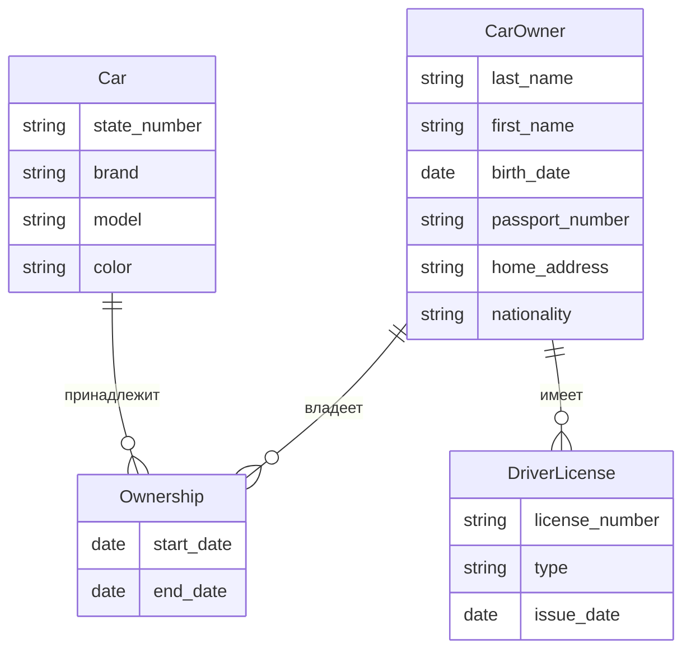

- Связь автомобилей и владельцев «многие ко многим» идёт через `Ownership` (`ManyToManyField(through=...)`), потому что у владения есть даты:

```python
class Car(models.Model):
    ...
    owners = models.ManyToManyField(
        settings.AUTH_USER_MODEL, through="Ownership", related_name="cars", verbose_name="Владельцы"
    )


class Ownership(models.Model):
    owner = models.ForeignKey(
        settings.AUTH_USER_MODEL, on_delete=models.CASCADE, related_name="ownerships", verbose_name="Владелец"
    )
    car = models.ForeignKey(Car, on_delete=models.CASCADE, related_name="ownerships", verbose_name="Автомобиль")
    start_date = models.DateField("Дата начала")
    end_date = models.DateField("Дата окончания", null=True, blank=True)
```

- Все модели зарегистрированы в `admin.py`. Админка — самый быстрый способ ввести данные и проверить, что связи между моделями работают, ещё до того, как написаны формы.
- Команда `seed` создаёт двух владельцев и четыре автомобиля. У каждого владельца не меньше трёх автомобилей, а периоды владения одним автомобилем не пересекаются (проверено тестом).
- Представление `owner_detail` (FBV) и шаблон `owner.html`, маршрут `owner/<int:owner_id>/`. Владелец с `id=1` — первый созданный (админ создаётся после владельцев).

Представление, маршрут и шаблон:

```python
# views.py
def owner_detail(request, owner_id):
    owner = get_object_or_404(CarOwner, pk=owner_id)
    ownerships = owner.ownerships.select_related("car")
    return render(request, "owner.html", {"owner": owner, "ownerships": ownerships, "licenses": owner.licenses.all()})

# urls.py
path("owner/<int:owner_id>/", views.owner_detail, name="owner_detail"),
```

```django
{# templates/owner.html #}


<h1>{{ owner.last_name }} {{ owner.first_name }}</h1>
<table>
  <tr><th>Автомобиль</th><th>С</th><th>По</th></tr>
  
  <tr>
    <td><a href="">{{ o.car }}</a></td>
    <td>{{ o.start_date }}</td>
    <td>{{ o.end_date|default:"по настоящее время" }}</td>
  </tr>
  
  <tr><td colspan="3">Нет автомобилей.</td></tr>
  
</table>

```

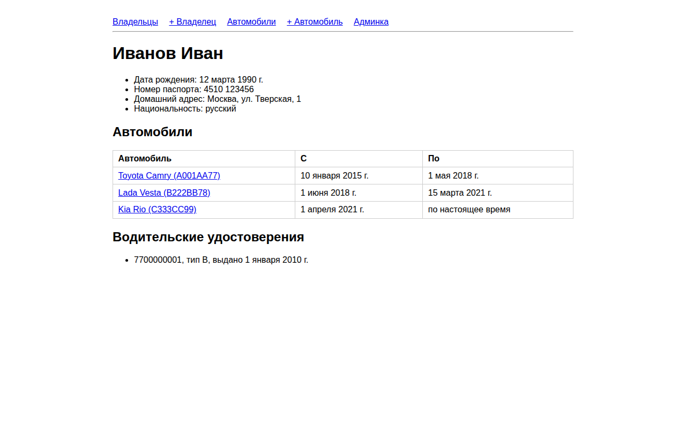

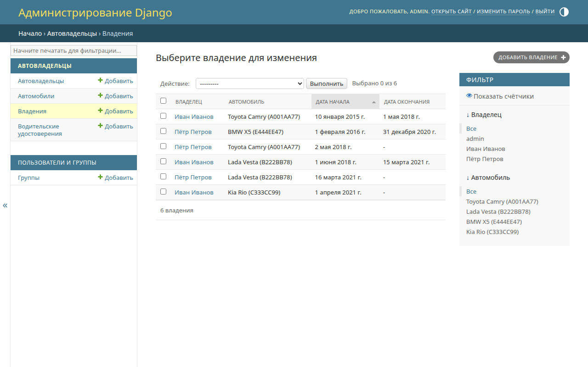

## Практика 2.2 — представления и шаблоны

- FBV: `owner_list` — все владельцы (`/owners/`).
- CBV: `CarListView` (`/cars/`, фильтр по марке `?brand=`), `CarDetailView` (`/cars/<pk>/`, история владения), `CarUpdateView` (`/cars/<pk>/update/`).
- Шаблоны наследуются от `base.html`, ссылки строятся через ``.

```python
# views.py
def owner_list(request):
    return render(request, "owners.html", {"owners": CarOwner.objects.order_by("last_name", "username")})


class CarListView(ListView):
    model = Car
    template_name = "car_list.html"
    context_object_name = "cars"

    def get_queryset(self):
        qs = super().get_queryset()
        brand = self.request.GET.get("brand")
        return qs.filter(brand__iexact=brand) if brand else qs


class CarDetailView(DetailView):
    model = Car
    template_name = "car_detail.html"


class CarUpdateView(UpdateView):
    model = Car
    form_class = CarForm
    template_name = "car_form.html"
    success_url = reverse_lazy("car_list")
```

```django
{# templates/car_list.html #}
<form method="get">
  <input name="brand" placeholder="Марка" value="{{ request.GET.brand }}">
  <button>Фильтр</button>
</form>

<tr>
  <td><a href="">{{ car.state_number }}</a></td>
  <td>{{ car.brand }}</td><td>{{ car.model }}</td><td>{{ car.color|default:"—" }}</td>
  <td><a href="">изменить</a> <a href="">удалить</a></td>
</tr>

```

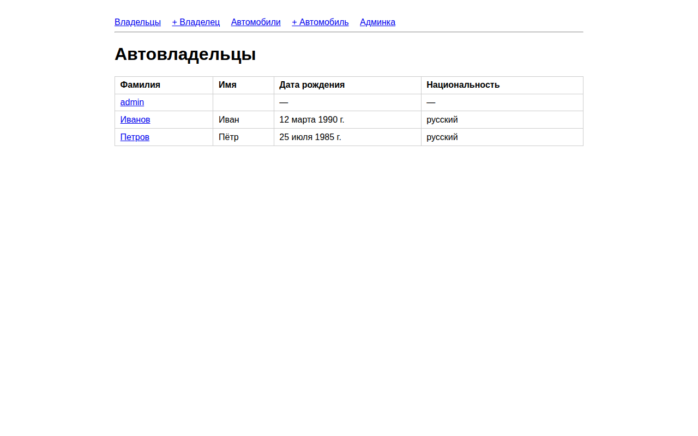

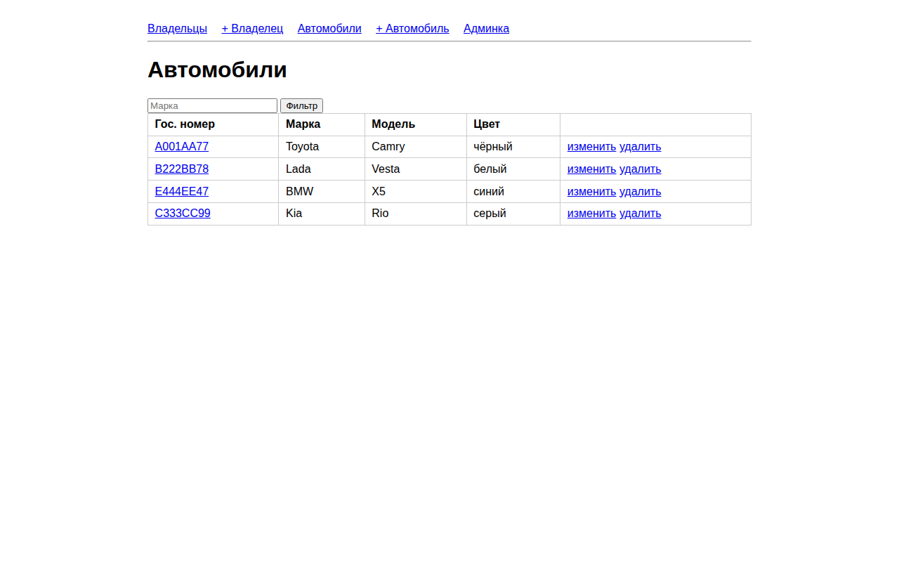

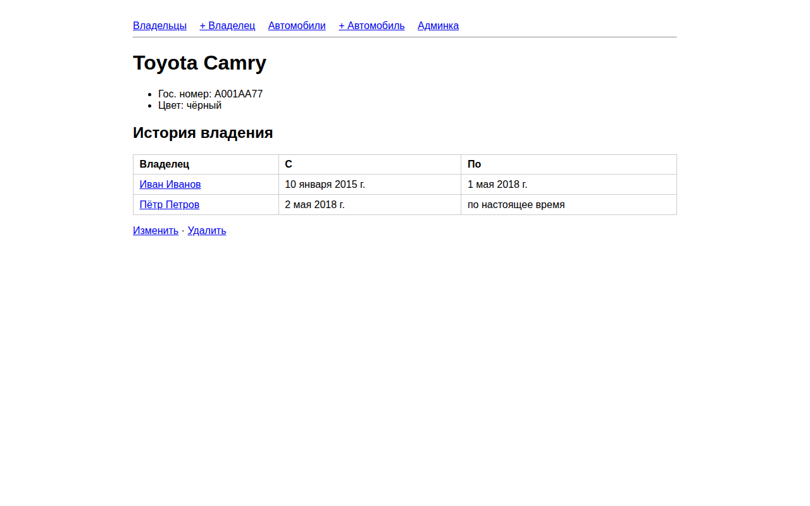

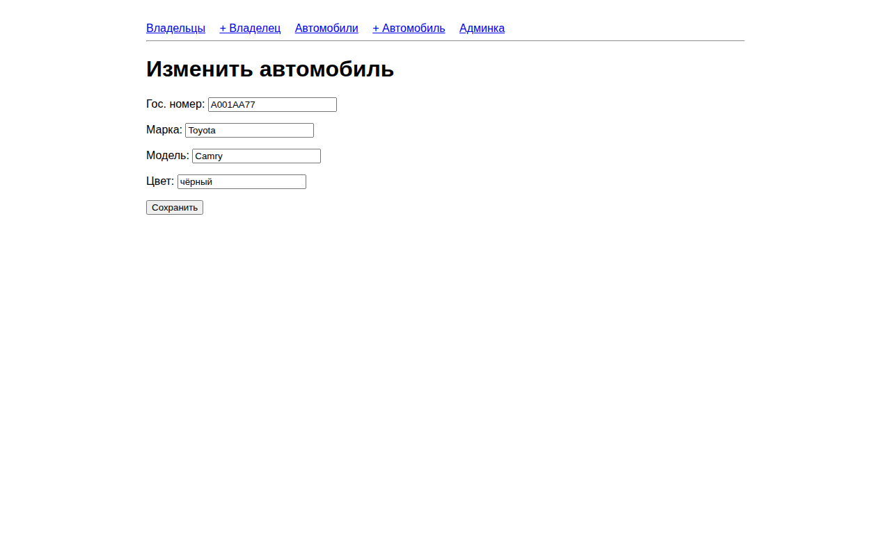

## Практика 2.3 — расширение пользователя и формы

- Почему `AbstractUser`, а не профиль или `AbstractBaseUser`: стандартная аутентификация остаётся, а новые поля лежат в той же таблице, поэтому не нужны лишние запросы и связь `OneToOne`. Модель подменяют до первой миграции, иначе схему БД придётся переделывать.
- `CarOwner(AbstractUser)` — это и есть пользователь (`AUTH_USER_MODEL = 'project_first_app.CarOwner'`). Добавлены поля `passport_number`, `home_address`, `nationality`.
- В Django-admin новые поля вынесены в отдельную группу «Данные автовладельца» (`fieldsets` и `add_fieldsets`).
- Страница владельца выводит новые поля.
- FBV `owner_create` (`/owners/new/`): форма `CarOwnerForm(UserCreationForm)` создаёт пользователя с новыми атрибутами и паролем, после сохранения редирект на страницу владельца.
- CBV `CarCreateView` (`/cars/create/`) и `CarUpdateView` используют форму `CarForm`, а `CarDeleteView` (`/cars/<pk>/delete/`) удаляет автомобиль после подтверждения.

Пользователь с новыми полями, форма создания и представление на функции:

```python
# models.py
class CarOwner(AbstractUser):
    birth_date = models.DateField("Дата рождения", null=True, blank=True)
    passport_number = models.CharField("Номер паспорта", max_length=20, blank=True)
    home_address = models.CharField("Домашний адрес", max_length=200, blank=True)
    nationality = models.CharField("Национальность", max_length=50, blank=True)

# settings.py
AUTH_USER_MODEL = "project_first_app.CarOwner"

# forms.py
class CarOwnerForm(UserCreationForm):
    class Meta(UserCreationForm.Meta):
        model = CarOwner
        fields = ("username", "first_name", "last_name", "birth_date",
                  "passport_number", "home_address", "nationality")

# views.py
def owner_create(request):
    form = CarOwnerForm(request.POST or None)
    if request.method == "POST" and form.is_valid():
        owner = form.save()
        return redirect("owner_detail", owner_id=owner.pk)
    return render(request, "owner_form.html", {"form": form})
```

Создание и удаление автомобиля на классах и админка пользователя с новыми полями:

```python
# views.py
class CarCreateView(CreateView):
    model = Car
    form_class = CarForm
    template_name = "car_form.html"
    success_url = reverse_lazy("car_list")


class CarDeleteView(DeleteView):
    model = Car
    template_name = "car_confirm_delete.html"
    success_url = reverse_lazy("car_list")

# admin.py
_extra = ("Данные автовладельца", {"fields": ("birth_date", "passport_number", "home_address", "nationality")})

@admin.register(CarOwner)
class CarOwnerAdmin(UserAdmin):
    fieldsets = UserAdmin.fieldsets + (_extra,)
    add_fieldsets = UserAdmin.add_fieldsets + (_extra,)
```

```django
{# templates/owner_form.html #}
<form method="post">
  
  {{ form.as_p }}
  <button type="submit">Сохранить</button>
</form>
```

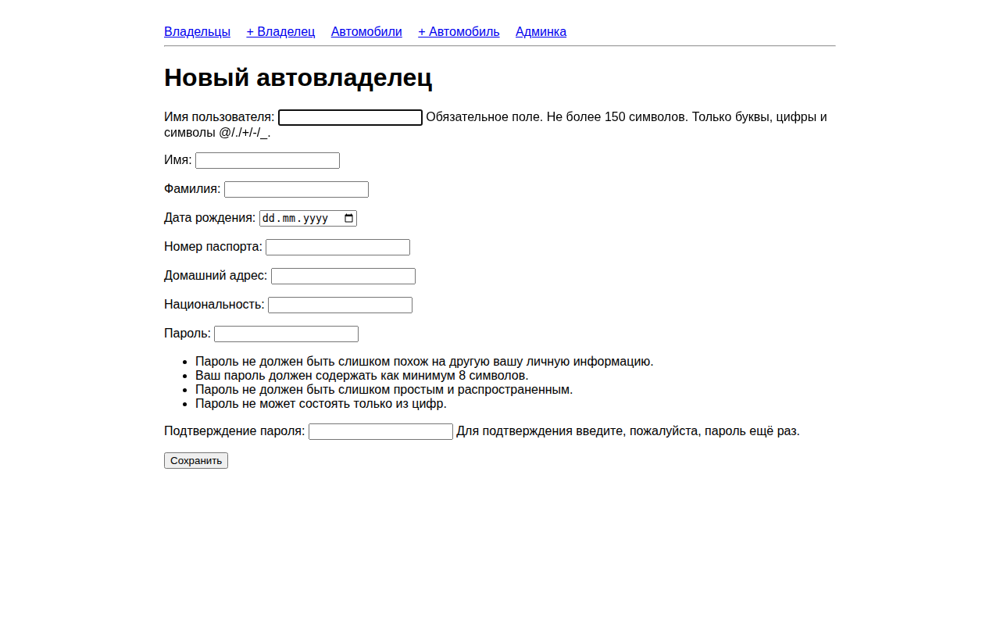

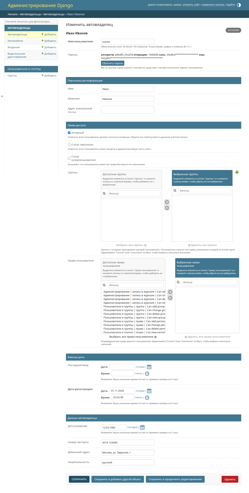

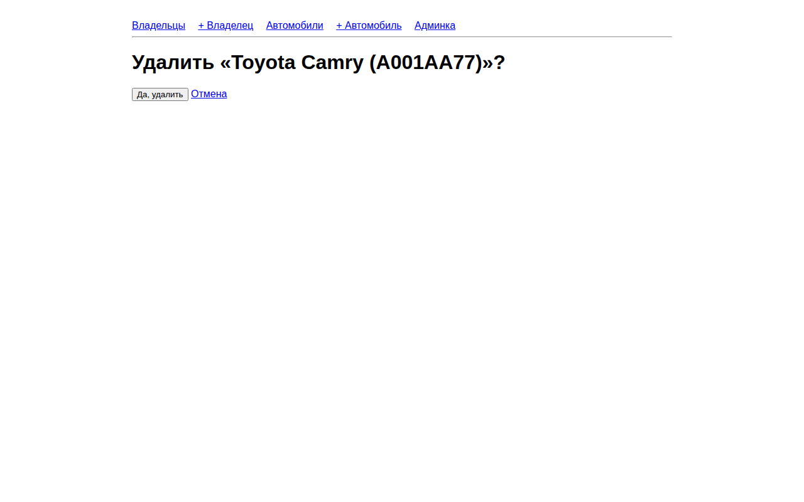

## Вывод

Выполнены практики 2.1–2.3. Описаны модели автовладельцев, автомобилей, владений и водительских удостоверений, связь «многие ко многим» оформлена через промежуточную модель с датами. Написаны представления на функциях и на классах, шаблоны с наследованием, формы создания, изменения и удаления. Пользователь расширен через `AbstractUser`, новые поля видны в админке и на сайте. Работа проверена восемью тестами.

## Источники

- [Практика 2.1](https://rendex85.github.io/ITMO_ICT_WebDevelopment_Docs/lab2/practice1/)
- [Практика 2.2](https://rendex85.github.io/ITMO_ICT_WebDevelopment_Docs/lab2/practice2/)
- [Практика 2.3](https://rendex85.github.io/ITMO_ICT_WebDevelopment_Docs/lab2/practice3/)
- [Django: модели и связи «многие ко многим» с `through`](https://docs.djangoproject.com/en/5.2/topics/db/models/#extra-fields-on-many-to-many-relationships)
- [Django: class-based views](https://docs.djangoproject.com/en/5.2/topics/class-based-views/)
- [Django: подмена модели пользователя](https://docs.djangoproject.com/en/5.2/topics/auth/customizing/#substituting-a-custom-user-model)
