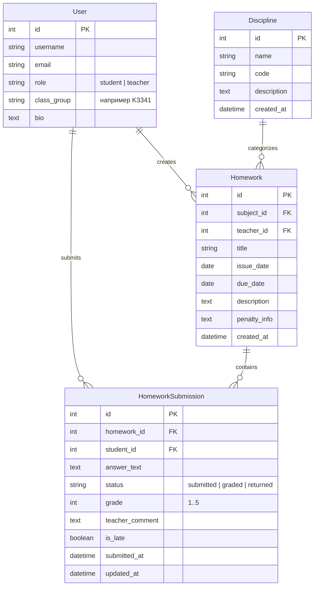

# Лабораторная работа №2: Простой сайт на Django

**Студент:** Тюняев Никита  
**Группа:** K3341  
**Номер в журнале:** 34  
**Вариант:** 2 — «Доска домашних заданий»  

---

## 1. Цель работы и постановка задачи

**Цель:** овладеть практическими навыками и умениями реализации web-сервисов средствами фреймворка Django, освоить паттерн MVC (MVT), систему шаблонизации, работу с реляционной СУБД PostgreSQL/SQLite через Django ORM, авторизацию пользователей и разграничение прав доступа.

### Требования варианта №2 («Доска домашних заданий»)
Сайт представляет собой сервис для организации учебного процесса и сдачи домашних заданий. Сервис хранит и отображает следующую информацию:
- Предмет (дисциплина).
- Преподаватель (автор задания).
- Дата выдачи задания.
- Период выполнения (дедлайн).
- Текст и подробное описание задания.
- Информация о штрафах за несвоевременную сдачу.

**Обязательный и расширенный функционал:**
1. Регистрация и аутентификация пользователей с выбором роли («Студент» или «Преподаватель») на базе расширенной модели пользователя `AbstractUser`.
2. Доска домашних заданий с фильтрацией по учебным дисциплинам, статусу дедлайна (активные / просроченные), полнотекстовым поиском по заголовку и описанию, а также пагинацией с сохранением query-параметров.
3. Просмотр полной информации о задании с динамическим расчетом оставшихся дней и статуса дедлайна.
4. Отправка решений студентами в текстовом виде (с возможностью доработки до выставления оценки и автоопределением сдачи после дедлайна `is_late`).
5. Проверка решений и выставление оценок (от 1 до 5) с текстовым комментарием:
   - Администратором/преподавателем через стандартную панель Django Admin (`list_editable=('grade', 'status')`).
   - Преподавателем напрямую через клиентский веб-интерфейс в карточке задания.
6. Разграничение прав доступа: преподаватель может создавать, редактировать и удалять задания через веб-интерфейс, а также просматривать решения всех студентов; студент видит только свои решения.
7. Электронный журнал класса (Gradebook): сводная матрица успеваемости (студенты $\times$ задания) с расчетом среднего балла каждого учащегося и цветовой индикацией оценок, доступная с фильтром по предмету.
8. Оформление адаптивного интерфейса на Bootstrap 5.3 + Bootstrap Icons.
9. Контейнеризация сервиса с использованием Docker и Docker Compose с PostgreSQL 16.

---

## 2. Архитектура и структура проекта

Проект организован в соответствии со стандартной структурой Django-приложений:

```
laboratory_work_2/
├── django_proj/
│   ├── manage.py
│   ├── requirements.txt
│   ├── Dockerfile
│   ├── docker-compose.yaml
│   ├── docker-entrypoint.sh
│   ├── .env.example
│   ├── config/
│   │   ├── __init__.py
│   │   ├── settings.py      # Настройки проекта (AUTH_USER_MODEL, БД, статика, шаблоны)
│   │   ├── urls.py          # Корневая маршрутизация
│   │   ├── asgi.py
│   │   └── wsgi.py
│   ├── app/
│   │   ├── models.py        # Модели User, Discipline, Homework, HomeworkSubmission
│   │   ├── views.py         # Контроллеры (CBV: ListView, DetailView, CreateView, UpdateView, DeleteView; FBV)
│   │   ├── forms.py         # Django Forms с валидацией и Bootstrap-виджетами
│   │   ├── urls.py          # Маршруты приложения
│   │   ├── admin.py         # Настройка панели администратора
│   │   ├── tests.py         # Автоматизированные тесты
│   │   ├── management/
│   │   │   └── commands/
│   │   │       └── init_data.py # Заполнение начальными демонстрационными данными
│   │   └── templates/       # HTML-шаблоны страниц
│   │       ├── base.html
│   │       ├── homework_list.html
│   │       ├── homework_detail.html
│   │       ├── homework_form.html
│   │       ├── homework_confirm_delete.html
│   │       ├── gradebook.html
│   │       ├── register.html
│   │       ├── login.html
│   │       └── profile.html
│   └── static/
│       └── css/
│           └── style.css    # Пользовательские стили оформления
└── report/
    └── webdocs/             # MkDocs документация
        ├── mkdocs.yml
        └── docs/
            ├── index.md
            ├── about.md
            └── labs/
                └── lab2/
                    └── lab2.md
```

---

## 3. Модели данных (ORM)

Диаграмма связей сущностей предметной области:



### Исходный код моделей (`app/models.py`)

```python
from django.db import models
from django.contrib.auth.models import AbstractUser
from django.utils import timezone
from django.core.validators import MinValueValidator, MaxValueValidator


class User(AbstractUser):
    ROLE_STUDENT = 'student'
    ROLE_TEACHER = 'teacher'
    ROLE_CHOICES = [
        (ROLE_STUDENT, 'Студент'),
        (ROLE_TEACHER, 'Преподаватель'),
    ]

    role = models.CharField(
        max_length=20,
        choices=ROLE_CHOICES,
        default=ROLE_STUDENT,
        verbose_name='Роль'
    )
    class_group = models.CharField(
        max_length=50,
        blank=True,
        default='K3341',
        verbose_name='Учебная группа / Класс'
    )
    bio = models.TextField(blank=True, verbose_name='О себе')

    class Meta:
        verbose_name = 'Пользователь'
        verbose_name_plural = 'Пользователи'

    @property
    def is_teacher_user(self):
        return self.role == self.ROLE_TEACHER or self.is_staff or self.is_superuser

    @property
    def is_student_user(self):
        return self.role == self.ROLE_STUDENT and not self.is_staff and not self.is_superuser


class Discipline(models.Model):
    name = models.CharField(max_length=150, unique=True, verbose_name='Название дисциплины')
    code = models.CharField(max_length=30, blank=True, verbose_name='Код дисциплины')
    description = models.TextField(blank=True, verbose_name='Описание')
    created_at = models.DateTimeField(auto_now_add=True, verbose_name='Создана')

    class Meta:
        verbose_name = 'Дисциплина'
        verbose_name_plural = 'Дисциплины'
        ordering = ['name']

    def __str__(self):
        return self.name


class Homework(models.Model):
    subject = models.ForeignKey(
        Discipline,
        on_delete=models.CASCADE,
        related_name='homeworks',
        verbose_name='Предмет'
    )
    teacher = models.ForeignKey(
        User,
        on_delete=models.CASCADE,
        related_name='created_homeworks',
        verbose_name='Преподаватель'
    )
    title = models.CharField(max_length=255, verbose_name='Тема задания')
    issue_date = models.DateField(default=timezone.now, verbose_name='Дата выдачи')
    due_date = models.DateField(verbose_name='Срок сдачи (дедлайн)')
    description = models.TextField(verbose_name='Текст задания')
    penalty_info = models.TextField(
        blank=True,
        default='При опоздании максимальный балл снижается на 1 оценку за каждые 3 дня задержки.',
        verbose_name='Информация о штрафах'
    )
    created_at = models.DateTimeField(auto_now_add=True, verbose_name='Дата публикации')

    class Meta:
        verbose_name = 'Домашнее задание'
        verbose_name_plural = 'Домашние задания'
        ordering = ['due_date', '-issue_date']

    def __str__(self):
        return f"{self.subject.name}: {self.title}"

    @property
    def is_past_due(self):
        return timezone.localdate() > self.due_date

    @property
    def days_remaining(self):
        delta = (self.due_date - timezone.localdate()).days
        return delta


class HomeworkSubmission(models.Model):
    STATUS_SUBMITTED = 'submitted'
    STATUS_GRADED = 'graded'
    STATUS_RETURNED = 'returned'

    STATUS_CHOICES = [
        (STATUS_SUBMITTED, 'Сдано на проверку'),
        (STATUS_GRADED, 'Оценено'),
        (STATUS_RETURNED, 'Возвращено на доработку'),
    ]

    homework = models.ForeignKey(
        Homework,
        on_delete=models.CASCADE,
        related_name='submissions',
        verbose_name='Задание'
    )
    student = models.ForeignKey(
        User,
        on_delete=models.CASCADE,
        related_name='submissions',
        verbose_name='Студент'
    )
    answer_text = models.TextField(verbose_name='Текст решения / ответ')
    status = models.CharField(
        max_length=20,
        choices=STATUS_CHOICES,
        default=STATUS_SUBMITTED,
        verbose_name='Статус проверки'
    )
    grade = models.PositiveSmallIntegerField(
        null=True,
        blank=True,
        validators=[MinValueValidator(1), MaxValueValidator(5)],
        verbose_name='Оценка (1-5)'
    )
    teacher_comment = models.TextField(blank=True, verbose_name='Комментарий преподавателя')
    is_late = models.BooleanField(default=False, verbose_name='Сдано с опозданием')
    submitted_at = models.DateTimeField(auto_now_add=True, verbose_name='Время первой сдачи')
    updated_at = models.DateTimeField(auto_now=True, verbose_name='Время обновления')

    class Meta:
        verbose_name = 'Сданная работа'
        verbose_name_plural = 'Сданные работы'
        unique_together = ('homework', 'student')
        ordering = ['-updated_at']

    def save(self, *args, **kwargs):
        if not self.pk and timezone.localdate() > self.homework.due_date:
            self.is_late = True
        super().save(*args, **kwargs)
```

---

## 4. Маршрутизация и представления (Views)

Контроллеры реализованы с использованием как Class-Based Views (CBV) для стандартных CRUD-операций и списков, так и Function-Based Views (FBV) для специфической бизнес-логики:

1. **`HomeworkListView` (ListView):**
   - Вывод списка заданий с пагинацией (`paginate_by = 6`).
   - Фильтрация по дисциплине (`?subject=...`).
   - Фильтрация по статусу дедлайна (`?status=active|expired`).
   - Полнотекстовый поиск (`?q=...`) по названию задания, описанию и имени преподавателя.
   - Для авторизованных студентов карточки заданий автоматически обогащаются статусом сдачи и полученной оценкой.
2. **`HomeworkDetailView` (DetailView):**
   - Полное описание задания, даты, штрафы.
   - Студенту предоставляется форма сдачи решения `HomeworkSubmissionForm`.
   - Преподавателю отображается аккордеон со всеми решениями студентов и модальные формы для выставления оценки и комментария.
3. **`HomeworkCreateView`, `HomeworkUpdateView`, `HomeworkDeleteView`:**
   - CRUD-операции для преподавателей, защищенные миксином `TeacherRequiredMixin`.
4. **`submit_homework` (FBV, `@login_required`):**
   - Обработка POST-запроса на отправку или обновление текста решения студента.
5. **`grade_submission` (FBV, `@login_required`):**
   - Оценивание решения студента преподавателем прямо из веб-интерфейса.
6. **`GradebookView` (TemplateView):**
   - Сводный электронный журнал класса. Формирует матрицу успеваемости, где строки — студенты группы, столбцы — домашние задания, а ячейки — полученные оценки. Для каждого студента рассчитывается средний балл.
7. **Аутентификация и профиль:**
   - `UserRegisterView`, `UserLoginView`, `UserLogoutView`, `UserProfileView`.

### Карта URL (`app/urls.py`)

```python
from django.urls import path
from . import views

urlpatterns = [
    path('', views.HomeworkListView.as_view(), name='homework_list'),
    path('homework/create/', views.HomeworkCreateView.as_view(), name='homework_create'),
    path('homework/<int:pk>/', views.HomeworkDetailView.as_view(), name='homework_detail'),
    path('homework/<int:pk>/edit/', views.HomeworkUpdateView.as_view(), name='homework_edit'),
    path('homework/<int:pk>/delete/', views.HomeworkDeleteView.as_view(), name='homework_delete'),
    path('homework/<int:pk>/submit/', views.submit_homework, name='homework_submit'),
    path('submission/<int:submission_id>/grade/', views.grade_submission, name='grade_submission'),
    path('gradebook/', views.GradebookView.as_view(), name='gradebook'),
    path('register/', views.UserRegisterView.as_view(), name='register'),
    path('login/', views.UserLoginView.as_view(), name='login'),
    path('logout/', views.UserLogoutView.as_view(), name='logout'),
    path('profile/', views.UserProfileView.as_view(), name='profile'),
]
```

---

## 5. Панель администратора Django (`app/admin.py`)

В соответствии с заданием, преподаватели и администраторы могут управлять заданиями и выставлять оценки через панель Django Admin:

- Задания (`HomeworkAdmin`): фильтрация по дисциплине и дедлайну, поиск по теме, встроенное отображение сданных решений через `TabularInline`.
- Сданные работы (`HomeworkSubmissionAdmin`): возможность быстрого выставления оценки (`grade`) и изменения статуса (`status`) прямо из общего списка через параметр `list_editable = ('grade', 'status')`.

```python
@admin.register(HomeworkSubmission)
class HomeworkSubmissionAdmin(admin.ModelAdmin):
    list_display = ('student', 'homework', 'status', 'grade', 'is_late', 'submitted_at', 'updated_at')
    list_filter = ('status', 'grade', 'is_late', 'homework__subject')
    search_fields = ('student__username', 'student__last_name', 'homework__title', 'answer_text')
    list_editable = ('grade', 'status')
    readonly_fields = ('submitted_at', 'updated_at')
```

---

## 6. Пользовательский интерфейс и клиентская логика

Интерфейс оформлен с использованием фреймворка **Bootstrap 5.3**:

1. **Главная страница (Доска заданий):**
   - Верхняя панель фильтрации с формой поиска, выпадающими списками дисциплин и статуса дедлайна.
   - Сетка карточек с бейджами дедлайнов (зеленый — активно, красный — просрочено), информацией о предмете, преподавателе и штрафах.
   - Персональный индикатор для студента: «Не сдано», «Сдано на проверку», «Оценка: 5/5».
   - Навигатор пагинации страниц с сохранением активных параметров фильтрации в ссылках.

2. **Страница задания:**
   - Детальный просмотр требований и штрафов.
   - Интерактивная форма отправки решения для студентов.
   - Таблица решений с модальными окнами оценивания для преподавателя.

3. **Сводная таблица (Журнал класса):**
   - Таблица успеваемости студентов группы (K3341).
   - Подсчет среднего балла каждого студента.
   - Цветовая дифференциация оценок (5 — зеленый, 4 — синий, 3 — желтый, 2 — красный).

---

## 7. Контейнеризация и запуск проекта

### Dockerfile
Сборка основана на легковесном образе `python:3.11-slim`:

```dockerfile
FROM python:3.11-slim

ENV PYTHONDONTWRITEBYTECODE=1
ENV PYTHONUNBUFFERED=1

WORKDIR /app

RUN apt-get update && apt-get install -y --no-install-recommends \
    gcc \
    libpq-dev \
    netcat-openbsd \
    && rm -rf /var/lib/apt/lists/*

COPY requirements.txt .
RUN pip install --no-cache-dir -r requirements.txt

COPY . .

RUN chmod +x /app/docker-entrypoint.sh

ENTRYPOINT ["/app/docker-entrypoint.sh"]
CMD ["python", "manage.py", "runserver", "0.0.0.0:8000"]
```

### Docker Compose (`docker-compose.yaml`)
Запуск веб-сервиса и базы данных PostgreSQL 16 Alpine:

```yaml
version: '3.8'

services:
  db:
    image: postgres:16-alpine
    container_name: itmo_web_lab2_db
    environment:
      POSTGRES_DB: itmo_web_db
      POSTGRES_USER: itmo_user
      POSTGRES_PASSWORD: itmo_password
    volumes:
      - pgdata:/var/lib/postgresql/data
    ports:
      - "5433:5432"

  web:
    build: .
    container_name: itmo_web_lab2_web
    command: python manage.py runserver 0.0.0.0:8000
    volumes:
      - .:/app
    ports:
      - "8000:8000"
    environment:
      - POSTGRES_DB=itmo_web_db
      - POSTGRES_USER=itmo_user
      - POSTGRES_PASSWORD=itmo_password
      - POSTGRES_HOST=db
      - POSTGRES_PORT=5432
      - DJANGO_SECRET_KEY=django-insecure-lab2-key
      - DJANGO_DEBUG=True
    depends_on:
      - db

volumes:
  pgdata:
```

### Инструкция по локальному запуску

1. **Запуск через Docker Compose (с PostgreSQL):**
   ```bash
   cd students/K3341/laboratory_works/Tyunyaev_Nikita/laboratory_work_2/django_proj
   docker compose up --build
   ```
   Сайт будет доступен по адресу `http://127.0.0.1:8000`.

2. **Запуск напрямую через Python/venv (со встроенной базой SQLite):**
   ```bash
   cd students/K3341/laboratory_works/Tyunyaev_Nikita/laboratory_work_2/django_proj
   python -m venv .venv
   source .venv/bin/activate
   pip install -r requirements.txt
   python manage.py migrate
   python manage.py init_data
   python manage.py runserver
   ```

3. **Тестовые учетные записи:**
   - **Преподаватель / Администратор:** логин `teacher`, пароль `admin123` (доступ к админке `http://127.0.0.1:8000/admin/`, созданию заданий и выставлению оценок).
   - **Студент:** логин `tyunyaev`, пароль `password123`.

---

## 8. Тестирование

Для проверки ключевого функционала написан набор автоматических тестов (`app/tests.py`), покрывающий:
- Загрузку главной страницы и корректность фильтрации заданий.
- Отправку решения студентом.
- Выставление оценки преподавателем через веб-интерфейс и проверку разграничения прав доступа.
- Корректность формирования сводного электронного журнала.

Результат выполнения тестов:
```
Found 4 test(s).
Creating test database for alias 'default'...
System check identified no issues (0 silenced).
....
----------------------------------------------------------------------
Ran 4 tests in 1.978s

OK
Destroying test database for alias 'default'...
```

---

## 9. Вывод

В ходе выполнения лабораторной работы №2 был разработан веб-сервис «Доска домашних заданий» на базе фреймворка Django 4.2. Были освоены и применены:
- Паттерн MVC (Model-View-Template) в Django.
- Проектирование реляционной схемы данных и кастомной модели пользователя `AbstractUser` средствами Django ORM.
- Реализация гибких представлений (CBV и FBV), форм с валидацией данных и пагинацией.
- Разграничение прав доступа между студентами и преподавателями как в веб-интерфейсе, так и в административной панели Django.
- Формирование динамических агрегированных отчетов (электронный журнал класса с расчетом средних баллов).
- Контейнеризация сервиса и СУБД PostgreSQL с помощью Docker Compose.
