# ЛР2. Простой сайт на Django

## Цель работы

Освоить разработку веб-сервиса на Django: модели и связи между ними, представления, шаблоны, формы, регистрацию пользователей и админ-панель. Я сделал сайт по варианту 5 «Список научных конференций» на Django и PostgreSQL. Перед лабораторной я выполнил практики 2.1-2.3, они описаны в конце отчёта.

Вариант определяется по номеру в журнале. Мой номер 17, вариантов 6, поэтому вариант считается как (17 - 1) mod 6 + 1 = 5.

## Задание варианта

Сайт хранит названия конференций, список тематик, место проведения, период проведения, описание конференции, описание места проведения и условия участия. Нужно реализовать:

- регистрацию новых пользователей;
- просмотр конференций и регистрацию авторов для выступлений, причём пользователь может редактировать и удалять свои регистрации;
- отзывы к конференциям: даты конференции, текст, рейтинг от 1 до 10 и информация о комментаторе;
- указание администратором результата выступления (рекомендован к публикации или нет) средствами Django-admin;
- таблицу всех участников по конференциям в клиентской части.

Для максимального балла я также сделал оформление на Bootstrap, пагинацию, поиск и фильтрацию на страницах с пагинацией и разграничение прав администратора и пользователя прямо в клиентском интерфейсе.

## Технологии

| Что | Версия | Зачем |
|-----|--------|-------|
| Python | 3.13 | язык проекта |
| Django | 5.2 (LTS) | фреймворк, ORM, админ-панель, авторизация |
| PostgreSQL | 18 | СУБД по заданию |
| psycopg | 3.3 | драйвер, через который Django подключается к PostgreSQL |
| python-dotenv | 1.2 | читает настройки из файла `.env` |
| Bootstrap | 5.3 | оформление интерфейса, подключён через CDN |

В задании упоминается Jinja2, но в практиках 2.1-2.3 используется встроенный шаблонизатор Django (DTL). Я тоже взял DTL: синтаксис у них почти одинаковый (`{{ }}`, ``), а проверка `` из требований написана именно для DTL.

Django 5.2 я выбрал, потому что это LTS-версия с поддержкой до 2028 года. В ней есть тег `` (появился в 5.1), он нужен для пагинации вместе с фильтрами.

## Структура проекта

```
laboratory_work_2/
  conference_project/     настройки проекта (settings.py, urls.py)
  conferences/            приложение: models, views, forms, urls, admin
    fixtures/demo_data.json   демо-данные
    migrations/
  templates/              шаблоны (base.html, conferences/, registration/)
  static/css/style.css
  requirements.txt
  .env.example
  manage.py
```

## Модель данных

В модели пять таблиц. Связи между ними я показал на ER-диаграмме.

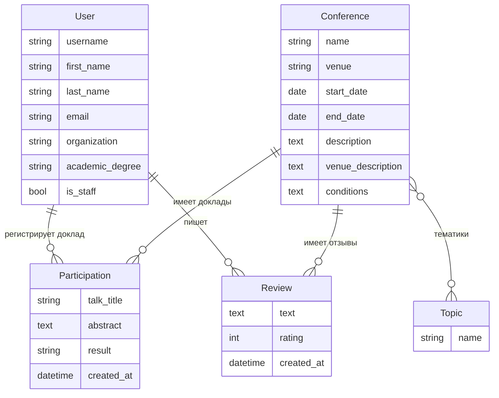

*Рис. 1. ER-диаграмма*

Таблица 1. Модели и их назначение.

| Модель | Что хранит | Связи |
|--------|------------|-------|
| User | пользователь сайта: логин, ФИО, email, организация, учёная степень | наследуется от `AbstractUser` |
| Topic | тематика (например, «Машинное обучение») | многие ко многим с Conference |
| Conference | конференция: название, место, даты начала и конца, описание, описание места, условия участия | тематики через `ManyToManyField` |
| Participation | регистрация автора на выступление: тема доклада, аннотация, результат | FK на User и FK на Conference |
| Review | отзыв: текст, рейтинг 1-10, дата отзыва | FK на User и FK на Conference |

Почему модель устроена так:

- Пользователя я расширил через `AbstractUser`, как в практике 2.3. Для научной конференции полезно знать организацию и учёную степень автора, а стандартный `User` таких полей не имеет. Модель указана в `AUTH_USER_MODEL` до первой миграции, потому что потом поменять её уже очень сложно.
- Тематики вынесены в отдельную таблицу `Topic`. Одна конференция охватывает несколько тематик, а одна тематика встречается у разных конференций, это связь многие ко многим. Отдельная таблица нужна, чтобы фильтровать конференции по тематике и не писать одно название по-разному.
- `Participation` (выступление) связывает пользователя и конференцию. Это отдельная модель, а не простое поле, потому что у регистрации есть свои данные: тема доклада, аннотация и результат. Пара `user + conference` уникальна (`unique_together`): на одну конференцию человек регистрируется один раз.
- Результат выступления хранится в поле `result` с вариантами выбора (`choices`): «Не рассмотрен», «Рекомендован к публикации», «Не рекомендован». Новая регистрация получает «Не рассмотрен» по умолчанию. В админ-панели это выпадающий список, а в шаблоне подпись выводится через `get_result_display`.
- Даты конференции в отзыве я отдельно не копирую. Отзыв связан с конференцией через FK, поэтому даты берутся из неё и показываются в карточке каждого отзыва. Если бы я копировал даты в отзыв, после исправления дат конференции они бы разошлись.
- Рейтинг ограничен валидаторами `MinValueValidator(1)` и `MaxValueValidator(10)`. Форма не пропустит значение вне диапазона.
- `on_delete=models.CASCADE` у всех FK: если удалить конференцию или пользователя, его регистрации и отзывы удаляются вместе с ним, без «висящих» записей.

Код моделей (`conferences/models.py`):

```python
from django.conf import settings
from django.contrib.auth.models import AbstractUser
from django.core.validators import MaxValueValidator, MinValueValidator
from django.db import models


class User(AbstractUser):
    organization = models.CharField("Организация", max_length=200, blank=True)
    academic_degree = models.CharField("Учёная степень", max_length=100, blank=True)

    def __str__(self):
        return self.get_full_name() or self.username


class Topic(models.Model):
    name = models.CharField("Название", max_length=100, unique=True)

    class Meta:
        ordering = ["name"]
        verbose_name = "Тематика"
        verbose_name_plural = "Тематики"

    def __str__(self):
        return self.name


class Conference(models.Model):
    name = models.CharField("Название", max_length=200)
    topics = models.ManyToManyField(Topic, related_name="conferences", verbose_name="Тематики")
    venue = models.CharField("Место проведения", max_length=200)
    start_date = models.DateField("Дата начала")
    end_date = models.DateField("Дата окончания")
    description = models.TextField("Описание конференции")
    venue_description = models.TextField("Описание места проведения")
    conditions = models.TextField("Условия участия")

    class Meta:
        ordering = ["start_date"]
        verbose_name = "Конференция"
        verbose_name_plural = "Конференции"

    def __str__(self):
        return self.name


class Participation(models.Model):
    RESULT_CHOICES = [
        ("pending", "Не рассмотрен"),
        ("recommended", "Рекомендован к публикации"),
        ("rejected", "Не рекомендован"),
    ]

    user = models.ForeignKey(settings.AUTH_USER_MODEL, on_delete=models.CASCADE,
                             related_name="participations", verbose_name="Участник")
    conference = models.ForeignKey(Conference, on_delete=models.CASCADE,
                                   related_name="participations", verbose_name="Конференция")
    talk_title = models.CharField("Тема доклада", max_length=300)
    abstract = models.TextField("Аннотация")
    result = models.CharField("Результат", max_length=20, choices=RESULT_CHOICES, default="pending")
    created_at = models.DateTimeField("Дата регистрации", auto_now_add=True)

    class Meta:
        ordering = ["conference__start_date", "user__last_name"]
        unique_together = ["user", "conference"]
        verbose_name = "Выступление"
        verbose_name_plural = "Выступления"

    def __str__(self):
        return f"{self.user}: {self.talk_title}"


class Review(models.Model):
    user = models.ForeignKey(settings.AUTH_USER_MODEL, on_delete=models.CASCADE,
                             related_name="reviews", verbose_name="Автор")
    conference = models.ForeignKey(Conference, on_delete=models.CASCADE,
                                   related_name="reviews", verbose_name="Конференция")
    text = models.TextField("Текст отзыва")
    rating = models.PositiveSmallIntegerField(
        "Рейтинг", validators=[MinValueValidator(1), MaxValueValidator(10)])
    created_at = models.DateTimeField("Дата отзыва", auto_now_add=True)

    class Meta:
        ordering = ["-created_at"]
        verbose_name = "Отзыв"
        verbose_name_plural = "Отзывы"

    def __str__(self):
        return f"{self.user} о {self.conference}"
```

## Настройки и подключение к PostgreSQL

Секретный ключ и пароль от базы не хранятся в коде. Они лежат в файле `.env`, который не попадает в репозиторий (он в `.gitignore`). В репозитории есть только шаблон `.env.example`.

```python
DATABASES = {
    "default": {
        "ENGINE": "django.db.backends.postgresql",
        "NAME": os.getenv("DB_NAME"),
        "USER": os.getenv("DB_USER"),
        "PASSWORD": os.getenv("DB_PASSWORD"),
        "HOST": os.getenv("DB_HOST", "localhost"),
        "PORT": os.getenv("DB_PORT", "5432"),
    }
}
```

```
SECRET_KEY=change-me
DEBUG=True
DB_NAME=conferences_db
DB_USER=postgres
DB_PASSWORD=your_password
DB_HOST=localhost
DB_PORT=5432
```

Запуск проекта:

```
pip install -r requirements.txt
copy .env.example .env        (вписать свои данные PostgreSQL)
python manage.py migrate
python manage.py loaddata demo_data
python manage.py runserver
```

Демо-данные (`loaddata demo_data`) содержат 7 конференций, 7 тематик, 7 пользователей, 15 регистраций и 5 отзывов. Администратор `admin` с паролем `admin12345`, обычные пользователи, например `kuznetsov` с паролем `test12345`.

## Адреса сайта

Таблица 2. Маршруты приложения (`conferences/urls.py`).

| URL | Представление | Кто может открыть |
|-----|---------------|-------------------|
| `/` | список конференций с поиском, фильтром и пагинацией | все |
| `/conference/<id>/` | страница конференции и отзывы | все |
| `/conference/<id>/register/` | регистрация доклада | вошедший пользователь |
| `/conference/<id>/review/` | новый отзыв | вошедший пользователь |
| `/my/` | мои регистрации | вошедший пользователь |
| `/participation/<id>/edit/`, `/delete/` | изменить или удалить регистрацию | только её автор |
| `/participation/<id>/result/` | поставить результат | только `is_staff` |
| `/participants/` | таблица участников с поиском, фильтрами и пагинацией | все |
| `/review/<id>/delete/` | удалить отзыв | автор отзыва или `is_staff` |
| `/signup/`, `/accounts/login/` | регистрация и вход | все |
| `/admin/` | Django-admin | `is_staff` |

```python
from django.urls import path

from . import views

urlpatterns = [
    path("", views.ConferenceListView.as_view(), name="conference_list"),
    path("conference/<int:pk>/", views.ConferenceDetailView.as_view(), name="conference_detail"),
    path("conference/<int:pk>/register/", views.ParticipationCreateView.as_view(),
         name="participation_create"),
    path("conference/<int:pk>/review/", views.ReviewCreateView.as_view(), name="review_create"),
    path("my/", views.MyParticipationListView.as_view(), name="my_participations"),
    path("participation/<int:pk>/edit/", views.ParticipationUpdateView.as_view(),
         name="participation_update"),
    path("participation/<int:pk>/delete/", views.ParticipationDeleteView.as_view(),
         name="participation_delete"),
    path("participation/<int:pk>/result/", views.set_result, name="set_result"),
    path("participants/", views.ParticipantListView.as_view(), name="participant_list"),
    path("review/<int:pk>/delete/", views.ReviewDeleteView.as_view(), name="review_delete"),
    path("signup/", views.SignUpView.as_view(), name="signup"),
]
```

## Интерфейсы

### Регистрация и вход

Форма регистрации построена на стандартной `UserCreationForm`. Я указал в ней свою модель и добавил поля организации и учёной степени. После регистрации пользователь сразу входит на сайт через `login()`, ему не нужно вводить пароль второй раз.

```python
class SignUpForm(UserCreationForm):
    class Meta:
        model = User
        fields = ["username", "first_name", "last_name", "email", "organization", "academic_degree"]
```

```python
class SignUpView(CreateView):
    form_class = SignUpForm
    template_name = "registration/signup.html"

    def form_valid(self, form):
        user = form.save()
        login(self.request, user)
        return redirect("conference_list")
```

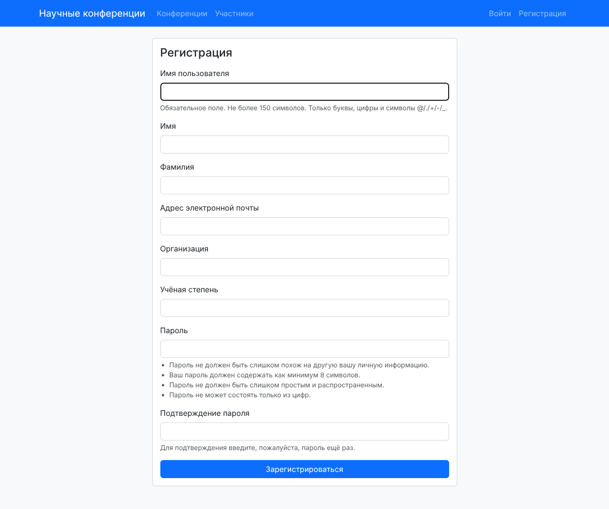

*Рис. 2. Форма регистрации нового пользователя*

Вход и выход работают через встроенные представления `django.contrib.auth.urls`, я написал только шаблон `registration/login.html`. Выход в Django 5 делается POST-запросом, поэтому кнопка «Выйти» в шапке это маленькая форма с ``.

### Список конференций: поиск, фильтр и пагинация

Главная страница показывает конференции карточками по 4 на страницу. Сверху строка поиска (ищет по названию, описанию и месту) и выпадающий список тематик.

```python
class ConferenceListView(ListView):
    model = Conference
    paginate_by = 4

    def get_queryset(self):
        queryset = Conference.objects.prefetch_related("topics")
        q = self.request.GET.get("q", "")
        topic = self.request.GET.get("topic", "")
        if q:
            queryset = queryset.filter(
                Q(name__icontains=q) | Q(description__icontains=q) | Q(venue__icontains=q))
        if topic.isdigit():
            queryset = queryset.filter(topics__id=topic)
        return queryset

    def get_context_data(self, **kwargs):
        context = super().get_context_data(**kwargs)
        context["topics"] = Topic.objects.all()
        return context
```

Как это работает:

- `paginate_by = 4` включает пагинацию: `ListView` сам режет список и передаёт в шаблон объект `page_obj` с номером страницы.
- В `get_queryset()` я беру параметры `q` и `topic` из GET-запроса и сужаю выборку. `Q(...) | Q(...)` это условие «ИЛИ»: конференция подходит, если слово есть хотя бы в одном из трёх полей. `icontains` ищет подстроку без учёта регистра.
- `topic.isdigit()` защищает от адреса вида `?topic=abc`: без проверки Django упал бы с ошибкой 500 при попытке сравнить id со строкой.
- `prefetch_related("topics")` загружает тематики всех конференций одним дополнительным запросом, а не отдельным запросом на каждую карточку.

Пагинацию я вынес в отдельный шаблон `pagination.html` и подключаю его через `` на двух страницах. Главная проблема пагинации с фильтром в том, что ссылка `?page=2` теряет параметры поиска. Тег `` берёт текущие GET-параметры и заменяет только `page`, поэтому со страницы `?topic=2` ссылка ведёт на `?topic=2&page=2`.

```html

    <nav>
        <ul class="pagination justify-content-center">
            
                <li class="page-item"><a class="page-link" href="">Назад</a></li>
            
                <li class="page-item disabled"><span class="page-link">Назад</span></li>
            
            
                <li class="page-item active">
                    <a class="page-link" href="">{{ num }}</a>
                </li>
            
            
                <li class="page-item"><a class="page-link" href="">Вперёд</a></li>
            
                <li class="page-item disabled"><span class="page-link">Вперёд</span></li>
            
        </ul>
    </nav>

```

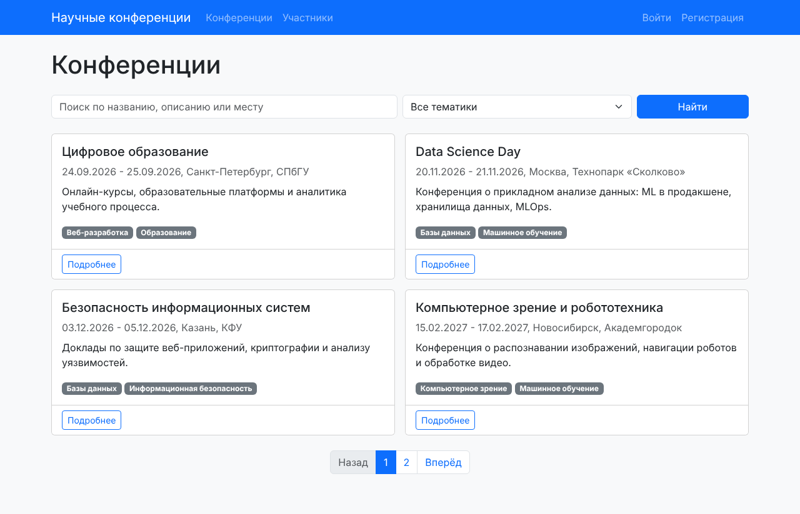

*Рис. 3. Список конференций, первая страница из двух*

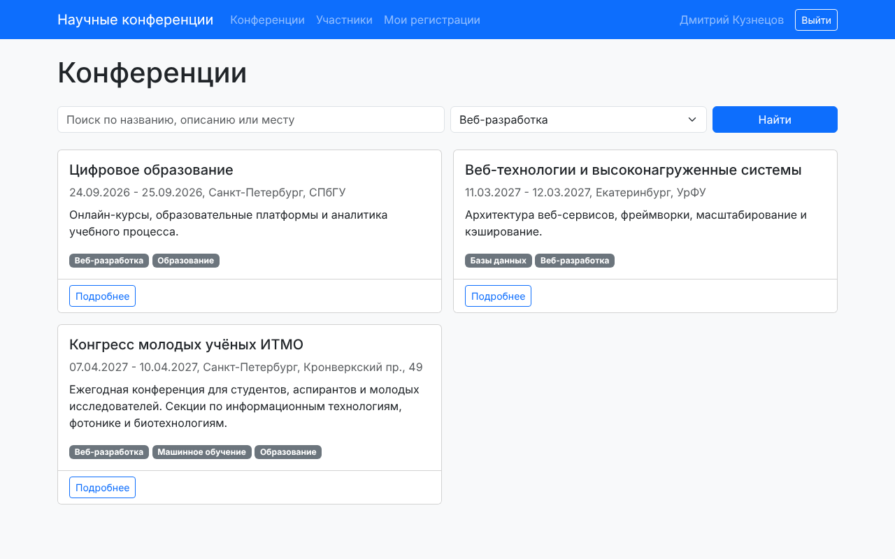

*Рис. 4. Фильтр по тематике «Веб-разработка»: найдено 3 конференции из 7*

### Страница конференции

На странице конференции выводятся все поля из задания, тематики, число докладов и средний рейтинг. Средний рейтинг считается в базе через `aggregate(Avg("rating"))`, а не циклом в Python. Если пользователь уже зарегистрирован, вместо кнопки регистрации он видит свой доклад и его результат.

```python
class ConferenceDetailView(DetailView):
    model = Conference

    def get_context_data(self, **kwargs):
        context = super().get_context_data(**kwargs)
        conference = self.object
        context["reviews"] = conference.reviews.select_related("user")
        context["avg_rating"] = conference.reviews.aggregate(Avg("rating"))["rating__avg"]
        if self.request.user.is_authenticated:
            context["my_participation"] = conference.participations.filter(
                user=self.request.user).first()
        return context
```

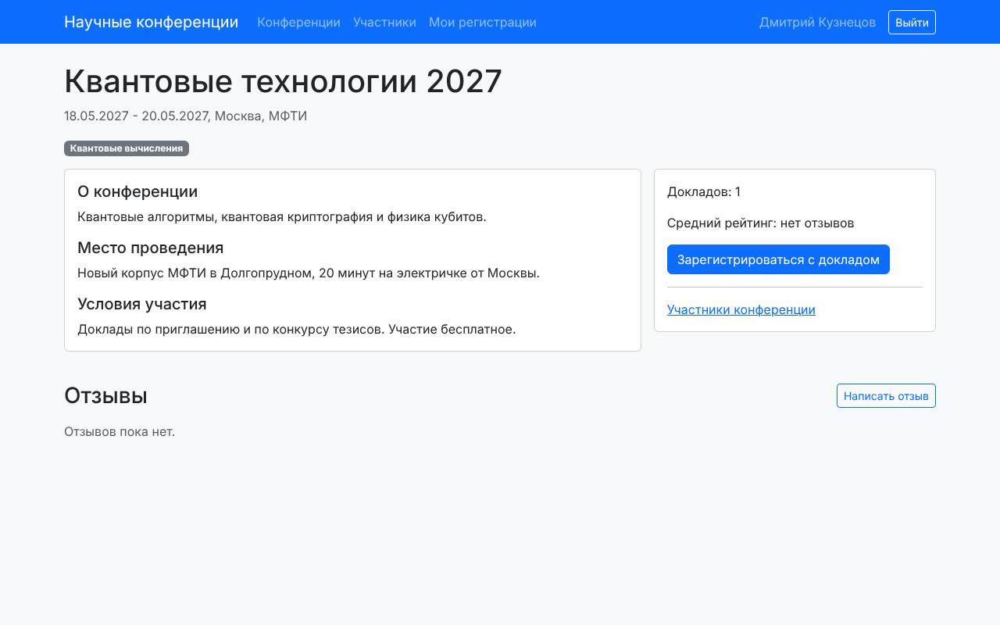

*Рис. 5. Страница конференции «Квантовые технологии 2027» для обычного пользователя*

### Регистрация доклада и свои регистрации

Регистрацию доклада делает `ParticipationCreateView`. В форме только тема и аннотация: пользователя и конференцию я подставляю в `form_valid()`, иначе пользователь мог бы подменить их в HTML-форме.

```python
class ParticipationCreateView(LoginRequiredMixin, CreateView):
    form_class = ParticipationForm
    template_name = "conferences/participation_form.html"
    success_url = reverse_lazy("my_participations")

    def dispatch(self, request, *args, **kwargs):
        self.conference = get_object_or_404(Conference, pk=kwargs["pk"])
        if request.user.is_authenticated and self.conference.participations.filter(
                user=request.user).exists():
            messages.warning(request, "Вы уже зарегистрированы на эту конференцию.")
            return redirect("my_participations")
        return super().dispatch(request, *args, **kwargs)

    def get_context_data(self, **kwargs):
        context = super().get_context_data(**kwargs)
        context["conference"] = self.conference
        return context

    def form_valid(self, form):
        form.instance.user = self.request.user
        form.instance.conference = self.conference
        messages.success(self.request, "Вы зарегистрированы как автор доклада.")
        return super().form_valid(form)
```

`LoginRequiredMixin` отправляет гостя на страницу входа. В `dispatch()` я проверяю, нет ли уже регистрации на эту конференцию. Ограничение `unique_together` в модели на это не годится: поля `user` и `conference` не входят в форму, поэтому форма их уникальность не проверяет, и повторная регистрация закончилась бы ошибкой базы данных.

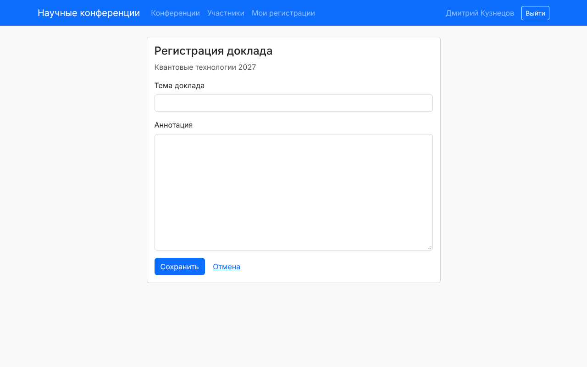

*Рис. 6. Форма регистрации доклада*

Свои регистрации пользователь видит на странице «Мои регистрации». Там же кнопки «Изменить» и «Удалить».

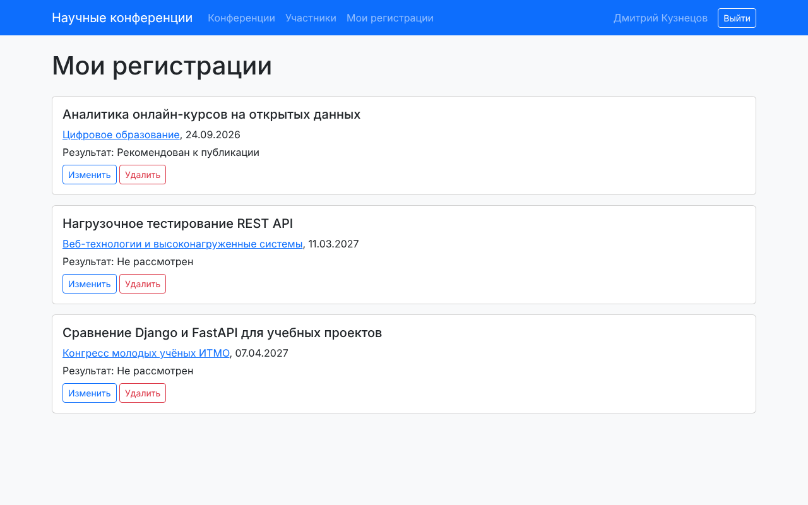

*Рис. 7. Регистрации пользователя Дмитрий Кузнецов с результатами*

Изменить или удалить можно только свою регистрацию. Для этого `get_queryset()` в представлениях изменения и удаления возвращает только записи текущего пользователя. Если открыть `/participation/<чужой id>/edit/`, Django не найдёт объект в этой выборке и вернёт 404.

```python
class MyParticipationListView(LoginRequiredMixin, ListView):
    template_name = "conferences/my_participations.html"

    def get_queryset(self):
        return Participation.objects.filter(user=self.request.user).select_related("conference")


class ParticipationUpdateView(LoginRequiredMixin, UpdateView):
    form_class = ParticipationForm
    success_url = reverse_lazy("my_participations")

    def get_queryset(self):
        return Participation.objects.filter(user=self.request.user)

    def get_context_data(self, **kwargs):
        context = super().get_context_data(**kwargs)
        context["conference"] = self.object.conference
        return context


class ParticipationDeleteView(LoginRequiredMixin, DeleteView):
    success_url = reverse_lazy("my_participations")

    def get_queryset(self):
        return Participation.objects.filter(user=self.request.user)
```

### Отзывы

Отзыв пишет вошедший пользователь. В карточке отзыва выводятся автор и его организация, рейтинг, даты конференции и дата отзыва. Удалить отзыв может его автор или администратор, это тоже решается в `get_queryset()`.

```python
class ReviewForm(forms.ModelForm):
    class Meta:
        model = Review
        fields = ["rating", "text"]
        widgets = {"rating": forms.NumberInput(attrs={"min": 1, "max": 10})}
```

```python
class ReviewDeleteView(LoginRequiredMixin, DeleteView):
    model = Review

    def get_queryset(self):
        if self.request.user.is_staff:
            return Review.objects.all()
        return Review.objects.filter(user=self.request.user)

    def get_success_url(self):
        return reverse("conference_detail", args=[self.object.conference.pk])
```

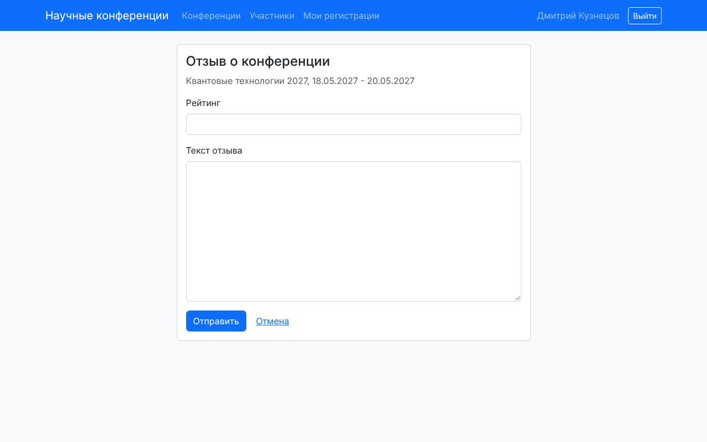

*Рис. 8. Форма отзыва, рейтинг ограничен значениями от 1 до 10*

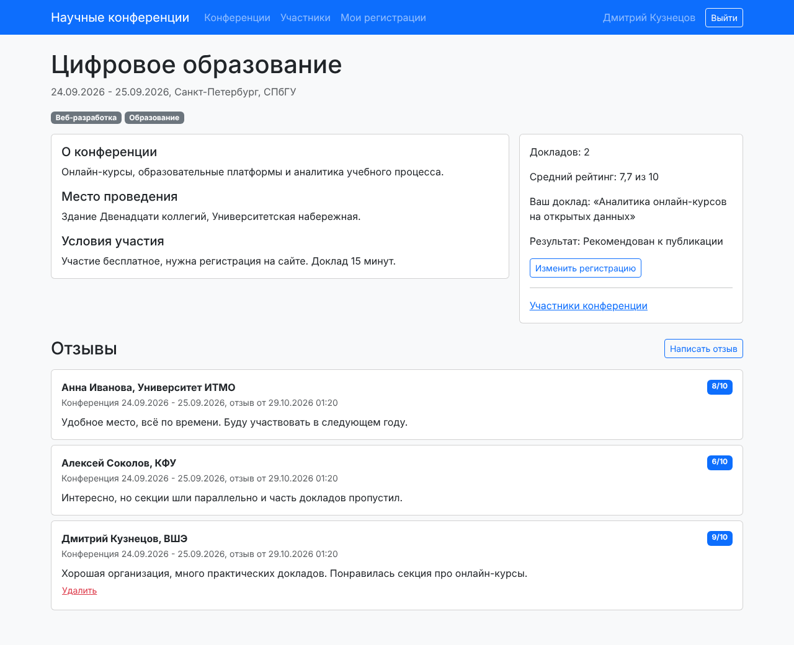

*Рис. 9. Отзывы о конференции «Цифровое образование» и средний рейтинг 7,7*

### Таблица участников по конференциям

Таблица показывает все регистрации: конференцию, участника, организацию, тему доклада и результат. Можно искать по фамилии, имени или теме, выбрать конференцию и результат. На странице 6 строк, пагинация сохраняет фильтры так же, как на главной.

```python
class ParticipantListView(ListView):
    template_name = "conferences/participant_list.html"
    paginate_by = 6

    def get_queryset(self):
        queryset = Participation.objects.select_related("user", "conference")
        q = self.request.GET.get("q", "")
        conference = self.request.GET.get("conference", "")
        result = self.request.GET.get("result", "")
        if q:
            queryset = queryset.filter(
                Q(user__last_name__icontains=q) | Q(user__first_name__icontains=q)
                | Q(talk_title__icontains=q))
        if conference.isdigit():
            queryset = queryset.filter(conference_id=conference)
        if result:
            queryset = queryset.filter(result=result)
        return queryset

    def get_context_data(self, **kwargs):
        context = super().get_context_data(**kwargs)
        context["conferences"] = Conference.objects.all()
        context["result_choices"] = Participation.RESULT_CHOICES
        return context
```

`select_related("user", "conference")` подтягивает пользователя и конференцию в том же SQL-запросе через JOIN. Без него на каждую строку таблицы было бы ещё два запроса.

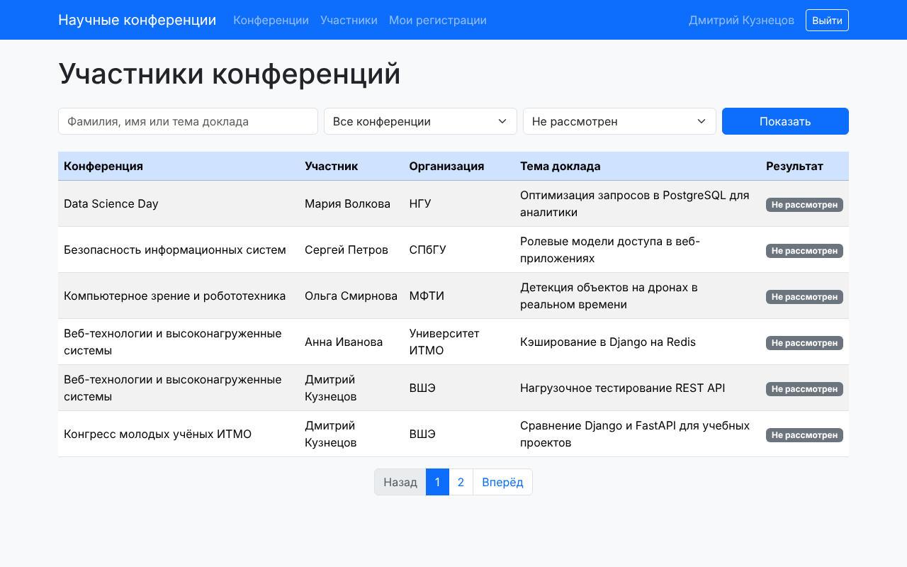

*Рис. 10. Таблица участников для обычного пользователя, фильтр «Не рассмотрен», первая страница из двух*

### Права администратора в клиентском интерфейсе

Администратор (пользователь с `is_staff`) видит и делает в браузере больше обычного пользователя:

- в шапке ссылку «Админ-панель» и пометку «админ»;
- в таблице участников столбцы Email и «Изменить результат» с кнопками «Рекомендовать» и «Отклонить»;
- на карточках и странице конференции кнопку «Изменить» и на главной кнопку «Добавить конференцию» (ведут в Django-admin);
- кнопку «Удалить» у любого отзыва.

В шаблоне это обычная проверка ``:

```html

    <td>{{ participation.user.email }}</td>
    <td>
        <form method="post" action="" class="d-flex gap-1">
            
            <input type="hidden" name="next" value="{{ request.get_full_path }}">
            <button name="result" value="recommended" class="btn btn-outline-success btn-sm">Рекомендовать</button>
            <button name="result" value="rejected" class="btn btn-outline-danger btn-sm">Отклонить</button>
        </form>
    </td>

```

Скрыть кнопку в шаблоне недостаточно: обычный пользователь может отправить POST-запрос на адрес сам. Поэтому представление `set_result` ещё раз проверяет `is_staff` и возвращает 403, если прав нет. `@require_POST` не даёт менять данные GET-запросом. Параметр `next` возвращает администратора на ту же страницу таблицы с теми же фильтрами, а `url_has_allowed_host_and_scheme` не даёт подставить в `next` адрес чужого сайта.

```python
@login_required
@require_POST
def set_result(request, pk):
    if not request.user.is_staff:
        raise PermissionDenied
    participation = get_object_or_404(Participation, pk=pk)
    result = request.POST.get("result")
    if result in dict(Participation.RESULT_CHOICES):
        participation.result = result
        participation.save()
    next_url = request.POST.get("next", "")
    if url_has_allowed_host_and_scheme(next_url, allowed_hosts={request.get_host()}):
        return redirect(next_url)
    return redirect("participant_list")
```

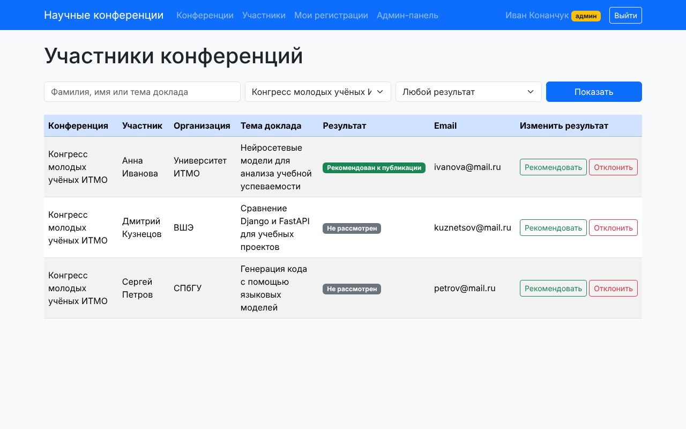

*Рис. 11. Таблица участников «Конгресса молодых учёных ИТМО» для администратора: Email и кнопки результата*

### Результат выступления в Django-admin

По заданию результат указывается средствами Django-admin. В `ParticipationAdmin` поле `result` добавлено в `list_editable`, поэтому администратор меняет результаты прямо в списке выступлений и сохраняет одной кнопкой. Справа фильтры по результату и конференции.

```python
from django.contrib import admin
from django.contrib.auth.admin import UserAdmin

from .models import Conference, Participation, Review, Topic, User


@admin.register(User)
class CustomUserAdmin(UserAdmin):
    fieldsets = UserAdmin.fieldsets + (
        ("Научные данные", {"fields": ("organization", "academic_degree")}),
    )
    list_display = ["username", "last_name", "first_name", "organization", "is_staff"]


@admin.register(Topic)
class TopicAdmin(admin.ModelAdmin):
    search_fields = ["name"]


@admin.register(Conference)
class ConferenceAdmin(admin.ModelAdmin):
    list_display = ["name", "venue", "start_date", "end_date"]
    list_filter = ["topics"]
    search_fields = ["name", "venue"]
    filter_horizontal = ["topics"]


@admin.register(Participation)
class ParticipationAdmin(admin.ModelAdmin):
    list_display = ["user", "conference", "talk_title", "result"]
    list_editable = ["result"]
    list_filter = ["result", "conference"]
    search_fields = ["talk_title", "user__last_name"]


@admin.register(Review)
class ReviewAdmin(admin.ModelAdmin):
    list_display = ["user", "conference", "rating", "created_at"]
    list_filter = ["conference", "rating"]
```

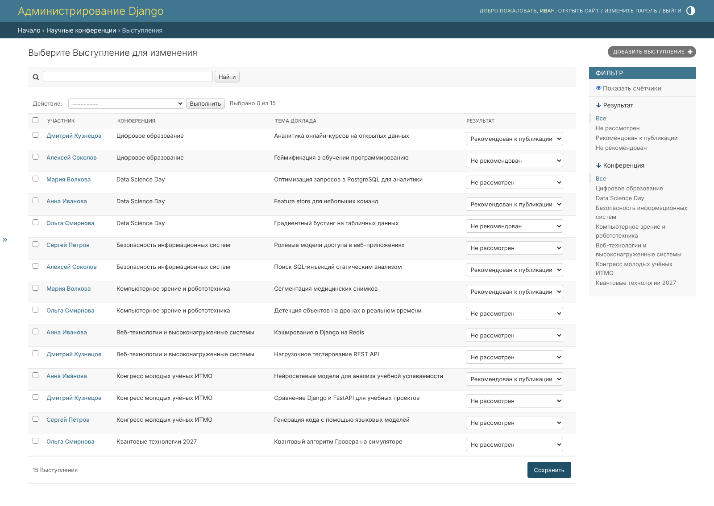

*Рис. 12. Список выступлений в Django-admin, результат меняется выпадающим списком*

## Практики 2.1-2.3

Практики лежат в `practical_works/simple_django_web_project/django_project_konanchuk`, приложение `project_first_app`. База там SQLite, как в методичке.

- 2.1: создал проект и приложение, модель автовладельцев (владелец, автомобиль, владение, водительское удостоверение), зарегистрировал модели в админке, сделал страницу владельца `/owner/<id>/` (функция `owner_detail` и шаблон `owner.html`).
- 2.2: связь автомобиля и владельца сделана через промежуточную модель `Ownership` с датами начала и конца (`ManyToManyField(through="Ownership")`). Список владельцев и форма создания владельца написаны функциями (FBV), список, просмотр, создание, изменение и удаление автомобиля написаны классами (CBV).
- 2.3: владелец стал пользователем: `CarOwner` наследуется от `AbstractUser` и хранит номер паспорта, домашний адрес и национальность. Новые поля выведены в админке, форма создания владельца построена на `UserCreationForm`.

```python
from django.contrib.auth.models import AbstractUser
from django.db import models


class CarOwner(AbstractUser):
    birth_date = models.DateField("Дата рождения", null=True, blank=True)
    passport_number = models.CharField("Номер паспорта", max_length=20, blank=True)
    home_address = models.CharField("Домашний адрес", max_length=200, blank=True)
    nationality = models.CharField("Национальность", max_length=50, blank=True)

    def __str__(self):
        return f"{self.last_name} {self.first_name}"


class Car(models.Model):
    state_number = models.CharField("Гос. номер", max_length=15)
    brand = models.CharField("Марка", max_length=20)
    model = models.CharField("Модель", max_length=20)
    color = models.CharField("Цвет", max_length=30, null=True, blank=True)
    owners = models.ManyToManyField(CarOwner, through="Ownership", related_name="cars")

    def __str__(self):
        return f"{self.brand} {self.model} ({self.state_number})"


class Ownership(models.Model):
    owner = models.ForeignKey(CarOwner, on_delete=models.CASCADE)
    car = models.ForeignKey(Car, on_delete=models.CASCADE)
    start_date = models.DateField("Дата начала")
    end_date = models.DateField("Дата конца", null=True, blank=True)


class DriverLicense(models.Model):
    owner = models.ForeignKey(CarOwner, on_delete=models.CASCADE, related_name="licenses")
    number = models.CharField("Номер удостоверения", max_length=10)
    type = models.CharField("Тип", max_length=10)
    issue_date = models.DateField("Дата выдачи")
```

## Выводы

Я сделал сайт научных конференций на Django 5.2 и PostgreSQL 18. Модель данных состоит из пяти таблиц: пользователь на основе `AbstractUser`, тематики со связью многие ко многим, конференции, регистрации на выступления и отзывы. Пользователь регистрируется, смотрит конференции, записывается с докладом, меняет и удаляет только свои регистрации и пишет отзывы с рейтингом от 1 до 10. Администратор ставит результат выступления в Django-admin через `list_editable` и прямо в таблице участников на сайте.

Для максимального балла я оформил интерфейс на Bootstrap, сделал пагинацию на двух страницах, поиск и фильтры, которые сохраняются при переходе по страницам через ``, и разграничил права через `` в шаблонах с повторной проверкой в представлении. Чужие записи защищены фильтром в `get_queryset()`, поэтому на чужой id сайт отвечает 404.
