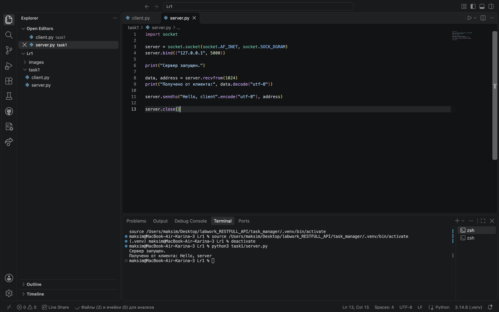
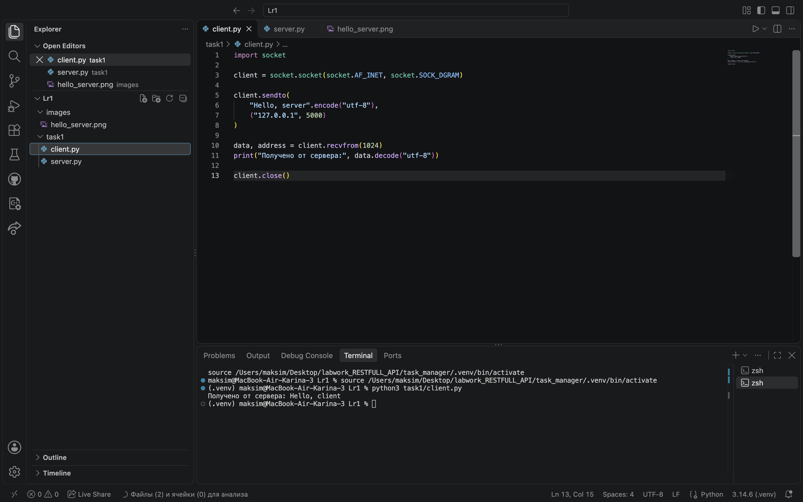
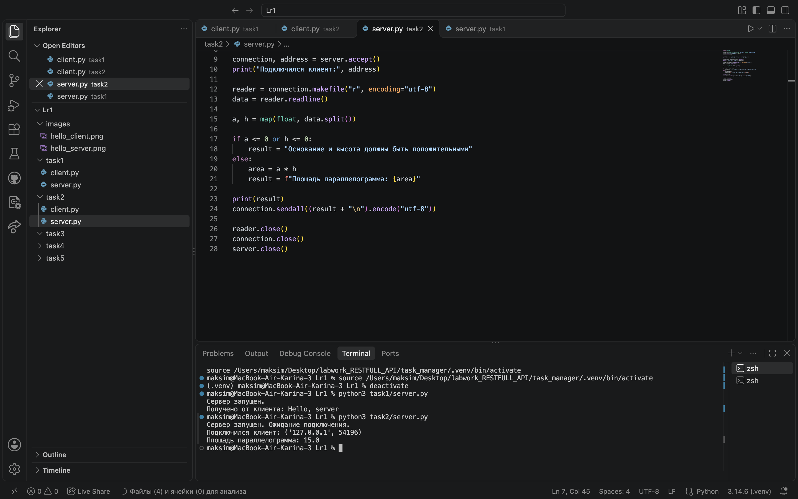
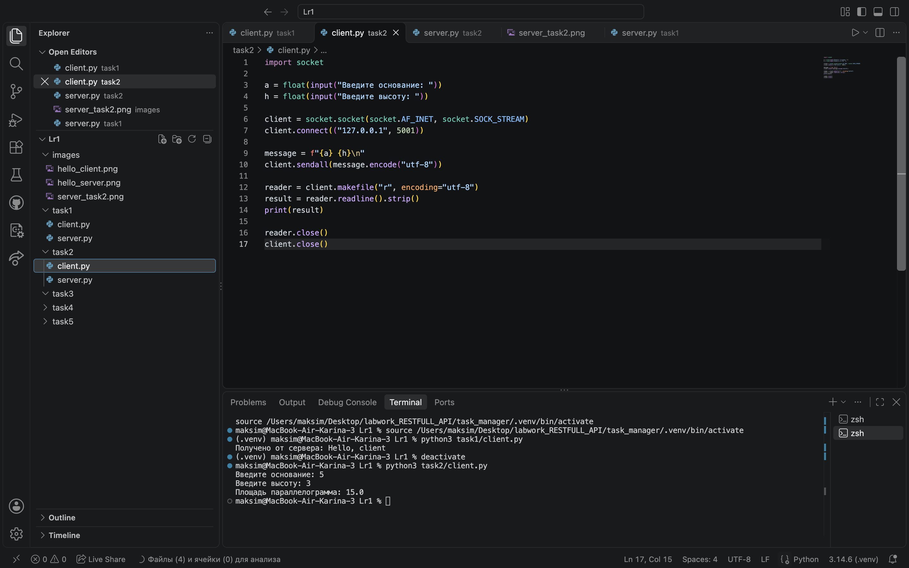
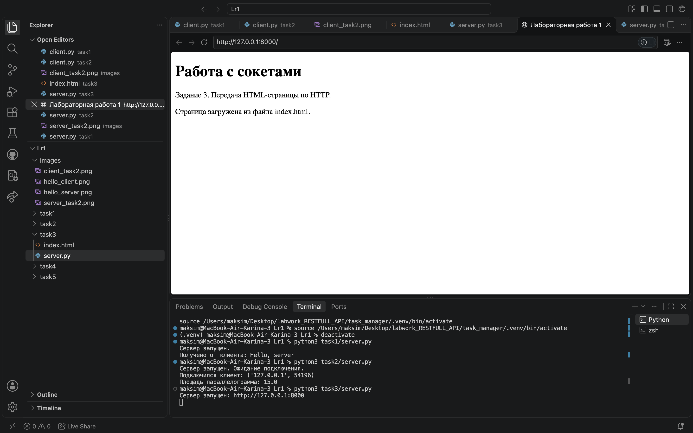
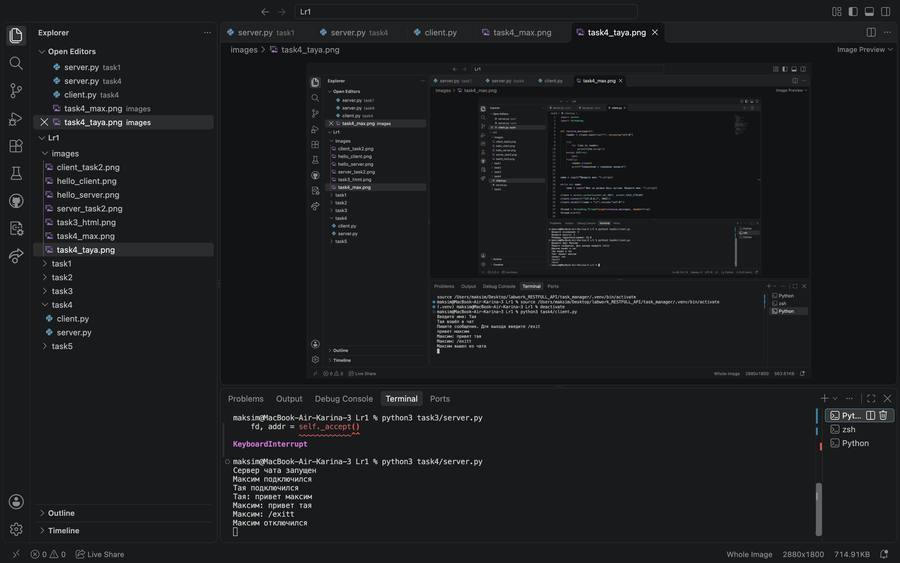
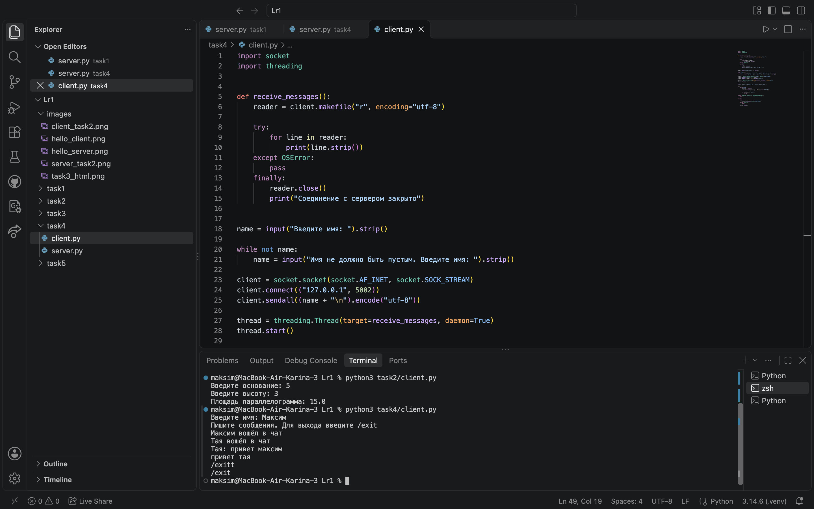
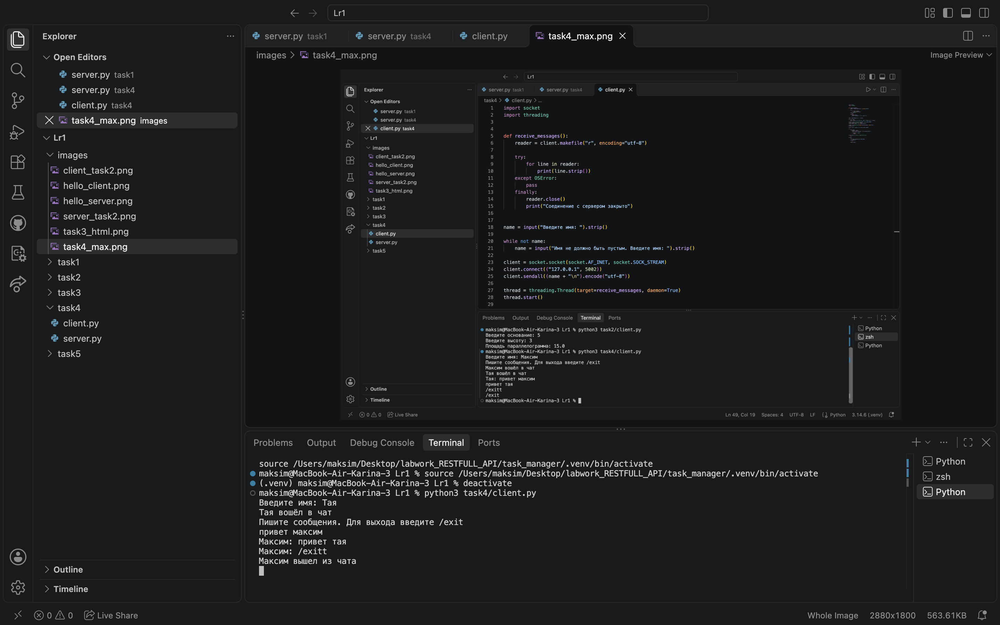
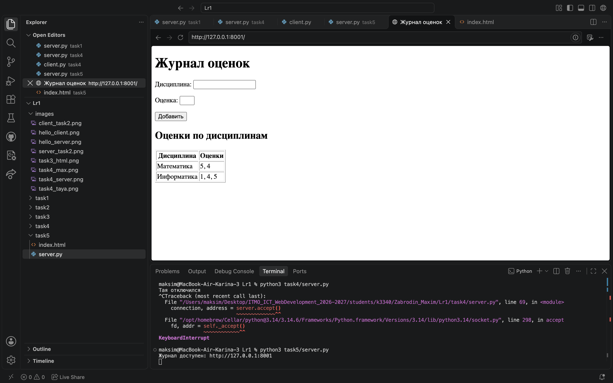

# Лабораторная работа №1. Работа с сокетами

**Выполнил:** Забродин Максим Александрович
**Группа:** К3340  
**Номер в журнале:** 8  
**Вариант задания 2:** 4 — площадь параллелограмма

## Цель работы

Изучить принципы взаимодействия клиента и сервера. Научиться использовать сокеты Python для передачи данных по UDP и TCP, обработки HTTP-запросов и организации многопользовательского чата.

## Задание 1. Обмен сообщениями по UDP

Реализованы клиент и сервер с использованием библиотеки `socket` и протокола UDP. Для создания сокетов используется `socket.SOCK_DGRAM`.

Сервер привязывается к адресу `127.0.0.1:5000` и ожидает сообщение. Клиент отправляет строку `Hello, server`. Сервер выводит полученное сообщение и отправляет ответ `Hello, client`.

Для передачи данных используются методы `sendto()` и `recvfrom()`. Строки преобразуются в байты методом `encode()`, а полученные байты — в строки методом `decode()`.

### Результат

Получение сообщения сервером:

Получение ответа клиентом:

## Задание 2. Вычисления через TCP

Реализовано вычисление площади параллелограмма по формуле:

**S = a × h**, где `a` — основание, `h` — высота.

Для обмена данными используется TCP: сокеты создаются с параметром `socket.SOCK_STREAM`. Сервер работает по адресу `127.0.0.1:5001`.

Клиент запрашивает основание и высоту с клавиатуры и отправляет их серверу. Сервер преобразует значения в числа, проверяет их положительность, вычисляет площадь и возвращает результат.

Сообщения завершаются символом перевода строки. Для получения полной строки используется `readline()`.

### Результат

Работа сервера:

Работа клиента:

## Задание 3. Передача HTML-страницы по HTTP

Реализован TCP-сервер по адресу `127.0.0.1:8000`. В качестве клиента используется браузер.

После получения запроса сервер читает файл `index.html` и формирует HTTP-ответ. Ответ содержит строку статуса `200 OK`, заголовки и содержимое HTML-файла.

Заголовок `Content-Type` указывает тип содержимого и кодировку UTF-8. В `Content-Length` передаётся размер тела ответа в байтах. Заголовки отделяются от тела пустой строкой `\r\n\r\n`.

Сервер работает в цикле, поэтому страницу можно открывать и обновлять многократно.

### Результат

## Задание 4. Многопользовательский чат

Реализован многопользовательский чат с использованием TCP и библиотеки `threading`. Сервер работает по адресу `127.0.0.1:5002`.

Каждый пользователь запускает один и тот же клиентский скрипт и вводит своё имя. Сервер хранит подключения и имена в словаре.

Для каждого подключения сервер создаёт отдельный поток. Полученные сообщения рассылаются остальным участникам с указанием имени отправителя. Доступ к общему словарю защищён блокировкой `Lock`.

На клиенте приём сообщений выполняется в отдельном потоке, а основной поток обрабатывает ввод с клавиатуры.

Для выхода используется команда `/exit`. При отключении пользователя сервер удаляет его из словаря и уведомляет остальных участников.

### Результат

Сервер чата:

Первый клиент:

Второй клиент:

## Задание 5. Веб-сервер с GET и POST

Реализован веб-сервер по адресу `127.0.0.1:8001` с использованием библиотеки `socket`. HTTP-запросы разбираются вручную.

При GET-запросе сервер возвращает страницу журнала оценок. При POST-запросе сервер получает название дисциплины и оценку из HTML-формы.

Оценки хранятся в словаре: ключом является название дисциплины, значением — список её оценок. Поэтому повторное добавление оценки по существующему предмету дополняет его список.

HTML-разметка хранится в отдельном файле `index.html`. Перед отправкой страницы метка `{{rows}}` заменяется строками таблицы с текущими оценками.

Для разбора данных формы используется `parse_qs()`, а для отображения названий дисциплин в HTML — `escape()`.

После сохранения оценки сервер отправляет ответ `303 See Other`, направляя браузер на главную страницу. Это предотвращает повторную отправку формы при обычном обновлении страницы.

Данные хранятся в памяти и очищаются после перезапуска сервера.

### Результат

## Вывод

В ходе лабораторной работы реализованы обмен сообщениями по UDP, вычисления через TCP, передача HTML-страницы, многопользовательский чат и веб-сервер с обработкой GET- и POST-запросов. Изучены работа сокетов, структура HTTP-сообщений и использование потоков для одновременного обслуживания пользователей.