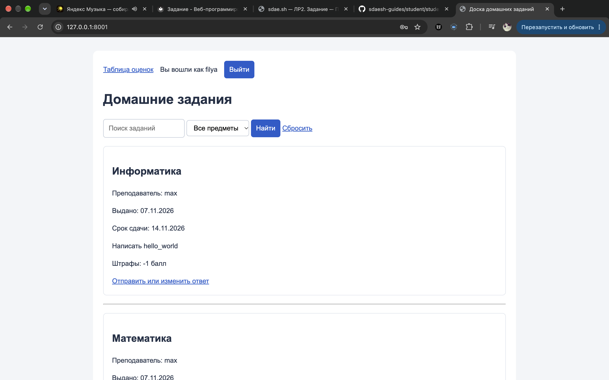
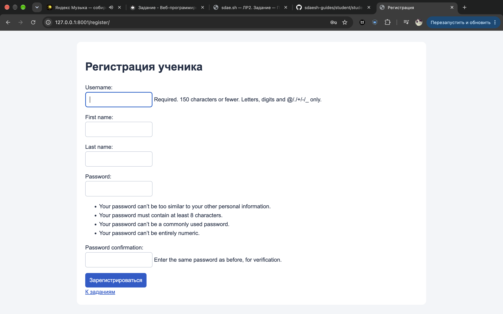
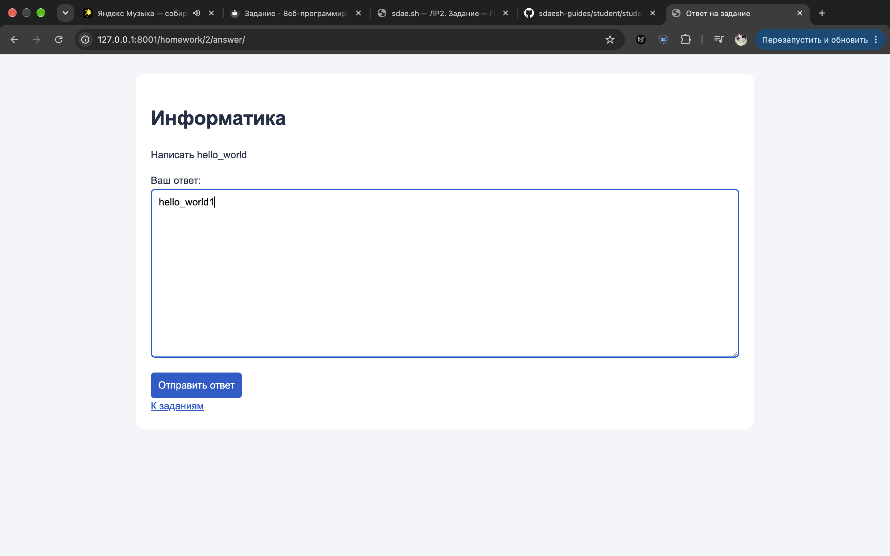
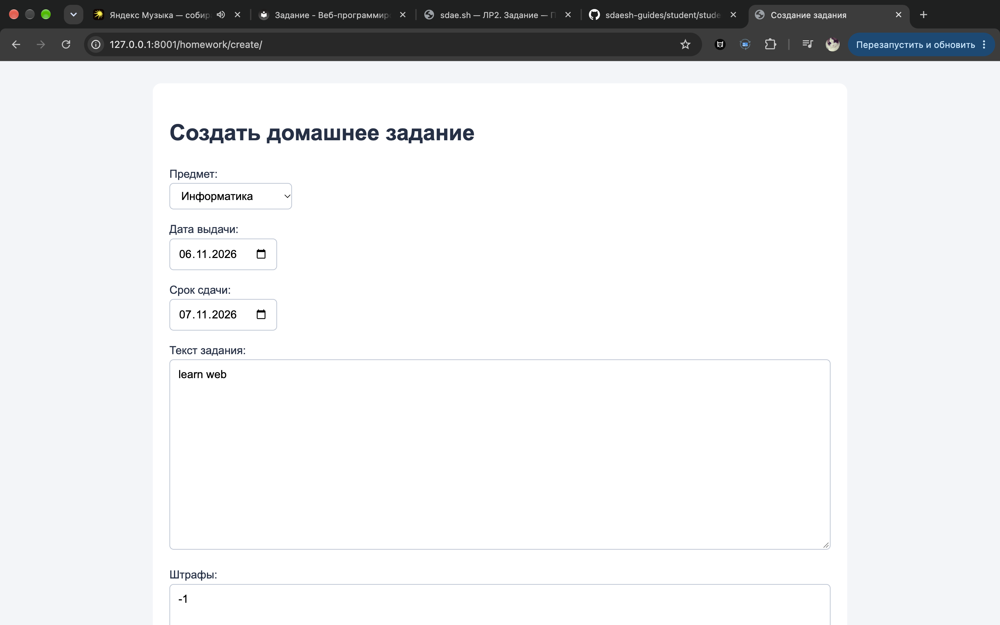
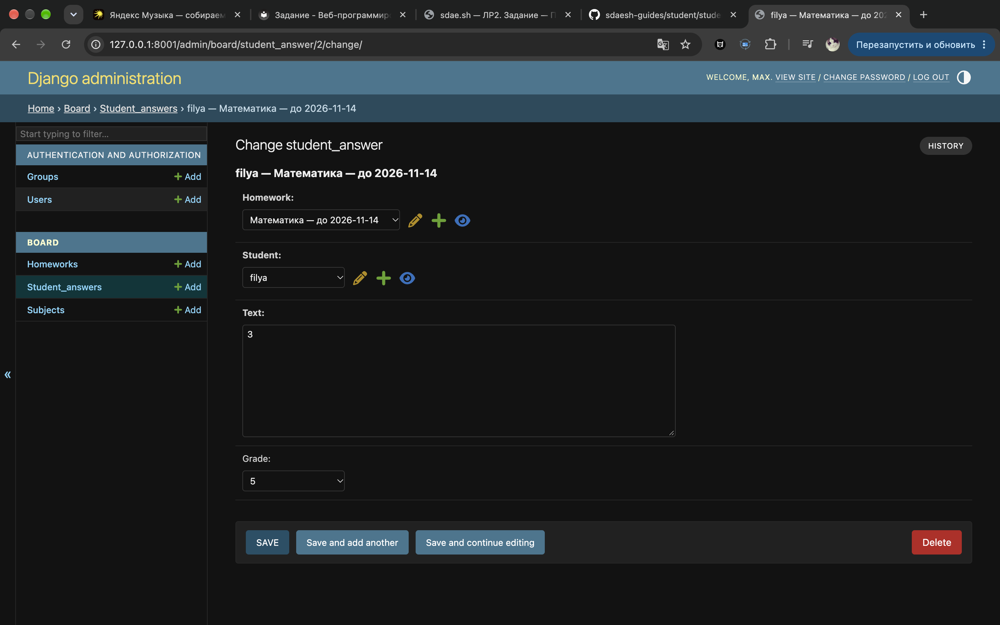
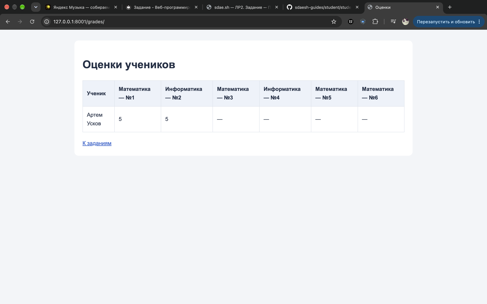
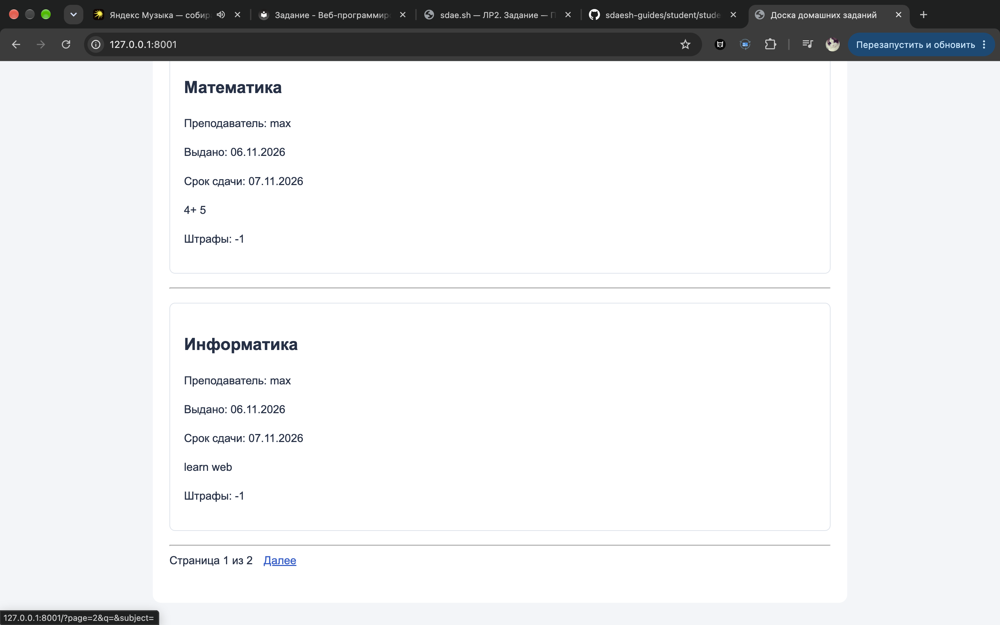

# Лабораторная работа №2

## Цель работы

Освоить создание веб-приложения на Django: проектирование моделей данных, обработку запросов, использование шаблонов Jinja2, форм и базы данных PostgreSQL.

## Вариант 2 — Доска домашних заданий

Реализован сайт, на котором ученики регистрируются, просматривают домашние задания, отправляют текстовые ответы и просматривают таблицу оценок.

Преподаватель создаёт задания через интерфейс сайта и выставляет оценки через Django Admin.

## Используемые технологии

- Python 3.14.6;
- Django 6.1.2;
- PostgreSQL 18;
- Psycopg;
- Jinja2;
- HTML и CSS;
- MkDocs для оформления отчёта.

## Структура проекта

```text
labwork/
├── board/
│   ├── migrations/
│   ├── admin.py
│   ├── forms.py
│   ├── models.py
│   ├── urls.py
│   └── views.py
├── homework_board/
│   ├── settings.py
│   ├── jinja2.py
│   └── urls.py
├── templates/
│   ├── base.html
│   ├── homework_list.html
│   ├── homework_form.html
│   ├── answer_form.html
│   ├── grade_table.html
│   ├── register.html
│   └── login.html
├── requirements.txt
└── manage.py
```

## Модель данных

Используется стандартная модель пользователя Django `User` и три модели приложения.

| Модель | Основные поля | Назначение |
|---|---|---|
| User | username, first_name, last_name, password, is_staff | Пользователи и их права |
| Subject | name | Учебные предметы |
| Homework | subject, teacher, issued_at, deadline, text, fine | Домашние задания |
| Student_answer | homework, student, text, submitted_at, grade | Ответы учеников и оценки |

Каждая модель имеет автоматически созданный первичный ключ `id`.

Связи между таблицами:

- один предмет связан со многими заданиями;
- один преподаватель может создать несколько заданий;
- одно задание может иметь ответы разных учеников;
- один ученик может ответить на несколько заданий.

Внешние ключи связывают записи через их ID. Ограничение `unique_student_homework` запрещает создавать несколько ответов одного ученика на одно задание.

Поле `grade` допускает оценки от 2 до 5 при проверке формы. До проверки ответа значение оценки отсутствует.

При удалении преподавателя используется `PROTECT`: удалить его, пока существуют связанные задания, нельзя.

Таблицы созданы в PostgreSQL командами:

```bash
python manage.py makemigrations
python manage.py migrate
```

## Регистрация и вход

Регистрация реализована формой на основе `UserCreationForm`. Она проверяет введённые данные и сохраняет хеш пароля.

После регистрации пользователь автоматически входит на сайт. Для повторного входа и выхода используются стандартные `LoginView` и `LogoutView`.

Выход выполняется POST-запросом. Формы, изменяющие данные, содержат CSRF-токен.

## Просмотр заданий

Главная страница показывает предмет, преподавателя, дату выдачи, срок сдачи, текст задания и информацию о штрафах.

Получение заданий реализовано в обработчике `homework_list`. Для загрузки связанных предметов и преподавателей используется `select_related`.

Добавлены:

- поиск по тексту задания и названию предмета;
- фильтрация по предмету;
- пагинация по пять заданий на странице.

При переходе между страницами поисковый запрос и выбранный предмет сохраняются.

## Отправка ответа

Форма `AnswerForm` содержит только поле текста. Ученика и задание обработчик определяет на сервере.

Поиск существующего ответа выполняется по текущему пользователю и выбранному заданию:

```python
answer = Student_answer.objects.filter(
    homework=homework,
    student=request.user,
).first()
```

При сохранении назначаются связанные записи:

```python
answer = form.save(commit=False)
answer.homework = homework
answer.student = request.user
answer.grade = None
answer.save()
```

Ученик может повторно открыть и изменить свой ответ. При повторной отправке оценка сбрасывается, поскольку изменённая работа требует новой проверки.

## Разграничение прав

Для различения преподавателя и ученика используется поле `is_staff`.

| Действие | Гость | Ученик | Преподаватель |
|---|---|---|---|
| Просматривать задания и искать их | Да | Да | Да |
| Просматривать таблицу оценок | Нет | Да | Да |
| Отправлять и изменять свой ответ | Нет | Да | Нет |
| Создавать задания | Нет | Нет | Да |
| Выставлять оценки через Django Admin | Нет | Нет | Администратор с необходимыми правами |

Ограничения действуют на сервере. Например, обработчик создания задания проверяет роль:

```python
if not request.user.is_staff:
    raise PermissionDenied(
        "Создавать задания может только учитель."
    )
```

В шаблоне ссылка на создание задания показывается только преподавателю:

```html

    <a href="{{ url('homework_create') }}">Создать задание</a>

```

## Выставление и просмотр оценок

Администратор открывает ответ ученика в Django Admin, читает его текст и заполняет поле `grade`.

На странице `/grades/` формируется таблица всех активных учеников: строки соответствуют ученикам, столбцы — заданиям. При отсутствии оценки выводится прочерк.

## Шаблоны и оформление

Страницы сайта используют Jinja2 и наследуют общий шаблон `base.html`.

Общий шаблон содержит оформление: шрифт, отступы, карточки заданий, стили форм и таблиц. Для небольших экранов предусмотрено уменьшение внешних и внутренних отступов.

Пример формы Jinja2:

```html
<form method="post">
    {{ csrf_input }}
    {{ form.as_p() }}
    <button type="submit">Сохранить</button>
</form>
```

## Основные адреса

| Адрес | Назначение |
|---|---|
| `/` | Список заданий, поиск и фильтрация |
| `/register/` | Регистрация ученика |
| `/login/` | Вход |
| `/logout/` | Выход через POST |
| `/homework/create/` | Создание задания преподавателем |
| `/homework/<id>/answer/` | Отправка и изменение собственного ответа |
| `/grades/` | Таблица оценок |
| `/admin/` | Панель администратора |

## Проверка работы

Вручную проверены регистрация, вход и выход, создание задания преподавателем, отправка и изменение ответа учеником, выставление оценки через админку и её отображение в таблице.

Также проверены поиск, фильтрация, переключение страниц и запрет доступа ученика к созданию задания.

## Результат

Создана доска домашних заданий на Django с PostgreSQL и шаблонами Jinja2. Реализованы функции варианта, разграничение прав, поиск, фильтрация и пагинация.

## Скриншоты

### Список заданий, поиск и фильтрация



### Регистрация ученика



### Отправка ответа



### Создание задания преподавателем



### Выставление оценки



### Таблица оценок



### Пагинация

