# ЛР2. Табло победителей автогонок

Вариант 6. Код: `laboratory_work_2` (проект `racing_board`, приложение `races`).

## Задание

Табло показывает участников автогонок: ФИО участника, название команды, описание автомобиля, описание участника, опыт и класс. Нужно реализовать:

- регистрацию новых пользователей;
- просмотр автогонок и регистрацию гонщиков с редактированием и удалением своих регистраций;
- отзывы к гонкам: дата заезда, текст, тип комментария (вопрос о сотрудничестве, вопрос о гонках, иное), рейтинг 1–10, комментатор;
- указание времени заезда и результата администратором в Django-admin;
- таблицу всех заездов и результатов конкретной гонки.

## Модель данных

| Модель | Назначение | Основные поля |
|---|---|---|
| `Team` | команда | название, страна, описание |
| `Racer` | участник, профиль пользователя (1:1 с `User`) | ФИО, команда, описание, опыт, класс |
| `Race` | автогонка | название, трасса, дата, описание, регистрация открыта |
| `Registration` | регистрация гонщика на гонку | гонка, гонщик, стартовый номер, автомобиль |
| `Heat` | заезд | гонка, номер, название, время заезда, круги |
| `Result` | результат участника в заезде | заезд, регистрация, место, время, статус |
| `Comment` | отзыв к гонке | гонка, автор, дата заезда, текст, тип, рейтинг |

Ограничения: один гонщик регистрируется на гонку один раз, стартовые номера в гонке не повторяются, у заезда уникальный номер внутри гонки, рейтинг комментария от 1 до 10.

```python
class Registration(models.Model):
    race = models.ForeignKey(Race, on_delete=models.CASCADE, related_name="registrations")
    racer = models.ForeignKey(Racer, on_delete=models.CASCADE, related_name="registrations")
    car_number = models.PositiveSmallIntegerField("Стартовый номер", validators=[MinValueValidator(1), MaxValueValidator(999)])
    car_description = models.CharField("Автомобиль", max_length=200)
    created_at = models.DateTimeField("Дата регистрации", auto_now_add=True)

    class Meta:
        constraints = [
            models.UniqueConstraint(fields=["race", "racer"], name="unique_racer_per_race"),
            models.UniqueConstraint(fields=["race", "car_number"], name="unique_car_number_per_race"),
        ]
```

## Страницы

| Адрес | Что показывает |
|---|---|
| `/` | табло победителей: призёры финальных заездов последних гонок, лучшие гонщики, ближайшие гонки |
| `/races/` | список гонок с поиском по названию и трассе, фильтром «предстоящие/прошедшие» и пагинацией |
| `/races/<id>/` | участники гонки, таблица всех заездов и результатов, отзывы и форма отзыва |
| `/races/<id>/register/` | регистрация на гонку (стартовый номер и автомобиль) |
| `/my/registrations/` | свои регистрации с изменением и отменой |
| `/racers/` | табло гонщиков с поиском, фильтром по классу и пагинацией |
| `/profile/` | профиль гонщика |
| `/signup/`, `/accounts/login/` | регистрация и вход |
| `/admin/` | администрирование: время заездов и результаты |

## Регистрации пользователя

Редактировать и удалять можно только свои регистрации и только пока гонка не прошла и по ней нет результатов. Чужая регистрация не попадает в queryset, поэтому по её адресу возвращается 404.

```python
class OwnRegistrationMixin(LoginRequiredMixin):
    model = Registration

    def get_queryset(self):
        return Registration.objects.filter(racer__user=self.request.user).select_related("race", "racer")

    def dispatch(self, request, *args, **kwargs):
        if not request.user.is_authenticated:
            return self.handle_no_permission()
        registration = get_object_or_404(self.get_queryset(), pk=kwargs["pk"])
        if not registration.can_be_changed():
            messages.error(request, "Гонка уже прошла или по ней есть результаты: регистрацию изменить нельзя.")
            return redirect("my_registrations")
        return super().dispatch(request, *args, **kwargs)
```

## Администрирование

Время заезда задаётся в списке заездов (`list_editable`) или в карточке заезда, результаты вносятся во встроенной таблице заезда. В выпадающем списке участников только регистрации этой гонки.

```python
class ResultInline(admin.TabularInline):
    model = Result
    extra = 0
    fields = ("registration", "position", "finish_time", "status")

    def formfield_for_foreignkey(self, db_field, request, **kwargs):
        if db_field.name == "registration":
            heat_id = request.resolver_match.kwargs.get("object_id")
            if heat_id:
                kwargs["queryset"] = Registration.objects.filter(race__heats__pk=heat_id).select_related("racer")
        return super().formfield_for_foreignkey(db_field, request, **kwargs)
```

## Меню, пагинация и поиск

Меню сделано на Bootstrap 5. Списки гонок и гонщиков разбиты на страницы (`paginate_by`), ссылки пагинации сохраняют параметры поиска через тег ``.

## Запуск

```bash
pip install -r requirements.txt
python manage.py makemigrations races
python manage.py migrate
python manage.py createsuperuser
python manage.py seed_races
python manage.py runserver
```

По умолчанию база SQLite; для PostgreSQL в файле `.env` задаётся `DB_ENGINE=postgres` и параметры подключения.

## Скриншоты

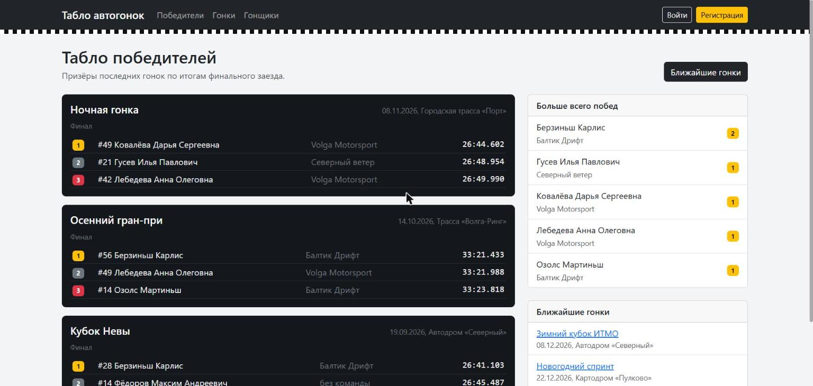
*Главная страница: призёры последних гонок и рейтинг по победам*

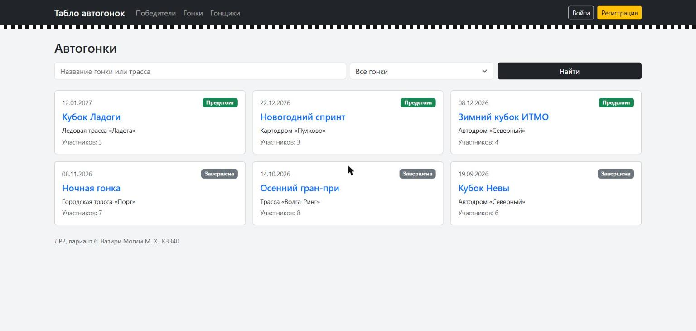
*Список гонок с поиском и фильтром по статусу*

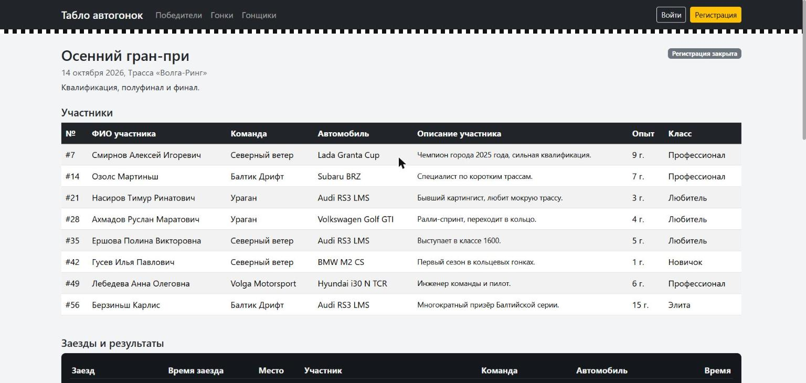
*Страница гонки: таблица участников*

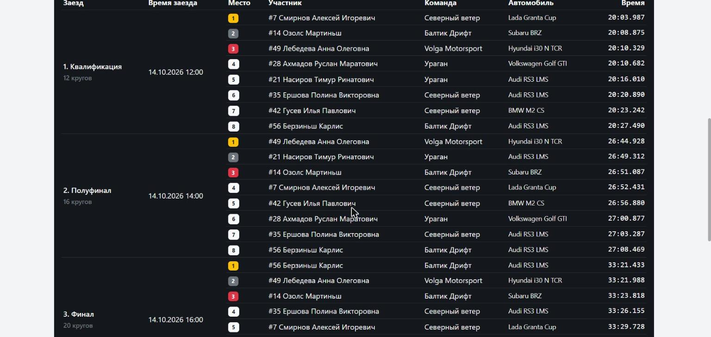
*Все заезды гонки с временем и результатами участников*

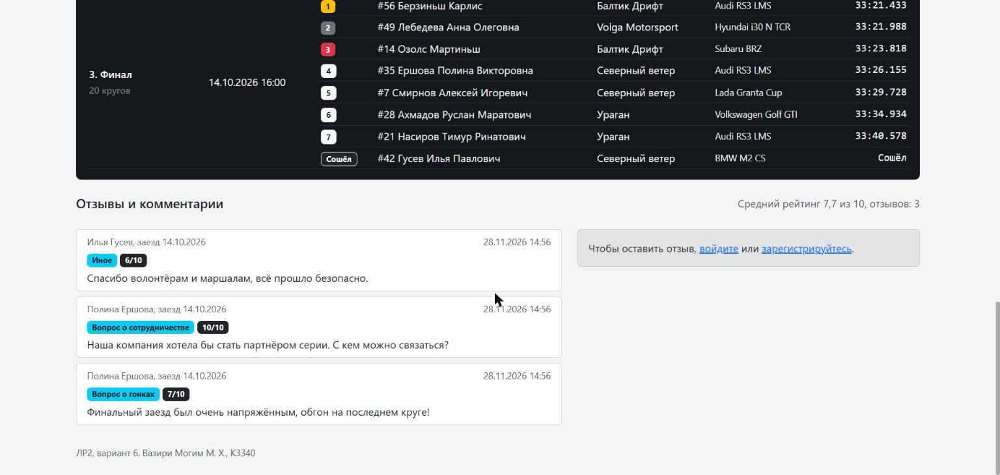
*Отзывы к гонке и средний рейтинг*

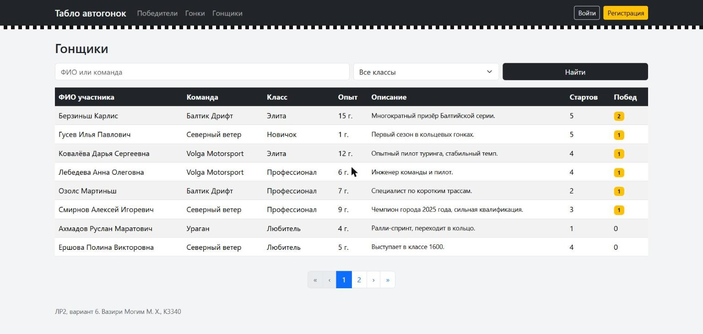
*Список гонщиков с поиском, фильтром и пагинацией*

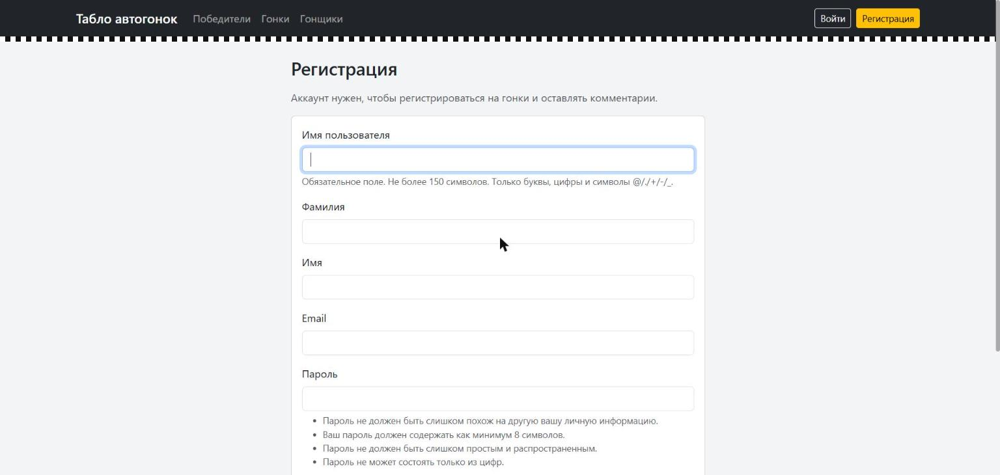
*Регистрация нового пользователя*

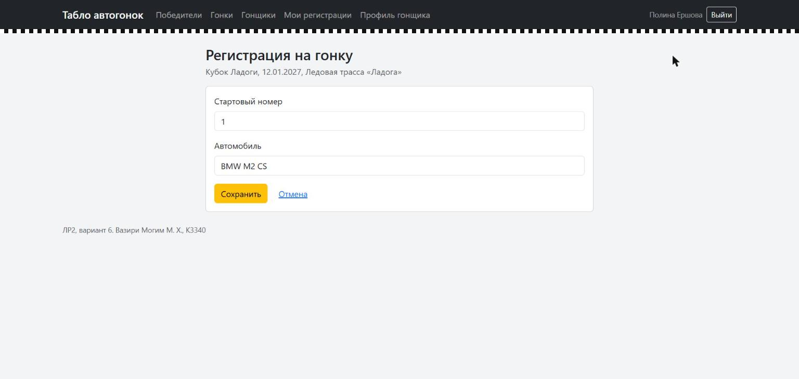
*Регистрация гонщика на предстоящую гонку*

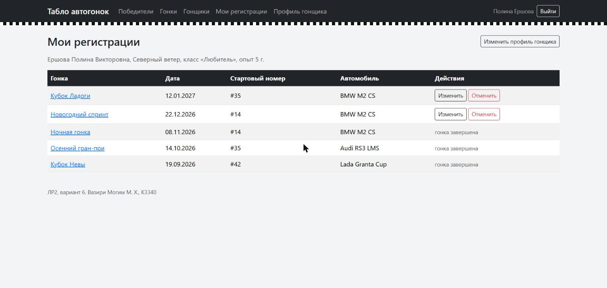
*Мои регистрации: изменение и отмена для предстоящих гонок*

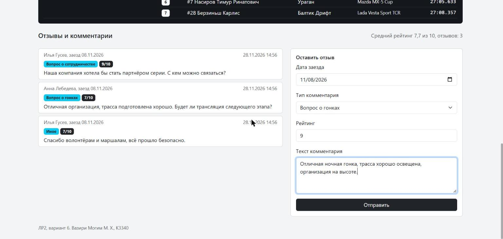
*Форма отзыва: дата заезда, тип комментария, рейтинг 1–10*

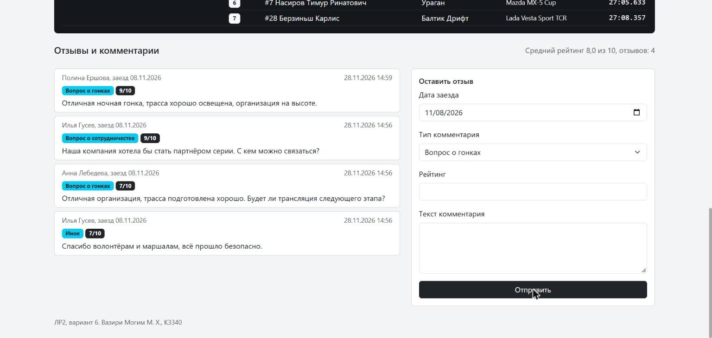
*Новый отзыв появился в списке, рейтинг пересчитан*

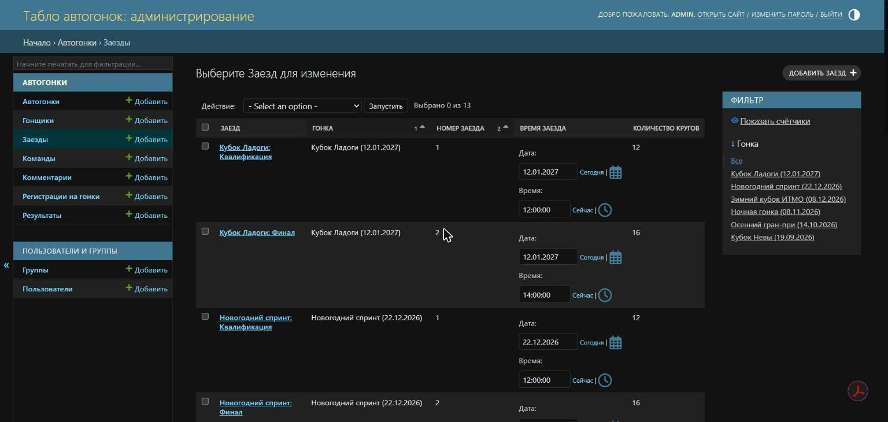
*Администратор задаёт время заезда прямо в списке заездов*

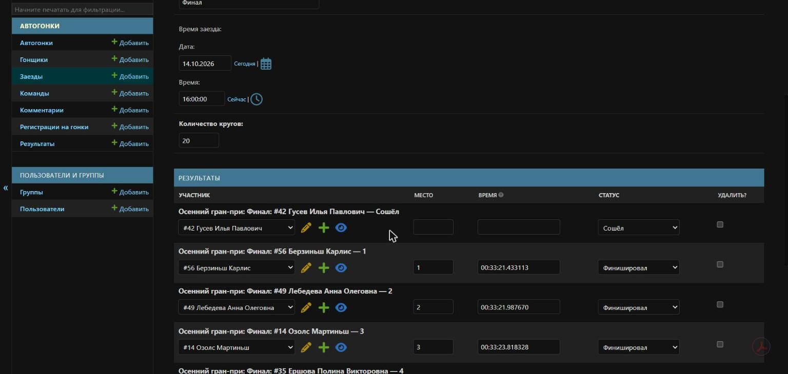
*Результаты участников редактируются внутри заезда*

