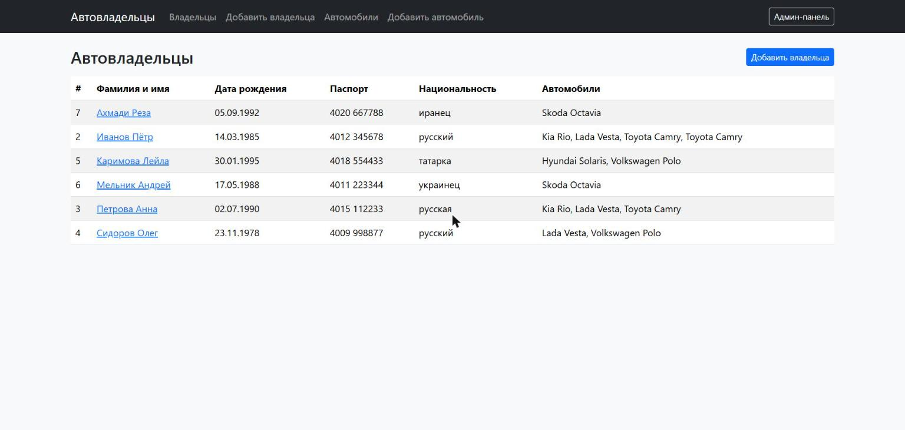
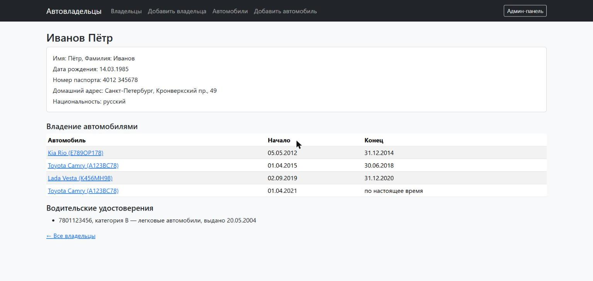
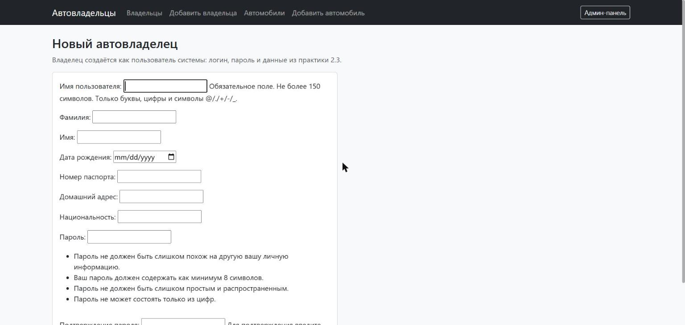
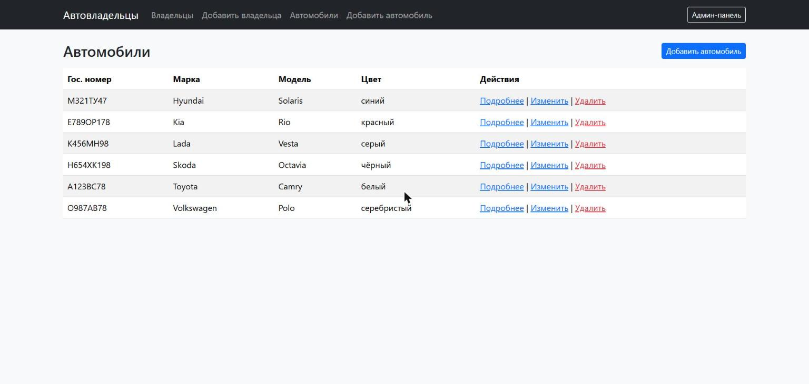
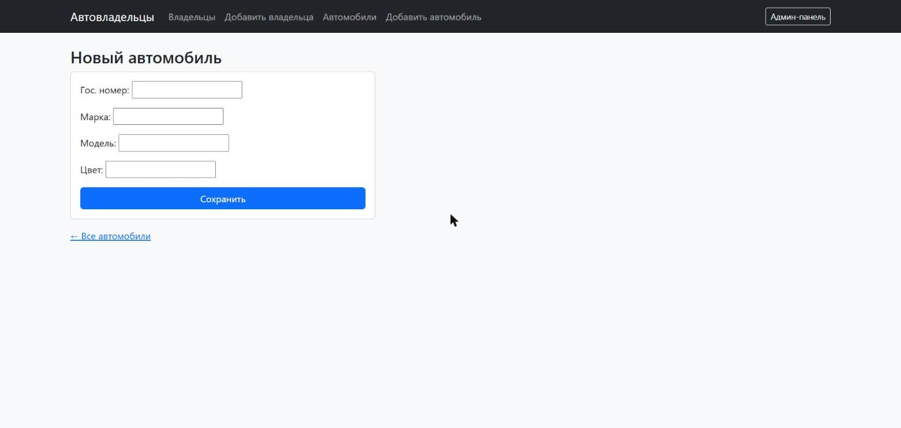

# Практические работы 2.1–2.3

Код: `students/k3340/practical_works/Vaziri_Mohammad/simple_django_web_project`
(проект `django_project_vaziri`, приложение `project_first_app`).

## Практика 2.1. Первое приложение

Модель данных об автовладельцах: автовладелец, автомобиль, владение (ассоциативная сущность с датами начала и конца) и водительское удостоверение с полем выбора типа.

```python
class Car(models.Model):
    plate_number = models.CharField("Гос. номер", max_length=15, unique=True)
    brand = models.CharField("Марка", max_length=20)
    model = models.CharField("Модель", max_length=20)
    color = models.CharField("Цвет", max_length=30, blank=True)
    owners = models.ManyToManyField(settings.AUTH_USER_MODEL, through="Ownership", related_name="cars")


class Ownership(models.Model):
    owner = models.ForeignKey(settings.AUTH_USER_MODEL, on_delete=models.CASCADE, related_name="ownerships")
    car = models.ForeignKey(Car, on_delete=models.CASCADE, related_name="ownerships")
    start_date = models.DateField("Дата начала владения")
    end_date = models.DateField("Дата конца владения", null=True, blank=True)


class DriverLicense(models.Model):
    owner = models.ForeignKey(settings.AUTH_USER_MODEL, on_delete=models.CASCADE, related_name="licenses")
    license_number = models.CharField("Номер удостоверения", max_length=10, unique=True)
    license_type = models.CharField("Тип", max_length=10, choices=LICENSE_TYPES)
    issue_date = models.DateField("Дата выдачи")
```

В `Ownership.clean()` проверяется, что периоды владения одним автомобилем не пересекаются, поэтому в админ-панели нельзя сохранить владение, которое накладывается на уже существующее.

Все модели зарегистрированы в админ-панели. Владелец по id выводится функциональным представлением и шаблоном `owner.html`:

```python
def owner_detail(request, owner_id):
    try:
        owner = Owner.objects.get(pk=owner_id)
    except Owner.DoesNotExist:
        raise Http404("Owner does not exist")
    ownerships = owner.ownerships.select_related("car").order_by("start_date")
    return render(request, "owner.html", {"owner": owner, "ownerships": ownerships})
```

Адрес: `http://127.0.0.1:8000/owner/1/`.

## Практика 2.2. Представления и формы

| Задание | Реализация | Адрес |
|---|---|---|
| Связь «многие ко многим» автомобиля и владельца | `Car.owners = ManyToManyField(..., through="Ownership")` | — |
| Вывод всех владельцев функционально | `owner_list` + `owners_list.html` | `/owners/` |
| Все автомобили, автомобиль по id, обновление на основе классов | `CarListView`, `CarDetailView`, `CarUpdateView` | `/cars/`, `/cars/1/`, `/cars/1/update/` |
| Форма ввода владельцев функционально | `owner_create` + `OwnerCreationForm` | `/owners/create/` |
| Ввод, обновление и удаление автомобилей на основе классов | `CarCreateView`, `CarUpdateView`, `CarDeleteView` + `CarForm` | `/cars/create/`, `/cars/1/delete/` |

```python
class CarCreateView(CreateView):
    model = Car
    form_class = CarForm
    template_name = "project_first_app/car_form.html"
    success_url = reverse_lazy("car_list")
```

## Практика 2.3. Расширение пользователя

Автовладелец стал пользователем: модель `Owner` наследуется от `AbstractUser` и хранит номер паспорта, домашний адрес и национальность. В `settings.py` указано `AUTH_USER_MODEL = "project_first_app.Owner"`.

```python
class Owner(AbstractUser):
    birth_date = models.DateField("Дата рождения", null=True, blank=True)
    passport_number = models.CharField("Номер паспорта", max_length=20, blank=True)
    home_address = models.CharField("Домашний адрес", max_length=255, blank=True)
    nationality = models.CharField("Национальность", max_length=50, blank=True)
```

Новые поля выведены в Django Admin через `UserAdmin` с дополнительным блоком полей, а форма `/owners/create/` создаёт пользователя с логином, паролем и этими атрибутами.

## Запуск

```bash
pip install -r requirements.txt
python manage.py makemigrations project_first_app
python manage.py migrate
python manage.py createsuperuser
python manage.py seed_owners
python manage.py runserver
```

## Скриншоты


*Список автовладельцев (`/owners/`)*


*Страница владельца с историей владения и удостоверениями (`/owner/<id>/`)*


*Создание владельца как пользователя системы (`/owners/create/`)*


*Список автомобилей с действиями «Подробнее / Изменить / Удалить» (`/cars/`)*


*Форма добавления автомобиля (`/cars/create/`)*

