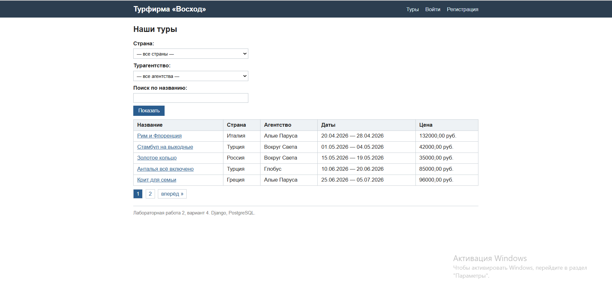
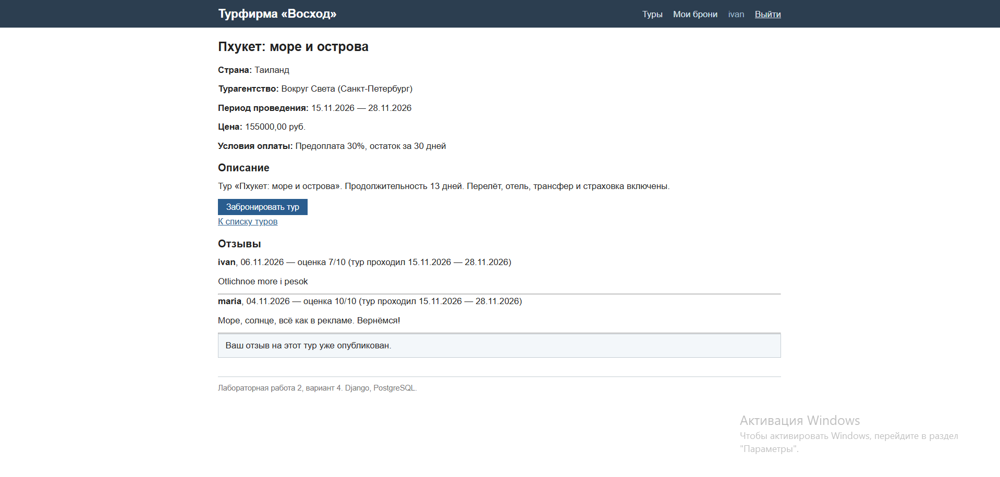
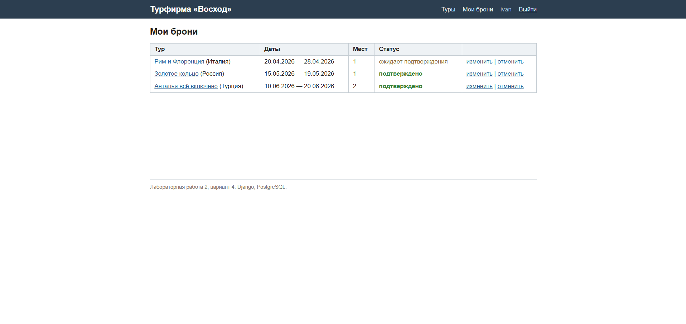
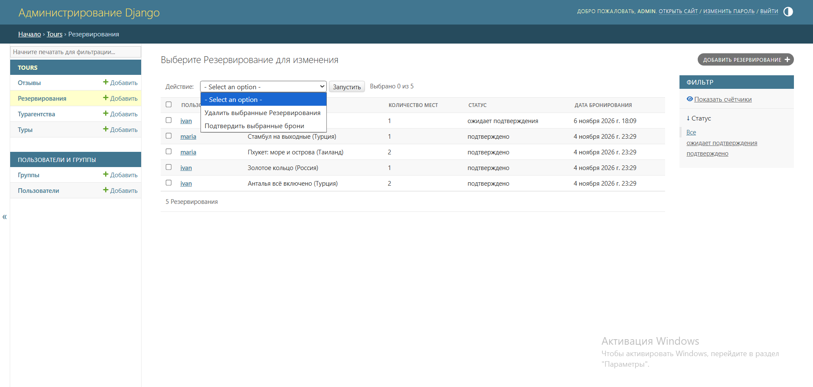
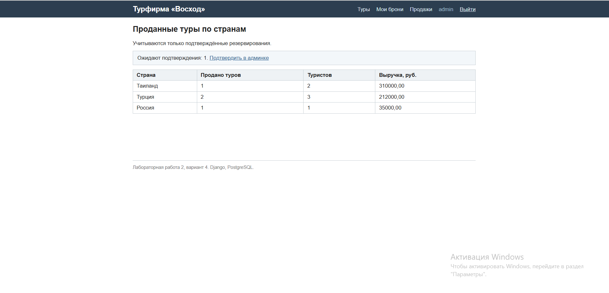

# Реализация функционала

## Базовый шаблон и оформление

Все страницы наследуются от базового шаблона `base.html`: шапка с навигацией,
область контента и подвал едины для сайта, дочерние шаблоны переопределяют
блоки `title` и `content`. Оформление - собственные стили
`static/css/style.css` без сторонних библиотек: таблицы, формы (включая вывод
ошибок валидации), кнопки, подсветка статусов броней, блок пагинации.
Содержимое шапки зависит от статуса посетителя (`user.is_authenticated`):
анониму - ссылки «Войти» и «Регистрация», вошедшему - «Мои брони», его имя
и кнопка «Выйти» (POST-форма, так как выход меняет состояние сессии).

## Список туров, фильтрация и пагинация

Главная страница (`/`) выводит туры таблицей. Фильтры (страна, агентство,
поиск по названию) передаются GET-параметрами и применяются в методе
`get_queryset()` класса `TourListView`; список разбит на страницы по 5 туров
(`paginate_by`).



Поиск по названию - `name__icontains` (без учёта регистра); список стран для
фильтра формируется из базы (`values_list(...).distinct()` - без повторов);
данные агентств подгружаются одним запросом `select_related('agency')`.
Адрес страницы с фильтром можно сохранить в закладки - состояние фильтра
живёт в URL. Пагинация выполняется на стороне базы: страница запрашивается
как `LIMIT 5 OFFSET ...`, из базы выбираются только записи нужной страницы;
ссылки пагинации сохраняют активные фильтры, обращение к несуществующей
странице возвращает 404.

## Страница тура

Страница `/tours/<id>/` (`TourDetailView`) выводит все поля тура из задания:
название, агентство, период, условия оплаты, цену, описание. Залогиненный
пользователь без брони видит кнопку «Забронировать тур» (POST-запрос);
забронировавший - статус своей брони. Ниже - отзывы с рейтингом и формой
нового отзыва (один отзыв на пользователя на тур).



Отзыв сохраняется методом `form.save(commit=False)`: автор, тур и даты тура
заполняются на сервере, клиент эти поля не передаёт.

## Регистрация и вход

Регистрация (`/register/`) - форма `UserCreationForm` (логин, пароль и
подтверждение; пароль хранится в виде хэша). Вход и выход - встроенные
представления `LoginView`/`LogoutView`.

## Мои резервирования

Страница «Мои брони» (`/my-reservations/`) выводит брони текущего
пользователя. Редактирование (количество мест) и удаление брони доступны
только для собственных броней: в `get_queryset()` представлений добавлен
фильтр `user=request.user`, поэтому попытка открыть чужую бронь по id
возвращает 404.



## Подтверждение резервирований (Django-admin)

В админ-панели зарегистрированы все модели. Для резервирований настроен
фильтр по статусу и действие `make_confirmed` («Подтвердить выбранные брони»):
администратор отмечает галочками ожидающие брони и подтверждает их одним
действием (один SQL-запрос `UPDATE`).



## Таблица проданных туров по странам

Страница `/sales/` формирует сводную таблицу по подтверждённым броням.
Агрегатный запрос группирует бронь по стране тура и вычисляет количество
проданных туров, число туристов и выручку (цена × количество мест -
арифметика выполняется в SQL средствами `F()`-выражений):

```python
Reservation.objects.filter(status='confirmed')
    .values(country=F('tour__country'))
    .annotate(
        tours_sold=Count('id'),
        tourists=Sum('guests'),
        revenue=Sum(F('tour__price') * F('guests'),
                    output_field=DecimalField()),
    )
    .order_by('-revenue')
```



## Разграничение прав администратора и пользователя

Помимо админ-панели, администратор видит больше и в клиентской части -
проверка `is_staff` в шаблонах:

1. ссылка «Продажи» в шапке видна только персоналу;
2. на странице тура администратор видит таблицу **всех** броней тура со
   статусами и ссылкой на подтверждение в админке; обычный пользователь -
   только собственную бронь;
3. на странице продаж администратору выводится счётчик броней, ожидающих
   подтверждения.

Скрытие элементов в шаблоне - удобство интерфейса; защита данных выполнена в
представлениях: страницы броней требуют входа (`LoginRequiredMixin`), а доступ
к объектам ограничен фильтром `user=request.user` в `get_queryset()`.

## Маршруты приложения

| URL | Представление | Назначение |
|---|---|---|
| `/` | TourListView | список туров |
| `/tours/<pk>/` | TourDetailView | страница тура + форма отзыва |
| `/tours/<pk>/reserve/` | tour_reserve | бронирование (POST) |
| `/register/`, `/accounts/login/`, `/accounts/logout/` | регистрация и вход | |
| `/my-reservations/` | MyReservationsView | свои брони |
| `/reservations/<pk>/edit/`, `/delete/` | изменение, отмена брони | только свои |
| `/sales/` | sales | продажи по странам |
| `/admin/` | Django-admin | управление данными |
