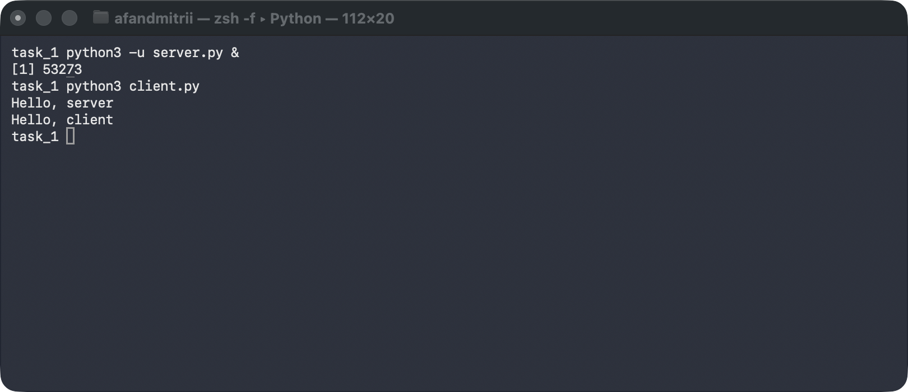
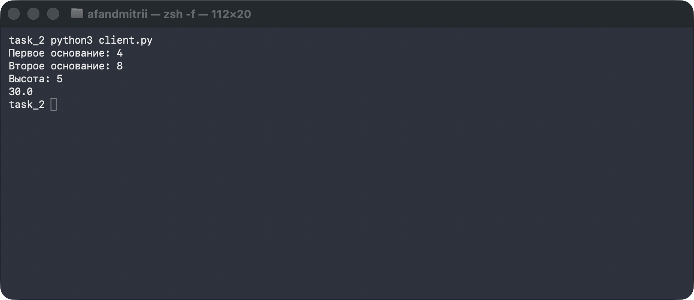
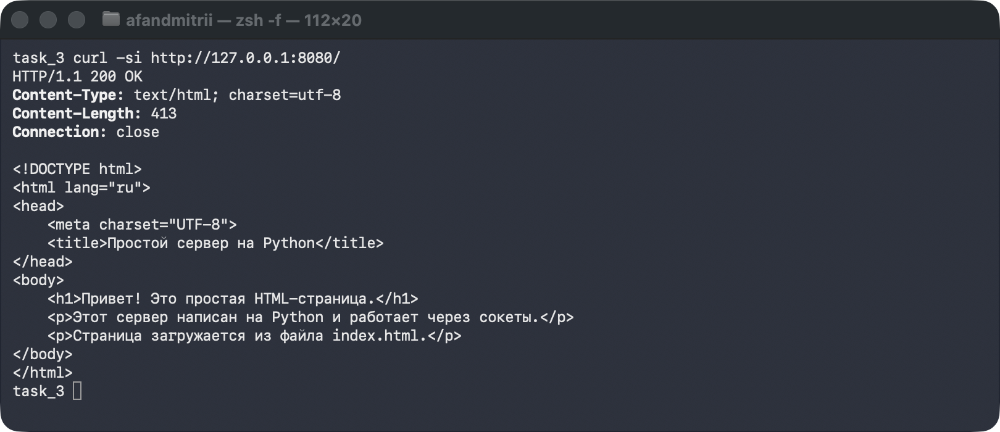
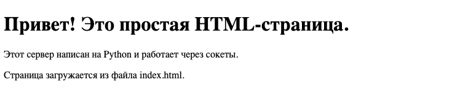
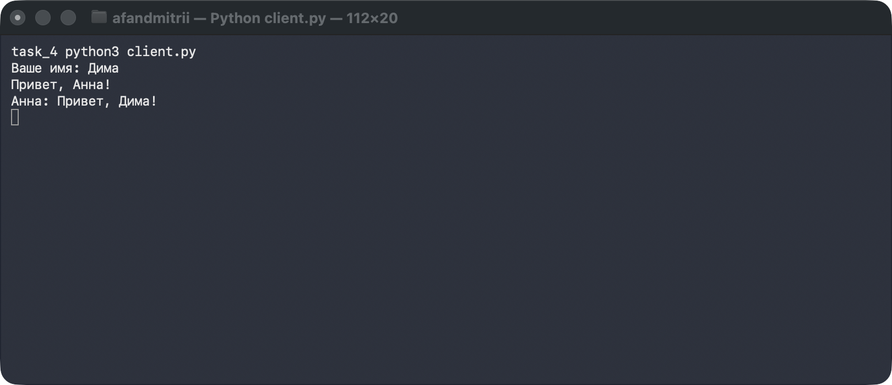
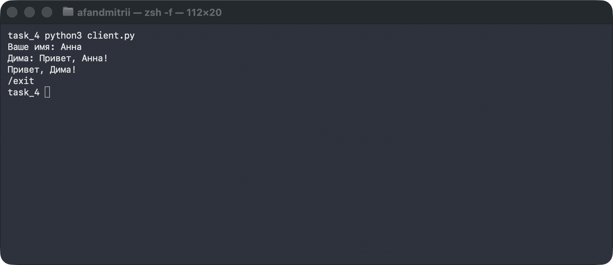
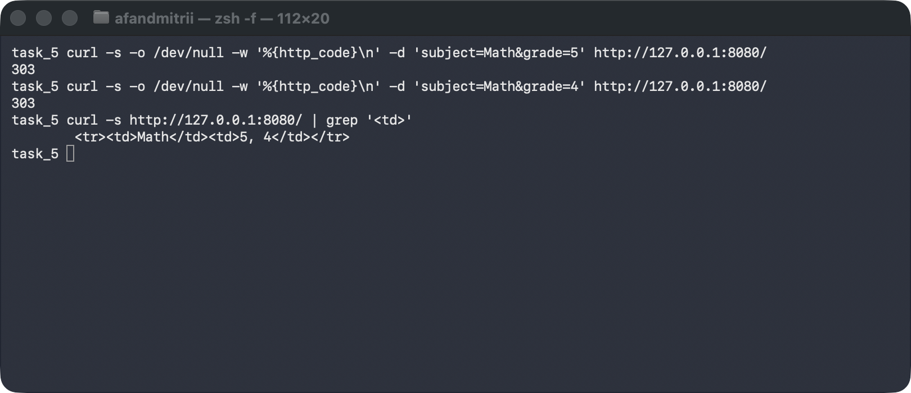
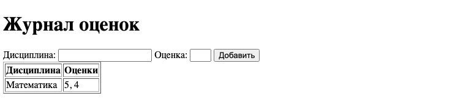

# ЛР1. Работа с сокетами

## 1. Обмен по UDP

Клиент отправляет датаграмму на порт 8080. Сервер получает сообщение и адрес отправителя через `recvfrom()`, печатает сообщение и отвечает на тот же адрес через `sendto()`.

## 2. Площадь трапеции

Клиент передаёт по TCP три числа в одной строке. Сервер вычисляет площадь по формуле `h * (a + b) / 2` и возвращает результат. При основаниях 4 и 8 и высоте 5 площадь равна 30.

## 3. Страница по HTTP

При запросе из браузера сервер читает `index.html` и отправляет его по TCP. В HTTP-ответе он указывает код 200, тип `text/html` и длину файла в байтах.

## 4. Чат

Каждый участник запускает один и тот же клиент и вводит имя. Сервер обрабатывает TCP-соединения в отдельных потоках и пересылает сообщение остальным участникам вместе с именем автора. Команда `/exit` завершает сеанс.

## 5. Журнал оценок

`POST /` добавляет оценку в список по названию дисциплины и сохраняет журнал в `grades.json`. Сервер отвечает перенаправлением на `GET /`. После добавления 5 и 4 и обновления страницы обе оценки остаются в одной строке.

[Исходный код пяти заданий](code.md)
