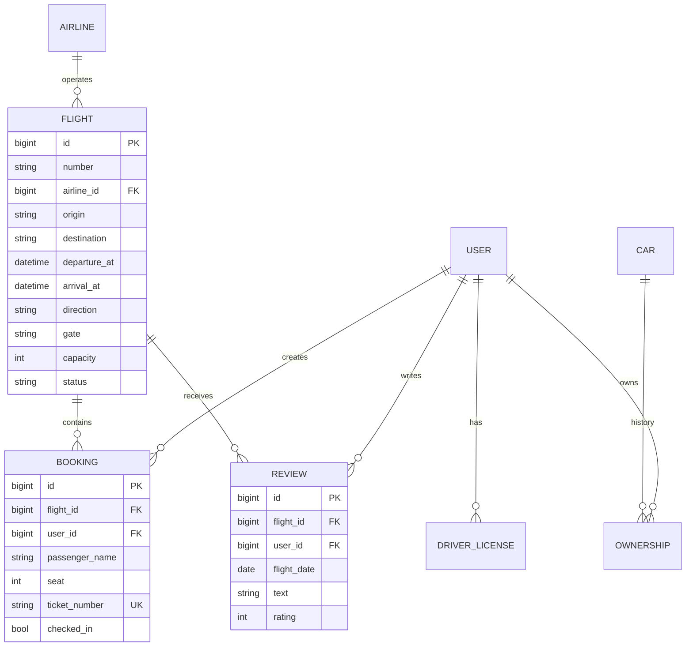

# Модель данных и архитектура

## ER-диаграмма

Один номер рейса может повторяться в разные даты. Уникален экземпляр `(number, departure_at)`. Для списка используется составной B-tree индекс `(departure_at, id)`. Авиакомпания вынесена в отдельную таблицу. Автовладелец — расширенный `AbstractUser`, `AUTH_USER_MODEL` задан до первой миграции.

## Компоненты

- `django_project_afanasev`: настройки, маршрутизация и окружение Jinja2.
- `accounts`: расширенная пользовательская модель, регистрация, профиль, admin.
- `flights`: рейсы, бронирования, отзывы, формы, представления и курсорная пагинация.
- `project_first_app`: практики об автомобилях, связях, формах и FBV/CBV.
- `templates`, `static`: собственная клиентская часть.

Браузер → `urls.py` → представление → ORM/PostgreSQL → контекст → Jinja2 → HTML. Для Django-admin оставлен стандартный движок DjangoTemplates, клиентская часть использует Jinja2.

Табло показывает по 10 рейсов. При переходе вперёд и назад выбранные фильтры сохраняются.

## Ограничения данных

Валидация дат, вместимости и номера места; уникальность места и билета; оценка 1–10; билет обязателен для регистрации. Конкурентные бронирования сериализуются блокировкой строки рейса. Пароли хэшируются средствами Django. Все изменяющие формы требуют CSRF-токен. Паспортные поля практики показаны только администратору и заполнены синтетическими данными.
