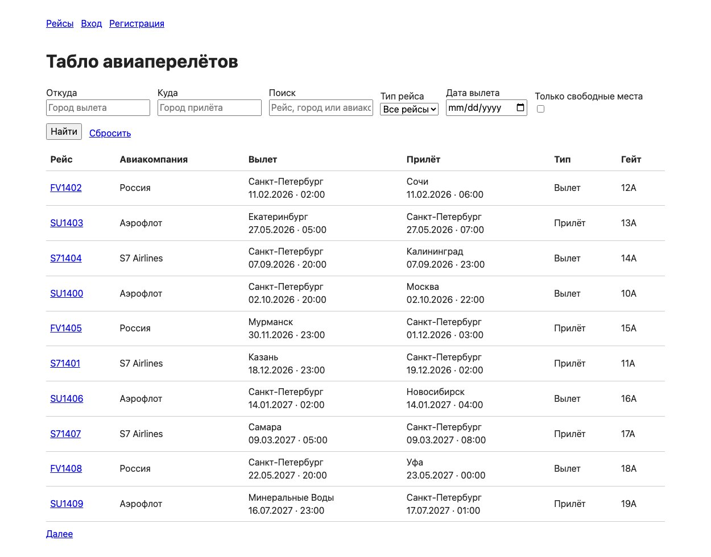

# Лабораторная работа №2

**Тема:** простой сайт на Django. **Вариант 3:** табло авиаперелётов.

**Автор:** Афанасьев Дмитрий. **Группа:** К3340.

**Цель:** разработать веб-приложение с реляционной моделью данных, серверными представлениями, шаблонами Jinja2, формами и разграничением доступа.

Работа включает приложение табло авиаперелётов и обязательные практики 2.1–2.3. В качестве СУБД используется PostgreSQL. Реализация — Django 5.2 LTS; версия отличается от Django 3 в формулировке задания из-за совместимости с Python 3.14.

[Задание курса](https://rendex85.github.io/ITMO_ICT_WebDevelopment_Docs/lab2/assignment/).

