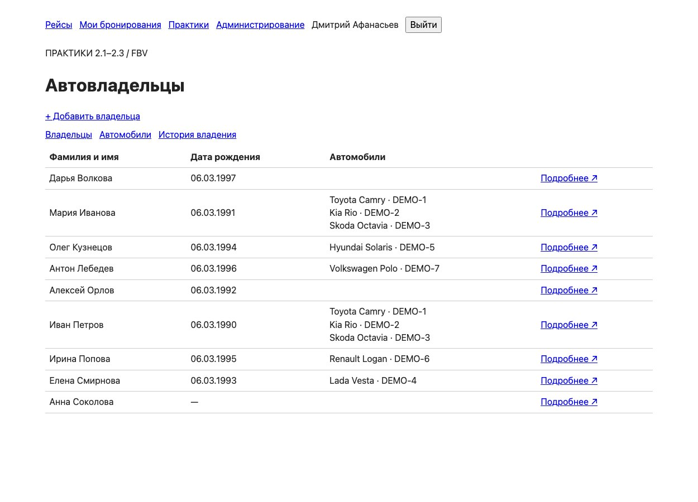

# Практические работы 2.1–2.3

## 2.1 — проект, модели, миграции и admin

Проект `django_project_afanasev`, приложение `project_first_app`. Модель данных соответствует предметной области схемы курса: пользователь-автовладелец, автомобиль, история владения и водительское удостоверение. В таблицах используются имена на латинице; идентификаторы создаются Django. Дата рождения допускает NULL, госномер и номер удостоверения уникальны, категория удостоверения задаётся `TextChoices`.

После описания моделей выполнены `makemigrations` и `migrate`. Все модели зарегистрированы в Django-admin. Пользователь `admin` — суперпользователь для локальной демонстрации.

Демо-набор содержит 8 автовладельцев и 7 автомобилей. Первые два владельца имеют историю владения тремя общими автомобилями в непересекающиеся периоды 2020–2022 и с 2022 года. У остальных владельцев отдельные автомобили. Пересечения периодов одного автомобиля отклоняются в `Ownership.clean()`; сохранение блокирует строку автомобиля. Интервалы считаются полуоткрытыми: конец предыдущего может совпасть с началом следующего.

## 2.2 — связи, FBV, CBV и формы

Связь M:N реализована через `Car.owners = ManyToManyField(..., through='Ownership')`. Промежуточная сущность содержит `owner`, `car`, `start_date`, `end_date`.

| Требование | Реализация |
|---|---|
| Список владельцев через FBV | `owner_list`, `/practice/owners/` |
| Владелец по ID через FBV | `owner_detail`, `/practice/owners/<id>/` |
| Форма создания владельца через FBV | `owner_create`, `OwnerRegistrationForm` |
| Список автомобилей через CBV | `CarList(ListView)` |
| Автомобиль по ID через CBV | `CarDetail(DetailView)` |
| Создание автомобиля | `CarCreate(CreateView)`, `CarForm` |
| Обновление автомобиля | `CarUpdate(UpdateView)` |
| Удаление автомобиля | `CarDelete(DeleteView)`, подтверждение и POST |

Адреса `/practice/cars/`, `/practice/cars/new/`, `/practice/cars/<id>/`, `/practice/cars/<id>/edit/`, `/practice/cars/<id>/delete/`. Все страницы практик требуют администратора.

Демонстрационные данные созданы автоматической командой `seed_demo`. Работа форм дополнительно подтверждена тестовым созданием пользователя и автомобиля, изменением и удалением автомобиля. Ввод каждого демо-объекта вручную через admin или формы не заявляется; при защите эти действия нужно показать отдельно.

## 2.3 — расширение пользователя

`accounts.User(AbstractUser)` добавляет `birth_date`, `passport_number`, `home_address`, `nationality`. Автомобиль ссылается на `settings.AUTH_USER_MODEL`. Дополнительные поля включены в `CustomUserAdmin` и форму создания автовладельца. Пароль сохраняется через `UserCreationForm`, а не в открытом виде.

```python
AUTH_USER_MODEL = 'accounts.User'
```

Форма пассажирской регистрации не требует паспортных полей: они предназначены для отдельной практики и не раскрываются в общедоступном интерфейсе.


