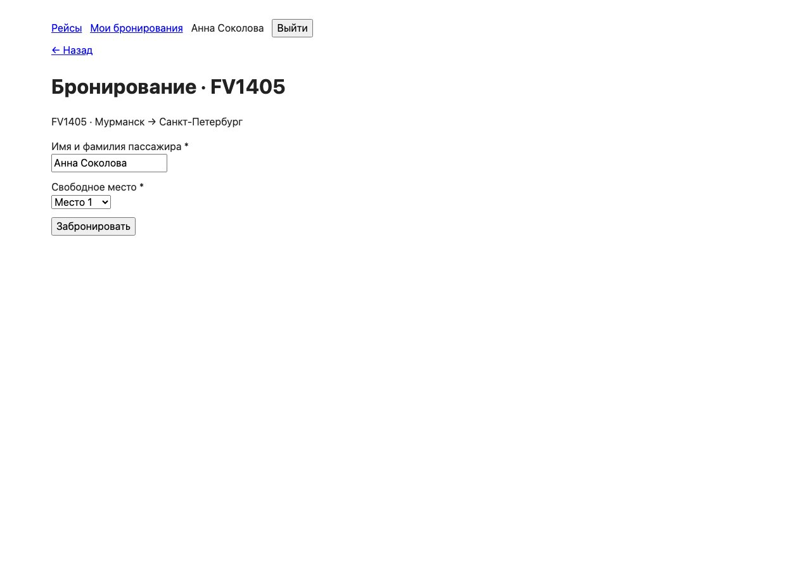
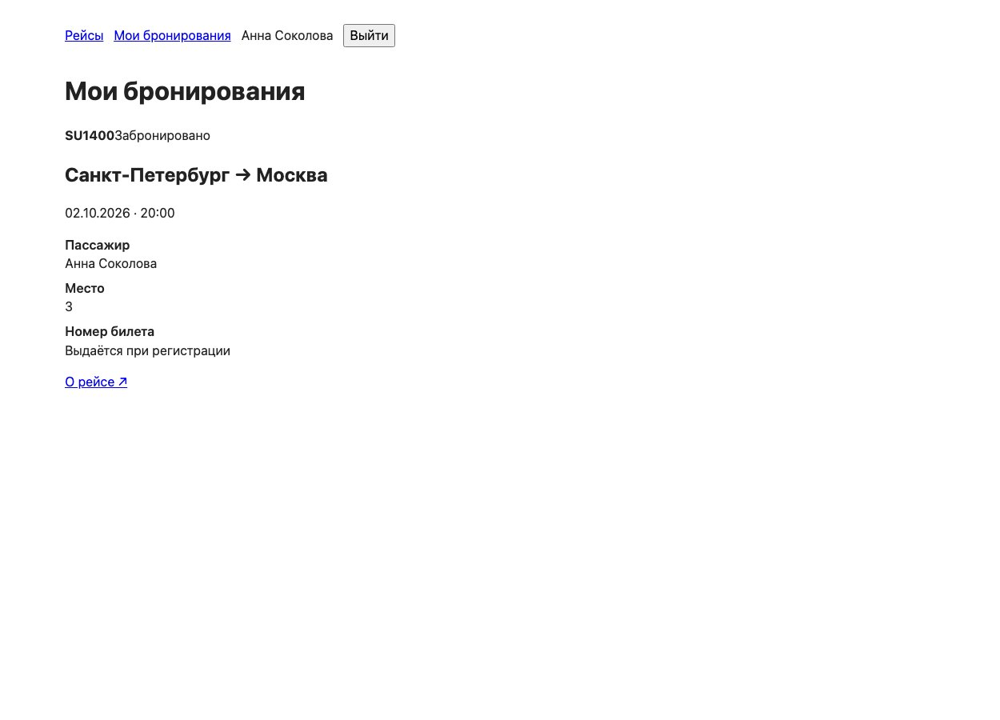
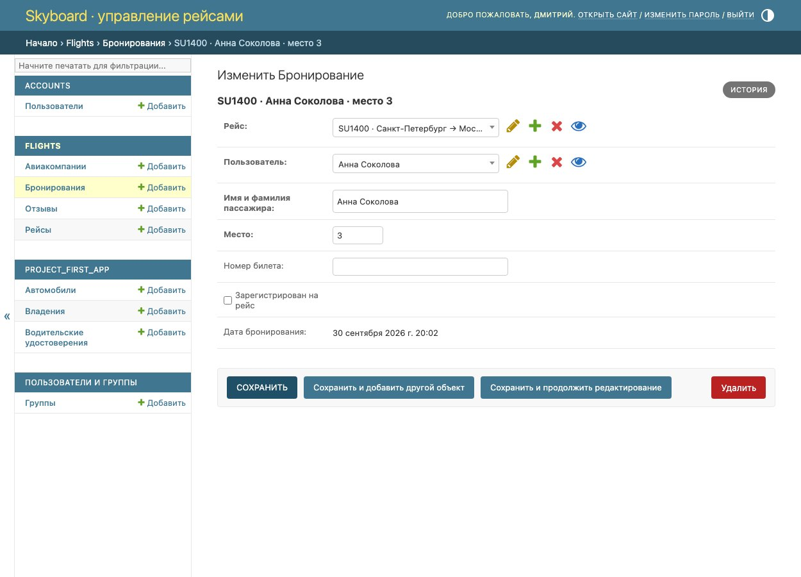
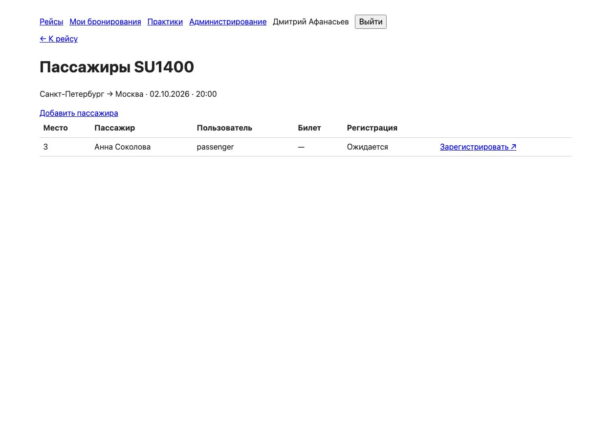
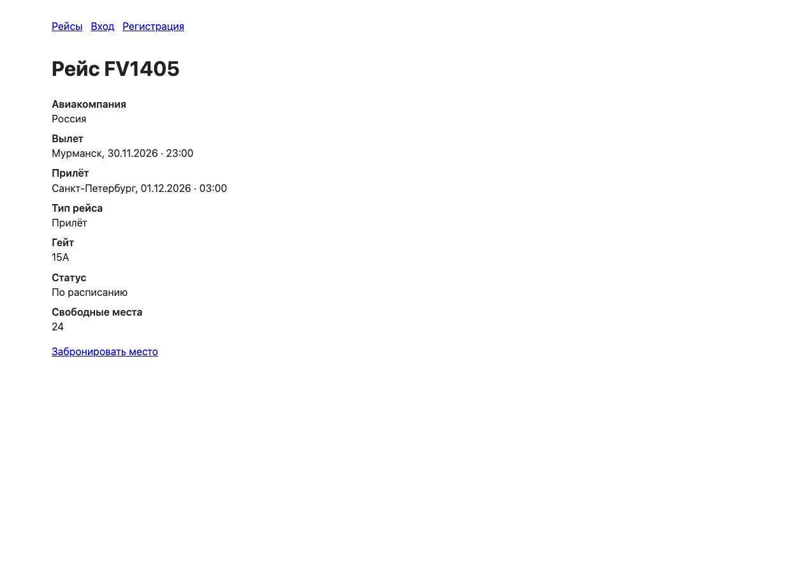
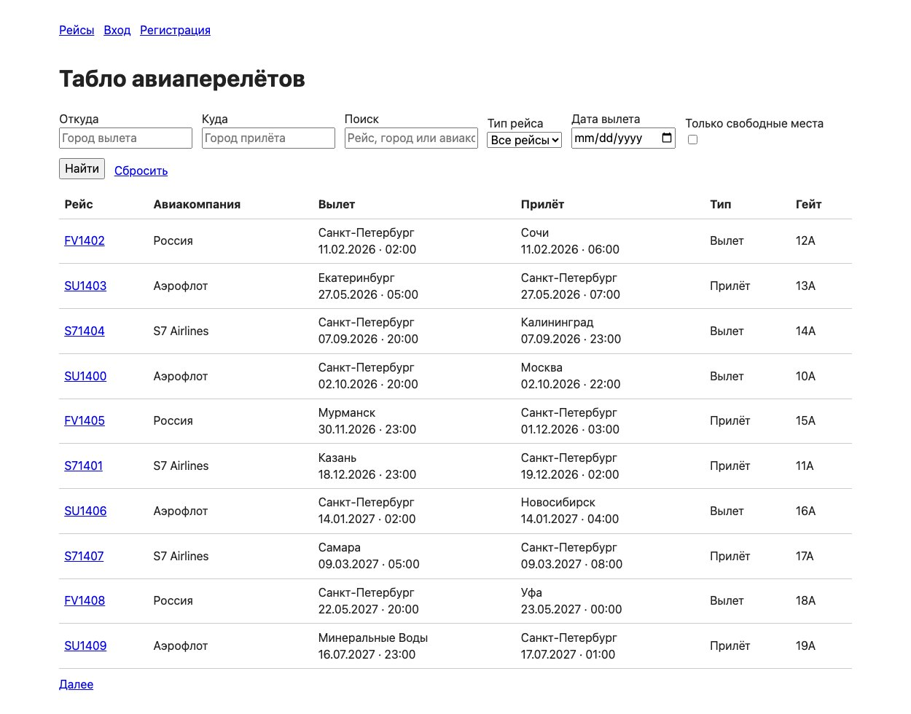

# Реализация варианта 3

## Постановка задачи

Система хранит номер рейса, авиакомпанию, маршрут, время вылета и прилёта, тип рейса и гейт. Пользователь регистрируется, просматривает рейсы, резервирует место, изменяет или отменяет свою бронь и оставляет отзыв. Администратор регистрирует пассажиров, указывает номер билета и просматривает манифест рейса.

## Реализованные интерфейсы

| Адрес | Назначение | Доступ |
|---|---|---|
| `/` | Поиск, фильтры, курсорная навигация | Все |
| `/accounts/register/` | Регистрация | Все |
| `/accounts/login/` | Вход с проверкой пароля | Все |
| `/accounts/logout/` | Выход, только POST | Авторизованный |
| `/accounts/profile/` | Имя, фамилия и email | Владелец профиля |
| `/flights/<id>/` | Рейс, места, ссылка на форму отзыва для пассажира | Все |
| `/flights/<id>/book/` | Создание бронирования | Авторизованный |
| `/bookings/` | Собственные бронирования | Авторизованный |
| `/bookings/<id>/edit/` | Изменение имени пассажира и места | Владелец брони |
| `/bookings/<id>/delete/` | Подтверждение и отмена, POST | Владелец брони |
| `/flights/<id>/review/` | Отзыв 1–10 | Пассажир рейса |
| `/flights/<id>/passengers/` | Таблица всех пассажиров | Администратор |
| `/bookings/<id>/check-in/` | Регистрация и номер билета | Администратор |
| `/flights/new/`, `/flights/<id>/edit/` | Управление рейсами | Администратор |
| `/admin/` | Django-admin для всех моделей | Администратор |

В клиентских шаблонах действия администратора показаны только при `is_staff` или `is_superuser`. Серверные представления независимо проверяют эти права: скрытая кнопка сама по себе не защищает маршрут. Манифест пассажиров доступен администратору, чтобы не раскрывать номера билетов другим пользователям.

## Бронирование

Форма предлагает только свободные номера мест. Пользователь передаёт имя пассажира и место; поля `user`, `flight`, `checked_in` и `ticket_number` не входят в пользовательскую форму. Автор бронирования назначается из сессии на сервере.

```python
form = BookingForm(request.POST or None, flight=flight)
form.instance.user = request.user
```

В одной транзакции блокируется строка рейса через `select_for_update()`, затем выполняются валидация и сохранение. Все способы записи, включая Django-admin, используют этот путь. Уникальное ограничение `(flight_id, seat)` не допускает двойного бронирования. Ограничение `(flight_id, user_id)` означает одну бронь пользователя на конкретный вылет; поле имени позволяет указать пассажира, но групповые бронирования не реализованы.

Пользователь может менять или удалять только собственную запись. GET показывает подтверждение; удаление выполняется после POST с CSRF-токеном. После регистрации или закрытия рейса изменение и отмена со стороны пользователя блокируются.





## Регистрация на рейс

В Django-admin нужно открыть раздел «Бронирования», выбрать запись, указать уникальный номер билета и включить флаг «Зарегистрирован на рейс». Можно также создать бронь для выбранного пользователя. Модель не разрешает регистрацию без номера билета. В клиентском интерфейсе администратору доступна эквивалентная форма из списка пассажиров.





## Отзывы

Отзыв сохраняет ссылку на рейс, автора, дату рейса, текст и рейтинг. Дата берётся из времени вылета в московском часовом поясе при первом сохранении, автор — из сессии. На один рейс допускается один отзыв пользователя. Рейтинг проверяется в форме, модели и ограничении БД. Текст отзыва сохраняется в базе. В публичной карточке рейса его нет.

Для учебной демонстрации отзыв разрешён при наличии бронирования, в том числе до вылета. Проверка фактического участия в перелёте не входит в требования.



## Поиск и оформление

Фильтры: города отправления и назначения, дата вылета, направление «прилёт/вылет», наличие свободных мест; поиск по номеру, городу и авиакомпании. Некорректная дата показывает ошибку формы без ошибки сервера. Фильтры сохраняются при переходе по курсору.

На табло отображается до 10 рейсов на страницу. Форма передаёт параметры поиска методом GET.


